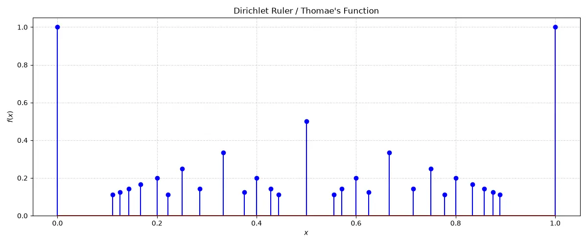

# 1.1 Average Rate of Change & Secant Lines

How fast does a quantity change when the rate itself is constantly shifting? In everyday algebra, finding the rate of change of a linear function is easy because the slope is constant everywhere. However, when we move to curved graphs, the steepness changes from point to point. Before we can pin down the exact rate of change at a single instant, we first need a reliable way to measure how a function changes across a finite interval.

> [!abstract] Definition: Average Rate of Change
> The **average rate of change** of $y = f(x)$ with respect to $x$ over the interval $[x_1, x_2]$ is defined as the ratio of the change in output to the change in input:
> $$
> \frac{\Delta y}{\Delta x} = \frac{f(x_2) - f(x_1)}{x_2 - x_1}
> $$
> By setting the interval width to $h = x_2 - x_1$ (so that $x_2 = x_1 + h$ with $h \neq 0$), we can rewrite this ratio in standard increment form:
> $$
> \begin{aligned}
> \frac{\Delta y}{\Delta x} &= \frac{f(x_1 + h) - f(x_1)}{(x_1 + h) - x_1} \\
> &= \frac{f(x_1 + h) - f(x_1)}{h}
> \end{aligned}
> $$

What does this ratio look like geometrically? Let's trace the graph of $y = f(x)$ and mark two distinct points on the curve: the starting point $P(x_1, f(x_1))$ and the ending point $Q(x_2, f(x_2))$.

> [!figure] Figure 1
> 
> 
> 
> Secant line through $P$ and $Q$. Graph of $y = f(x)$ with points $P$ (at $x_1$) and $Q$ (at $x_2$) marked on the curve, dotted vertical lines down to $x_1$ and $x_2$ on the $x$-axis, and the secant line joining $P$ and $Q$.

A straight line that cuts across a curve at two or more distinct points is called a **secant line**. Looking at Figure 1, the vertical rise between $P$ and $Q$ is $\Delta y = f(x_2) - f(x_1)$, and the horizontal run is $\Delta x = x_2 - x_1 = h$. Consequently, the average rate of change of the function between $x_1$ and $x_2$ is geometrically identical to the **slope of the secant line** joining $P$ and $Q$.

## Instantaneous Rate of Change

Now suppose we want to know the **instantaneous rate of change**—the exact rate at which $y = f(x)$ is changing at the single point $x_1$. If we look at our difference quotient,
$$
\frac{\Delta y}{\Delta x} = \frac{f(x_1 + h) - f(x_1)}{h}
$$
we run into an immediate algebraic roadblock: we cannot simply substitute $h = 0$ to collapse the interval down to $x_1$, because doing so produces the meaningless $0/0$ division by zero.

How do we get around this? Even though we cannot set $h = 0$ directly, we *can* choose values of $h$ that get smaller and smaller, approaching $0$ as closely as we please from either side. Geometrically, as $h$ shrinks toward $0$, the point $Q$ slides along the curve toward the fixed point $P$. If the resulting secant slopes $\frac{\Delta y}{\Delta x}$ settle down and get arbitrarily close to a single, specific number as $h$ approaches $0$, we take that limiting value to be the instantaneous rate of change at $x_1$. This foundational idea brings us directly to the concept of a **limit**.

## Informal Definition of a Limit

Before building the rigorous machinery of calculus, let's capture the intuitive idea of a function approaching a target value near a point.

> [!abstract] Definition: Limit of a Function (Informal)
> Let $f(x)$ be defined on an open interval about $x_0$, except possibly at $x_0$ itself. If $f(x)$ gets arbitrarily close to a single real number $L$ for all $x$ sufficiently close to $x_0$ (with $x \neq x_0$), we say that $f$ approaches the **limit** $L$ as $x$ approaches $x_0$, and we write:
> $$
> \lim_{x \to x_0} f(x) = L
> $$

Notice a crucial detail in this definition: the phrase *"except possibly at $x_0$ itself."* When we evaluate $\lim_{x \to x_0} f(x)$, we only care about how $f(x)$ behaves for inputs *near* $x_0$, never at $x = x_0$. The function does not even need to be defined at $x_0$ for the limit to exist!

> [!note] Theoretical Remark: Fundamental Building-Block Limits
> Using this intuitive definition, we can immediately see how three common types of functions behave as $x$ approaches $x_0$:
> 1. **Identity Function:** If $f(x) = x$, then as $x$ gets arbitrarily close to $x_0$, the output $f(x)$ is literally $x$ itself, so it must approach $x_0$:
>    $$
>    \lim_{x \to x_0} f(x) = \lim_{x \to x_0} x = x_0
>    $$
> 2. **Constant Function:** If $f(x) = k$ (where $k \in \mathbb{R}$ is a fixed constant), the output remains frozen at $k$ regardless of where $x$ moves. Therefore, the limit at any point $x_0$ is simply $k$:
>    $$
>    \lim_{x \to x_0} f(x) = \lim_{x \to x_0} k = k
>    $$
> 3. **Well-Behaved Algebraic & Trigonometric Combinations:** If $f$ is an algebraic combination of polynomial or trigonometric functions and $f$ is well-defined at $x_0$, the limit as $x \to x_0$ can often be found simply by direct substitution, $f(x_0)$. For instance:
>    $$
>    \lim_{x \to 0} \frac{3x + 4}{5x + 9} = \frac{3(0) + 4}{5(0) + 9} = \frac{4}{9}
>    $$

## How Limits Can Fail to Exist

Does every function have a limit at every point? Not at all. A limit $\lim_{x \to x_0} f(x)$ only exists if the outputs settle down toward a *single finite real number* $L$ as $x$ approaches $x_0$ from *both* the left and the right. Let's look at three classic ways a function can fail to have a limit at $x = 0$.

1. **A Jump in the Graph (The Unit Step Function):**
   Consider the **unit step function** $U(x)$ at $x = 0$, defined by:
   $$
   U(x) = \begin{cases} 0, & x < 0 \\ 1, & x \ge 0 \end{cases}
   $$
   What happens as $x$ approaches $0$? If $x$ approaches $0$ from the left ($x < 0$), the function values are constantly $0$, so $U(x)$ approaches $0$. However, if $x$ approaches $0$ from the right ($x > 0$), the function values are constantly $1$, so $U(x)$ approaches $1$. Because the left-hand and right-hand approaches disagree, $U(x)$ does not approach a single unified value, and $\lim_{x \to 0} U(x)$ does not exist.

2. **Unbounded Growth Near the Point:**
   Consider the reciprocal function modified to have a value at the origin:
   $$
   g(x) = \begin{cases} \dfrac{1}{x}, & x \neq 0 \\ 0, & x = 0 \end{cases}
   $$
   As $x$ gets closer and closer to $0$ from the right, $1/x$ grows arbitrarily large without bound; as $x$ approaches $0$ from the left, $1/x$ plunges to arbitrarily large negative values. Even though $g(0)$ is explicitly defined to be $0$, the nearby outputs do not settle near $0$ (or near any other fixed real number). Thus, $g(x)$ has no limit at $x = 0$.

3. **Infinite Oscillation Near the Point:**
   Consider the function:
   $$
   f(x) = \begin{cases} 0, & x = 0 \\ \sin\left(\dfrac{1}{x}\right), & x \neq 0 \end{cases}
   $$
   As $x$ approaches $0$, the reciprocal $1/x$ races toward $\pm\infty$, causing $\sin(1/x)$ to cycle through full periods faster and faster. No matter how tiny an interval we zoom into around $x = 0$, the graph wiggles infinitely many times and takes on *every* value between $-1$ and $1$. Because it refuses to settle down to any single number, $f(x)$ has no limit at $x = 0$.

> [!figure] Figure 2
> 
> 
> 
> Graphs of the three discontinuous functions discussed above: (a) the unit step function $U(x)$, (b) the unbounded function $g(x) = 1/x$, and (c) the infinitely oscillating function $f(x) = \sin(1/x)$.

---

# 1.2 Rules for Finding Limits

Relying on graphs or tables of numbers to guess limits is slow and prone to error. Fortunately, once we know the limits of the basic building blocks—the constant function $\lim_{x \to c} k = k$ and the identity function $\lim_{x \to c} x = c$—we can compute the limits of vast families of functions using standard algebraic rules.

## Limits of Powers and Algebraic Combinations

> [!theorem] Theorem 1: Properties of Limits
> Suppose $L$, $M$, $c$, and $k$ are real numbers, and suppose that
> $$
> \lim_{x \to c} f(x) = L \quad \text{and} \quad \lim_{x \to c} g(x) = M
> $$
> Then the following algebraic rules hold:
> 1. **Sum Rule:**
>    $$
>    \lim_{x \to c} \big[f(x) + g(x)\big] = L + M
>    $$
> 2. **Difference Rule:**
>    $$
>    \lim_{x \to c} \big[f(x) - g(x)\big] = L - M
>    $$
> 3. **Product Rule:**
>    $$
>    \lim_{x \to c} \big[f(x) \cdot g(x)\big] = L \cdot M
>    $$
> 4. **Constant Multiple Rule:**
>    $$
>    \lim_{x \to c} \big[k \cdot f(x)\big] = kL
>    $$
> 5. **Quotient Rule:** Provided the denominator limit is non-zero ($M \neq 0$),
>    $$
>    \lim_{x \to c} \frac{f(x)}{g(x)} = \frac{L}{M}
>    $$
> 6. **Power Rule:** If $m$ and $n$ are integers, then provided $L^{m/n} \in \mathbb{R}$ (meaning that if $n$ is even, we require $L > 0$),
>    $$
>    \lim_{x \to c} \big(f(x)\big)^{m/n} = L^{m/n}
>    $$

In plain words, Theorem 1 tells us that limits respect arithmetic: the limit of a sum is the sum of the limits, the limit of a product is the product of the limits, and so forth—as long as we don't divide by zero or take an even root of a negative number. We will prove these rules rigorously in Section 1.3 once we have the formal $\varepsilon$-$\delta$ definition of a limit in hand.

> [!note] Theoretical Remark: Building Up to Polynomials and Rational Functions
> Notice what happens when we combine our fundamental identity limit $\lim_{x \to c} x = c$ with the Power Rule (Property 6): we immediately get $\lim_{x \to c} x^{m/n} = c^{m/n}$, and in particular $\lim_{x \to c} x^k = c^k$ for any positive integer $k$. Scaling each power by a constant $c_k$ via the Constant Multiple Rule and adding the terms together via the Sum Rule gives us a remarkably convenient result: limits of polynomials and well-behaved rational functions can be evaluated purely by direct substitution!

> [!theorem] Theorem 2: Limits of Polynomials
> Limits of polynomials can be found by direct substitution. If $P(x) = \sum_{k=0}^{n} c_k x^k = c_n x^n + c_{n-1} x^{n-1} + \dots + c_0$, then for any real number $c$:
> $$
> \lim_{x \to c} P(x) = \sum_{k=0}^{n} c_k c^k = P(c)
> $$

> [!theorem] Theorem 3: Limits of Rational Functions
> Limits of rational functions can be found by direct substitution whenever the limit of the denominator is non-zero. If $P(x)$ and $Q(x)$ are polynomials and $Q(c) \neq 0$, then:
> $$
> \lim_{x \to c} \frac{P(x)}{Q(x)} = \frac{P(c)}{Q(c)}
> $$

## Eliminating Zero Denominators Algebraically

Theorem 3 works like a charm when $Q(c) \neq 0$, but what if substituting $x = c$ makes the denominator zero? In calculus, the most interesting limits—such as the difference quotient for instantaneous rate of change—almost always have a denominator that approaches $0$.

If both the numerator $P(c)$ and the denominator $Q(c)$ evaluate to $0$ at $x = c$, the fraction takes the indeterminate form $0/0$. When this happens for a rational function, $(x - c)$ is a common factor of both $P(x)$ and $Q(x)$. We can algebraically factor out and cancel the offending $(x - c)$ term, or rationalize radicals, to obtain a simplified expression whose denominator is no longer zero at $x = c$.

Why is cancelling $(x - c)$ legally permitted when $x = c$ would mean dividing by zero? Remember our core insight from Section 1.1: **the limit as $x \to c$ never looks at $x = c$**. For every other point $x \neq c$, the factor $(x - c)$ is strictly non-zero, so cancelling it does not change the value of the function anywhere on the punctured neighborhood around $c$.

> [!example] Example: Evaluating Limits by Factoring and Rationalizing
> Evaluate the following limits:
> 1. **Part (i):** $\lim_{x \to 1} \frac{x^2 + x - 2}{x^2 - x}$
> 2. **Part (ii):** $\lim_{h \to 0} \frac{\sqrt{2 + h} - \sqrt{2}}{h}$

**Solution:**
1. **Part (i):** Plugging in $x = 1$ gives the indeterminate form $0/0$. Factoring the numerator and denominator reveals the shared $(x - 1)$ factor, which we can cancel for all $x \neq 1$:
   $$
   \begin{aligned}
   \lim_{x \to 1} \frac{x^2 + x - 2}{x^2 - x} &= \lim_{x \to 1} \frac{(x + 2)(x - 1)}{x(x - 1)} \\
   &= \lim_{x \to 1} \frac{x + 2}{x} \\
   &= \frac{1 + 2}{1} = 3
   \end{aligned}
   $$
2. **Part (ii):** Again, substituting $h = 0$ yields $0/0$. Because of the square root in the numerator, we multiply the top and bottom by the conjugate $\sqrt{2 + h} + \sqrt{2}$ to clear the radical in the numerator and expose the hidden factor of $h$:
   $$
   \begin{aligned}
   \lim_{h \to 0} \frac{\sqrt{2 + h} - \sqrt{2}}{h} &= \lim_{h \to 0} \frac{(\sqrt{2 + h} - \sqrt{2})(\sqrt{2 + h} + \sqrt{2})}{h\left(\sqrt{2 + h} + \sqrt{2}\right)} \\
   &= \lim_{h \to 0} \frac{(2 + h) - 2}{h\left(\sqrt{2 + h} + \sqrt{2}\right)} \\
   &= \lim_{h \to 0} \frac{h}{h\left(\sqrt{2 + h} + \sqrt{2}\right)} \\
   &= \lim_{h \to 0} \frac{1}{\sqrt{2 + h} + \sqrt{2}} \\
   &= \frac{1}{2\sqrt{2}}
   \end{aligned}
   $$
$\blacksquare$

## The Sandwich Theorem

What if we encounter a messy function $f(x)$ whose limit cannot be found by direct substitution or algebraic factoring? If we can trap (or "sandwich") $f(x)$ between two simpler functions $g(x)$ and $h(x)$ that both converge to the exact same limit $L$ at $x = c$, then $f(x)$ is forced to converge to $L$ as well.

> [!theorem] Theorem 4: The Sandwich Theorem (Squeeze Theorem)
> Suppose that $g(x) \le f(x) \le h(x)$ for all $x$ in some open interval containing $c$, except possibly at $x = c$ itself. Suppose also that the lower and upper bounding functions approach the same limit $L$ as $x$ approaches $c$:
> $$
> \lim_{x \to c} g(x) = \lim_{x \to c} h(x) = L
> $$
> Then $f(x)$ is forced to approach $L$ as well:
> $$
> \lim_{x \to c} f(x) = L
> $$

*(We will present the complete rigorous proof of the Sandwich Theorem at the end of Section 1.3 once we establish the formal definition of a limit.)*

> [!example] Example: Zero Absolute-Value Limit via the Sandwich Theorem
> Show that if $\lim_{x \to c} |f(x)| = 0$, then $\lim_{x \to c} f(x) = 0$.

**Solution:**
For every real number $x$ in the domain of $f$, the value $f(x)$ is always trapped between $-|f(x)|$ and $|f(x)|$:
$$
-|f(x)| \le f(x) \le |f(x)|, \quad \forall x \in \mathbb{R}
$$
Since we are given that $\lim_{x \to c} |f(x)| = 0$, the Constant Multiple Rule (with $k = -1$) tells us that $\lim_{x \to c} (-|f(x)|) = 0$ as well. Because both the lower bound $-|f(x)|$ and the upper bound $|f(x)|$ converge to $0$ as $x \to c$, the Sandwich Theorem immediately guarantees that:
$$
\lim_{x \to c} f(x) = 0
$$
$\blacksquare$

## 1.2 Exercises

Limits of the difference-quotient form $\lim_{h \to 0} \frac{f(x + h) - f(x)}{h}$ appear constantly throughout calculus because they represent the slope of a tangent line and the instantaneous rate of change of $f(x)$. Let's evaluate this limit for several fundamental functions, along with key theoretical exercises from Section 1.2.

### Problem 37: Difference Quotient of a Quadratic Function

> [!abstract] Problem Statement
> Evaluate the difference-quotient limit $\lim_{h \to 0} \frac{f(x + h) - f(x)}{h}$ for the function $f(x) = x^2$.

**Solution:**
Expanding $(x + h)^2 = x^2 + 2xh + h^2$, we subtract $f(x) = x^2$ and cancel the common factor $h$ (since $h \neq 0$ inside the limit):
$$
\begin{aligned}
\lim_{h \to 0} \frac{f(x + h) - f(x)}{h} &= \lim_{h \to 0} \frac{(x + h)^2 - x^2}{h} \\
&= \lim_{h \to 0} \frac{x^2 + 2xh + h^2 - x^2}{h} \\
&= \lim_{h \to 0} \frac{h(2x + h)}{h} \\
&= \lim_{h \to 0} (2x + h) = 2x
\end{aligned}
$$
Thus, the instantaneous rate of change of $f(x) = x^2$ at any point $x$ is $2x$. $\blacksquare$

### Problem 39: Difference Quotient of a Linear Function

> [!abstract] Problem Statement
> Evaluate the difference-quotient limit $\lim_{h \to 0} \frac{f(x + h) - f(x)}{h}$ for the general linear function $f(x) = ax + b$.

**Solution:**
Substituting $f(x + h) = a(x + h) + b$ into the difference quotient, we find:
$$
\begin{aligned}
\lim_{h \to 0} \frac{f(x + h) - f(x)}{h} &= \lim_{h \to 0} \frac{a(x + h) + b - (ax + b)}{h} \\
&= \lim_{h \to 0} \frac{ah}{h} \\
&= \lim_{h \to 0} a = a
\end{aligned}
$$
As expected from basic algebra, a line $y = ax + b$ has a constant rate of change equal to its slope $a$ at every point. $\blacksquare$

### Problem 40: Difference Quotient of the Reciprocal Function

> [!abstract] Problem Statement
> Evaluate the difference-quotient limit $\lim_{h \to 0} \frac{f(x + h) - f(x)}{h}$ for the reciprocal function $f(x) = \frac{1}{x}$ (where $x \neq 0$).

**Solution:**
Combining the two fractions in the numerator over the common denominator $x(x + h)$ allows us to cancel $h$:
$$
\begin{aligned}
\lim_{h \to 0} \frac{f(x + h) - f(x)}{h} &= \lim_{h \to 0} \frac{\dfrac{1}{x + h} - \dfrac{1}{x}}{h} \\
&= \lim_{h \to 0} \frac{x - (x + h)}{h \cdot x(x + h)} \\
&= \lim_{h \to 0} \frac{-h}{h \cdot x(x + h)} \\
&= \lim_{h \to 0} \frac{-1}{x(x + h)} = -\frac{1}{x^2}
\end{aligned}
$$
$\blacksquare$

### Problem 42: Difference Quotient of a Square Root Function

> [!abstract] Problem Statement
> Evaluate the difference-quotient limit $\lim_{h \to 0} \frac{f(x + h) - f(x)}{h}$ for the radical function $f(x) = \sqrt{ax + b}$.

**Solution:**
To eliminate the $0/0$ indeterminacy caused by the difference of square roots, we rationalize the numerator by multiplying top and bottom by the conjugate $\sqrt{a(x + h) + b} + \sqrt{ax + b}$:
$$
\begin{aligned}
\lim_{h \to 0} \frac{f(x + h) - f(x)}{h} &= \lim_{h \to 0} \frac{\sqrt{a(x + h) + b} - \sqrt{ax + b}}{h} \\
&= \lim_{h \to 0} \frac{\big[a(x + h) + b\big] - (ax + b)}{h\left(\sqrt{a(x + h) + b} + \sqrt{ax + b}\right)} \\
&= \lim_{h \to 0} \frac{ah}{h\left(\sqrt{a(x + h) + b} + \sqrt{ax + b}\right)} \\
&= \lim_{h \to 0} \frac{a}{\sqrt{a(x + h) + b} + \sqrt{ax + b}} \\
&= \frac{a}{2\sqrt{ax + b}}
\end{aligned}
$$
$\blacksquare$

### Problem 43: Deducing Function Limits from a Quotient Limit

> [!abstract] Problem Statement
> If $\lim_{x \to 2} \frac{f(x) - 5}{x - 2} = 3$, find $\lim_{x \to 2} f(x)$.

**Solution:**
Notice that as $x \to 2$, the denominator $(x - 2)$ approaches $0$, yet the overall quotient approaches a finite limit of $3$. We can isolate $f(x) - 5$ by multiplying the quotient by $(x - 2)$ and applying the Product Rule for limits:
$$
\begin{aligned}
\lim_{x \to 2} \big(f(x) - 5\big) &= \lim_{x \to 2} \left( \frac{f(x) - 5}{x - 2} \cdot (x - 2) \right) \\
&= \left( \lim_{x \to 2} \frac{f(x) - 5}{x - 2} \right) \cdot \left( \lim_{x \to 2} (x - 2) \right) \\
&= 3 \cdot 0 = 0
\end{aligned}
$$
Since $\lim_{x \to 2} (f(x) - 5) = 0$, adding $\lim_{x \to 2} 5 = 5$ via the Sum Rule gives:
$$
\lim_{x \to 2} f(x) = \lim_{x \to 2} \big[(f(x) - 5) + 5\big] = 0 + 5 = 5
$$
$\blacksquare$

> [!note] Theoretical Remark: Necessary Condition for Finite Quotient Limits with Zero Denominator
> Problem 43 illustrates a vital general principle: if the quotient limit $\lim_{x \to c} \frac{f(x)}{g(x)}$ exists (equals a finite real number $L$) and $\lim_{x \to c} g(x) = 0$, then $\lim_{x \to c} f(x)$ **must** also equal $0$. Indeed, $\lim_{x \to c} f(x) = \lim_{x \to c} \left[\frac{f(x)}{g(x)} \cdot g(x)\right] = L \cdot 0 = 0$. If the numerator approached anything other than $0$ while the denominator approached $0$, the ratio would blow up and could never converge to a finite number!

### Problem 53: Damped Oscillations via the Sandwich Theorem

> [!abstract] Problem Statement
> Use the Sandwich Theorem to evaluate the following limits:
> 1. **Part (a):** Find $\lim_{x \to 0} x \sin\left(\frac{1}{x}\right)$.
> 2. **Part (b):** Find $\lim_{x \to 0} x^2 \cos\left(\frac{1}{x^3}\right)$.

**Solution:**
1. **Part (a):** Recall from Section 1.1 that $\sin(1/x)$ oscillates wildly as $x \to 0$ and has no limit on its own, so we cannot use the Product Rule directly. However, the sine function is always bounded between $-1$ and $1$:
   $$
   -1 \le \sin\left(\frac{1}{x}\right) \le 1, \quad \forall x \in \mathbb{R} \setminus \{0\}
   $$
   When we multiply this inequality by $x$, we must pay attention to the sign of $x$:
   - If $x > 0$, multiplying by $x$ preserves the inequality direction:
     $$
     -x \le x \sin\left(\frac{1}{x}\right) \le x
     $$
   - If $x < 0$, multiplying by $x$ reverses the inequalities:
     $$
     -x \ge x \sin\left(\frac{1}{x}\right) \ge x
     $$
   In either case (which we can also write compactly as $-|x| \le x \sin(1/x) \le |x|$), the function $x \sin(1/x)$ is trapped between $-x$ and $x$. Since $\lim_{x \to 0} (-x) = 0$ and $\lim_{x \to 0} x = 0$, the Sandwich Theorem guarantees that:
   $$
   \lim_{x \to 0} x \sin\left(\frac{1}{x}\right) = 0
   $$
2. **Part (b):** Similarly, for all $x \neq 0$, the cosine term satisfies $-1 \le \cos\left(\frac{1}{x^3}\right) \le 1$. Because $x^2 > 0$ for all $x \neq 0$, multiplying through by $x^2$ preserves the inequality signs everywhere:
   $$
   -x^2 \le x^2 \cos\left(\frac{1}{x^3}\right) \le x^2, \quad \forall x \neq 0
   $$
   Since $\lim_{x \to 0} (-x^2) = 0$ and $\lim_{x \to 0} x^2 = 0$, the Sandwich Theorem yields:
   $$
   \lim_{x \to 0} x^2 \cos\left(\frac{1}{x^3}\right) = 0
   $$
$\blacksquare$

---

# 1.3 Target Values and Formal Definition of Limits

In Section 1.1, we defined $\lim_{x \to x_0} f(x) = L$ informally by saying that "$f(x)$ gets arbitrarily close to $L$ for all $x$ sufficiently close to $x_0$." While that phrasing is great for intuition, phrases like *"arbitrarily close"* and *"sufficiently close"* are too vague to prove subtle theorems like the Product or Quotient Rules. To make calculus rock-solid, we need to translate this intuition into precise inequalities using error tolerances.

## Keeping Outputs Near Target Values

Imagine you are machining a precision part or calibrating an instrument: you have a desired **target output value** $y_0$, and your specifications allow an output error tolerance of at most $\varepsilon > 0$ units (so the output $y$ must stay inside the interval $(y_0 - \varepsilon, y_0 + \varepsilon)$). The practical question is: **how tightly around the target input $x_0$ must we control the input $x$—say, within some input tolerance $\delta > 0$—to guarantee that the output stays within $\varepsilon$ of $y_0$?**

> [!example] Example: Controlling Input Tolerance for a Linear Function
> How close to $x_0 = 4$ must we hold the input values $x$ to be sure that the output of $y = 2x - 1$ lies within $2$ units of $y_0 = 7$?

**Solution:**
We want the distance between $y$ and $7$ to be strictly less than $2$. Expressing this requirement using absolute value inequalities and substituting $y = 2x - 1$, we can solve directly for the allowable deviation $|x - 4|$:
$$
\begin{aligned}
|y - 7| < 2 &\iff |(2x - 1) - 7| < 2 \\
&\iff |2x - 8| < 2 \\
&\iff 2|x - 4| < 2 \\
&\iff |x - 4| < 1
\end{aligned}
$$
Therefore, keeping the input $x$ within $1$ unit of $4$ (that is, $\delta = 1$) guarantees that the output $y$ stays within $2$ units of $7$. $\blacksquare$

> [!note] Theoretical Remark: Graphical Interpretation of Target Tolerances
> Graphically, prescribing an output tolerance $\varepsilon > 0$ around a target value $y_0$ corresponds to drawing two horizontal boundary lines at $y = y_0 - \varepsilon$ and $y = y_0 + \varepsilon$. If we trace where the graph of $y = f(x)$ lies strictly between these two horizontal lines and project that portion of the curve straight down onto the $x$-axis, we obtain an input interval $[x_1, x_2]$ surrounding $x_0$. For any input $x \in [x_1, x_2]$, the corresponding output $f(x)$ is guaranteed to fall inside the target range $[y_0 - \varepsilon, y_0 + \varepsilon]$.

## The Formal ($\varepsilon$-$\delta$) Definition of a Limit

Now imagine turning this tolerance problem into a universal challenge. Suppose a challenger can pick *any* output error tolerance $\varepsilon > 0$, no matter how microscopically small, and each time you can respond with a positive input tolerance $\delta > 0$ that forces $f(x)$ to stay within $\varepsilon$ of $L$ whenever $x$ is within $\delta$ of $x_0$ (excluding $x = x_0$ itself). If you can always win this game for *every* $\varepsilon > 0$, then $f(x)$ truly converges to $L$ as $x \to x_0$.

> [!abstract] Definition: Limit of a Function (Formal $\varepsilon$-$\delta$ Definition)
> Let $f(x)$ be defined on an open interval about $x_0$, except possibly at $x_0$ itself. We say that $f(x)$ approaches the **limit** $L$ as $x$ approaches $x_0$, and write
> $$
> \lim_{x \to x_0} f(x) = L
> $$
> if, for every number $\varepsilon > 0$, there exists a corresponding number $\delta > 0$ such that for all $x$:
> $$
> 0 < |x - x_0| < \delta \implies |f(x) - L| < \varepsilon
> $$

Let's unpack the two inequalities in this definition:
- $|f(x) - L| < \varepsilon$ means the distance between the output $f(x)$ and the limit $L$ is less than $\varepsilon$; equivalently, $L - \varepsilon < f(x) < L + \varepsilon$.
- $|x - x_0| < \delta$ means the distance between the input $x$ and $x_0$ is less than $\delta$; that is, $x_0 - \delta < x < x_0 + \delta$.
- $0 < |x - x_0|$ explicitly enforces $x \neq x_0$. We never require $|f(x_0) - L| < \varepsilon$ to hold at $x_0$ itself!

> [!note] Theoretical Remark: Role of the Formal Definition
> Keep two important perspectives in mind when working with the $\varepsilon$-$\delta$ definition:
> 1. **Verification vs. Computation:** The formal definition does *not* tell us how to guess the value of $L$ from scratch. Rather, once we have a candidate limit $L$, the definition gives us a rigorous test to verify whether $L$ is genuinely the limit.
> 2. **Proving General Theorems:** Even more importantly, the $\varepsilon$-$\delta$ definition is the engine that allows us to prove general rules (like Theorem 1 and the Sandwich Theorem) once and for all, freeing us to compute complicated limits algebraically without finding $\delta$ by hand every time.

> [!example] Example: Proving a Linear Limit Using the $\varepsilon$-$\delta$ Definition
> Show that $\lim_{x \to 1} (5x - 3) = 2$.

**Solution:**
Let $\varepsilon > 0$ be an arbitrary positive number. For $2$ to be the limit as $x \to 1$, we must find a $\delta > 0$ around $x_0 = 1$ such that $0 < |x - 1| < \delta \implies |(5x - 3) - 2| < \varepsilon$. Simplifying the target inequality reveals how $|x - 1|$ relates to $\varepsilon$:
$$
\begin{aligned}
|(5x - 3) - 2| < \varepsilon &\iff |5x - 5| < \varepsilon \\
&\iff |5(x - 1)| = 5|x - 1| < \varepsilon \\
&\iff |x - 1| < \frac{\varepsilon}{5}
\end{aligned}
$$
Hence, if we choose $\delta = \frac{\varepsilon}{5} > 0$, then whenever the input $x$ is within $\delta$ distance of $1$ ($0 < |x - 1| < \delta$), the output $5x - 3$ is guaranteed to stay within $\varepsilon$ distance of $2$. $\blacksquare$

> [!example] Example: Verifying Two Fundamental Building-Block Limits
> Use the formal $\varepsilon$-$\delta$ definition to verify:
> 1. **Part (a):** $\lim_{x \to x_0} x = x_0$
> 2. **Part (b):** $\lim_{x \to x_0} k = k$

**Solution:**
1. **Part (a):** Let $\varepsilon > 0$ be given. Since $y = f(x) = x$ and $L = x_0$, our target inequality is:
   $$
   |y - x_0| < \varepsilon \iff |x - x_0| < \varepsilon
   $$
   Hence, choosing $\delta = \varepsilon$ always works: whenever $0 < |x - x_0| < \delta$, we immediately have $|f(x) - x_0| < \varepsilon$.
2. **Part (b):** Again, let $\varepsilon > 0$ be given. Since $y = f(x) = k$ and $L = k$, we need:
   $$
   |y - k| < \varepsilon \iff |k - k| < \varepsilon \iff 0 < \varepsilon
   $$
   Because $0 < \varepsilon$ is always true regardless of $x$, literally *any* positive number $\delta > 0$ works! $\blacksquare$

## Finding $\delta$ Algebraically for Given $f$, $L$, $x_0$, and $\varepsilon > 0$

When $f(x)$ is nonlinear, $|f(x) - L|$ will not simply factor into a constant multiple of $|x - x_0|$, and the open interval $(a, b)$ of inputs satisfying $|f(x) - L| < \varepsilon$ may not be symmetric about $x_0$. How do we find a single symmetric radius $\delta > 0$ in general? We can always follow a systematic two-step procedure:

1. **Step 1:** Solve the inequality $|f(x) - L| < \varepsilon$ to find an open interval $(a, b)$ containing $x_0$ on which the inequality holds for all $x \neq x_0$.
2. **Step 2:** Find a value $\delta > 0$ that places the symmetric open interval $(x_0 - \delta, x_0 + \delta)$ centered at $x_0$ completely inside the interval $(a, b)$—namely, by choosing $\delta = \min(x_0 - a, b - x_0)$. Then $|f(x) - L| < \varepsilon$ is guaranteed to hold for all $x \neq x_0$ in this $\delta$-interval.

> [!example] Example: Finding $\delta$ Algebraically for a Piecewise Nonlinear Function
> Prove that $\lim_{x \to 2} f(x) = 4$ if:
> $$
> f(x) = \begin{cases} x^2, & x \neq 2 \\ 1, & x = 2 \end{cases}
> $$

**Solution:**
Notice first that the value $f(2) = 1$ does not affect the limit because the formal definition only tests $0 < |x - 2| < \delta$, where $x \neq 2$ and therefore $f(x) = x^2$.
1. **Step 1:** Given any $\varepsilon > 0$ (assuming $\varepsilon < 4$ so that $4 - \varepsilon > 0$), we solve $|f(x) - 4| < \varepsilon$ for $x \neq 2$ near $2$:
   $$
   \begin{aligned}
   |f(x) - 4| < \varepsilon &\iff -\varepsilon < x^2 - 4 < \varepsilon \\
   &\iff 4 - \varepsilon < x^2 < 4 + \varepsilon \\
   &\iff \sqrt{4 - \varepsilon} < x < \sqrt{4 + \varepsilon} \quad (\text{assuming } \varepsilon < 4)
   \end{aligned}
   $$
   Thus, our open interval around $x_0 = 2$ is $(a, b) = \left(\sqrt{4 - \varepsilon}, \sqrt{4 + \varepsilon}\right)$.
2. **Step 2:** To place the symmetric interval $(2 - \delta, 2 + \delta)$ inside $\left(\sqrt{4 - \varepsilon}, \sqrt{4 + \varepsilon}\right)$, we choose $\delta$ to be the minimum distance from $2$ to the two endpoints:
   $$
   \delta = \min\left(2 - \sqrt{4 - \varepsilon}, \, \sqrt{4 + \varepsilon} - 2\right)
   $$
   For this $\delta > 0$, any $x$ satisfying $0 < |x - 2| < \delta$ lies inside $\left(\sqrt{4 - \varepsilon}, \sqrt{4 + \varepsilon}\right)$ and therefore satisfies $|f(x) - 4| < \varepsilon$. $\blacksquare$

> [!note] Theoretical Remark: Why Assuming an Upper Bound on $\varepsilon$ (Such as $\varepsilon < 4$) Is Always Valid
> In Step 1 above, we assumed $\varepsilon < 4$ so that we could take the real square root $\sqrt{4 - \varepsilon}$. Why is it completely rigorous to restrict $\varepsilon$ to be small? Suppose a challenger hands us a huge tolerance, say $\varepsilon \ge 4$. We can simply pick a stricter, smaller tolerance $\varepsilon' < 4$ (for instance, $\varepsilon' = 1$) and use the formula above to find the $\delta$ corresponding to $\varepsilon'$. Because $\varepsilon' < \varepsilon$, the narrower target band $(L - \varepsilon', L + \varepsilon')$ sits completely inside the wider band $(L - \varepsilon, L + \varepsilon)$: any $x$ that keeps $|f(x) - L| < \varepsilon'$ automatically satisfies $|f(x) - L| < \varepsilon$!

## Using the Formal Definition to Prove Limit Theorems

Now we are ready to pay off our debt from Section 1.2 and use the formal $\varepsilon$-$\delta$ definition to prove the algebraic limit laws (Theorem 1) and the Sandwich Theorem (Theorem 4). Throughout these proofs, we assume $\lim_{x \to c} f(x) = L$ and $\lim_{x \to c} g(x) = M$.

### Proof of the Sum Rule

We want to prove that:
$$
\lim_{x \to c} \big[f(x) + g(x)\big] = L + M
$$

**Proof:**
Let $\varepsilon > 0$ be given. We must find a $\delta > 0$ such that for all $x$:
$$
0 < |x - c| < \delta \implies \big|\big(f(x) + g(x)\big) - (L + M)\big| < \varepsilon
$$
Notice how we can regroup the difference inside the absolute value and apply the triangle inequality ($|a + b| \le |a| + |b|$):
$$
\big|\big(f(x) + g(x)\big) - (L + M)\big| = \big|(f(x) - L) + (g(x) - M)\big| \le |f(x) - L| + |g(x) - M|
$$
To make the sum of these two nonnegative terms strictly less than $\varepsilon$, it suffices to make *each* term strictly less than half the error budget, $\frac{\varepsilon}{2}$! Since $\lim_{x \to c} f(x) = L$ and $\lim_{x \to c} g(x) = M$, and $\frac{\varepsilon}{2} > 0$, there exist positive numbers $\delta_1 > 0$ and $\delta_2 > 0$ such that:
$$
\begin{aligned}
0 < |x - c| < \delta_1 &\implies |f(x) - L| < \frac{\varepsilon}{2} \\
0 < |x - c| < \delta_2 &\implies |g(x) - M| < \frac{\varepsilon}{2}
\end{aligned}
$$
How do we make both inequalities hold at the same time? We choose $\delta = \min(\delta_1, \delta_2) > 0$. Then whenever $0 < |x - c| < \delta$, both $0 < |x - c| < \delta_1$ and $0 < |x - c| < \delta_2$ hold simultaneously, which implies:
$$
\begin{aligned}
\big|\big(f(x) + g(x)\big) - (L + M)\big| &\le |f(x) - L| + |g(x) - M| \\
&< \frac{\varepsilon}{2} + \frac{\varepsilon}{2} = \varepsilon
\end{aligned}
$$
Hence, $\lim_{x \to c} [f(x) + g(x)] = L + M$. $\blacksquare$

> [!note] Theoretical Remark: Proof of the Difference Rule
> The Difference Rule, $\lim_{x \to c} [f(x) - g(x)] = L - M$, can be proved in the exact same way by writing $|(f(x) - g(x)) - (L - M)| = |(f(x) - L) - (g(x) - M)| \le |f(x) - L| + |g(x) - M|$, or by combining the Sum Rule with the Constant Multiple Rule for $k = -1$.

### Proof of the Product Rule

We want to prove that:
$$
\lim_{x \to c} \big[f(x) \cdot g(x)\big] = LM
$$

**Proof:**
Let $D$ be the intersection of the domains of $f$ and $g$. Given any $\varepsilon > 0$, we need to find a $\delta > 0$ such that for all $x \in D$:
$$
0 < |x - c| < \delta \implies |f(x)g(x) - LM| < \varepsilon
$$
How can we express $f(x)g(x) - LM$ in terms of the known small deviations $(f(x) - L)$ and $(g(x) - M)$? Let's write $f(x) = L + (f(x) - L)$ and $g(x) = M + (g(x) - M)$ and multiply them out:
$$
f(x)g(x) = LM + L\big(g(x) - M\big) + M\big(f(x) - L\big) + \big(f(x) - L\big)\big(g(x) - M\big)
$$
Subtracting $LM$ from both sides and applying the triangle inequality $|a + b + c| \le |a| + |b| + |c|$ gives:
$$
\begin{aligned}
|f(x)g(x) - LM| &= \big|L(g(x) - M) + M(f(x) - L) + (f(x) - L)(g(x) - M)\big| \\
&\le |L| \cdot |g(x) - M| + |M| \cdot |f(x) - L| + |f(x) - L| \cdot |g(x) - M|
\end{aligned}
$$
Wait—what if $L = 0$ or $M = 0$? If we tried to divide $\varepsilon$ by $|L|$ or $|M|$, we would risk dividing by zero! To avoid that trap cleanly, we can replace $|L|$ and $|M|$ with the strictly positive numbers $(1 + |L|)$ and $(1 + |M|)$:
$$
|L| \cdot |g(x) - M| \le (1 + |L|) \cdot |g(x) - M| \quad \text{and} \quad |M| \cdot |f(x) - L| \le (1 + |M|) \cdot |f(x) - L|
$$
Now we have three nonnegative terms to bound, so we allocate $\frac{\varepsilon}{3}$ of our error budget to each of the three pieces. Since $\lim_{x \to c} f(x) = L$ and $\lim_{x \to c} g(x) = M$, there exist $\delta_1, \delta_2, \delta_3, \delta_4 > 0$ such that:
$$
\begin{aligned}
0 < |x - c| < \delta_1 &\implies |f(x) - L| < \sqrt{\frac{\varepsilon}{3}} \\
0 < |x - c| < \delta_2 &\implies |g(x) - M| < \sqrt{\frac{\varepsilon}{3}} \\
0 < |x - c| < \delta_3 &\implies |f(x) - L| < \frac{\varepsilon}{3(1 + |M|)} \\
0 < |x - c| < \delta_4 &\implies |g(x) - M| < \frac{\varepsilon}{3(1 + |L|)}
\end{aligned}
$$
Choosing $\delta = \min(\delta_1, \delta_2, \delta_3, \delta_4) > 0$ ensures that all four inequalities hold simultaneously whenever $0 < |x - c| < \delta$. Substituting these bounds into our three-term inequality yields:
$$
\begin{aligned}
|f(x)g(x) - LM| &\le (1 + |L|)|g(x) - M| + (1 + |M|)|f(x) - L| + |f(x) - L||g(x) - M| \\
&< (1 + |L|) \frac{\varepsilon}{3(1 + |L|)} + (1 + |M|) \frac{\varepsilon}{3(1 + |M|)} + \sqrt{\frac{\varepsilon}{3}} \sqrt{\frac{\varepsilon}{3}} \\
&= \frac{\varepsilon}{3} + \frac{\varepsilon}{3} + \frac{\varepsilon}{3} = \varepsilon
\end{aligned}
$$
Thus, $|f(x)g(x) - LM| < \varepsilon$ for all $0 < |x - c| < \delta$, completing the proof. $\blacksquare$

### Proof of the Quotient Rule

We want to prove that if $M \neq 0$, then:
$$
\lim_{x \to c} \frac{f(x)}{g(x)} = \frac{L}{M}
$$

**Proof:**
Since $\frac{f(x)}{g(x)} = f(x) \cdot \frac{1}{g(x)}$ and we already proved the Product Rule, it suffices to prove the reciprocal limit rule:
$$
\lim_{x \to c} \frac{1}{g(x)} = \frac{1}{M}
$$
Let $\varepsilon > 0$ be given. We must find a $\delta > 0$ such that $0 < |x - c| < \delta \implies \left|\frac{1}{g(x)} - \frac{1}{M}\right| < \varepsilon$. Let's combine the fractions over a common denominator:
$$
\left|\frac{1}{g(x)} - \frac{1}{M}\right| = \left|\frac{M - g(x)}{M \cdot g(x)}\right| = \frac{|g(x) - M|}{|M| \cdot |g(x)|}
$$
Look closely at the denominator $|M| \cdot |g(x)|$. While $|M|$ is a fixed positive constant, $|g(x)|$ varies with $x$! If $g(x)$ got too close to $0$, then $\frac{1}{|g(x)|}$ would blow up. How do we prevent $g(x)$ from getting too close to $0$? Because $\lim_{x \to c} g(x) = M$ and $|M| > 0$, we can first force $g(x)$ to stay within half a distance of $M$ from $M$ itself—that is, within $\frac{|M|}{2}$ of $M$. Specifically, there exists a $\delta_1 > 0$ such that:
$$
0 < |x - c| < \delta_1 \implies |g(x) - M| < \frac{|M|}{2}
$$
Using the reverse triangle inequality $\big||g(x)| - |M|\big| \le |g(x) - M|$, this immediately traps $|g(x)|$ away from zero:
$$
\begin{aligned}
\big||g(x)| - |M|\big| < \frac{|M|}{2} &\implies -\frac{|M|}{2} < |g(x)| - |M| < \frac{|M|}{2} \\
&\implies \frac{|M|}{2} < |g(x)| < \frac{3|M|}{2} \\
&\implies \frac{2}{3|M|} < \frac{1}{|g(x)|} < \frac{2}{|M|}
\end{aligned}
$$
Substituting the upper bound $\frac{1}{|g(x)|} < \frac{2}{|M|}$ into our difference of reciprocals gives a clean upper bound with a constant denominator:
$$
\left|\frac{1}{g(x)} - \frac{1}{M}\right| = \frac{|g(x) - M|}{|M| \cdot |g(x)|} < \frac{2}{|M|^2} |g(x) - M|
$$
Now, to make the right-hand side strictly less than $\varepsilon$, we simply choose $\delta_2 > 0$ such that whenever $0 < |x - c| < \delta_2$:
$$
|g(x) - M| < \frac{\varepsilon |M|^2}{2}
$$
Setting $\delta = \min(\delta_1, \delta_2) > 0$ guarantees that both inequalities hold simultaneously whenever $0 < |x - c| < \delta$, yielding:
$$
\left|\frac{1}{g(x)} - \frac{1}{M}\right| < \frac{2}{|M|^2} \left(\frac{\varepsilon |M|^2}{2}\right) = \varepsilon
$$
Thus $\lim_{x \to c} \frac{1}{g(x)} = \frac{1}{M}$, and applying the Product Rule to $f(x) \cdot \frac{1}{g(x)}$ proves the Quotient Rule. $\blacksquare$

> [!note] Theoretical Remark: Proof of the Reverse Triangle Inequality ($\big||x| - |y|\big| \le |x - y|$)
> In the Quotient Rule proof above, we used the inequality $\big||x| - |y|\big| \le |x - y|$. Let's verify why this holds for all real numbers $x$ and $y$:
> 1. **Upper Bound:** Writing $x = (x - y) + y$ and applying the standard triangle inequality gives:
>    $$
>    |x| = |(x - y) + y| \le |x - y| + |y| \implies |x| - |y| \le |x - y|
>    $$
> 2. **Lower Bound:** Swapping the roles of $x$ and $y$ by writing $y = (y - x) + x$ gives:
>    $$
>    |y| = |(y - x) + x| \le |y - x| + |x| = |x - y| + |x| \implies -|x - y| \le |x| - |y|
>    $$
> Combining the lower and upper bounds yields $-|x - y| \le |x| - |y| \le |x - y|$, which is equivalent to $\big||x| - |y|\big| \le |x - y|$.

### Proof of the Constant Multiple Rule

We want to prove that for any constant $k \in \mathbb{R}$:
$$
\lim_{x \to c} \big[k f(x)\big] = kL
$$

**Proof:**
This is the most direct of all the limit rules. (If $k = 0$, then $kf(x) = 0$ and $kL = 0$, which holds trivially by the constant function rule; so suppose $k \neq 0$.) Let $\varepsilon > 0$ be any positive real number. We want to satisfy:
$$
\begin{aligned}
|k f(x) - kL| < \varepsilon &\iff |k| \cdot |f(x) - L| < \varepsilon \\
&\iff |f(x) - L| < \frac{\varepsilon}{|k|}
\end{aligned}
$$
Since $\lim_{x \to c} f(x) = L$ and $\frac{\varepsilon}{|k|} > 0$, there exists a $\delta > 0$ such that $0 < |x - c| < \delta \implies |f(x) - L| < \frac{\varepsilon}{|k|}$. For this exact same $\delta$, multiplying by $|k|$ yields $|kf(x) - kL| < \varepsilon$. $\blacksquare$

> [!note] Theoretical Remark: Scope of the Power Rule Proof
> We will omit the formal $\varepsilon$-$\delta$ proof of the general Power Rule ($\lim_{x \to c} [f(x)]^{m/n} = L^{m/n}$) using purely algebraic root bounds at this stage, as proving the root case directly from $\varepsilon$-$\delta$ goes beyond the introductory scope of this chapter. However, when $L > 0$, we can prove a far more general result—where *both* the base and the exponent are functions of $x$—by leveraging the natural exponential function $e^x$, the natural logarithm $\ln x$, and the continuity of composite functions!

### Proof of the General Exponential Limit Rule ($\lim_{x \to c} [f(x)]^{g(x)} = L^M$)

Suppose $\lim_{x \to c} f(x) = L > 0$ and $\lim_{x \to c} g(x) = M$. We want to prove that:
$$
\lim_{x \to c} \big[f(x)\big]^{g(x)} = L^M
$$
*(Notice that setting $g(x) = \frac{m}{n}$ as a constant function immediately recovers the Power Rule $\lim_{x \to c} [f(x)]^{m/n} = L^{m/n}$ for $L > 0$ as a special case!)*

**Proof:**
First, let's make sure $[f(x)]^{g(x)}$ is well-defined as a real number for $x$ near $c$. Since $\lim_{x \to c} f(x) = L > 0$, choosing the error tolerance $\varepsilon = \frac{L}{2} > 0$ in the formal $\varepsilon$-$\delta$ definition guarantees that there exists a $\delta_0 > 0$ such that whenever $0 < |x - c| < \delta_0$:
$$
|f(x) - L| < \frac{L}{2} \implies f(x) > L - \frac{L}{2} = \frac{L}{2} > 0
$$
Because $f(x)$ is strictly positive on this punctured neighborhood of $c$, we can apply the inverse relationship between the natural exponential function $e^u$ and the natural logarithm $\ln u$ (namely, $a = e^{\ln a}$ for any $a > 0$, and $\ln(a^b) = b \ln a$) to rewrite $[f(x)]^{g(x)}$ with a fixed base $e$:
$$
\big[f(x)\big]^{g(x)} = e^{\ln\left([f(x)]^{g(x)}\right)} = e^{g(x) \ln(f(x))}
$$
Now we can evaluate the limit step by step by combining the Product Rule with the continuity of $\ln u$ and $e^u$ (via the Continuity of Composite Functions, Theorem 8 in Section 1.5, which allows us to pass a limit inside a continuous outer function):
1. **Limit of $\ln(f(x))$:** Because the natural logarithm $\ln u$ is continuous at every positive number $u > 0$, it is continuous at $L > 0$. Since $\lim_{x \to c} f(x) = L$, the composite limit rule lets us bring the limit inside the logarithm:
   $$
   \lim_{x \to c} \ln\big(f(x)\big) = \ln\left(\lim_{x \to c} f(x)\right) = \ln L
   $$
2. **Limit of the Exponent $g(x) \ln(f(x))$:** Since $\lim_{x \to c} g(x) = M$ and $\lim_{x \to c} \ln(f(x)) = \ln L$, the Product Rule for limits (proved above) tells us that the limit of their product is the product of their limits:
   $$
   \lim_{x \to c} \Big[g(x) \ln\big(f(x)\big)\Big] = \left(\lim_{x \to c} g(x)\right) \cdot \left(\lim_{x \to c} \ln\big(f(x)\big)\right) = M \ln L = \ln\left(L^M\right)
   $$
3. **Exponentiating Back via $e^u$:** Finally, because the natural exponential function $e^u$ is continuous everywhere on $(-\infty, \infty)$, it is continuous at the point $u = M \ln L$. Applying the composite limit rule one more time to pass the limit into the exponent of $e$ yields:
   $$
   \begin{aligned}
   \lim_{x \to c} \big[f(x)\big]^{g(x)} &= \lim_{x \to c} e^{g(x) \ln(f(x))} \\
   &= e^{\lim_{x \to c} [g(x) \ln(f(x))]} \\
   &= e^{M \ln L} = e^{\ln(L^M)} = L^M
   \end{aligned}
   $$
Thus, $\lim_{x \to c} [f(x)]^{g(x)} = L^M$. $\blacksquare$

> [!note] Note for First-Time Readers
> The proof above relies on two concepts that are developed later in the course: the **continuity of composite functions** (which allows us to move $\lim_{x \to c}$ inside a continuous function, covered in Section 1.5) and the definitions and continuity of the **transcendental functions** $e^x$ and $\ln x$. If you are reading this chapter for the first time and have not yet studied continuity or transcendental functions, feel free to skip this proof for now and come back to it once you have finished those sections!

### Proof of the Sandwich Theorem

Finally, let's prove Theorem 4 (the Sandwich Theorem). Suppose $g(x) \le f(x) \le h(x)$ for all $x$ in some open interval containing $c$ (except possibly at $x = c$), and suppose $\lim_{x \to c} g(x) = \lim_{x \to c} h(x) = L$. We want to prove that:
$$
\lim_{x \to c} f(x) = L
$$

**Proof:**
We can structure the proof cleanly so that it establishes the Sandwich Theorem for right-hand limits, left-hand limits, and two-sided limits all at once:
1. **Right-Hand Limit Case:** Suppose $\lim_{x \to c^+} g(x) = \lim_{x \to c^+} h(x) = L$. Given any $\varepsilon > 0$, there exists a $\delta > 0$ such that for all $x$ satisfying $c < x < c + \delta$, both $g(x)$ and $h(x)$ lie within $\varepsilon$ of $L$:
   $$
   \begin{aligned}
   |g(x) - L| < \varepsilon &\iff -\varepsilon < g(x) - L < \varepsilon \iff L - \varepsilon < g(x) < L + \varepsilon \\
   |h(x) - L| < \varepsilon &\iff -\varepsilon < h(x) - L < \varepsilon \iff L - \varepsilon < h(x) < L + \varepsilon
   \end{aligned}
   $$
   Combining the lower bound $L - \varepsilon < g(x)$ and the upper bound $h(x) < L + \varepsilon$ with the given inequality $g(x) \le f(x) \le h(x)$ traps $f(x)$ inside the exact same $\varepsilon$-band:
   $$
   \begin{aligned}
   L - \varepsilon < g(x) \le f(x) \le h(x) < L + \varepsilon &\implies L - \varepsilon < f(x) < L + \varepsilon \\
   &\implies -\varepsilon < f(x) - L < \varepsilon \\
   &\implies |f(x) - L| < \varepsilon
   \end{aligned}
   $$
   Hence, $\lim_{x \to c^+} f(x) = L$.
2. **Left-Hand Limit Case:** Similarly, if $\lim_{x \to c^-} g(x) = \lim_{x \to c^-} h(x) = L$, then for any $\varepsilon > 0$ there exists a $\delta > 0$ such that for all $x$ satisfying $c - \delta < x < c$:
   $$
   L - \varepsilon < g(x) < L + \varepsilon \quad \text{and} \quad L - \varepsilon < h(x) < L + \varepsilon
   $$
   By the exact same chain of inequalities $L - \varepsilon < g(x) \le f(x) \le h(x) < L + \varepsilon$, we obtain $|f(x) - L| < \varepsilon$ for all $c - \delta < x < c$, proving $\lim_{x \to c^-} f(x) = L$.
3. **Two-Sided Limit Case:** Now suppose the two-sided limits satisfy $\lim_{x \to c} g(x) = \lim_{x \to c} h(x) = L$. Then both the right-hand and left-hand limits of $g$ and $h$ equal $L$:
   $$
   \begin{aligned}
   \lim_{x \to c^+} g(x) = \lim_{x \to c^+} h(x) = L &\implies \lim_{x \to c^+} f(x) = L \\
   \lim_{x \to c^-} g(x) = \lim_{x \to c^-} h(x) = L &\implies \lim_{x \to c^-} f(x) = L
   \end{aligned}
   $$
   Because both one-sided limits of $f$ at $c$ exist and equal $L$, the two-sided limit exists and equals $L$: $\lim_{x \to c} f(x) = L$. $\blacksquare$

---

# 1.4 Extensions of the Limit Concept

So far, our definition of a limit has required $f(x)$ to approach a finite number $L$ as $x$ approaches $x_0$ from *both* sides simultaneously. However, as we saw with the unit step function in Section 1.1—and as we just used in proving the Sandwich Theorem—a function may approach different values from the left and the right, or its domain might only lie on one side of a boundary point (such as $f(x) = \sqrt{x}$ for $x \ge 0$). Furthermore, a function may grow infinitely large near a point instead of settling at a finite height. In this section, we extend our limit framework to capture **one-sided limits** and **infinite limits**.

## Informal Definition of Right-Hand and Left-Hand Limits

> [!abstract] Definition: Right-Hand Limit (Informal)
> Let $f(x)$ be defined on an open interval $(a, b)$ where $a < b$. If $f(x)$ approaches arbitrarily close to $L$ as $x$ approaches $a$ from within that interval (that is, from the right, where $x > a$), we say that $f$ has a **right-hand limit** $L$ at $a$, and we write:
> $$
> \lim_{x \to a^+} f(x) = L
> $$

> [!abstract] Definition: Left-Hand Limit (Informal)
> Let $f(x)$ be defined on an open interval $(c, a)$ where $c < a$. If $f(x)$ gets arbitrarily close to $M$ as $x$ approaches $a$ from within the interval $(c, a)$ (that is, from the left, where $x < a$), we say that $f$ has a **left-hand limit** $M$ at $a$, and we write:
> $$
> \lim_{x \to a^-} f(x) = M
> $$

> [!example] Example: One-Sided Limits of the Sign Function
> Find the left-hand and right-hand limits of $f(x) = \frac{x}{|x|}$ at $x = 0$.

**Solution:**
When $x < 0$, we have $|x| = -x$, so $\frac{x}{|x|} = \frac{x}{-x} = -1$. When $x > 0$, we have $|x| = x$, so $\frac{x}{|x|} = \frac{x}{x} = 1$. Therefore, the left-hand and right-hand limits at $x = 0$ are:
$$
\lim_{x \to 0^-} \frac{x}{|x|} = \lim_{x \to 0^-} (-1) = -1, \qquad \lim_{x \to 0^+} \frac{x}{|x|} = \lim_{x \to 0^+} 1 = 1
$$
$\blacksquare$

> [!note] Theoretical Remark: Domain Endpoints and Algebraic Properties of One-Sided Limits
> Keep two essential facts about one-sided limits in mind:
> 1. **Domain Endpoints:** A function defined on a closed interval $[a, b]$ cannot have an ordinary two-sided limit at the endpoints $a$ or $b$ because the function is not defined on both sides of an endpoint. However, it *can* have a right-hand limit at the left endpoint $a$ and a left-hand limit at the right endpoint $b$.
> 2. **Preservation of Limit Laws:** One-sided limits obey all six algebraic rules listed in Theorem 1 (Sum, Difference, Product, Constant Multiple, Quotient, and Power Rules), as well as the Sandwich Theorem (Theorem 4).

## One-Sided vs. Two-Sided Limits

How do the left-hand and right-hand limits at an interior point $c$ relate to the ordinary two-sided limit $\lim_{x \to c} f(x)$? They must both exist and agree!

> [!theorem] Theorem 5: Relation Between One-Sided and Two-Sided Limits
> A function $f(x)$ has a two-sided limit as $x$ approaches $c$ if and only if both its left-hand limit and its right-hand limit exist at $c$ and are equal:
> $$
> \lim_{x \to c} f(x) = L \iff \lim_{x \to c^+} f(x) = L \quad \text{and} \quad \lim_{x \to c^-} f(x) = L
> $$

## Precise ($\varepsilon$-$\delta$) Definition of One-Sided Limits

To prove Theorem 5 rigorously, let's write down the formal $\varepsilon$-$\delta$ definitions of right-hand and left-hand limits. Notice how the condition $0 < |x - x_0| < \delta$ splits cleanly into two one-sided intervals: $x_0 < x < x_0 + \delta$ on the right, and $x_0 - \delta < x < x_0$ on the left.

> [!abstract] Definition: Right-Hand Limit (Formal $\varepsilon$-$\delta$ Definition)
> We say that $f(x)$ has **right-hand limit** $L$ at $x_0$, written
> $$
> \lim_{x \to x_0^+} f(x) = L
> $$
> if for every $\varepsilon > 0$ there exists a corresponding $\delta > 0$ such that for all $x$:
> $$
> x_0 < x < x_0 + \delta \implies |f(x) - L| < \varepsilon
> $$

> [!abstract] Definition: Left-Hand Limit (Formal $\varepsilon$-$\delta$ Definition)
> We say that $f(x)$ has **left-hand limit** $L$ at $x_0$, written
> $$
> \lim_{x \to x_0^-} f(x) = L
> $$
> if for every $\varepsilon > 0$ there exists a corresponding $\delta > 0$ such that for all $x$:
> $$
> x_0 - \delta < x < x_0 \implies |f(x) - L| < \varepsilon
> $$

**Proof of Theorem 5:**
Because Theorem 5 is an "if and only if" ($\iff$) equivalence, we must prove both directions:
1. **Case I (Forward Direction: $\lim_{x \to x_0} f(x) = L \implies \lim_{x \to x_0^+} f(x) = \lim_{x \to x_0^-} f(x) = L$):**
   Suppose $\lim_{x \to x_0} f(x) = L$. Then for every $\varepsilon > 0$, there exists a $\delta > 0$ such that:
   $$
   0 < |x - x_0| < \delta \implies |f(x) - L| < \varepsilon
   $$
   Notice that the punctured interval $0 < |x - x_0| < \delta$ is the union of the right-hand interval $0 < x - x_0 < \delta$ (which is $x_0 < x < x_0 + \delta$) and the left-hand interval $-\delta < x - x_0 < 0$ (which is $x_0 - \delta < x < x_0$). Since $|f(x) - L| < \varepsilon$ holds across the entire punctured interval, it automatically holds on both one-sided sub-intervals using the exact same $\delta$. Thus, both $\lim_{x \to x_0^+} f(x) = L$ and $\lim_{x \to x_0^-} f(x) = L$ exist and equal $L$.
2. **Case II (Converse Direction: $\lim_{x \to x_0^+} f(x) = \lim_{x \to x_0^-} f(x) = L \implies \lim_{x \to x_0} f(x) = L$):**
   Conversely, suppose both one-sided limits exist and equal $L$. Then given any $\varepsilon > 0$, there exist $\delta_1 > 0$ (for the right side) and $\delta_2 > 0$ (for the left side) such that:
   $$
   \begin{aligned}
   x_0 < x < x_0 + \delta_1 &\iff 0 < x - x_0 < \delta_1 \implies |f(x) - L| < \varepsilon \\
   x_0 - \delta_2 < x < x_0 &\iff -\delta_2 < x - x_0 < 0 \implies |f(x) - L| < \varepsilon
   \end{aligned}
   $$
   Let $\delta = \min(\delta_1, \delta_2) > 0$. Since $\delta \le \delta_2$, we have $-\delta_2 \le -\delta$, so any $x$ satisfying $-\delta < x - x_0 < 0$ also satisfies $-\delta_2 < x - x_0 < 0$, which guarantees $|f(x) - L| < \varepsilon$. Similarly, since $\delta \le \delta_1$, any $x$ satisfying $0 < x - x_0 < \delta$ satisfies $0 < x - x_0 < \delta_1$, which also guarantees $|f(x) - L| < \varepsilon$. Combining both sides gives:
   $$
   0 < |x - x_0| < \delta \implies |f(x) - L| < \varepsilon
   $$
   Hence, $\lim_{x \to x_0} f(x) = L$. $\blacksquare$

## Precise Definition of Infinite Limits

What about functions like $f(x) = \frac{1}{x^2}$ as $x \to 0$, where the outputs do not approach any finite number $L$, but instead climb higher and higher above every conceivable ceiling? Even though the limit does not exist as a finite real number, we describe this behavior precisely by saying that $f(x)$ approaches **infinity** ($\infty$).

Instead of challenging us with a tiny error tolerance $\varepsilon > 0$ around a finite target $L$, a challenger now picks an arbitrarily high horizontal threshold $B > 0$ (or an arbitrarily deep negative threshold $-B < 0$), and we must find a $\delta$-neighborhood around $x_0$ that forces the graph of $f(x)$ to stay strictly above $B$ (or strictly below $-B$).

> [!abstract] Definition: Infinite Limits (Formal Definition)
> 1. **Limit Approaching $+\infty$:** We say that $f(x)$ approaches **infinity** as $x$ approaches $x_0$, and write
>    $$
>    \lim_{x \to x_0} f(x) = \infty
>    $$
>    if for every positive real number $B > 0$ there exists a corresponding $\delta > 0$ such that for all $x$:
>    $$
>    0 < |x - x_0| < \delta \implies f(x) > B
>    $$
> 2. **Limit Approaching $-\infty$:** We say that $f(x)$ approaches **minus infinity** as $x$ approaches $x_0$, and write
>    $$
>    \lim_{x \to x_0} f(x) = -\infty
>    $$
>    if for every negative real number $-B$ (where $B > 0$) there exists a corresponding $\delta > 0$ such that for all $x$:
>    $$
>    0 < |x - x_0| < \delta \implies f(x) < -B
>    $$

> [!note] Theoretical Remark: One-Sided Infinite Limits
> By replacing the two-sided condition $0 < |x - x_0| < \delta$ with the right-hand condition $x_0 < x < x_0 + \delta$ or the left-hand condition $x_0 - \delta < x < x_0$, we immediately obtain the formal definitions for one-sided infinite limits: $\lim_{x \to x_0^+} f(x) = \pm\infty$ and $\lim_{x \to x_0^-} f(x) = \pm\infty$.

---

# 1.5 Continuity

Intuitively, a curve is **continuous** if you can draw it on a sheet of paper from start to finish without ever lifting your pencil. What does "not lifting your pencil" mean in the language of limits? Remember from Section 1.1 that $\lim_{x \to c} f(x)$ describes where the graph is *heading* as $x$ approaches $c$, whereas $f(c)$ describes where the point is *actually plotted* at $x = c$. If the curve has no holes, jumps, or blow-ups at $x = c$, then the point you arrive at must be the exact same point that is plotted there!

## Continuity at a Point

> [!abstract] Definition: Continuity at an Interior Point
> A function $f$ is **continuous at an interior point** $x = c$ of its domain if the limit of $f(x)$ as $x$ approaches $c$ equals the function value at $c$:
> $$
> \lim_{x \to c} f(x) = f(c)
> $$

Notice that this single equation $\lim_{x \to c} f(x) = f(c)$ secretly packs three requirements into one:
1. $f(c)$ must be defined (so $c$ is in the domain of $f$),
2. $\lim_{x \to c} f(x)$ must exist as a finite real number, and
3. those two numbers must be equal.

## Types of Discontinuity

If any one of the conditions for continuity fails at $x = c$, we say that $f$ is **discontinuous** at $c$. Depending on *how* the limit or function value fails to match up, discontinuities fall into four distinct categories:

1. **Removable Discontinuity:**
   This occurs when the two-sided limit $\lim_{x \to c} f(x) = L$ exists as a finite number, but the function is either undefined at $x = c$ (leaving an open hole in the graph) or defined to have a mismatched value $f(c) \neq L$. Why is it called *removable*? Because we can easily "patch" the hole and make the function continuous at $c$ simply by defining (or redefining) $f(c) = L$.
   For example, consider $f(x) = \frac{x^2 - 2}{x - \sqrt{2}}$ at $x = \sqrt{2}$. Although $f(\sqrt{2})$ is undefined, factoring the numerator as $(x - \sqrt{2})(x + \sqrt{2})$ shows that $\lim_{x \to \sqrt{2}} f(x) = 2\sqrt{2}$. If we define $f(\sqrt{2}) = 2\sqrt{2}$, we remove the discontinuity completely.

   > [!figure] Figure 4
   > 

2. **Jump Discontinuity:**
   This occurs when the graph takes an abrupt vertical step at $x = c$. In analytical terms, both one-sided limits $\lim_{x \to c^-} f(x)$ and $\lim_{x \to c^+} f(x)$ exist as finite numbers, but they are **not equal** ($\lim_{x \to c^-} f(x) \neq \lim_{x \to c^+} f(x)$), so the two-sided limit does not exist.
   A classic example is the greatest integer (floor) function $f(x) = [x]$ (or $\lfloor x \rfloor$), which has a jump discontinuity of size $1$ at every integer $x = n \in \mathbb{Z}$.

   > [!figure] Figure 5 — Jump Discontinuity
   > 

3. **Infinite Discontinuity:**
   This occurs when the function blows up toward $+\infty$ or $-\infty$ on one or both sides of $x = c$. Here, neither the two-sided limit nor a finite one-sided limit exists at the blow-up side.
   For example, $f(x) = \frac{1}{x - 2}$ has an infinite discontinuity at $x = 2$. Unlike a removable hole, an infinite discontinuity cannot be fixed by assigning a single value at $x = 2$—the two branches shoot off to infinity, so no finite patch can bridge the gap.

   > [!figure] Figure 6 — Infinite Discontinuity
   > 

4. **Oscillating Discontinuity:**
   This occurs when the values of the function oscillate infinitely often and aggressively near $x = c$, failing to approach any single finite value or $\pm\infty$.
   Our prime example from Section 1.1 is $f(x) = \sin\left(\frac{1}{x}\right)$ at $x = 0$, which oscillates endlessly between $-1$ and $1$ as $x \to 0$.

   > [!figure] Figure 7 — Oscillating Discontinuity
   > 

## Left and Right Continuity

What if $x = a$ is the left endpoint of a function's domain (say, $[a, b]$), or $x = b$ is the right endpoint? As we noted in Section 1.4, a function cannot have a two-sided limit at an endpoint of its domain because there are no inputs on the outside of the interval. Instead, we define continuity at endpoints—and one-sided continuity in general—using one-sided limits.

> [!abstract] Definition: Endpoint Continuity and One-Sided Continuity
> - A function $f$ is **continuous at a left endpoint** $x = a$ of its domain (or more generally, **right-continuous** at $x = a$) if:
>   $$
>   \lim_{x \to a^+} f(x) = f(a)
>   $$
> - A function $f$ is **continuous at a right endpoint** $x = b$ of its domain (or more generally, **left-continuous** at $x = b$) if:
>   $$
>   \lim_{x \to b^-} f(x) = f(b)
>   $$

> [!note] Theoretical Remark: One-Sided Continuity at Interior Points
> Even at an interior point $a$ of a domain where a function has a jump discontinuity, it can still be one-sided continuous! By Theorem 5, a function is continuous at an interior point $a$ if and only if it is *both* left-continuous ($\lim_{x \to a^-} f(x) = f(a)$) and right-continuous ($\lim_{x \to a^+} f(x) = f(a)$) at $a$.

> [!example] Example: One-Sided Continuity of the Greatest Integer Function
> Discuss the continuity of the greatest integer function $f(x) = [x]$ at $x = 1$.

**Solution:**
At $x = 1$, for inputs slightly above $1$ ($1 < x < 2$), we have $[x] = 1$, and for inputs slightly below $1$ ($0 < x < 1$), we have $[x] = 0$. Thus:
$$
\lim_{x \to 1^+} f(x) = 1, \qquad \lim_{x \to 1^-} f(x) = 0, \qquad f(1) = 1
$$
Because $\lim_{x \to 1^+} f(x) = f(1) = 1$, $f$ is **right-continuous** at $x = 1$. However, because $\lim_{x \to 1^-} f(x) = 0 \neq f(1)$, $f$ is neither left-continuous nor continuous at $x = 1$. $\blacksquare$

## Continuity of Algebraic Combinations, Polynomials, and Rational Functions

Because continuity at $x = c$ simply means $\lim_{x \to c} f(x) = f(c)$, our algebraic limit rules from Theorem 1 translate immediately into rules for combining continuous functions!

> [!theorem] Theorem 6: Continuity of Algebraic Combinations
> If the functions $f$ and $g$ are both continuous at $x = c$, then the following algebraic combinations are also continuous at $x = c$:
> 1. **Sum:** $f + g$
> 2. **Difference:** $f - g$
> 3. **Product:** $f \cdot g$
> 4. **Constant Multiple:** $k \cdot f$, for any real number $k \in \mathbb{R}$
> 5. **Quotient:** $\frac{f}{g}$, provided $g(c) \neq 0$
> 6. **Power / Root:** $\big(f(x)\big)^{m/n}$, provided $\big(f(c)\big)^{m/n} \in \mathbb{R}$ ($m, n$ integers)

**Proof:**
Since $f$ and $g$ are continuous at $x = c$, let $f(c) = L$ and $g(c) = M$. By the definition of continuity:
$$
\lim_{x \to c} f(x) = f(c) = L \quad \text{and} \quad \lim_{x \to c} g(x) = g(c) = M
$$
To check whether the sum $(f + g)$ is continuous at $x = c$, we apply the Sum Rule for limits (Theorem 1):
$$
\lim_{x \to c} \big(f(x) + g(x)\big) = L + M = f(c) + g(c) = (f + g)(c)
$$
Because the limit as $x \to c$ equals the value of $(f + g)$ at $c$, the sum $f + g$ is continuous at $x = c$. The proofs for differences, products, constant multiples, quotients, and powers follow identically from the corresponding parts of Theorem 1. $\blacksquare$

> [!theorem] Theorem 7: Continuity of Polynomials and Rational Functions
> Every polynomial is continuous at every point on the real number line $(-\infty, \infty)$, and every rational function $\frac{P(x)}{Q(x)}$ is continuous at every point where its denominator is non-zero ($Q(c) \neq 0$).

**Proof:**
This follows directly from Theorem 6 (or from Theorems 2 and 3): since the identity function $f(x) = x$ and constant functions $g(x) = c_k$ are continuous everywhere, their powers, constant multiples, sums (polynomials), and quotients (rational functions where $Q(c) \neq 0$) are automatically continuous. $\blacksquare$

## Continuity of Composites

What happens when we plug one continuous function inside another, forming a composite function $(g \circ f)(x) = g(f(x))$? Intuitively, if a small change in $x$ near $c$ causes only a small change in $f(x)$ near $f(c)$, and a small change in the input to $g$ near $f(c)$ causes only a small change in $g(f(x))$ near $g(f(c))$, then the chained composition must also be continuous!

> [!theorem] Theorem 8: Continuity of Composite Functions
> If $f$ is continuous at $c$, and $g$ is continuous at $f(c)$, then the composite function $g \circ f$ is continuous at $c$:
> $$
> \lim_{x \to c} g\big(f(x)\big) = g\big(f(c)\big)
> $$

**Proof:**
Since $f$ is continuous at $x = c$, we have $\lim_{x \to c} f(x) = f(c)$. Since $g$ is continuous at the point $y_0 = f(c)$, we have $\lim_{y \to f(c)} g(y) = g(f(c))$.

Let $\varepsilon > 0$ be given. Because $g$ is continuous at $f(c)$, there exists a tolerance $\delta_g > 0$ such that for all inputs $y$ in the domain of $g$:
$$
|y - f(c)| < \delta_g \implies \big|g(y) - g(f(c))\big| < \varepsilon
$$
*(Note that this inequality also holds when $y = f(c)$, since $|g(f(c)) - g(f(c))| = 0 < \varepsilon$.)* Replacing the dummy variable $y$ with the intermediate output $f(x)$, we see that for any $x$ satisfying $|f(x) - f(c)| < \delta_g$:
$$
|f(x) - f(c)| < \delta_g \implies \big|g(f(x)) - g(f(c))\big| < \varepsilon
$$
Now, how do we force $f(x)$ to stay within $\delta_g$ of $f(c)$? Because $f$ is continuous at $c$ and $\delta_g > 0$ acts as a positive error tolerance for $f$, there exists an input tolerance $\delta_f > 0$ around $c$ such that for all $x$:
$$
|x - c| < \delta_f \implies |f(x) - f(c)| < \delta_g
$$
Chaining these two implications together shows that for every $\varepsilon > 0$, there exists a $\delta_f > 0$ such that for all $x$:
$$
0 < |x - c| < \delta_f \implies |f(x) - f(c)| < \delta_g \implies \big|g(f(x)) - g(f(c))\big| < \varepsilon
$$
Therefore, $\lim_{x \to c} g(f(x)) = g(f(c))$, which proves that $g \circ f$ is continuous at $x = c$. $\blacksquare$

We can visualize how the two tolerances $\delta_f$ and $\delta_g$ chain together across the intermediate axis in the diagram below:

> [!figure] Figure 8
> 

> [!note] Theoretical Remark: Limit of a Composite Function When $g$ Is Continuous at $L$
> Notice that in the proof of Theorem 8, $f$ didn't even need to equal $L$ at $c$—it only needed $\lim_{x \to c} f(x) = L$ as long as $g$ is continuous at $L$ (so that $g(L)$ matches $\lim_{y \to L} g(y) = M$). More generally, if $\lim_{x \to c} f(x) = L$ and $g$ is continuous at $L$ (with $g(L) = M$), the exact same $\varepsilon$-$\delta$ chain proves that $\lim_{x \to c} g(f(x)) = g\left(\lim_{x \to c} f(x)\right) = g(L) = M$.

Let's look at three powerful examples applying Theorems 6, 7, and 8:

> [!example] Example: Continuity of the Absolute Value Function
> Discuss the continuity of the absolute value function $y = f(x) = |x|$.

**Solution:**
The function $y = f(x) = |x|$ is continuous everywhere on the real number line $(-\infty, \infty)$ (since $|x| = \sqrt{x^2}$ is a composition of the everywhere-continuous polynomial $x^2$ and the continuous square root function, or because the linear pieces $x$ for $x > 0$ and $-x$ for $x < 0$ agree with $|0| = 0$ at the origin). $\blacksquare$

> [!example] Example: Continuity of Trigonometric Functions
> Discuss the continuity of the six standard trigonometric functions.

**Solution:**
As we will see later on, the functions $\sin x$ and $\cos x$ are continuous everywhere on the real number line $(-\infty, \infty)$. Using the Quotient Rule for continuous functions (Theorem 6), it immediately follows that all ratios and reciprocals of $\sin x$ and $\cos x$—namely:
$$
\tan x = \frac{\sin x}{\cos x}, \quad \cot x = \frac{\cos x}{\sin x}, \quad \sec x = \frac{1}{\cos x}, \quad \csc x = \frac{1}{\sin x}
$$
are continuous functions throughout their respective domains (everywhere except where their denominators equal $0$). $\blacksquare$

> [!example] Example: Continuity of a Composite Algebraic-Trigonometric Function
> Discuss the continuity of $\frac{x \cos\left(x^{2/3}\right)}{1 + x^4}$.

**Solution:**
We can verify that this function is continuous everywhere on $\mathbb{R}$ step by step:
1. $x^{2/3}$ is continuous everywhere on $\mathbb{R}$ by the Power Rule (Theorem 6).
2. Since $\cos y$ and $x^{2/3}$ are both continuous everywhere, the composite function $\cos\left(x^{2/3}\right)$ is continuous everywhere by Theorem 8.
3. Multiplying by the continuous identity function $x$ shows that the numerator $x \cdot \cos\left(x^{2/3}\right)$ is continuous everywhere by Theorem 6.
4. Finally, the denominator $1 + x^4$ is a polynomial that is never zero for any real $x$. By the Quotient Rule in Theorem 6, $\frac{x \cos\left(x^{2/3}\right)}{1 + x^4}$ is continuous everywhere on $(-\infty, \infty)$. $\blacksquare$

## Continuous Extension to a Point

Often in physics and calculus, a formula $f(x)$ has a removable discontinuity at $x = c$ simply because of a $0/0$ division, even though $\lim_{x \to c} f(x) = L$ exists and is completely well-behaved. When this happens, we can formally construct a new function $F(x)$ that agrees with $f(x)$ everywhere in its domain and fills in the missing point at $x = c$.

> [!abstract] Definition: Continuous Extension to a Point
> If a function $f$ is discontinuous (or undefined) at $x = c$, but the finite limit $\lim_{x \to c} f(x) = L$ exists, we can define a new function $F$ called the **continuous extension** of $f$ to $x = c$ by:
> $$
> F(x) = \begin{cases} f(x), & \text{if } x \in D(f) \text{ and } x \neq c \\ L, & \text{if } x = c \end{cases}
> $$
> By construction, $\lim_{x \to c} F(x) = \lim_{x \to c} f(x) = L = F(c)$, so $F$ is continuous at $x = c$.

## Continuity on Intervals

So far we have talked about continuity at a single point $c$. How do we extend this terminology to entire intervals or entire functions?

> [!abstract] Definition: Continuous Function and Continuity on an Interval
> - **Continuous Function:** A function is called **continuous** (without specifying a point) if it is continuous at *every* point in its domain. *(Note: A function that is not continuous throughout its entire domain may still be continuous when restricted to specific intervals within its domain.)*
> - **Continuity on an Interval $I$:** A function $f$ is said to be **continuous on an interval $I$** in its domain if $\lim_{x \to c} f(x) = f(c)$ holds at every interior point $c$ of $I$, and $f$ is one-sided continuous (right-continuous at a left endpoint, left-continuous at a right endpoint) at any endpoints that $I$ contains.
> - **Sub-Interval Property:** Any function that is continuous on an interval $I$ is automatically continuous on every sub-interval contained inside $I$.

> [!example] Example: Interval Continuity of the Reciprocal Function
> Discuss the interval continuity of the function $f(x) = \frac{1}{x}$.

**Solution:**
The function $f(x) = \frac{1}{x}$ has domain $(-\infty, 0) \cup (0, \infty)$ and satisfies $\lim_{x \to c} \frac{1}{x} = \frac{1}{c}$ at every point $c \neq 0$. Therefore, $f(x) = \frac{1}{x}$ is continuous on $(-\infty, 0)$ and on $(0, \infty)$ (and is a continuous function on its domain), even though it has an infinite discontinuity at $x = 0$ and is not continuous on any interval containing $0$. $\blacksquare$

## The Intermediate Value Theorem (IVT)

What is the single most important geometric property of a function that is continuous on a closed interval $[a, b]$? Because you can draw the graph from $(a, f(a))$ to $(b, f(b))$ without lifting your pencil, the curve cannot "teleport" over any horizontal line $y = y_0$ lying between height $f(a)$ and height $f(b)$. It *must* cross every intermediate height at least once!

> [!theorem] Theorem 9: The Intermediate Value Theorem (IVT)
> Suppose $f(x)$ is continuous on an interval $I$, and let $a$ and $b$ be any two points inside $I$ (with $a < b$). If $y_0$ is any real number strictly between $f(a)$ and $f(b)$, then there exists at least one number $c$ between $a$ and $b$ such that:
> $$
> f(c) = y_0
> $$

**Proof:**
Consider the case where $f(a) < y_0 < f(b)$ (the proof for the reverse case $f(b) < y_0 < f(a)$ is completely analogous). How do we pinpoint the exact location $c \in [a, b]$ where $f(c)$ first reaches the height $y_0$?

Let's collect all inputs $x$ in the closed interval $[a, b]$ where the function value is still strictly below $y_0$:
$$
S = \big\{x \in [a, b] \;\big|\; f(x) < y_0\big\}
$$
Notice two critical properties of the set $S$:
1. $S$ is **non-empty**, because $a \in [a, b]$ and we are given $f(a) < y_0$, so $a \in S$.
2. $S$ is **bounded above**, because every element $x \in S$ satisfies $x \le b$, so $b$ is an upper bound for $S$.

By the Least Upper Bound (Completeness) Axiom of the real numbers, every non-empty set of real numbers that is bounded above has a **supremum** (least upper bound) in $\mathbb{R}$. Let $c = \sup S$. Since $a \in S$ and $b$ is an upper bound for $S$, we know $a \le c \le b$.

We claim that $f(c)$ must equal $y_0$. By trichotomy, there are only three possibilities: $f(c) < y_0$, $f(c) > y_0$, or $f(c) = y_0$. Let's rule out the first two cases by contradiction using the continuity of $f$ at $c$:

- **Case I: Suppose $f(c) < y_0$.**
  Then the vertical gap $\varepsilon = y_0 - f(c) = |f(c) - y_0|$ is strictly positive ($\varepsilon > 0$).*(Note also that $c \neq b$ since $f(b) > y_0$.)* Because $f$ is continuous on $[a, b]$, there exists a $\delta > 0$ (small enough that $c + \delta \le b$) such that for all $x \in (c - \delta, c + \delta)$:
  $$
  \begin{aligned}
  |x - c| < \delta &\implies |f(x) - f(c)| < |f(c) - y_0| = y_0 - f(c) \\
  &\implies -(y_0 - f(c)) < f(x) - f(c) < y_0 - f(c) \\
  &\implies 2f(c) - y_0 < f(x) < y_0
  \end{aligned}
  $$
  Look at the right-hand half of this $\delta$-neighborhood: for every $x \in (c, c + \delta)$, we have $f(x) < y_0$! By definition of the set $S$, every such $x \in (c, c + \delta)$ belongs to $S$. However, those points satisfy $x > c$, which contradicts the fact that $c = \sup S$ is an upper bound for $S$! Therefore, $f(c) < y_0$ is impossible.

- **Case II: Suppose $f(c) > y_0$.**
  Now the vertical gap $\varepsilon = f(c) - y_0 > 0$ is strictly positive *(and $c \neq a$ since $f(a) < y_0$)*. By the continuity of $f$ at $c$, there exists a $\delta > 0$ (with $c - \delta \ge a$) such that for all $x \in (c - \delta, c + \delta)$:
  $$
  |f(x) - f(c)| < f(c) - y_0 \implies y_0 < f(x) < 2f(c) - y_0
  $$
  In particular, for every $x$ in the left-hand interval $(c - \delta, c]$, we have $f(x) > y_0$, which means **no point in $(c - \delta, c]$ can belong to $S$**. Now consider any element $s \in S$: we already know $s \le c$ (since $c$ is an upper bound for $S$), and because $s \notin (c - \delta, c]$, we must have:
  $$
  s \le c - \delta, \quad \forall s \in S
  $$
  This means that $c - \delta$ is also an upper bound for $S$—a strictly smaller upper bound than $c$, which contradicts the fact that $c = \sup S$ is the *least* upper bound of $S$! Therefore, $f(c) > y_0$ is also impossible.

Since neither $f(c) < y_0$ nor $f(c) > y_0$ is possible, we are forced to conclude that:
$$
f(c) = y_0
$$
This completes the proof of the Intermediate Value Theorem. $\blacksquare$

### Consequence for Root Finding

One of the most practical applications of the Intermediate Value Theorem is locating the roots (zeros) of nonlinear equations.

> [!theorem] Corollary: Root-Finding Property of Continuous Functions (Bolzano's Theorem)
> If $f$ is a continuous function on the closed interval $[a, b]$, and $f(a)$ and $f(b)$ have opposite signs (that is, $f(a) \cdot f(b) < 0$), then $0$ lies strictly between $f(a)$ and $f(b)$, so by Theorem 9 there exists at least one number $c \in (a, b)$ such that:
> $$
> f(c) = 0
> $$

## 1.5 Exercises

Let's explore three classic theoretical problems from Section 1.5 that showcase the power of the Intermediate Value Theorem and the $\varepsilon$-$\delta$ definition of continuity.

### Problem 58: The Stretched Rubber Band Fixed-Point Problem

> [!abstract] Problem Statement
> Is it true that if you stretch a rubber band by moving one end to the right and the other end to the left, some point of the band will end up in its exact original position? Give reasons for your answer.

**Solution:**
**Yes, it is always true.** Let's model the unstretched rubber band as a closed interval $[a, b]$ on the $x$-axis, and let $f(x)$ denote the new position of the point that originally started at coordinate $x \in [a, b]$. Because the rubber band is stretched without tearing or breaking, $f(x)$ is a continuous function on $[a, b]$.

To track how far each point moves from its original spot, we define the **displacement (deviation) function**:
$$
d(x) = f(x) - x
$$
Since $f(x)$ and $x$ are both continuous on $[a, b]$, their difference $d(x)$ is also continuous on $[a, b]$. Now let's check the sign of $d(x)$ at the two ends of the band:
- The left end $x = a$ is pulled to the left, so its new position satisfies $f(a) < a$, which means:
  $$
  d(a) = f(a) - a < 0
  $$
- The right end $x = b$ is pulled to the right, so its new position satisfies $f(b) > b$, which means:
  $$
  d(b) = f(b) - b > 0
  $$
Because $d(x)$ is continuous on $[a, b]$ and has opposite signs at the endpoints ($d(a) < 0 < d(b)$), the Intermediate Value Theorem guarantees that there exists at least one point $c \in (a, b)$ where:
$$
d(c) = 0 \implies f(c) - c = 0 \implies f(c) = c
$$
Thus, the point $c$ ends up in its exact original position! $\blacksquare$

### Problem 59: Brouwer Fixed-Point Theorem in One Dimension

> [!abstract] Problem Statement
> Suppose that a function $f$ is continuous on the closed interval $[0, 1]$ and that $0 \le f(x) \le 1$ for every $x$ in $[0, 1]$. Show that there must exist a number $c$ in $[0, 1]$ such that $f(c) = c$ ($c$ is called a **fixed point** of $f$).

**Solution:**
First, check the two boundary cases: if $f(0) = 0$, then $c = 0$ is already a fixed point; if $f(1) = 1$, then $c = 1$ is already a fixed point, and we are done.

Suppose neither endpoint is fixed, so $f(0) \neq 0$ and $f(1) \neq 1$. Since we are given that $0 \le f(x) \le 1$ for all $x \in [0, 1]$, excluding $f(0) = 0$ and $f(1) = 1$ forces the strict inequalities:
$$
f(0) > 0 \quad \text{and} \quad f(1) < 1
$$
Just as in Problem 58, let's construct the auxiliary displacement function $d(x) = f(x) - x$, which is continuous on $[0, 1]$ by Theorem 6. Evaluating $d(x)$ at the endpoints $0$ and $1$ gives:
$$
\begin{aligned}
d(0) &= f(0) - 0 = f(0) > 0 \\
d(1) &= f(1) - 1 < 0
\end{aligned}
$$
Because $d(x)$ is continuous on $[0, 1]$ and $d(0) > 0 > d(1)$, the Intermediate Value Theorem guarantees that there exists some $c \in (0, 1)$ such that:
$$
d(c) = 0 \implies f(c) - c = 0 \implies f(c) = c
$$
Hence, $f$ always possesses at least one fixed point $c \in [0, 1]$. $\blacksquare$

### Problem 60: The Sign-Preserving Property of Continuous Functions

> [!abstract] Problem Statement
> Let $f$ be defined on an open interval $(a, b)$ and suppose that $f(c) \neq 0$ at some point $c \in (a, b)$ where $f$ is continuous. Show that there is an open interval $(c - \delta, c + \delta)$ about $c$ where $f(x)$ has the exact same sign as $f(c)$.

**Solution:**
Since $f$ is continuous at $x = c$, we have $\lim_{x \to c} f(x) = f(c)$. How close to $f(c)$ must we keep $f(x)$ so that $f(x)$ cannot cross $0$ and change sign? If the distance between $f(x)$ and $f(c)$ is strictly less than the distance from $f(c)$ to $0$—which is $|f(c)| > 0$—then $f(x)$ can never reach $0$!

Therefore, let's choose our specific error tolerance to be $\varepsilon = |f(c)| > 0$. By the formal definition of continuity at $c$, there exists a $\delta > 0$ such that for all $x$:
$$
\begin{aligned}
|x - c| < \delta &\implies |f(x) - f(c)| < |f(c)| \\
&\implies -|f(c)| < f(x) - f(c) < |f(c)| \\
&\implies f(c) - |f(c)| < f(x) < f(c) + |f(c)|
\end{aligned}
$$
Let's examine what this inequality gives in both sign cases for $f(c)$:
1. **If $f(c) > 0$:** Then $|f(c)| = f(c)$, so the inequality becomes:
   $$
   0 < f(x) < 2f(c)
   $$
   Thus $f(x) > 0$ for all $x \in (c - \delta, c + \delta)$.
2. **If $f(c) < 0$:** Then $|f(c)| = -f(c)$, so the inequality becomes:
   $$
   2f(c) < f(x) < 0
   $$
   Thus $f(x) < 0$ for all $x \in (c - \delta, c + \delta)$.

In either case, $f(x)$ maintains the exact same sign as $f(c)$ throughout the entire interval $(c - \delta, c + \delta)$. $\blacksquare$

---

# 1.6 Tangent Lines

What does it actually mean for a straight line to be **tangent** to a curve $C$ at a point $P$? For a circle in plane geometry, a tangent line is simply a line that meets the circle at exactly one point. However, for general curves, many of the casual definitions people try to use turn out to be mathematically flawed!

## Common Misconceptions About Tangent Lines

Let's test three tempting—but incorrect—statements about tangent lines:
1. **Misconception (i):** *"The line $L$ is tangent to curve $C$ at point $P$ if it meets $C$ at only one point $P$."*
   **Why this is wrong:** Any vertical line $x = c$ cuts straight across the parabola $y = x^2$ at a single point, yet it is clearly not tangent to the parabola! Conversely, a true tangent line to a wavy curve like $y = \sin x$ can easily intersect the curve at many other points further away.
2. **Misconception (ii):** *"A line that just touches the curve at $P$ and doesn't cross it."*
   **Why this is wrong:** First, a tangent line at $P$ can cross the curve at some distant point $Q$. Even locally right at $P$, a tangent line can cross the curve—for example, the $x$-axis $y = 0$ is tangent to the cubic curve $y = x^3$ at the origin $(0, 0)$, yet the curve crosses from below the tangent line ($x < 0$) to above it ($x > 0$).
3. **Misconception (iii):** *"A line that touches the curve and always lies on one side of the curve."*
   **Why this is wrong:** As shown by the inflection-point example in Figure 11 below, a tangent line can pass right through the curve at the point of tangency, lying above the curve on one side of $P$ and below the curve on the other side.

> [!figure] Figure 11
> 

## Tangent Line as the Limit of Secant Slopes

If static geometry cannot define a tangent line to a general curve, how *do* we define it? We return to the dynamic limiting process from Section 1.1! We start with a fixed point $P(x_0, f(x_0))$ and a nearby moving point $Q(x_0 + h, f(x_0 + h))$ on the curve $C$. As $Q$ slides along the curve toward $P$ from either side ($h \to 0$), the secant line through $P$ and $Q$ pivots around $P$. If the slope of the secant line approaches a well-defined limiting slope $m$, then the line through $P$ with slope $m$ is by definition the **tangent line** at $P$.

> [!figure] Figure 12
> 

> [!abstract] Definition: Slope of a Curve and Tangent Line
> The **slope** of the curve $y = f(x)$ at the point $P(x_0, f(x_0))$ is the number:
> $$
> m = \lim_{h \to 0} \frac{f(x_0 + h) - f(x_0)}{h} \quad \text{(provided the limit exists)}
> $$
> The **tangent line** to the curve at $P$ is the straight line passing through $P(x_0, f(x_0))$ with this slope $m$.

## Rates of Change and the Difference Quotient

Let's tie together all the terminology we have developed across Chapter 1 around the ratio $\frac{f(x_0 + h) - f(x_0)}{h}$:
- **Difference Quotient:** The algebraic ratio $\frac{f(x_0 + h) - f(x_0)}{h}$ is called the **difference quotient** of $f$ at $x_0$ with increment $h$.
- **Derivative at $x_0$:** If the limit of the difference quotient as $h \to 0$ exists, that limiting value is called the **derivative** of $f$ at $x_0$.
- **Geometric Perspective (Slopes):** Geometrically, the difference quotient is the **slope of the secant line** through $P(x_0, f(x_0))$ and $Q(x_0 + h, f(x_0 + h))$, while its limit (the derivative) is the **slope of the tangent line** at $P$.
- **Analytical / Physical Perspective (Rates of Change):** In terms of rates, the difference quotient measures the **average rate of change** of $f(x)$ over the interval $[x_0, x_0 + h]$, while its limit (the derivative) measures the **instantaneous rate of change** of $f(x)$ with respect to $x$ at $x_0$.

## Vertical Tangents

What if the secant lines through $P$ and $Q$ become steeper and steeper without bound as $Q \to P$, rotating into a purely vertical position? Because a vertical line has undefined (infinite) slope, the finite limit $m$ does not exist, but if the difference quotient approaches $+\infty$ or $-\infty$ from both sides of $h = 0$, the curve has a **vertical tangent line** $x = x_0$.

> [!abstract] Definition: Vertical Tangent Line
> Let $f(x)$ be continuous at $x = x_0$. We say that the curve $y = f(x)$ has a **vertical tangent** (the vertical line $x = x_0$) at the point $P(x_0, f(x_0))$ if:
> $$
> \lim_{h \to 0} \frac{f(x_0 + h) - f(x_0)}{h} = \infty \quad \text{or} \quad \lim_{h \to 0} \frac{f(x_0 + h) - f(x_0)}{h} = -\infty
> $$

---

# 1.7 Chapter 1 Additional Exercises

## Problem 8: True or False Statements on Limits and Continuity

> [!abstract] Problem Statement
> Which of the following statements are true, and which are false? Explain your answers (using proofs or counterexamples):
> 1. **Part (a):** If $\lim_{x \to a} f(x)$ exists but $\lim_{x \to a} g(x)$ does not exist, then $\lim_{x \to a} \big(f(x) + g(x)\big)$ does not exist.
> 2. **Part (b):** If neither $\lim_{x \to a} f(x)$ nor $\lim_{x \to a} g(x)$ exists, then $\lim_{x \to a} \big(f(x) + g(x)\big)$ also does not exist.
> 3. **Part (c):** If $f$ is continuous at $a$, then so is $|f|$.
> 4. **Part (d):** If $|f|$ is continuous at $a$, then so is $f$.

**Solution:**
1. **Part (a): True.** We can prove this by contradiction using the Difference Rule for limits. Suppose $\lim_{x \to a} f(x) = L$ exists, and suppose for the sake of contradiction that the sum limit $\lim_{x \to a} [f(x) + g(x)] = M$ also exists. Since we can write $g(x) = [f(x) + g(x)] - f(x)$, applying the Difference Rule (Theorem 1) would guarantee that the limit of $g(x)$ exists:
   $$
   \begin{aligned}
   \lim_{x \to a} g(x) &= \lim_{x \to a} \Big[\big(f(x) + g(x)\big) - f(x)\Big] \\
   &= \lim_{x \to a} \big(f(x) + g(x)\big) - \lim_{x \to a} f(x) \\
   &= M - L
   \end{aligned}
   $$
   This contradicts the premise that $\lim_{x \to a} g(x)$ does not exist! Therefore, $\lim_{x \to a} [f(x) + g(x)]$ cannot exist.
2. **Part (b): False.** Two badly behaved functions can cancel out each other's discontinuities when added together! As a concrete counterexample at $a = 0$, take $f(x) = \frac{1}{x}$ and $g(x) = -\frac{1}{x}$. Neither $\lim_{x \to 0} f(x)$ nor $\lim_{x \to 0} g(x)$ exists, yet their sum is identically zero for all $x \neq 0$, so:
   $$
   \lim_{x \to 0} \big(f(x) + g(x)\big) = \lim_{x \to 0} \left(\frac{1}{x} - \frac{1}{x}\right) = \lim_{x \to 0} 0 = 0
   $$
   which clearly exists.
3. **Part (c): True.** Let $h(y) = |y|$ be the absolute value function, which is continuous everywhere on $\mathbb{R}$. If $f$ is continuous at $x = a$, then $h$ is continuous at $f(a)$, so by the Continuity of Composites (Theorem 8), the composite function $(h \circ f)(x) = |f(x)|$ is automatically continuous at $x = a$.
4. **Part (d): False.** Taking the absolute value can erase a sign-flip jump discontinuity! As a counterexample at $a = 0$, consider the step function:
   $$
   f(x) = \begin{cases} 1, & x \ge 0 \\ -1, & x < 0 \end{cases}
   $$
   Here, $|f(x)| = 1$ for all $x \in \mathbb{R}$, which is a constant function and therefore continuous at $x = 0$. However, $f(x)$ itself has a jump discontinuity at $x = 0$ ($\lim_{x \to 0^-} f(x) = -1 \neq 1 = \lim_{x \to 0^+} f(x)$) and is not continuous at $0$. $\blacksquare$

## Problem 13: Antipodal Points on the Equator

> [!abstract] Problem Statement
> Is there any reason to believe that there is always a pair of antipodal (diametrically opposite) points on the Earth's equator where the temperatures are the exact same at a given instant? Explain.

**Solution:**
**Yes, by the Intermediate Value Theorem.** Let's parameterize the Earth's equator by angle $\theta \in [0, 2\pi]$ (or position $P$ along the equator), and let $T(P)$ denote the temperature at point $P$ at a fixed instant in time. Because physical temperature varies smoothly across space without instantaneous jumps, $T$ is a continuous function.

For any point $P$ on the equator, let $P'$ denote its antipodal point ($180^\circ$ or $\pi$ radians away on the opposite side of the globe), and define the temperature-difference function:
$$
f(P) = T(P) - T(P')
$$
Since $T(P)$ and $T(P')$ are both continuous as we move $P$ continuously around the equator, $f(P)$ is also a continuous function. Now pick any starting point $P_0$ on the equator:
- If $f(P_0) = 0$, then $T(P_0) = T(P_0')$, so $P_0$ and $P_0'$ already have the exact same temperature, and we are done!
- If $f(P_0) \neq 0$, then $f(P_0)$ is either strictly positive ($f(P_0) > 0$) or strictly negative ($f(P_0) < 0$). Now imagine walking halfway around the equator from $P_0$ to its antipodal point $P_0'$. Notice that the antipode of $P_0'$ is $P_0$ itself! Therefore, at the end of this semi-circular walk, the function evaluates to:
  $$
  f(P_0') = T(P_0') - T(P_0) = -\big(T(P_0) - T(P_0')\big) = -f(P_0)
  $$
Because $f(P_0)$ and $f(P_0') = -f(P_0)$ have opposite signs, the Intermediate Value Theorem guarantees that at some point $P^*$ along the semi-circle between $P_0$ and $P_0'$, we must have $f(P^*) = 0$, meaning $T(P^*) = T((P^*)')$. $\blacksquare$

> [!note] Theoretical Remark: The Borsuk–Ulam Theorem
> Problem 13 is the one-dimensional case of a famous result in algebraic topology called the **Borsuk–Ulam Theorem**. The two-dimensional version states that any continuous mapping from the surface of a sphere $S^2$ into the plane $\mathbb{R}^2$ maps at least one pair of antipodal points to the exact same value. Physically, this means that at any given moment, there are always at least two antipodal points on the Earth's surface that have both the exact same **temperature** and the exact same **barometric pressure** simultaneously! While proving this for a single variable (temperature *or* pressure along the equator) requires only the 1D Intermediate Value Theorem, proving it for two variables simultaneously on a sphere requires algebraic topology.

## Problem 14: Uniqueness of Limits

> [!abstract] Problem Statement
> Show that a function cannot have two different limits at the same point. That is, if $\lim_{x \to x_0} f(x) = L_1$ and $\lim_{x \to x_0} f(x) = L_2$, then $L_1 = L_2$.

**Solution:**
Intuitively, a single output $f(x)$ cannot get arbitrarily close to two distinct numbers $L_1$ and $L_2$ at the same time. Let's make this precise via a proof by contradiction using the $\varepsilon$-$\delta$ definition.

Suppose $L_1 \neq L_2$. Without loss of generality, assume $L_1 < L_2$, so the distance between them is $L_2 - L_1 > 0$. To separate $L_1$ and $L_2$ into non-overlapping target intervals, we choose our error tolerance $\varepsilon$ to be half the distance between them:
$$
\varepsilon = \frac{L_2 - L_1}{2} > 0
$$
Because $\lim_{x \to x_0} f(x) = L_1$ and $\lim_{x \to x_0} f(x) = L_2$, there exist $\delta_1 > 0$ and $\delta_2 > 0$ such that for all $x$:
$$
\begin{aligned}
0 < |x - x_0| < \delta_1 &\implies |f(x) - L_1| < \varepsilon \iff f(x) \in (L_1 - \varepsilon, L_1 + \varepsilon) \\
0 < |x - x_0| < \delta_2 &\implies |f(x) - L_2| < \varepsilon \iff f(x) \in (L_2 - \varepsilon, L_2 + \varepsilon)
\end{aligned}
$$

> [!figure] Figure 13
> 

Let $\delta = \min(\delta_1, \delta_2) > 0$. Since $f$ is defined on a punctured neighborhood of $x_0$, we can pick an input $x$ satisfying $0 < |x - x_0| < \delta$. For this $x$, both conditions above must hold simultaneously, meaning $f(x)$ must lie in both $(L_1 - \varepsilon, L_1 + \varepsilon)$ and $(L_2 - \varepsilon, L_2 + \varepsilon)$ at the same time. However, notice that:
$$
L_1 + \varepsilon = L_1 + \frac{L_2 - L_1}{2} = \frac{L_1 + L_2}{2} = L_2 - \frac{L_2 - L_1}{2} = L_2 - \varepsilon
$$
Thus, the two open intervals $\left(L_1 - \varepsilon, \frac{L_1 + L_2}{2}\right)$ and $\left(\frac{L_1 + L_2}{2}, L_2 + \varepsilon\right)$ are completely **disjoint** (they share no common points)! Because $f(x)$ cannot belong to two disjoint sets simultaneously, our assumption that $L_1 \neq L_2$ is impossible, proving $L_1 = L_2$. $\blacksquare$

## Problem 21: Closed-Form Algebraic Identities for $\max(a, b)$ and $\min(a, b)$

> [!abstract] Problem Statement
> Express $\max(a, b)$ and $\min(a, b)$ using algebraic combinations of $a$, $b$, and $|a - b|$ (establishing that if $f$ and $g$ are continuous functions, then $\max(f, g)$ and $\min(f, g)$ are also continuous).

**Solution:**
Notice that the midpoint of $a$ and $b$ is $\frac{a + b}{2}$, and the distance from that midpoint to either endpoint is half the total distance between them, $\frac{|a - b|}{2}$. Moving up from the midpoint by $\frac{|a - b|}{2}$ always lands on the larger number $\max(a, b)$, while moving down by $\frac{|a - b|}{2}$ always lands on the smaller number $\min(a, b)$:
$$
\begin{aligned}
\max(a, b) &= \frac{a + b}{2} + \frac{|a - b|}{2} \\
\min(a, b) &= \frac{a + b}{2} - \frac{|a - b|}{2}
\end{aligned}
$$
*(Because sums, differences, constant multiples, and absolute values of continuous functions are continuous by Theorems 6 and 8, these identities immediately show that $\max(f(x), g(x))$ and $\min(f(x), g(x))$ are continuous wherever $f$ and $g$ are continuous.)* $\blacksquare$

## Problem 24: The Dirichlet Ruler Function (Thomae's Function)

> [!abstract] Problem Statement
> If $x$ is a rational number, then $x$ can be written in a unique way as a quotient of integers $\frac{m}{n}$, where $n > 0$ and $m$ and $n$ have no common factor greater than $1$ (we say the fraction is in **lowest form**). Let $f(x)$ be defined for all $x \in [0, 1]$ by:
> $$
> f(x) = \begin{cases} \dfrac{1}{n}, & \text{if } x = \dfrac{m}{n} \text{ is rational in lowest form} \\[2mm] 0, & \text{if } x \text{ is irrational} \end{cases}
> $$
> 1. **Part (a):** Show that $f$ is discontinuous at every rational number in $[0, 1]$.
> 2. **Part (b):** Show that $f$ is continuous at every irrational number in $[0, 1]$.
> 3. **Part (c):** Sketch the graph of $f$ and explain why it is called the **ruler function**.

**Solution:**
1. **Part (a): Discontinuity at Every Rational Point $x_0 = \frac{m}{n} \in [0, 1]$.**
   Let $x_0 = \frac{m}{n}$ be any rational number in $[0, 1]$ written in lowest terms, so that $f(x_0) = \frac{1}{n} > 0$. Why must $f$ be discontinuous at $x_0$? Because the irrational numbers are dense in the real line: **every open interval $(x_0 - \delta, x_0 + \delta)$ around $x_0$, no matter how tiny $\delta > 0$ is, contains infinitely many irrational numbers $x$**, at which $f(x) = 0$!
   To write this out formally with $\varepsilon$-$\delta$, pick the specific tolerance $\varepsilon = \frac{1}{2n} > 0$. If $f$ were continuous at $x_0$, there would exist some $\delta > 0$ such that for all $x \in (x_0 - \delta, x_0 + \delta) \cap [0, 1]$:
   $$
   \left|f(x) - \frac{1}{n}\right| < \frac{1}{2n}
   $$
   However, choosing any irrational number $x$ inside $(x_0 - \delta, x_0 + \delta) \cap [0, 1]$ gives $f(x) = 0$, which would require:
   $$
   \left|0 - \frac{1}{n}\right| < \frac{1}{2n} \implies \frac{1}{n} < \frac{1}{2n} \implies 2 < 1
   $$
   which is a contradiction! Therefore, $\lim_{x \to x_0} f(x) \neq f(x_0)$ (in fact, $\lim_{x \to x_0} f(x) = 0 \neq \frac{1}{n}$), so $f$ is discontinuous at every rational number in $[0, 1]$.

2. **Part (b): Continuity at Every Irrational Point $x_0 \in [0, 1]$.**
   Now let $x_0 \in [0, 1]$ be irrational, so $f(x_0) = 0$. We must show that for any given $\varepsilon > 0$, there exists a $\delta > 0$ such that $|x - x_0| < \delta \implies |f(x) - 0| = f(x) < \varepsilon$.
   Let $\varepsilon > 0$ be given, and choose $N$ to be the smallest positive integer such that $N\varepsilon > 1$, or equivalently:
   $$
   \frac{1}{N} < \varepsilon
   $$
   Which points $x \in [0, 1]$ could possibly violate $f(x) < \varepsilon$? Irrational points have $f(x) = 0 < \varepsilon$, and rational points $x = \frac{m}{n}$ with denominator $n \ge N$ have $f(x) = \frac{1}{n} \le \frac{1}{N} < \varepsilon$. Thus, the **only** points in $[0, 1]$ where $f(x)$ can be $\ge \varepsilon$ are rational numbers $\frac{m}{n}$ with denominator $n < N$ (or $n \le N$).
   Crucially, because we are working inside the bounded interval $[0, 1]$, for each fixed denominator $k \in \{1, 2, \dots, N\}$, there are only **finitely many** fractions in lowest form:
   - Denominator $1$: $\frac{0}{1}, \frac{1}{1}$
   - Denominator $2$: $\frac{1}{2}$
   - Denominator $3$: $\frac{1}{3}, \frac{2}{3}$
   - Denominator $4$: $\frac{1}{4}, \frac{3}{4}$
   - $\dots$ up to denominator $N$.
   Let $r_1, r_2, \dots, r_p$ list all of these finitely many rational numbers in $[0, 1]$ that have denominator $\le N$. Because $x_0$ is irrational, $x_0$ is not equal to any $r_i$, so the distance $|r_i - x_0|$ is strictly positive for every $i = 1, \dots, p$. Because there are only finitely many such distances, their minimum is strictly positive! We can therefore choose:
   $$
   \delta = \min\big\{|r_i - x_0| \;\big|\; i = 1, 2, \dots, p\big\} > 0
   $$
   This choice of $\delta$ fences every single $r_i$ outside the open interval $(x_0 - \delta, x_0 + \delta)$. Consequently, any $x \in (x_0 - \delta, x_0 + \delta) \cap [0, 1]$ is either irrational (so $f(x) = 0 < \varepsilon$) or rational with a denominator $n_1 > N$ (so $f(x) = \frac{1}{n_1} < \frac{1}{N} < \varepsilon$). In both cases, $|f(x) - f(x_0)| = f(x) < \varepsilon$, proving that $f$ is continuous at every irrational number $x_0 \in [0, 1]$!

3. **Part (c): Graph of the Ruler Function.**
   To plot the graph of $f$ on $[0, 1]$, we mark the non-zero heights at the rational numbers layer by layer according to their denominators:
   - At the midpoint $x = \frac{1}{2}$ (denominator $2$), the function has height $\frac{1}{2}$.
   - At the thirds $x = \frac{1}{3}, \frac{2}{3}$ (denominator $3$), both points have height $\frac{1}{3}$.
   - At the reduced fourths $x = \frac{1}{4}, \frac{3}{4}$ (denominator $4$), both points have height $\frac{1}{4}$.
   - At the fifths $x = \frac{1}{5}, \frac{2}{5}, \frac{3}{5}, \frac{4}{5}$ (denominator $5$), all four points have height $\frac{1}{5}$.
   - As the denominator $n$ increases, the points get denser and their heights $\frac{1}{n}$ shrink toward the $x$-axis (where all the irrationals sit at height $0$).

   > [!figure] Figure 14
   > 

   If we imagine drawing vertical line segments down from each plotted point $(m/n, 1/n)$ to the $x$-axis, the pattern of alternating long and short tick marks looks just like the fractional markings on a physical **ruler** (measuring scale)—which is why $f$ is famously called the **Dirichlet ruler function**. $\blacksquare$

---

# Skeleton Index

## 1.1 Average Rate of Change & Secant Lines

**[Average Rate of Change and Secant Slope]**
- Define the average rate of change of a function over an interval in both two-point form and increment form.
- Define a secant line and explain the geometric interpretation of the average rate of change on the graph of a function.

### Instantaneous Rate of Change

**[Motivating the Limit via Difference Quotients]**
- Explain why the instantaneous rate of change at a point cannot be computed by direct substitution into the difference quotient, and describe how a limiting process resolves this issue geometrically and analytically.

### Informal Definition of a Limit

**[Informal Limit Concept and Basic Building Blocks]**
- State the informal definition of the limit of a function at an interior point, including the domain requirement and how the behavior right at the target input point is treated.
- State the limits at an arbitrary point for the identity function, a constant function, and well-behaved algebraic combinations when defined at that point.

### How Limits Can Fail to Exist

**[Three Mechanisms of Limit Failure]**
- Identify, formulate piecewise expressions for, and sketch the graphical behaviors of the three fundamental mechanisms by which a function can fail to have a limit at the origin: a jump in the graph (the unit step function), unbounded growth, and infinite oscillation.

## 1.2 Rules for Finding Limits

### Limits of Powers and Algebraic Combinations

**[Algebraic Limit Laws]**
- State Theorem 1 (Properties of Limits), enumerating all six algebraic rules (Sum, Difference, Product, Constant Multiple, Quotient, and Power Rules) and their validity conditions.
- Explain how combining the identity limit with the algebraic limit rules leads to the direct substitution rules for polynomials and rational functions.
- State Theorem 2 (Limits of Polynomials) and Theorem 3 (Limits of Rational Functions), specifying the required condition on the denominator.

### Eliminating Zero Denominators Algebraically

**[Algebraic Cancellation and Rationalization]**
- Explain why factoring out and cancelling a vanishing common factor from a rational expression does not alter the value of its limit at the point where the factor vanishes.
- Evaluate $\lim_{x \to 1} \frac{x^2 + x - 2}{x^2 - x}$ and $\lim_{h \to 0} \frac{\sqrt{2 + h} - \sqrt{2}}{h}$.

### The Sandwich Theorem

**[Statement and Application of the Sandwich Theorem]**
- State Theorem 4 (The Sandwich / Squeeze Theorem) and all of its hypotheses.
- Prove that if $\lim_{x \to c} |f(x)| = 0$, then $\lim_{x \to c} f(x) = 0$.

### 1.2 Exercises

**[Curated Problems]**
- **Problem 37:** Evaluate the difference-quotient limit $\lim_{h \to 0} \frac{f(x + h) - f(x)}{h}$ for the function $f(x) = x^2$.
- **Problem 39:** Evaluate the difference-quotient limit $\lim_{h \to 0} \frac{f(x + h) - f(x)}{h}$ for the general linear function $f(x) = ax + b$.
- **Problem 40:** Evaluate the difference-quotient limit $\lim_{h \to 0} \frac{f(x + h) - f(x)}{h}$ for the reciprocal function $f(x) = \frac{1}{x}$ (where $x \neq 0$).
- **Problem 42:** Evaluate the difference-quotient limit $\lim_{h \to 0} \frac{f(x + h) - f(x)}{h}$ for the radical function $f(x) = \sqrt{ax + b}$.
- **Problem 43:** If $\lim_{x \to 2} \frac{f(x) - 5}{x - 2} = 3$, find $\lim_{x \to 2} f(x)$. Also state and justify the necessary condition on the numerator limit whenever a quotient limit exists as a finite number while the denominator limit vanishes.
- **Problem 53:** Evaluate: (a) $\lim_{x \to 0} x \sin\left(\frac{1}{x}\right)$, and (b) $\lim_{x \to 0} x^2 \cos\left(\frac{1}{x^3}\right)$.

## 1.3 Target Values and Formal Definition of Limits

### Keeping Outputs Near Target Values

**[Input-Output Error Tolerances]**
- Determine how close to $x_0 = 4$ we must hold the input values $x$ to be sure that the output of $y = 2x - 1$ lies within $2$ units of $y_0 = 7$.
- Explain the graphical method for finding the input interval corresponding to a prescribed output tolerance band around a target value.

### The Formal ($\varepsilon$-$\delta$) Definition of a Limit

**[Formal Limit Definition and Fundamental Verifications]**
- State the formal definition of the limit of a function at a point.
- Explain the two primary theoretical roles served by the formal definition of a limit.
- Use the formal definition of a limit to verify: (1) $\lim_{x \to 1} (5x - 3) = 2$, (2) $\lim_{x \to x_0} x = x_0$, and (3) $\lim_{x \to x_0} k = k$.

### Finding $\delta$ Algebraically for Given $f$, $L$, $x_0$, and $\varepsilon > 0$

**[General Algebraic Procedure for Finding Input Tolerances]**
- State the general two-step procedure for finding a symmetric input tolerance radius algebraically for a given function, limit, target point, and output tolerance.
- Prove using the formal definition of a limit that $\lim_{x \to 2} f(x) = 4$ for the piecewise function:
  $$
  f(x) = \begin{cases} x^2, & x \neq 2 \\ 1, & x = 2 \end{cases}
  $$
- Explain why assuming an upper bound on the output error tolerance when solving for the input tolerance is mathematically valid for arbitrary positive tolerances.

### Using the Formal Definition to Prove Limit Theorems

**[Proofs of the Algebraic Limit Laws and Sandwich Theorem]**
- State and prove the Sum Rule for limits analytically using the formal definition of a limit, and explain how the Difference Rule follows.
- State and prove the Product Rule for limits analytically using the formal definition of a limit.
- State and prove the Quotient Rule for limits analytically using the formal definition of a limit.
- State and prove the reverse triangle inequality comparing the absolute difference of absolute values to the absolute value of their difference.
- State and prove the Constant Multiple Rule for limits analytically using the formal definition of a limit.
- State and prove the general exponential limit rule for $\lim_{x \to c} [f(x)]^{g(x)}$ when $\lim_{x \to c} f(x) = L > 0$ and $\lim_{x \to c} g(x) = M$, and explain how the Power Rule for positive limits follows as a special case.
- Prove Theorem 4 (the Sandwich Theorem) analytically for right-hand limits, left-hand limits, and two-sided limits.

## 1.4 Extensions of the Limit Concept

### Informal Definition of Right-Hand and Left-Hand Limits

**[One-Sided Limits and Domain Endpoints]**
- State the informal definitions of the right-hand limit and the left-hand limit of a function at a point.
- Evaluate the left-hand and right-hand limits of $f(x) = \frac{x}{|x|}$ at $x = 0$.
- Explain how one-sided limits apply at domain endpoints and which algebraic limit laws they satisfy.

### One-Sided vs. Two-Sided Limits

**[Equivalence Between One-Sided and Two-Sided Limits]**
- State Theorem 5 regarding the necessary and sufficient condition relating a two-sided limit at a point to the corresponding one-sided limits.

### Precise ($\varepsilon$-$\delta$) Definition of One-Sided Limits

**[Formal One-Sided Limit Definitions and Equivalence Proof]**
- State the formal definitions of the right-hand limit and the left-hand limit of a function at a point.
- Prove both directions of Theorem 5 analytically using the formal definitions of two-sided and one-sided limits.

### Precise Definition of Infinite Limits

**[Formal Definitions of Infinite Limits]**
- State the formal definitions of a function approaching positive infinity and negative infinity at a point, and describe how these definitions adapt to one-sided infinite limits.

## 1.5 Continuity

### Continuity at a Point

**[Interior Point Continuity]**
- State the definition of continuity of a function at an interior point of its domain, and enumerate the three implicit conditions required by this definition.

### Types of Discontinuity

**[Classification of Discontinuities]**
- Define, classify, and provide an explicit analytical example and graphical characterization for each of the four types of discontinuity at a point: removable, jump, infinite, and oscillating discontinuities.

### Left and Right Continuity

**[Endpoint and One-Sided Continuity]**
- Define continuity at a left endpoint, continuity at a right endpoint, and general right-continuity and left-continuity at a point.
- Analyze the left-continuity, right-continuity, and two-sided continuity of the greatest integer function $f(x) = [x]$ at $x = 1$.

### Continuity of Algebraic Combinations, Polynomials, and Rational Functions

**[Algebraic Preservation of Continuity]**
- State and prove Theorem 6 (Continuity of Algebraic Combinations).
- State and prove Theorem 7 (Continuity of Polynomials and Rational Functions).

### Continuity of Composites

**[Continuity of Composite Functions]**
- State and prove Theorem 8 (Continuity of Composite Functions) analytically using the formal definition of limits and continuity.
- State the general limit property for a composite function when the outer function is continuous at the limit of the inner function.
- State the continuity domains of the absolute value function and the six standard trigonometric functions, and justify where $\frac{x \cos(x^{2/3})}{1 + x^4}$ is continuous.

### Continuous Extension to a Point

**[Constructing Continuous Extensions]**
- Define the continuous extension of a function to a point where it has a removable discontinuity.

### Continuity on Intervals

**[Global and Interval Continuity]**
- Define what it means for a function to be a continuous function (on its domain) and what it means for a function to be continuous on an interval, and analyze the continuity of $f(x) = \frac{1}{x}$.

### The Intermediate Value Theorem (IVT)

**[Intermediate Value Theorem and Root Finding]**
- State and prove Theorem 9 (The Intermediate Value Theorem) analytically.
- State and justify the root-finding consequence (Bolzano's Theorem) of the Intermediate Value Theorem for a continuous function on a closed interval.

### 1.5 Exercises

**[Curated Problems]**
- **Problem 58:** Is it true that if you stretch a rubber band by moving one end to the right and the other end to the left, some point of the band will end up in its exact original position? Give reasons for your answer.
- **Problem 59:** Suppose that a function $f$ is continuous on the closed interval $[0, 1]$ and that $0 \le f(x) \le 1$ for every $x$ in $[0, 1]$. Show that there must exist a number $c$ in $[0, 1]$ such that $f(c) = c$ ($c$ is called a fixed point of $f$).
- **Problem 60:** Let $f$ be defined on an open interval $(a, b)$ and suppose that $f(c) \neq 0$ at some point $c \in (a, b)$ where $f$ is continuous. Show that there is an open interval $(c - \delta, c + \delta)$ about $c$ where $f(x)$ has the exact same sign as $f(c)$.

## 1.6 Tangent Lines

### Common Misconceptions About Tangent Lines

**[Critique of Naive Tangent Definitions]**
- Critique the three common flawed geometric statements attempting to define a tangent line to a general curve at a point, providing counterexamples for each.

### Tangent Line as the Limit of Secant Slopes

**[Formal Definition of Curve Slope and Tangent Line]**
- State the formal definition of the slope of a curve at a point and the tangent line to the curve at that point.

### Rates of Change and the Difference Quotient

**[Geometric and Analytical Interpretations of the Derivative]**
- Define the difference quotient and the derivative of a function at a point, and compare their geometric (slope) and physical/analytical (rate of change) interpretations.

### Vertical Tangents

**[Condition for Vertical Tangent Lines]**
- State the formal definition of a vertical tangent line to a curve at a point.

## 1.7 Chapter 1 Additional Exercises

**[Curated Problems]**
- **Problem 8:** Determine which of the following statements are true and which are false, and justify your answers with proofs or counterexamples:
  - **(a)** If $\lim_{x \to a} f(x)$ exists but $\lim_{x \to a} g(x)$ does not exist, then $\lim_{x \to a} \big(f(x) + g(x)\big)$ does not exist.
  - **(b)** If neither $\lim_{x \to a} f(x)$ nor $\lim_{x \to a} g(x)$ exists, then $\lim_{x \to a} \big(f(x) + g(x)\big)$ also does not exist.
  - **(c)** If $f$ is continuous at $a$, then so is $|f|$.
  - **(d)** If $|f|$ is continuous at $a$, then so is $f$.
- **Problem 13:** Is there any reason to believe that there is always a pair of antipodal (diametrically opposite) points on the Earth's equator where the temperatures are the exact same at a given instant? Explain, and state the generalization of this principle to two simultaneous variables on a sphere (the Borsuk–Ulam Theorem).
- **Problem 14:** Show that a function cannot have two different limits at the same point; that is, if $\lim_{x \to x_0} f(x) = L_1$ and $\lim_{x \to x_0} f(x) = L_2$, then $L_1 = L_2$.
- **Problem 21:** Express $\max(a, b)$ and $\min(a, b)$ in closed form using algebraic combinations of $a$, $b$, and $|a - b|$.
- **Problem 24 (The Dirichlet Ruler Function):** If $x$ is a rational number, then $x$ can be written in a unique way as a quotient of integers $\frac{m}{n}$, where $n > 0$ and $m$ and $n$ have no common factor greater than $1$ (lowest form). Let $f(x)$ be defined for all $x \in [0, 1]$ by:
  $$
  f(x) = \begin{cases} \dfrac{1}{n}, & \text{if } x = \dfrac{m}{n} \text{ is rational in lowest form} \\[2mm] 0, & \text{if } x \text{ is irrational} \end{cases}
  $$
  - **(a)** Show that $f$ is discontinuous at every rational number in $[0, 1]$.
  - **(b)** Show that $f$ is continuous at every irrational number in $[0, 1]$.
  - **(c)** Sketch the graph of $f$ and explain why it is called the ruler function.
