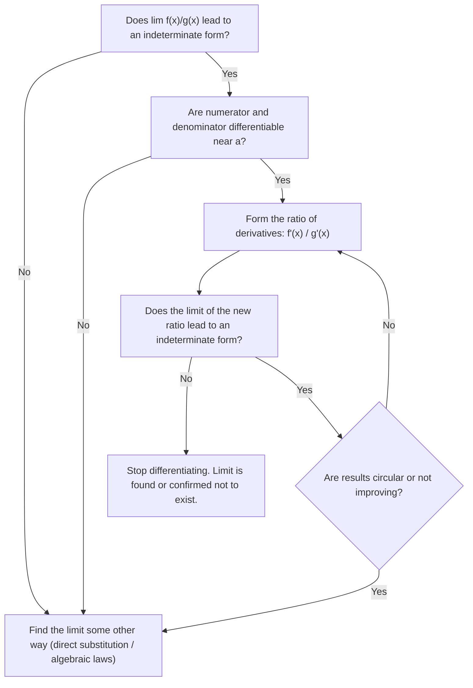

# Overview

When we study functions in mathematics, physics, and engineering, we quickly notice that many of the most critical tools occur naturally as function–inverse pairs. Just as subtraction undoes addition and division undoes multiplication, inverse functions allow us to reverse a mathematical process and solve for the input that produced a known output. Among the most fundamental of these pairs are the natural logarithm $\ln x$ and the exponential function $e^x$. Other essential families include the trigonometric functions (when restricted to appropriate intervals) and their inverses, as well as the hyperbolic functions and their inverses.

Why do we call these functions *transcendental*? Unlike algebraic functions, which can be built from polynomials and roots using basic arithmetic operations, transcendental functions "transcend" algebra. Yet they are indispensable for describing the physical world. They provide the exact mathematical models for phenomena as diverse as the mechanics of hanging cables (catenaries), the diffusion of heat flow through a solid, radioactive decay, and the atmospheric drag experienced by objects falling through fluids.

In our systematic calculus development, how do we build these functions from the ground up on a rock-solid foundation? Rather than relying on hand-wavy definitions of irrational exponents, we begin by examining the general theory of inverse functions and their derivatives. We then define the natural logarithm $\ln x$ directly via integration, and from that single integral definition, we systematically construct $e^x$ and all remaining transcendental functions.

---

# 6.1 Inverse Functions and Their Derivatives

## One-to-One Functions

A function $f$ is a rule that assigns a single output from its range to each input in its domain. Some functions assign the same output to several different inputs—for instance, $f(x) = x^2$ sends both $-2$ and $2$ to $4$, while $f(x) = \sin x$ sends infinitely many angles to $0$. Other functions, however, never repeat an output: different inputs always produce different outputs. When a function has this non-repeating property, we say it is **one-to-one** (or *injective*).

Why do we care whether a function repeats its outputs? Suppose you know that $f(x) = 4$ and you want to recover the exact input $x$ that produced it. If $f(x) = x^2$, you are stuck with an ambiguity: was the input $2$ or $-2$? Without a unique input corresponding to each output, we cannot uniquely reverse the function. Having a one-to-one function eliminates this ambiguity completely.

> [!abstract] Definition: One-to-One Function
> A function $f(x)$ is **one-to-one** on a domain $D$ if
> $$
> f(x_1) \neq f(x_2) \quad \text{whenever } x_1 \neq x_2
> $$
> Equivalently, in contrapositive form:
> $$
> f(x_1) = f(x_2) \implies x_1 = x_2
> $$

In plain English, the direct definition says that distinct inputs are guaranteed to land on distinct outputs. The contrapositive form gives us our go-to algebraic strategy for proving a function is one-to-one: if two inputs $x_1$ and $x_2$ happen to yield the exact same output $f(x_1) = f(x_2)$, then those two inputs must have been the exact same number ($x_1 = x_2$) all along.

### The Horizontal Line Test

How can we tell at a glance from a function's Cartesian graph whether it is one-to-one? Since outputs are plotted as vertical heights $y$, a repeated output means the graph reaches the same height $y = c$ at two or more different horizontal positions $x$. This geometric observation gives us a visual counterpart to the vertical line test.

> [!theorem] The Horizontal Line Test
> A function $y = f(x)$ is one-to-one if and only if its graph intersects each horizontal line at most once.

To see why this works, imagine drawing a horizontal line $y = c$ across the coordinate plane. If that line intersects the graph of $f$ at two or more distinct points, say $(x_1, c)$ and $(x_2, c)$, then both $x_1$ and $x_2$ share the exact same output height: $f(x_1) = f(x_2) = c$ despite $x_1 \neq x_2$. That immediately violates the definition of a one-to-one function. For example, $y = x^3$ and $y = \sqrt{x}$ pass the horizontal line test across their entire domains because no horizontal line cuts their graphs more than once, whereas $y = x^2$ and $y = \sin x$ fail because horizontal lines slice through them multiple times.

## Inverses

Because each output of a one-to-one function originates from one—and only one—input, we can reverse the assignment rule entirely. Instead of feeding in $a$ to get $b$, we can build a reverse machine that takes the output $b$ and sends it right back to the unique input $a$ that produced it. This reversed function is called the **inverse** of $f$.

### Formal Definition and Domain–Range Relations

> [!abstract] Definition: Inverse Function
> Let $f$ be a one-to-one function with domain $\operatorname{Dom}(f)$ and range $\operatorname{Ran}(f)$. The **inverse function** $f^{-1}$, read "$f$ inverse," is defined by the rule
> $$
> f^{-1}(b) = a \iff f(a) = b
> $$
> for every $b \in \operatorname{Ran}(f)$.
> 
> Because $f^{-1}$ swaps the roles of inputs and outputs, the domain and range of $f$ and $f^{-1}$ are interchanged:
> - $\operatorname{Dom}(f^{-1}) = \operatorname{Ran}(f)$
> - $\operatorname{Ran}(f^{-1}) = \operatorname{Dom}(f)$

In other words, whatever set of numbers comes *out* of $f$ becomes the valid set of inputs you can feed *into* $f^{-1}$, and the values that come *out* of $f^{-1}$ are the original inputs from the domain of $f$.

> [!warning] Notational Caution: Functional Inversion vs. Reciprocal
> Be careful with the superscript "$-1$" in $f^{-1}(x)$! In function notation, this symbol denotes **functional inversion** (reversing the mapping), **not** an algebraic exponent of $-1$. That is, $f^{-1}(x)$ is never the reciprocal $\frac{1}{f(x)}$:
> $$
> f^{-1}(x) \neq \frac{1}{f(x)} = (f(x))^{-1}
> $$
> If we want to write the reciprocal of $f(x)$ using an exponent, we wrap the entire expression in parentheses as $(f(x))^{-1}$.

### Composition and Identity Characterization

What happens if we apply $f$ to a number $x$, and then immediately apply $f^{-1}$ to the result? Since $f$ sends $x$ to $f(x)$, and $f^{-1}$ sends $f(x)$ right back to the input that produced it, we end up back where we started at $x$. The same thing happens if we apply $f^{-1}$ first and $f$ second. A function whose output is always identical to its input is called the **identity function**. Thus, composing a function and its inverse in either order cancels both operations out, leaving the identity function on their respective domains.

> [!theorem] Inverse Composition Rule
> Functions $f$ and $g$ form an inverse pair ($g = f^{-1}$ and $f = g^{-1}$) if and only if both of the following composition identities hold:
> $$
> f(g(x)) = x \quad \text{for all } x \in \operatorname{Dom}(g)
> $$
> and
> $$
> g(f(x)) = x \quad \text{for all } x \in \operatorname{Dom}(f)
> $$

This theorem gives us a powerful algebraic test: to verify that two given formulas $f$ and $g$ are inverses of each other, we simply compute both composite functions $(f \circ g)(x)$ and $(g \circ f)(x)$ and check that both simplify cleanly to $x$.

### Existence Criteria (Connection to Monotonicity and the MVT)

We know that a function possesses an inverse if and only if it is one-to-one. In practice, however, checking $f(x_1) = f(x_2) \implies x_1 = x_2$ algebraically can be difficult for complicated functions. How can calculus help us guarantee that a function is one-to-one without solving equations?

Think about how a function moves as $x$ increases from left to right. If a function is always climbing (**strictly increasing**), it can never loop back down to hit a previous height. Specifically, a strictly increasing function satisfies $x_1 < x_2 \implies f(x_1) < f(x_2)$, so two distinct inputs can never share the same output. Similarly, a **strictly decreasing** function satisfies $x_1 < x_2 \implies f(x_1) > f(x_2)$, so it also never repeats an output. In short, any strictly monotonic function on an interval is automatically one-to-one!

By combining this observation with **Corollary 3 of the Mean Value Theorem**, we obtain a simple derivative test for invertibility:
1. If $f'(x) > 0$ for all $x$ in an interval $I$, then $f$ is strictly increasing on $I$, and therefore $f^{-1}$ exists on $f(I)$.
2. If $f'(x) < 0$ for all $x$ in an interval $I$, then $f$ is strictly decreasing on $I$, and therefore $f^{-1}$ exists on $f(I)$.

## Finding and Graphing Inverses

### Geometric Symmetry Across the Line $y = x$

Suppose we have already plotted the graph of a one-to-one function $y = f(x)$. How does the graph of its inverse $y = f^{-1}(x)$ relate to it geometrically?

Think about what happens to individual coordinates. If a point $(a, b)$ lies on the graph of $f$, that means $b = f(a)$. By the definition of the inverse, this is equivalent to saying $a = f^{-1}(b)$. When we plot $f^{-1}$ using $x$ as the horizontal input axis and $y$ as the vertical output axis, the input $b$ produces the output $a$, which means the point $(b, a)$ lies on the graph of $y = f^{-1}(x)$.

Geometrically, swapping the first and second coordinates of a point—sending $(a, b)$ to $(b, a)$—is a reflection across the $45^\circ$ diagonal line $y = x$. Consequently, the graph of $f^{-1}$ is the exact mirror reflection of the graph of $f$ across the line $y = x$, and the line $y = x$ acts as an axis of symmetry between the two curves.

### Algebraic Procedure to Express $f^{-1}$ as a Function of $x$

When we write functions in calculus, we customarily use $x$ for the independent input variable and $y$ for the dependent output variable. To find an explicit formula for $f^{-1}(x)$ and graph it on the same coordinate axes as $f(x)$, we follow a standard two-step algebraic procedure:
1. **Solve for $x$ in terms of $y$:** Start with the equation $y = f(x)$ and manipulate it algebraically to isolate $x$ on one side, giving $x = f^{-1}(y)$. This step actually finds the inverse rule, expressing the original input $x$ as a function of the output $y$.
2. **Interchange $x$ and $y$:** Swap the symbols $x$ and $y$ throughout the equation to obtain $y = f^{-1}(x)$. This relabeling puts the inverse function back into conventional notation with $x$ as the independent variable, which also corresponds geometrically to reflecting the graph across the line $y = x$.

### Domain Restrictions

What if a function we care about is *not* one-to-one across its entire natural domain? We don't have to give up on inverting it! Instead, we can restrict its domain to a smaller sub-interval on which the function *is* strictly monotonic (and therefore one-to-one).

For example, the squaring function $y = x^2$ fails the horizontal line test on $(-\infty, \infty)$ because every positive height $y$ is hit twice (at $\pm\sqrt{y}$). However, if we restrict the domain to nonnegative numbers $x \ge 0$, the restricted function $f(x) = x^2$ for $x \ge 0$ is strictly increasing and passes the horizontal line test. Solving $y = x^2$ for $x \ge 0$ gives $x = \sqrt{y}$, and swapping variables yields the inverse function $f^{-1}(x) = \sqrt{x}$ on the domain $x \ge 0$. (As we will see later in this chapter, this exact technique of domain restriction is how we define the inverse trigonometric functions $\sin^{-1} x$, $\cos^{-1} x$, and $\tan^{-1} x$.)

## Derivatives of Inverses of Differentiable Functions

Now let's bring calculus into the picture. If a one-to-one function $f$ is continuous and differentiable, is its inverse $f^{-1}$ also differentiable? And if so, how is the derivative of $f^{-1}$ related to the derivative of $f$?

### Reciprocal Slopes of Reflected Tangents

To build geometric intuition before stating the formal theorem, let's look at what reflection across the line $y = x$ does to the slope of a straight line. Consider a nonvertical, nonhorizontal line $L$ given by the equation $y = mx + b$ with slope $m \neq 0$. To reflect this line across $y = x$, we follow our two-step inversion procedure. First, we solve for $x$:
$$
x = \frac{1}{m}y - \frac{b}{m}
$$
Second, we interchange $x$ and $y$ to get the equation of the reflected line $L'$:
$$
y = \frac{1}{m}x - \frac{b}{m}
$$
Look at the coefficient of $x$ in the reflected line: its slope is $\frac{1}{m}$, the exact **reciprocal** of the original slope $m$!

Now extend this idea to smooth curves. The tangent line to the graph of $f^{-1}$ at the point $(f(a), a)$ is simply the mirror reflection across $y = x$ of the tangent line to the graph of $f$ at the point $(a, f(a))$. Because reflecting a line across $y = x$ takes the reciprocal of its slope, the slope of $f^{-1}$ at $x = f(a)$ must be the reciprocal of the slope of $f$ at $x = a$:
$$
\left. \frac{df^{-1}}{dx} \right|_{x = f(a)} = \frac{1}{\left. \frac{df}{dx} \right|_{x = a}}
$$
Notice carefully *where* each derivative is evaluated! We do not evaluate both derivatives at the same $x$-value. The derivative of $f^{-1}$ is evaluated at the output value $f(a)$, while the derivative of $f$ in the denominator is evaluated at the corresponding input value $a$.

### The Derivative Rule for Inverses

Let's state this fundamental relationship as a rigorous theorem and see why the condition $f'(a) \neq 0$ is essential. Geometrically, if $f'(a) = 0$, the graph of $f$ has a horizontal tangent line at $(a, f(a))$. When you reflect a horizontal line across $y = x$, it becomes a *vertical* tangent line at $(f(a), a)$, where the slope is undefined and $f^{-1}$ fails to be differentiable. Avoiding zero derivatives prevents vertical tangents on the inverse graph.

> [!theorem] Theorem 1: The Derivative Rule for Inverses
> If $f$ is differentiable at every point of an interval $I$ and $\frac{df}{dx}$ is never zero on $I$, then $f$ is one-to-one and its inverse $f^{-1}$ is differentiable at every point of the interval $f(I)$. Furthermore, the value of $\frac{df^{-1}}{dx}$ at any particular point $f(a)$ is the reciprocal of the value of $\frac{df}{dx}$ at $a$:
> $$
> \left( \frac{df^{-1}}{dx} \right)_{x = f(a)} = \frac{1}{\left( \frac{df}{dx} \right)_{x = a}}
> $$
> In prime notation, this rule reads:
> $$
> (f^{-1})'(f(a)) = \frac{1}{f'(a)}
> $$
> Or, in concise operator notation:
> $$
> (f^{-1})' = \frac{1}{f'}
> $$

**Proof:**
The proof consists of two parts: first establishing that the inverse function $f^{-1}$ exists and is continuous on $f(I)$, and second, proving from the limit definition of the derivative that $f^{-1}$ is differentiable with the stated reciprocal formula.

**Step 1: Existence and Continuity of $f^{-1}$**
1. **Strict Monotonicity:** Since $f$ is differentiable on the interval $I$, its derivative $f'(x)$ satisfies the Intermediate Value Property (by Darboux's Theorem)—meaning $f'$ cannot jump from positive to negative values without passing through zero. Because $f'(x) \neq 0$ anywhere on $I$, $f'(x)$ must maintain a single strict sign across the entire interval: either $f'(x) > 0$ everywhere on $I$, or $f'(x) < 0$ everywhere on $I$. By Corollary 3 of the Mean Value Theorem, $f$ is either strictly increasing on $I$ or strictly decreasing on $I$.
2. **Invertibility:** Because $f$ is strictly monotonic on $I$, it is one-to-one (injective). Therefore, the inverse function $f^{-1}$ is guaranteed to exist on the range $f(I)$.
3. **Continuity of the Inverse:** Since $f$ is differentiable on the interval $I$, it is continuous on $I$. By a standard theorem of real analysis, the inverse of a continuous, strictly monotonic function on an interval $I$ is itself continuous on the image interval $f(I)$.

**Step 2: Differentiability via the Limit Definition**
Let $a \in I$ and set $b = f(a)$, so that $a = f^{-1}(b)$. To show that $f^{-1}$ is differentiable at $b$, we examine the difference quotient for $f^{-1}$ at any point $y \in f(I)$ with $y \neq b$. Because $f: I \to f(I)$ is a bijection, there exists a unique $x \in I$ such that $y = f(x)$, which is equivalent to $x = f^{-1}(y)$. Moreover, since $y \neq b$ and $f$ is one-to-one, we must have $x \neq a$.

Using the substitutions $f^{-1}(y) = x$, $f^{-1}(b) = a$, $y = f(x)$, and $b = f(a)$, we can rewrite the difference quotient for $f^{-1}$ at $b$ as:
$$
\frac{f^{-1}(y) - f^{-1}(b)}{y - b} = \frac{x - a}{f(x) - f(a)}
$$
Since $x \neq a$, we can divide the numerator and denominator on the right-hand side by $x - a$ to express this ratio as the reciprocal of the difference quotient for $f$:
$$
\frac{f^{-1}(y) - f^{-1}(b)}{y - b} = \frac{1}{\frac{f(x) - f(a)}{x - a}}
$$
Now let's take the limit as $y \to b$. What happens to $x$ as $y$ approaches $b$? Because we proved in Step 1 that $f^{-1}$ is continuous at $b$, taking $y \to b$ forces $x = f^{-1}(y) \to f^{-1}(b) = a$. Since $y \neq b$ implies $x \neq a$, the limit as $y \to b$ is completely equivalent to the limit as $x \to a$. By the quotient law for limits, the denominator approaches $f'(a)$:
$$
\lim_{y \to b} \frac{f^{-1}(y) - f^{-1}(b)}{y - b} = \lim_{x \to a} \frac{1}{\frac{f(x) - f(a)}{x - a}} = \frac{1}{\lim_{x \to a} \frac{f(x) - f(a)}{x - a}} = \frac{1}{f'(a)}
$$
Because $f$ is differentiable at $a$ and $f'(a) \neq 0$ by hypothesis, this limit exists and is finite. We conclude that $f^{-1}$ is differentiable at $b = f(a)$ and its derivative is given by:
$$
\left(\frac{df^{-1}}{dx}\right)_{x=f(a)} = \frac{1}{\left(\frac{df}{dx}\right)_{x=a}} \quad \text{or} \quad (f^{-1})'(f(a)) = \frac{1}{f'(a)} \quad \blacksquare
$$

### Differential and Rate-of-Change Interpretation

There is also a very natural way to understand Theorem 1 through differentials and rates of change. Suppose $y = f(x)$ is differentiable at $x = a$. If we nudge $x$ by a tiny increment $dx$, the corresponding change in $y$ is approximated by the differential relation:
$$
dy \approx f'(a) \, dx
$$
In plain language, near $x = a$, the output $y$ changes approximately $f'(a)$ times as fast as the input $x$. For example, if $f'(a) = 3$, then $y$ grows three times as fast as $x$.

Now flip your perspective and view $x$ as a function of $y$ via the inverse $x = f^{-1}(y)$. If $y$ changes three times as fast as $x$, then $x$ must change one-third as fast as $y$! Algebraically, dividing the differential relation by $f'(a)$ gives:
$$
dx \approx \frac{1}{f'(a)} \, dy
$$
This confirms that $x$ changes approximately $\frac{1}{f'(a)}$ times as fast as $y$, which is why the Leibniz notation $\frac{dx}{dy} = \frac{1}{dy/dx}$ behaves just like an ordinary fraction.

### Chain Rule Connection

Once you already know that both $f$ and $f^{-1}$ are differentiable, you never have to memorize the formula in Theorem 1—you can re-derive it in two lines using the Chain Rule! Starting from the defining identity $f^{-1}(f(x)) = x$, we differentiate both sides with respect to $x$:
$$
\begin{aligned}
\frac{d}{dx} \left[ f^{-1}(f(x)) \right] &= \frac{d}{dx}[x] \\
(f^{-1})'(f(x)) \cdot f'(x) &= 1
\end{aligned}
$$
Dividing both sides by $f'(x)$ (which is valid whenever $f'(x) \neq 0$) immediately produces:
$$
(f^{-1})'(f(x)) = \frac{1}{f'(x)}
$$

## 6.1 Exercises: Theory and Applications (Selected Problems 45–52)

### Problem 45: Invertibility of Negated Functions

> [!abstract] Problem Statement
> If $f(x)$ is one-to-one, can anything be said about $g(x) = -f(x)$? Give reasons for your answer.

**Solution:**
Yes! If $f(x)$ is one-to-one, then its negation $g(x) = -f(x)$ is also guaranteed to be one-to-one. We can verify this both algebraically and geometrically.

For the algebraic proof, let $x_1$ and $x_2$ be any two points in $\operatorname{Dom}(g) = \operatorname{Dom}(f)$ and suppose that $g(x_1) = g(x_2)$. By the definition of $g$, this means:
$$
-f(x_1) = -f(x_2)
$$
Multiplying both sides of the equation by $-1$ cancels the negative signs:
$$
f(x_1) = f(x_2)
$$
Since $f$ is given to be one-to-one, having equal outputs $f(x_1) = f(x_2)$ forces the inputs to be equal: $x_1 = x_2$. Thus, $g(x_1) = g(x_2) \implies x_1 = x_2$, which proves that $g$ is one-to-one.

From a geometric perspective, the graph of $g(x) = -f(x)$ is obtained by reflecting the graph of $f(x)$ vertically across the $x$-axis. Any horizontal line $y = c$ intersects the reflected graph $y = g(x)$ at an $x$-value if and only if the mirrored horizontal line $y = -c$ intersects the original graph $y = f(x)$ at that exact same $x$-value. Because $f$ passes the horizontal line test (meaning $y = -c$ hits $f$ at most once), the line $y = c$ can hit $g$ at most once. Therefore, $g$ also passes the horizontal line test. $\blacksquare$

### Problem 46: Invertibility of Reciprocal Functions

> [!abstract] Problem Statement
> If $f(x)$ is one-to-one and $f(x)$ is never $0$, can anything be said about $h(x) = 1/f(x)$? Give reasons for your answer.

**Solution:**
Yes, the reciprocal function $h(x) = \frac{1}{f(x)}$ is guaranteed to be one-to-one on $\operatorname{Dom}(h) = \operatorname{Dom}(f)$.

To prove this, suppose that $h(x_1) = h(x_2)$ for some $x_1, x_2 \in \operatorname{Dom}(f)$. Writing out the definition of $h$ gives:
$$
\frac{1}{f(x_1)} = \frac{1}{f(x_2)}
$$
Because $f(x)$ is never zero on its domain, both denominators are nonzero real numbers, allowing us to take the reciprocal of both sides:
$$
f(x_1) = f(x_2)
$$
Since $f$ is one-to-one, $f(x_1) = f(x_2)$ implies $x_1 = x_2$. This shows that $h(x_1) = h(x_2) \implies x_1 = x_2$, proving that $h$ is one-to-one. $\blacksquare$

### Problem 47: Composition of One-to-One Functions

> [!abstract] Problem Statement
> Suppose that the range of $g$ lies in the domain of $f$ so that the composite $f \circ g$ is defined. If $f$ and $g$ are one-to-one, can anything be said about $f \circ g$? Give reasons for your answer.

**Solution:**
Yes, the composite function $f \circ g$ is guaranteed to be one-to-one. Intuitively, if the inner machine $g$ never merges distinct inputs, and the outer machine $f$ never merges distinct intermediate outputs, then chaining the two machines together will never merge distinct inputs either.

To prove this formally, let $x_1, x_2 \in \operatorname{Dom}(g)$ and assume that $(f \circ g)(x_1) = (f \circ g)(x_2)$. By the definition of function composition, we have:
$$
f(g(x_1)) = f(g(x_2))
$$
Here, the numbers $g(x_1)$ and $g(x_2)$ act as inputs to the outer function $f$. Since $f$ is one-to-one, two inputs that produce the same output under $f$ must be equal:
$$
g(x_1) = g(x_2)
$$
Now we peel back the second layer: since the inner function $g$ is also one-to-one, the equality $g(x_1) = g(x_2)$ forces the original inputs to be equal:
$$
x_1 = x_2
$$
Therefore, $(f \circ g)(x_1) = (f \circ g)(x_2) \implies x_1 = x_2$, so $f \circ g$ is one-to-one. $\blacksquare$

### Problem 48: One-to-One Property of Inner Functions in a Composite

> [!abstract] Problem Statement
> If a composite $f \circ g$ is one-to-one, must $g$ be one-to-one? Give reasons for your answer.

**Solution:**
Yes, the inner function $g$ **must** be one-to-one. Why? Imagine what would happen if $g$ were *not* one-to-one: two different inputs $x_1 \neq x_2$ would get collapsed by $g$ into the exact same intermediate number $g(x_1) = g(x_2)$. Once those two inputs are merged into a single number, the outer function $f$ receives only that single value and must output $f(g(x_1)) = f(g(x_2))$, which would destroy the one-to-one property of $f \circ g$.

We can turn this intuition into a direct proof. Suppose $g(x_1) = g(x_2)$ for some $x_1, x_2 \in \operatorname{Dom}(g)$. Because $f$ is a well-defined function, applying $f$ to the equal numbers $g(x_1)$ and $g(x_2)$ must yield equal outputs:
$$
f(g(x_1)) = f(g(x_2))
$$
By the definition of composition, this equation is simply:
$$
(f \circ g)(x_1) = (f \circ g)(x_2)
$$
Since the composite function $f \circ g$ is given to be one-to-one, equal outputs under $f \circ g$ imply that the starting inputs must be equal:
$$
x_1 = x_2
$$
Hence, $g(x_1) = g(x_2) \implies x_1 = x_2$, which proves that $g$ must be one-to-one. (Notice, by the way, that the outer function $f$ only needs to be one-to-one on the subset $\operatorname{Ran}(g)$, not necessarily on all of $\operatorname{Dom}(f)$!) $\blacksquare$

### Problem 49: Geometric Area Integral Identity for Inverses

> [!abstract] Problem Statement
> Suppose $f(x)$ is positive, continuous, and increasing over the interval $[a, b]$. By interpreting the graph of $f$ show that:
> $$
> \int_a^b f(x) \, dx + \int_{f(a)}^{f(b)} f^{-1}(y) \, dy = b f(b) - a f(a)
> $$

**Solution:**
We can establish this beautiful identity both geometrically—by slicing up rectangles in the plane—and analytically via integration by parts.

**Method 1: Geometric Interpretation (Decomposition of Bounding Rectangles)**
Assuming $a \ge 0$ so that the curve lies entirely in the first quadrant ($x \ge 0$ and $y \ge 0$), let's look at the rectangles formed by the endpoints $(a, f(a))$ and $(b, f(b))$ on the graph of $y = f(x)$:
1. First, construct the large outer rectangle with vertices at $(0,0)$, $(b,0)$, $(b, f(b))$, and $(0, f(b))$. Its base is $b$ and its height is $f(b)$, so its area is:
   $$
   \text{Area}_{\text{large}} = b \cdot f(b)
   $$
2. Next, look at the smaller inner rectangle tucked into the lower-left corner with vertices at $(0,0)$, $(a,0)$, $(a, f(a))$, and $(0, f(a))$. Its base is $a$ and its height is $f(a)$, so its area is:
   $$
   \text{Area}_{\text{corner}} = a \cdot f(a)
   $$
3. Because $f$ is increasing on $[a, b]$, we have $a < b$ and $f(a) < f(b)$, so the corner rectangle lies completely inside the large rectangle. Removing the smaller corner rectangle from the large outer rectangle leaves an $L$-shaped region whose total area is the difference:
   $$
   \text{Area}_L = b f(b) - a f(a)
   $$
4. Now look at how the continuous, strictly increasing curve $y = f(x)$ travels from the inner corner $(a, f(a))$ to the outer corner $(b, f(b))$. This curve slices the $L$-shaped region cleanly into two non-overlapping pieces:
   - **Region 1 (Below the curve, along the $x$-axis):** The vertical strip bounded below by the $x$-axis, above by $y = f(x)$, and horizontally from $x = a$ to $x = b$. By the definition of the definite integral with respect to $x$, its area is:
     $$
     \text{Area}_1 = \int_a^b f(x) \, dx
     $$
   - **Region 2 (Left of the curve, along the $y$-axis):** The horizontal strip bounded on the left by the $y$-axis, on the right by the curve $x = f^{-1}(y)$, and vertically from $y = f(a)$ to $y = f(b)$. Integrating horizontally with respect to $y$, its area is:
     $$
     \text{Area}_2 = \int_{f(a)}^{f(b)} f^{-1}(y) \, dy
     $$

Because Region 1 and Region 2 fit together like puzzle pieces to form the entire $L$-shaped region ($\text{Area}_1 + \text{Area}_2 = \text{Area}_L$), summing the two integrals gives the desired identity:
$$
\int_a^b f(x) \, dx + \int_{f(a)}^{f(b)} f^{-1}(y) \, dy = b f(b) - a f(a)
$$

**Method 2: Analytic Verification (Assuming Differentiability, via Integration by Parts)**
If $f$ is also continuously differentiable, we can verify this identity purely by calculus. In the second integral $\int_{f(a)}^{f(b)} f^{-1}(y) \, dy$, make the substitution $y = f(x)$, so that $dy = f'(x) \, dx$. When $y = f(a)$, $x = a$; when $y = f(b)$, $x = b$. Since $f^{-1}(f(x)) = x$, the integral transforms into:
$$
\int_{f(a)}^{f(b)} f^{-1}(y) \, dy = \int_a^b f^{-1}(f(x)) f'(x) \, dx = \int_a^b x f'(x) \, dx
$$
Now apply integration by parts ($\int u \, dv = uv - \int v \, du$) with $u = x$ and $dv = f'(x) \, dx$, so that $du = dx$ and $v = f(x)$:
$$
\int_a^b x f'(x) \, dx = \left[ x f(x) \right]_a^b - \int_a^b f(x) \, dx = b f(b) - a f(a) - \int_a^b f(x) \, dx
$$
Adding $\int_a^b f(x) \, dx$ to both sides immediately confirms the identity:
$$
\int_a^b f(x) \, dx + \int_{f(a)}^{f(b)} f^{-1}(y) \, dy = b f(b) - a f(a) \quad \blacksquare
$$

### Problem 50: Invertibility of Linear Fractional (Möbius) Transformations

> [!abstract] Problem Statement
> Determine conditions on the constants $a, b, c,$ and $d$ so that the rational function
> $$
> f(x) = \frac{ax + b}{cx + d}
> $$
> has an inverse.

**Solution:**
First, for $f(x)$ to be a well-defined function at all, the denominator $cx + d$ cannot be identically zero, meaning $c$ and $d$ cannot both be $0$. On its natural domain $\{x \in \mathbb{R} \mid cx + d \neq 0\}$, the rational function $f(x)$ has an inverse if and only if it is one-to-one.

Let's test when $f$ is one-to-one by setting $f(x_1) = f(x_2)$ for two inputs $x_1, x_2 \in \operatorname{Dom}(f)$ and seeing what condition forces $x_1 = x_2$:
$$
\frac{ax_1 + b}{cx_1 + d} = \frac{ax_2 + b}{cx_2 + d}
$$
Cross-multiplying to clear the nonzero denominators gives:
$$
(ax_1 + b)(cx_2 + d) = (ax_2 + b)(cx_1 + d)
$$
Expanding the products on both sides yields:
$$
ac x_1 x_2 + ad x_1 + bc x_2 + bd = ac x_1 x_2 + ad x_2 + bc x_1 + bd
$$
Notice that the terms $ac x_1 x_2$ and $bd$ appear identically on both sides! Subtracting them away simplifies the equation to:
$$
ad x_1 + bc x_2 = ad x_2 + bc x_1
$$
Now let's bring all terms involving $x_1$ to the left side and all terms involving $x_2$ to the right side, and factor:
$$
\begin{aligned}
ad x_1 - bc x_1 &= ad x_2 - bc x_2 \\
(ad - bc) x_1 &= (ad - bc) x_2 \\
(ad - bc)(x_1 - x_2) &= 0
\end{aligned}
$$
Look closely at the factor $ad - bc$ (which you may recognize as the determinant of the coefficient matrix $\begin{pmatrix} a & b \\ c & d \end{pmatrix}$). This equation splits into two distinct cases:
1. **Case 1 ($ad - bc \neq 0$):** Because the constant $ad - bc$ is nonzero, we can divide both sides of $(ad - bc)(x_1 - x_2) = 0$ by $ad - bc$ to conclude that:
   $$
   x_1 - x_2 = 0 \implies x_1 = x_2
   $$
   Thus, whenever $ad - bc \neq 0$, the function $f$ is strictly one-to-one and has a valid inverse! In fact, solving $y = \frac{ax+b}{cx+d}$ for $x$ via $y(cx+d) = ax+b \implies (cy - a)x = -dy + b$ gives the explicit inverse formula:
   $$
   f^{-1}(y) = \frac{-dy + b}{cy - a}
   $$
2. **Case 2 ($ad - bc = 0$):** If $ad - bc = 0$, the equation $(ad - bc)(x_1 - x_2) = 0$ becomes $0 \cdot (x_1 - x_2) = 0$, which is satisfied for *all* pairs $x_1$ and $x_2$ even when $x_1 \neq x_2$. Why does this happen? We can also see this via calculus by computing the derivative of $f(x)$ with the Quotient Rule:
   $$
   f'(x) = \frac{a(cx + d) - c(ax + b)}{(cx + d)^2} = \frac{ad - bc}{(cx + d)^2}
   $$
   When $ad - bc = 0$, the derivative $f'(x)$ is identically $0$ everywhere on its domain, meaning $f(x)$ collapses into a constant function, which is never one-to-one and has no inverse.

Therefore, the rational function $f(x) = \frac{ax+b}{cx+d}$ has an inverse if and only if:
$$
ad - bc \neq 0 \quad \blacksquare
$$

### Problem 51: Chain Rule Connection and Differentiability of Inverses

> [!abstract] Problem Statement
> If we write $g(x)$ for $f^{-1}(x)$, the derivative formula can be written as:
> $$
> g'(f(a)) = \frac{1}{f'(a)}, \quad \text{or} \quad g'(f(a)) \cdot f'(a) = 1
> $$
> Replacing $a$ with $x$ yields:
> $$
> g'(f(x)) \cdot f'(x) = 1
> $$
> Assume that $f$ and $g$ are differentiable functions that are inverses of one another, so that $(g \circ f)(x) = x$. Differentiate both sides of this equation with respect to $x$, using the Chain Rule to express $(g \circ f)'(x)$ as a product of derivatives of $g$ and $f$. What do you find? Explain why this is not a proof of Theorem 1.

**Solution:**
Let's perform the differentiation first and then examine the logical assumptions behind it.

**Part 1: Chain Rule Derivation**
Assuming that $f$ and $g = f^{-1}$ are both differentiable inverse functions, they satisfy the identity $(g \circ f)(x) = g(f(x)) = x$ for all $x \in \operatorname{Dom}(f)$. Differentiating both sides of this equation with respect to $x$ gives:
$$
\frac{d}{dx}\left[ g(f(x)) \right] = \frac{d}{dx}[x]
$$
Applying the Chain Rule to the composite function on the left-hand side and noting that $\frac{d}{dx}[x] = 1$ on the right-hand side, we find:
$$
g'(f(x)) \cdot f'(x) = 1
$$
Provided $f'(x) \neq 0$, dividing both sides by $f'(x)$ yields the exact derivative formula from Theorem 1:
$$
g'(f(x)) = \frac{1}{f'(x)}
$$
(Or, setting $y = f(x)$ so that $x = g(y) = f^{-1}(y)$, this reads $(f^{-1})'(y) = \frac{1}{f'(f^{-1}(y))}$.)

**Part 2: Why This Is Not a Proof of Theorem 1**
Why couldn't we just use this short two-line calculation to prove Theorem 1 instead of going through the two-step limit proof? Look at the hypotheses required to invoke the Chain Rule: in order to write $\frac{d}{dx}[g(f(x))] = g'(f(x)) \cdot f'(x)$, you must **already know in advance** that the outer function $g = f^{-1}$ is differentiable at $f(x)$!

In Theorem 1, however, we are *only* given that $f$ is differentiable with $f' \neq 0$; we are not told whether $f^{-1}$ is differentiable. The hardest and most important part of Theorem 1 is proving that the derivative $g'(f(x))$ *exists in the first place*. If you use the Chain Rule to prove Theorem 1, you are assuming at the very first step that $g$ is differentiable in order to prove that $g$ is differentiable—a classic logical fallacy known as **circular reasoning** (or begging the question). Thus, while the Chain Rule gives a great shortcut for finding the *formula* once differentiability is known, proving *existence* of the derivative requires the rigorous difference-quotient argument of Theorem 1. $\blacksquare$

### Problem 52: Equivalence of the Washer and Shell Methods for Inverses

> [!abstract] Problem Statement
> Let $f$ be differentiable on the interval $a \le x \le b$, with $a > 0$, and suppose that $f$ has a differentiable inverse, $f^{-1}$. Revolve about the $y$-axis the region bounded by the graph of $f$ and the lines $x = a$ and $y = f(b)$ to generate a solid. Then the values of the integrals given by the washer and shell methods for the volume have identical values:
> $$
> \int_{f(a)}^{f(b)} \pi \left( (f^{-1}(y))^2 - a^2 \right) dy = \int_a^b 2\pi x (f(b) - f(x)) \, dx
> $$
> To prove this equality, define:
> $$
> W(t) = \int_{f(a)}^{f(t)} \pi \left( (f^{-1}(y))^2 - a^2 \right) dy
> $$
> $$
> S(t) = \int_a^t 2\pi x (f(t) - f(x)) \, dx
> $$
> Show that the functions $W$ and $S$ agree at a point of $[a, b]$ and have identical derivatives on $[a, b]$, thereby establishing $W(t) = S(t)$ for all $t \in [a, b]$, and in particular $W(b) = S(b)$.

**Solution:**
In earlier chapters on volumes of solids of revolution, we took on faith that slicing a solid horizontally into washers ($W$) and slicing it vertically into cylindrical shells ($S$) always produce the exact same volume. Here, by letting the upper bound $b$ vary as a variable $t \in [a, b]$, we can prove that the two integral formulas are mathematically identical!

**Step 1: Verify Agreement at the Initial Point $t = a$**
Let's evaluate both volume functions $W(t)$ and $S(t)$ at the left endpoint $t = a$:
$$
\begin{aligned}
W(a) &= \int_{f(a)}^{f(a)} \pi \left( (f^{-1}(y))^2 - a^2 \right) dy = 0 \\
S(a) &= \int_a^a 2\pi x (f(a) - f(x)) \, dx = 0
\end{aligned}
$$
Because both definite integrals have matching upper and lower limits of integration at $t = a$, both evaluate to zero, confirming that $W(a) = S(a) = 0$.

**Step 2: Differentiate $W(t)$ Using the Fundamental Theorem of Calculus and the Chain Rule**
In $W(t)$, the variable $t$ appears only in the upper limit of integration $u(t) = f(t)$, while the integrand $\pi \left( (f^{-1}(y))^2 - a^2 \right)$ is a continuous function of the dummy variable $y$. By the Fundamental Theorem of Calculus (Part 1) combined with the Chain Rule, we differentiate $W(t)$ by plugging the upper limit $y = f(t)$ into the integrand and multiplying by the derivative of the upper limit, $f'(t)$:
$$
W'(t) = \frac{d}{dt} \left[ \int_{f(a)}^{f(t)} \pi \left( (f^{-1}(y))^2 - a^2 \right) dy \right] = \pi \left( (f^{-1}(f(t)))^2 - a^2 \right) \cdot f'(t)
$$
Since $f^{-1}(f(t)) = t$ by the inverse composition rule, this simplifies cleanly to:
$$
W'(t) = \pi (t^2 - a^2) f'(t)
$$

**Step 3: Differentiate $S(t)$ Using Algebra, the Product Rule, and the FTC**
Be careful when differentiating $S(t)$! Notice that the variable $t$ appears in *two* places: as the upper limit of integration $\int_a^t$, and inside the integrand via the factor $f(t)$. Before we can apply the Fundamental Theorem of Calculus, we must expand the integrand and factor $f(t)$ outside the $x$-integral (since $f(t)$ is independent of the integration variable $x$):
$$
\begin{aligned}
S(t) &= \int_a^t 2\pi x (f(t) - f(x)) \, dx \\
&= \int_a^t 2\pi x f(t) \, dx - \int_a^t 2\pi x f(x) \, dx \\
&= f(t) \int_a^t 2\pi x \, dx - \int_a^t 2\pi x f(x) \, dx
\end{aligned}
$$
We can evaluate the first integral explicitly right now:
$$
\int_a^t 2\pi x \, dx = \left[ \pi x^2 \right]_a^t = \pi(t^2 - a^2)
$$
Substituting this back into our expression for $S(t)$ gives:
$$
S(t) = \pi(t^2 - a^2) f(t) - \int_a^t 2\pi x f(x) \, dx
$$
Now we can differentiate $S(t)$ with respect to $t$. We apply the Product Rule to the first term $\pi(t^2 - a^2) f(t)$ and the Fundamental Theorem of Calculus to the integral term $\int_a^t 2\pi x f(x) \, dx$:
$$
\begin{aligned}
S'(t) &= \frac{d}{dt}\left[ \pi(t^2 - a^2) f(t) \right] - \frac{d}{dt}\left[ \int_a^t 2\pi x f(x) \, dx \right] \\
&= \left( \frac{d}{dt}[\pi(t^2 - a^2)] \cdot f(t) + \pi(t^2 - a^2) \cdot f'(t) \right) - 2\pi t f(t) \\
&= 2\pi t f(t) + \pi(t^2 - a^2) f'(t) - 2\pi t f(t) \\
&= \pi(t^2 - a^2) f'(t)
\end{aligned}
$$
Look how nicely the $2\pi t f(t)$ terms cancel out!

**Step 4: Conclude That $W(b) = S(b)$**
Comparing our results from Step 2 and Step 3, we see that $W(t)$ and $S(t)$ have the exact same derivative at every point of $[a, b]$:
$$
W'(t) = S'(t) = \pi(t^2 - a^2) f'(t) \quad \text{for all } t \in [a, b]
$$
By Corollary 2 of the Mean Value Theorem, two functions with identical derivatives on an interval $[a, b]$ can differ only by a constant $C$:
$$
W(t) - S(t) = C \quad \text{for all } t \in [a, b]
$$
Evaluating this equation at $t = a$ and using $W(a) = S(a) = 0$ from Step 1 gives:
$$
C = W(a) - S(a) = 0 - 0 = 0
$$
Therefore, $W(t) = S(t)$ for all $t \in [a, b]$. Setting $t = b$ establishes the exact equality of the washer and shell volume integrals:
$$
W(b) = S(b) \iff \int_{f(a)}^{f(b)} \pi \left( (f^{-1}(y))^2 - a^2 \right) dy = \int_a^b 2\pi x (f(b) - f(x)) \, dx \quad \blacksquare
$$

---

# 6.2 Natural Logarithms

## Historical Context and Development

Before the age of electronic calculators, multiplying and dividing large multi-digit numbers by hand was a grueling bottleneck for astronomers, navigators, and engineers. In the late 1500s, the Scottish baron **John Napier** (1550–1617) asked a brilliant question: *What if we could transform multiplication into simple addition?* This led him to invent a revolutionary computational method called the **logarithm**, built around the fundamental algebraic identity:
$$
\ln(ax) = \ln a + \ln x
$$
Instead of multiplying two large numbers $a$ and $x$ directly, a calculator could simply look up their logarithms in a precomputed table, add those two numbers together, and then look up the corresponding "anti-logarithm" to read off the product.

Napier devoted the final 20 years of his life to calculating these extensive logarithmic tables by hand, while the Danish astronomer Tycho Brahe waited anxiously for them to accelerate his celestial mechanics calculations. When Napier passed away before finishing, the tables were completed posthumously by his friend **Henry Briggs** in London. Because Briggs adapted the tables to base $10$ for practical decimal arithmetic, base-$10$ logarithms became known historically as *Briggsian logarithms*.

*(Historical note: Napier was also a prolific inventor of military technology and designed a devastatingly accurate artillery piece capable of hitting a cow a mile away; appalled by the destructive capability of the weapon, he stopped manufacturing it and suppressed the blueprints.)*

In modern calculus, however, we reverse Napier's historical path. Rather than starting with computational bases and fractional exponents—which are tricky to define rigorously for irrational numbers—we define the **natural logarithm** directly and cleanly as a definite integral. From this single geometric foundation, all the classic algebraic laws of logarithms emerge naturally through calculus.

## Definition of the Natural Logarithm Function

Why do we define the natural logarithm as an integral? Recall the power rule for integration, $\int t^n \, dt = \frac{t^{n+1}}{n+1} + C$, which works for every rational power except $n = -1$ (where dividing by $n + 1$ causes division by zero). Defining a function that accumulates the area under the hyperbola $y = \frac{1}{t}$ fills this exact gap in calculus.

> [!abstract] Definition: The Natural Logarithm Function
> The **natural logarithm function**, denoted $\ln x$, is defined for all positive real numbers $x > 0$ by:
> $$
> \ln x = \int_1^x \frac{1}{t} \, dt, \quad x > 0
> $$

In plain language, $\ln x$ measures the signed area between the curve $y = \frac{1}{t}$ and the horizontal $t$-axis from the fixed starting point $t = 1$ to the variable endpoint $t = x$.

### Geometric Interpretation as an Accumulation Function

Because $\ln x$ is defined as a definite integral starting at $t = 1$, its value and algebraic sign depend on where $x$ lies relative to $1$ along the horizontal axis:

1. **For $x > 1$:** We integrate from left to right ($1$ to $x$) beneath a strictly positive curve, so $\ln x$ represents the positive geometric area under $y = \frac{1}{t}$ from $t = 1$ to $t = x$:
   $$
   \ln x = \int_1^x \frac{1}{t} \, dt > 0
   $$
2. **For $x = 1$:** The upper and lower integration limits coincide, collapsing the region of integration to a single line segment of zero width:
   $$
   \ln 1 = \int_1^1 \frac{1}{t} \, dt = 0
   $$
3. **For $0 < x < 1$:** Here the upper limit $x$ lies to the left of the lower limit $1$. Reversing the integration limits shows that $\ln x$ is the negative of the geometric area under $y = \frac{1}{t}$ from $t = x$ to $t = 1$:
   $$
   \ln x = \int_1^x \frac{1}{t} \, dt = -\int_x^1 \frac{1}{t} \, dt < 0
   $$
4. **For $x \le 0$:** The function $\ln x$ is **undefined** because integrating from $1$ to a non-positive number $x$ would require crossing $t = 0$, where the integrand $\frac{1}{t}$ has an infinite, non-integrable singularity.

### The Dummy Variable of Integration

Why do we write $\int_1^x \frac{1}{t} \, dt$ using the letter $t$ instead of $\int_1^x \frac{1}{x} \, dx$? In the integral definition $\ln x = \int_1^x \frac{1}{t} \, dt$, the symbol $t$ serves as a **dummy variable of integration**. Using a distinct variable $t$ to sweep along the horizontal axis of the curve $y = \frac{1}{t}$ prevents us from confusing the running integration variable with the fixed upper limit $x$ at which we are evaluating the logarithm.

## The Derivative of $y = \ln x$

### Direct Derivative from the Fundamental Theorem of Calculus

Because we defined $\ln x$ as an accumulation integral with a variable upper limit $x$, finding its derivative requires zero algebraic guesswork—we can read it directly off Part 1 of the Fundamental Theorem of Calculus, which states that $\frac{d}{dx} \int_a^x f(t)\,dt = f(x)$ for any continuous integrand $f(t)$. Applying this theorem to $f(t) = \frac{1}{t}$ (which is continuous for all $t > 0$) immediately yields:
$$
\frac{d}{dx} \ln x = \frac{d}{dx} \int_1^x \frac{1}{t} \, dt = \frac{1}{x}
$$

> [!theorem] Derivative of the Natural Logarithm
> For every $x > 0$:
> $$
> \frac{d}{dx} \ln x = \frac{1}{x}
> $$

Notice what this says geometrically: at any positive input $x$, the slope of the tangent line to $y = \ln x$ is simply the reciprocal $\frac{1}{x}$. As $x$ grows very large, the slope $\frac{1}{x}$ flattens out toward $0$; as $x$ approaches $0$ from the right, the slope shoots up toward $+\infty$.

### Chain Rule Extension

What if the argument inside the natural logarithm is not simply $x$, but a composite function $u = u(x)$? Provided $u(x)$ is positive and differentiable, we can combine our basic derivative formula with the Chain Rule:
$$
\frac{d}{dx} \ln u = \frac{d}{du}[\ln u] \cdot \frac{du}{dx} = \frac{1}{u} \frac{du}{dx}
$$

> [!theorem] Chain Rule for Natural Logarithms
> If $u > 0$ is a differentiable function of $x$:
> $$
> \frac{d}{dx} \ln u = \frac{1}{u} \frac{du}{dx}
> $$

In words, differentiating the natural logarithm of a positive function produces a fraction: place the inside function $u$ in the denominator, and place its derivative $\frac{du}{dx}$ in the numerator.

### Scaling Invariance of the Derivative

Let's test the Chain Rule on a simple scaled input, $\ln(ax)$, where $a > 0$ is any positive constant. Differentiating with respect to $x$ gives a surprising result:
$$
\frac{d}{dx} \ln(ax) = \frac{1}{ax} \cdot \frac{d}{dx}(ax) = \frac{1}{ax} \cdot a = \frac{1}{x}
$$
The constant factor $a$ cancels out completely! Consequently, the horizontally scaled function $\ln(ax)$ has the **exact same derivative** as $\ln x$ at every point $x > 0$. Geometrically, this means the graph of $y = \ln(ax)$ has the exact same slope as $y = \ln x$ at every $x$, so one graph must simply be a vertical shift of the other—an observation that unlocks all the algebraic laws of logarithms.

## Algebraic Properties of Logarithms and Their Rigorous Proofs

In precalculus, you likely memorized the logarithm laws as consequences of exponent rules. Now that we have defined $\ln x$ as an integral, how do we know it actually obeys Napier's algebraic rules? Let's summarize these four classic identities and then prove each one rigorously using calculus.

> [!summary] Table 6.1: Properties of Natural Logarithms
> For any positive numbers $a > 0$ and $x > 0$:
> 1. **Product Rule:** $\ln(ax) = \ln a + \ln x$
> 2. **Quotient Rule:** $\ln \left(\frac{a}{x}\right) = \ln a - \ln x$
> 3. **Reciprocal Rule:** $\ln \left(\frac{1}{x}\right) = -\ln x$ (special case of Quotient Rule with $a = 1$)
> 4. **Power Rule:** $\ln(x^n) = n \ln x$ (for rational $n$, and all real $n$)

### Proof of the Product Rule: $\ln(ax) = \ln a + \ln x$

**Proof:** Why should the logarithm of a product equal the sum of the individual logarithms? Recall from our scaling invariance calculation above that when we treat $a > 0$ as a fixed constant and differentiate both $\ln(ax)$ and $\ln x$ with respect to $x$, we obtain the exact same derivative:
$$
\frac{d}{dx} \ln(ax) = \frac{1}{ax} \cdot a = \frac{1}{x} \quad \text{and} \quad \frac{d}{dx} \ln x = \frac{1}{x}
$$
Because both functions share the identical derivative across the entire connected open interval $(0, \infty)$, **Corollary 1 of the Mean Value Theorem** guarantees that they can differ only by a constant $C$ on $(0, \infty)$:
$$
\ln(ax) = \ln x + C
$$
To pinpoint the value of $C$, we can plug in any convenient positive value of $x$ since this equation holds for all $x > 0$. Choosing $x = 1$ (where we already know $\ln 1 = 0$) makes the evaluation effortless:
$$
\begin{aligned}
\ln(a \cdot 1) &= \ln(1) + C \\
\ln a &= 0 + C \\
\implies C &= \ln a
\end{aligned}
$$
Substituting $C = \ln a$ back into our relation gives the desired identity for all $a, x > 0$:
$$
\ln(ax) = \ln a + \ln x \quad \blacksquare
$$

### Proof of the Reciprocal Rule: $\ln\left(\frac{1}{x}\right) = -\ln x$

**Proof:** Once the Product Rule is established, we don't even need derivatives to prove the Reciprocal Rule! Since $\frac{1}{x}$ and $x$ multiply to $1$, we can substitute $a = \frac{1}{x}$ directly into the Product Rule $\ln(ax) = \ln a + \ln x$:
$$
\begin{aligned}
\ln\left(\frac{1}{x} \cdot x\right) &= \ln\left(\frac{1}{x}\right) + \ln x \\
\ln(1) &= \ln\left(\frac{1}{x}\right) + \ln x \\
0 &= \ln\left(\frac{1}{x}\right) + \ln x \\
\implies \ln\left(\frac{1}{x}\right) &= -\ln x \quad \blacksquare
\end{aligned}
$$

### Proof of the Quotient Rule: $\ln\left(\frac{a}{x}\right) = \ln a - \ln x$

**Proof:** We can view division by $x$ as multiplication by the reciprocal $\frac{1}{x}$. Rewriting $\frac{a}{x}$ as the product $a \cdot \frac{1}{x}$ and applying the Product Rule followed by the Reciprocal Rule yields:
$$
\ln\left(\frac{a}{x}\right) = \ln\left(a \cdot \frac{1}{x}\right) = \ln a + \ln\left(\frac{1}{x}\right) = \ln a - \ln x \quad \blacksquare
$$

### Proof of the Power Rule: $\ln(x^n) = n \ln x$ (for Rational $n$)

**Proof:** Let $n$ be any rational number, and let $x > 0$. We use the same Mean Value Theorem strategy that worked for the Product Rule: compare the derivatives of the left-hand side and the right-hand side. First, differentiating $\ln(x^n)$ with respect to $x$ via the Chain Rule and the Power Rule for rational exponents gives:
$$
\frac{d}{dx} \ln(x^n) = \frac{1}{x^n} \cdot \frac{d}{dx}(x^n) = \frac{1}{x^n} \cdot (n x^{n-1}) = \frac{n}{x}
$$
Next, differentiating $n \ln x$ with respect to $x$ gives:
$$
\frac{d}{dx}(n \ln x) = n \cdot \frac{1}{x} = \frac{n}{x}
$$
Because $\ln(x^n)$ and $n \ln x$ have identical derivatives on the open interval $(0, \infty)$, Corollary 1 of the Mean Value Theorem ensures that they differ by a constant $C$:
$$
\ln(x^n) = n \ln x + C
$$
Evaluating both sides at $x = 1$ (where $1^n = 1$ and $\ln 1 = 0$) determines $C$:
$$
\begin{aligned}
\ln(1^n) &= n \ln(1) + C \\
\ln(1) &= 0 + C \\
0 &= 0 + C \implies C = 0
\end{aligned}
$$
Substituting $C = 0$ completes the proof:
$$
\ln(x^n) = n \ln x \quad \blacksquare
$$

> [!note] Theoretical Remark on Irrational Exponents
> Notice that the proof above relies on the differentiation formula $\frac{d}{dx}(x^n) = n x^{n-1}$, which has only been established for rational exponents $n \in \mathbb{Q}$ at this stage of calculus. While the identity $\ln(x^n) = n \ln x$ does hold for all real exponents, proving it for irrational powers requires first defining what an irrational power $x^r$ even means via the exponential definition $x^r = e^{r \ln x}$.

## Analysis of the Graph and Range of $\ln x$

What does the curve $y = \ln x$ look like globally, and how much of the vertical $y$-axis does its range cover? By combining derivative tests for shape with our newly proven Power Rule for boundary limits, we can build a complete picture of the graph.

### Monotonicity and Concavity

We can determine the direction and bending of $y = \ln x$ directly from its first and second derivatives:
- **First Derivative (Monotonicity):** Because $x$ is restricted to the domain $(0, \infty)$, the first derivative is always strictly positive:
  $$
  \frac{d}{dx} \ln x = \frac{1}{x} > 0 \quad \text{for all } x \in (0, \infty)
  $$
  Therefore, $\ln x$ is **strictly increasing** on its entire domain $(0, \infty)$ (and hence is a one-to-one function).
- **Second Derivative (Concavity):** Differentiating $\frac{1}{x} = x^{-1}$ a second time shows that the second derivative is always strictly negative:
  $$
  \frac{d^2}{dx^2} \ln x = \frac{d}{dx}\left(\frac{1}{x}\right) = -\frac{1}{x^2} < 0 \quad \text{for all } x \in (0, \infty)
  $$
  Therefore, the graph of $\ln x$ is **strictly concave down** everywhere on its domain.

### Asymptotic Behavior at Boundaries

Because the slope $\frac{1}{x}$ approaches $0$ as $x$ grows large, a natural question arises: *Does $\ln x$ level off below some horizontal asymptote, or does it keep climbing to $\infty$?*

To answer this rigorously, we first observe by numerical area approximation (for instance, comparing the area under $y = \frac{1}{t}$ on $[1, 2]$ to a simple inscribed rectangle or trapezoid) that $\ln 2 \approx 0.693 > \frac{1}{2}$. Now we can use the Power Rule on powers of $2$:
- **Behavior as $x \to \infty$:** For any positive integer $n$, evaluating $\ln x$ at $x = 2^n$ yields:
  $$
  \ln(2^n) = n \ln 2 > n \left(\frac{1}{2}\right) = \frac{n}{2}
  $$
  As $n \to \infty$, the lower bound $\frac{n}{2} \to \infty$, which forces $\ln(2^n) \to \infty$. Since $\ln x$ is strictly increasing for all $x > 0$, it cannot be bounded above, proving that:
  $$
  \lim_{x \to \infty} \ln x = \infty
  $$
- **Behavior as $x \to 0^+$:** Similarly, evaluating $\ln x$ at $x = 2^{-n} = \frac{1}{2^n}$ for any positive integer $n$ gives:
  $$
  \ln(2^{-n}) = -n \ln 2 < -n \left(\frac{1}{2}\right) = -\frac{n}{2}
  $$
  As $n \to \infty$, $2^{-n} \to 0^+$ while the upper bound $-\frac{n}{2} \to -\infty$. Because $\ln x$ is strictly increasing, this proves that the graph plunges downward without bound near the $y$-axis:
  $$
  \lim_{x \to 0^+} \ln x = -\infty
  $$

### Summary of Function Characteristics

Because $\ln x$ is continuous on $(0, \infty)$ and stretches between $-\infty$ and $\infty$, the Intermediate Value Theorem guarantees that it attains every real number as an output. We can summarize its fundamental characteristics as follows:
- **Domain:** $(0, \infty)$
- **Range:** $(-\infty, \infty)$
- **Intercept:** $(1, 0)$ (since $\ln 1 = 0$)
- **Asymptote:** Vertical asymptote at the line $x = 0$ (the $y$-axis).

## Technique of Logarithmic Differentiation

Suppose you need to differentiate a daunting function built from multiple products, quotients, and fractional powers—such as $y = \frac{(x^2 + 1)(x + 3)^{1/2}}{x - 1}$. Attacking this directly with the Product, Quotient, and Chain Rules all at once is an algebraic minefield.

Instead, we can use **logarithmic differentiation**: by taking the natural logarithm of both sides *before* differentiating, we use Napier's logarithm laws to break complicated products into simple sums, quotients into differences, and exponents into scalar multipliers.

### Procedural Algorithm (for $y = f(x) > 0$)

Whenever you want to differentiate a positive function $y = f(x) > 0$ involving messy products, quotients, or powers, follow this five-step algorithm:

1. **Take logarithms:** Take the natural logarithm of both sides of the equation:
   $$
   \ln y = \ln f(x)
   $$
2. **Expand:** Apply the algebraic properties of logarithms (Product, Quotient, and Power rules) to expand $\ln f(x)$ into a sum and difference of simpler logarithmic terms.
3. **Differentiate implicitly:** Differentiate both sides with respect to $x$, using the Chain Rule $\frac{d}{dx}[\ln y] = \frac{1}{y}\frac{dy}{dx}$ on the left:
   $$
   \begin{aligned}
   \frac{d}{dx}[\ln y] &= \frac{d}{dx}[\ln f(x)] \\
   \frac{1}{y} \frac{dy}{dx} &= \frac{d}{dx}[\ln f(x)]
   \end{aligned}
   $$
4. **Isolate $\frac{dy}{dx}$:** Multiply both sides by $y$ to solve for the derivative:
   $$
   \frac{dy}{dx} = y \cdot \frac{d}{dx}[\ln f(x)]
   $$
5. **Substitute the original formula:** Replace $y$ with its explicit expression $f(x)$ so that the final derivative is written purely in terms of $x$:
   $$
   \frac{dy}{dx} = f(x) \cdot \frac{d}{dx}[\ln f(x)]
   $$

> [!note] Theoretical Nuance: Domain Restrictions and Validity of Logarithmic Differentiation
> A natural theoretical question arises: *Does taking the logarithm in Step 1 artificially restrict our final derivative formula only to points where $f(x) > 0$?* 
> 
> Remarkably, the resulting derivative formula remains valid everywhere the original function $f$ is differentiable—including points where $f(x) < 0$ and even roots where $f(x) = 0$! This holds because of three theoretical principles:
> 
> 1. **Negative Values ($f(x) < 0$):** Where $f(x)$ is negative (and nonzero), we can apply logarithms to the absolute value: $\ln |y| = \ln |f(x)|$. Because $\frac{d}{dx}\ln |u| = \frac{1}{u}\frac{du}{dx}$ for any nonzero differentiable function $u$, the negative signs cancel identically during differentiation:
>    - For $u > 0$: $\frac{d}{dx}\ln(u) = \frac{1}{u}\frac{du}{dx}$
>    - For $u < 0$: $\frac{d}{dx}\ln(-u) = \frac{1}{-u}\left(-\frac{du}{dx}\right) = \frac{1}{u}\frac{du}{dx}$
>    
>    Thus, sign information does not alter the resulting derivative at all; the intermediate logarithmic step requires only $f(x) \neq 0$.
> 
> 2. **Zeroes ($f(x) = 0$):** At roots where $f(x) = 0$, $\ln |f(x)|$ is temporarily undefined. However, in Step 5:
>    $$
>    \frac{dy}{dx} = f(x) \cdot \frac{d}{dx}[\ln |f(x)|]
>    $$
>    multiplying back through by the original factor $f(x)$ algebraically cancels the vanishing factors in the denominators, healing those removable singularities. By the continuity of $f'(x)$, the simplified derivative formula evaluated at the root $x = a$ automatically matches the true derivative limit:
>    $$
>    f'(a) = \lim_{x \to a} f'(x)
>    $$
> 
> 3. **Equivalence to the Product and Quotient Rules:** At its core, logarithmic differentiation is simply an algebraic bookkeeping shortcut for repeated applications of the Leibniz Product Rule and Quotient Rule. For any product $y = uv$, the standard product rule $y' = u'v + uv'$ (when divided through by $y = uv$) is algebraically equivalent to:
>    $$
>    \frac{y'}{y} = \frac{u'}{u} + \frac{v'}{v}
>    $$
>    The logarithm serves solely as a temporary scaffolding to decompose products into sums. Because the underlying product and quotient rules hold globally across the entire domain of $f$, the final simplified formula is valid everywhere $f$ is differentiable.

## Integration Involving Logarithms

Every differentiation formula in calculus can be read in reverse as an integration formula. Let's see how reversing the derivative of the natural logarithm allows us to integrate reciprocal functions and quotients across both positive and negative domains.

### The Integral $\int \frac{1}{u} \, du$

Since $\frac{d}{du}\ln u = \frac{1}{u}$ for $u > 0$, we immediately know that $\int \frac{1}{u} \, du = \ln u + C$ whenever $u$ is positive.

Wait—what if $u < 0$? The reciprocal function $\frac{1}{u}$ is perfectly continuous and integrable on negative intervals, even though $\ln u$ itself is undefined for $u < 0$. How do we write an antiderivative when $u < 0$?
- If $u < 0$, then its opposite $-u$ is positive ($-u > 0$), which means $\ln(-u)$ is well-defined!
- Differentiating $\ln(-u)$ with respect to $u$ via the Chain Rule (with inner function $w = -u$) reveals that the two minus signs cancel out:
  $$
  \frac{d}{du} \ln(-u) = \frac{1}{-u} \cdot \frac{d}{du}(-u) = \frac{1}{-u} (-1) = \frac{1}{u}
  $$
- Therefore, on any interval where $u < 0$, the antiderivative of $\frac{1}{u}$ is:
  $$
  \int \frac{1}{u} \, du = \ln(-u) + C
  $$

We can unify both the positive case ($u > 0$) and the negative case ($u < 0$) into a single formula using the **absolute value** notation $|u|$:
- When $u > 0$, $|u| = u \implies \ln |u| = \ln u$.
- When $u < 0$, $|u| = -u \implies \ln |u| = \ln(-u)$.

> [!theorem] Integral of $1/u$
> If $u$ is a nonzero differentiable function:
> $$
> \int \frac{1}{u} \, du = \ln |u| + C
> $$

Including the absolute value bars inside $\ln |u|$ is crucial whenever you compute an indefinite integral or a definite integral over an interval where $u$ takes negative values.

### Resolution of the Power Rule Exception

Look back at the standard power rule for integration:
$$
\int u^n \, du = \frac{u^{n+1}}{n+1} + C, \quad n \neq -1
$$
For every power $n \neq -1$, integrating a power function yields another power function. The mysterious exception at $n = -1$ (where $\frac{u^0}{0}$ breaks down) is now completely resolved by the natural logarithm:
$$
\int u^{-1} \, du = \int \frac{1}{u} \, du = \ln |u| + C
$$

### The Form $\int \frac{f'(x)}{f(x)} \, dx$

In practice, the integral rule $\int \frac{du}{u} = \ln |u| + C$ appears most frequently in disguise as a fraction whose numerator is the derivative of its denominator. Whenever you spot an integrand of the form $\frac{f'(x)}{f(x)}$, substituting $u = f(x)$ and $du = f'(x) \, dx$ immediately reduces the integral to a natural logarithm:
$$
\int \frac{f'(x)}{f(x)} \, dx = \int \frac{du}{u} = \ln |u| + C = \ln |f(x)| + C
$$
(provided $f(x)$ maintains a constant sign—i.e., does not cross zero—on the domain of integration).

## Theoretical Derivations of the Integrals of $\tan x$ and $\cot x$

Prior to introducing the logarithmic integral rule $\int \frac{du}{u} = \ln |u| + C$, we knew how to integrate $\sin x$ and $\cos x$, as well as $\sec^2 x$ and $\csc^2 x$, but the basic trigonometric integrals $\int \tan x \, dx$ and $\int \cot x \, dx$ could not be evaluated in closed form! By rewriting tangent and cotangent as ratios of sine and cosine, we can recognize both integrals as instances of the logarithmic pattern $\int \frac{f'(x)}{f(x)} \, dx$.

### Integral of the Tangent Function

To integrate $\tan x$, we first rewrite it in terms of sine and cosine as $\frac{\sin x}{\cos x}$:
$$
\int \tan x \, dx = \int \frac{\sin x}{\cos x} \, dx
$$
Notice that the derivative of the denominator $\cos x$ is $-\sin x$, which matches the numerator up to a minus sign! Let $u = \cos x$, so that $du = -\sin x \, dx$, or equivalently $\sin x \, dx = -du$. Substituting these into the integral gives:
$$
\int \tan x \, dx = \int \frac{-du}{u} = -\int \frac{du}{u} = -\ln |u| + C = -\ln |\cos x| + C
$$
We can also express this answer without the leading minus sign by applying the Reciprocal Rule of logarithms: since $-\ln |\cos x| = \ln |\cos x|^{-1} = \ln \left|\frac{1}{\cos x}\right| = \ln |\sec x|$, we obtain two equally useful forms for the integral of the tangent function:
$$
\int \tan u \, du = -\ln |\cos u| + C = \ln |\sec u| + C
$$

### Integral of the Cotangent Function

Similarly, to integrate $\cot x$, we express it as the quotient $\frac{\cos x}{\sin x}$:
$$
\int \cot x \, dx = \int \frac{\cos x}{\sin x} \, dx
$$
Here the numerator $\cos x$ is the exact derivative of the denominator $\sin x$. Setting $u = \sin x$ and $du = \cos x \, dx$ transforms the integral directly into:
$$
\int \cot x \, dx = \int \frac{du}{u} = \ln |u| + C = \ln |\sin x| + C
$$
Just as before, if we wish to write this in terms of cosecant, applying the Reciprocal Rule $\ln |\sin x| = -\ln \left|\frac{1}{\sin x}\right| = -\ln |\csc x|$ gives:
$$
\int \cot u \, du = \ln |\sin u| + C = -\ln |\csc u| + C
$$

> [!summary] Summary of Boxed Integrals
> $$
> \int \tan u \, du = -\ln |\cos u| + C = \ln |\sec u| + C
> $$
> $$
> \int \cot u \, du = \ln |\sin u| + C = -\ln |\csc u| + C
> $$

---

# 6.3 The Exponential Function

## The Inverse of the Natural Logarithm and the Number $e$

### Invertibility of the Natural Logarithm

In Section 6.2, we defined the natural logarithm for all $x > 0$ via the definite integral:
$$
\ln x = \int_1^x \frac{1}{t} \, dt
$$
Why are we guaranteed that $\ln x$ has an inverse function? By the Fundamental Theorem of Calculus, the derivative of $\ln x$ is:
$$
\frac{d}{dx} \ln x = \frac{1}{x}
$$
For every $x$ in the domain $(0, \infty)$, the derivative $\frac{1}{x}$ is strictly positive. Because its derivative is strictly positive across its entire domain, $\ln x$ is a strictly increasing function. By Theorem 1 of Section 6.1, any strictly increasing function is one-to-one and therefore possesses a unique inverse function, which we initially denote by $\ln^{-1}$.

Because an inverse function swaps inputs and outputs, the domain and range of $\ln^{-1}$ are the exact reverses of the domain and range of $\ln$:
- $\operatorname{Dom}(\ln^{-1}) = \operatorname{Ran}(\ln) = (-\infty, \infty)$
- $\operatorname{Ran}(\ln^{-1}) = \operatorname{Dom}(\ln) = (0, \infty)$

In other words, $\ln^{-1} x$ accepts any real number $x$ as an input and always produces a strictly positive output. We can also determine the end behavior of $\ln^{-1} x$ directly from the asymptotic limits of $\ln x$:
- Since $\lim_{x \to \infty} \ln x = \infty$, the inverse function grows without bound as $x$ increases:
  $$
  \lim_{x \to \infty} \ln^{-1} x = \infty
  $$
- Since $\lim_{x \to 0^+} \ln x = -\infty$, the inverse function approaches zero as $x$ retreats toward $-\infty$:
  $$
  \lim_{x \to -\infty} \ln^{-1} x = 0
  $$

Geometrically, this second limit tells us that the line $y = 0$ (the negative $x$-axis) serves as a horizontal asymptote for the graph of $y = \ln^{-1} x$, which is the reflection of $y = \ln x$ across the line $y = x$.

### Definition of the Number $e$

Since $\ln x$ is continuous, strictly increasing, and ranges from $-\infty$ to $\infty$, the Intermediate Value Theorem guarantees that it passes through every real height—including $y = 1$—at a single, unique point. We define the fundamental constant $e$ through this exact crossing point.

> [!abstract] Definition: The Number $e$
> The number $e$ is the unique real number whose natural logarithm equals $1$:
> $$
> e = \ln^{-1}(1)
> $$
> Equivalently, $e$ satisfies the integral condition:
> $$
> \ln e = 1 \iff \int_1^e \frac{1}{t} \, dt = 1
> $$

What does $e$ represent geometrically? Look at the integral above: $e$ is the unique $x$-coordinate along the positive horizontal axis such that the area under the hyperbola $y = 1/t$ between $t = 1$ and $t = e$ is equal to $1$ square unit.

Analytically, $e$ is an irrational, transcendental number. As we will see when studying infinite series, its numerical value can be computed as the limit of Taylor polynomials:
$$
e = \lim_{n \to \infty} \left( 1 + 1 + \frac{1}{2!} + \frac{1}{3!} + \dots + \frac{1}{n!} \right) = \sum_{k=0}^\infty \frac{1}{k!}
$$
Evaluated to fifteen decimal places, this series converges to:
$$
e \approx 2.718281828459045
$$

### The Function $y = e^x$

How does the inverse function $\ln^{-1} x$ connect to raising the number $e$ to a power? For any rational number $x$, elementary algebra already defines powers of the positive base $e$ through multiplication, reciprocals, and roots:
$$
e^2 = e \cdot e, \quad e^{-2} = \frac{1}{e^2}, \quad e^{1/2} = \sqrt{e}, \quad e^{p/q} = \sqrt[q]{e^p}
$$
Because $e > 0$, every rational power $e^x$ is strictly positive, so we can take its natural logarithm. Using the power rule for rational exponents from Section 6.2 together with the fact that $\ln e = 1$, we find:
$$
\ln(e^x) = x \ln e = x \cdot 1 = x
$$
Now, apply the inverse function $\ln^{-1}$ to both sides of $\ln(e^x) = x$. Since $\ln^{-1}(\ln u) = u$, we obtain:
$$
e^x = \ln^{-1} x \quad \text{for all rational } x
$$

Here is the crucial question: what does $e^x$ mean when $x$ is an *irrational* number, such as $e^{\sqrt{2}}$ or $e^\pi$? Elementary algebra gives us no way to multiply $e$ by itself $\sqrt{2}$ times. However, the function $\ln^{-1} x$ is already well-defined, smooth, and continuous for *every* real number $x \in (-\infty, \infty)$, and it agrees with algebraic exponentiation at every rational $x$. We therefore use $\ln^{-1} x$ to define $e^x$ across the entire real line.

> [!abstract] Definition: The Natural Exponential Function
> For every real number $x$, the **natural exponential function** $e^x$ is defined as the inverse of the natural logarithm:
> $$
> e^x = \ln^{-1} x
> $$
> 
> **Domain and Range:**
> - $\operatorname{Dom}(e^x) = (-\infty, \infty)$
> - $\operatorname{Ran}(e^x) = (0, \infty)$

### Inverse Equations Involving $\ln x$ and $e^x$

Because $f(x) = e^x$ and $g(x) = \ln x$ are mutually inverse functions ($e^x = \ln^{-1} x$ and $\ln x = (e^x)^{-1}$), composing them in either order cancels both operations and returns the original input.

> [!theorem] Fundamental Inverse Identities
> For all $x > 0$:
> $$
> e^{\ln x} = x
> $$
> and for all $x \in (-\infty, \infty)$:
> $$
> \ln(e^x) = x
> $$

These two identities give us a reliable pair of operating rules whenever we need to isolate a variable trapped inside a logarithm or an exponent:
1. **Removing logarithms:** To eliminate a natural logarithm from an equation, exponentiate both sides with base $e$:
   $$
   \ln y = u(x) \implies e^{\ln y} = e^{u(x)} \implies y = e^{u(x)}
   $$
2. **Removing exponentials:** To eliminate an exponential from an equation, take the natural logarithm of both sides (provided $v(x) > 0$):
   $$
   e^y = v(x) \implies \ln(e^y) = \ln(v(x)) \implies y = \ln(v(x))
   $$

## Laws of Exponents

Even though we defined $e^x$ for arbitrary real exponents as the inverse function $\ln^{-1} x$, does it still obey all the familiar algebraic laws of exponents? Remarkably, yes—and each law follows directly from the corresponding property of logarithms established in Section 6.2.

> [!summary] Summary: Laws of Exponents for $e^x$
> For all real numbers $x, x_1, x_2$:
> 1. **Product Rule:**
>    $$
>    e^{x_1} \cdot e^{x_2} = e^{x_1 + x_2}
>    $$
> 2. **Reciprocal Rule:**
>    $$
>    e^{-x} = \frac{1}{e^x}
>    $$
> 3. **Quotient Rule:**
>    $$
>    \frac{e^{x_1}}{e^{x_2}} = e^{x_1 - x_2}
>    $$
> 4. **Power of a Power Rule:**
>    $$
>    (e^{x_1})^{x_2} = e^{x_1 x_2} = (e^{x_2})^{x_1}
>    $$

### Proof of Law 1: Product Rule

**Proof:** Let us set:
$$
y_1 = e^{x_1} \quad \text{and} \quad y_2 = e^{x_2}
$$
Taking the natural logarithm of both equations converts our exponentials into logarithmic expressions:
$$
x_1 = \ln y_1 \quad \text{and} \quad x_2 = \ln y_2
$$
Adding these two equations together gives:
$$
x_1 + x_2 = \ln y_1 + \ln y_2
$$
Now we apply the Product Rule for logarithms ($\ln y_1 + \ln y_2 = \ln(y_1 y_2)$) to combine the right-hand side:
$$
x_1 + x_2 = \ln(y_1 y_2)
$$
Exponentiating both sides with base $e$ removes the logarithm:
$$
e^{x_1 + x_2} = e^{\ln(y_1 y_2)} = y_1 y_2
$$
Finally, substituting back $y_1 = e^{x_1}$ and $y_2 = e^{x_2}$ yields:
$$
e^{x_1 + x_2} = e^{x_1} \cdot e^{x_2}
$$
This establishes Law 1. $\blacksquare$

### Proof of Law 2: Reciprocal Rule

**Proof:** Setting $x_1 = x$ and $x_2 = -x$ in Law 1 gives:
$$
e^x \cdot e^{-x} = e^{x + (-x)} = e^0
$$
Since $\ln 1 = 0$, we have $e^0 = \ln^{-1}(0) = 1$, so the equation becomes:
$$
e^x \cdot e^{-x} = 1
$$
Because $e^x > 0$ for all real $x$, we can divide both sides by $e^x$ without risk of dividing by zero:
$$
e^{-x} = \frac{1}{e^x}
$$
This establishes Law 2. $\blacksquare$

### Proof of Law 3: Quotient Rule

**Proof:** Combining Law 1 and Law 2 allows us to rewrite the quotient as a product:
$$
\begin{aligned}
\frac{e^{x_1}}{e^{x_2}} &= e^{x_1} \cdot \frac{1}{e^{x_2}} \\
&= e^{x_1} \cdot e^{-x_2} \\
&= e^{x_1 + (-x_2)} \\
&= e^{x_1 - x_2}
\end{aligned}
$$
This establishes Law 3. $\blacksquare$

### Proof of Law 4: Power of a Power Rule

**Proof:** Let us set:
$$
y = (e^{x_1})^{x_2}
$$
Taking the natural logarithm of both sides gives:
$$
\ln y = \ln\left( (e^{x_1})^{x_2} \right)
$$
Applying the Power Rule for logarithms ($\ln(a^r) = r \ln a$) brings the outer exponent $x_2$ out front:
$$
\ln y = x_2 \ln(e^{x_1})
$$
Since $\ln(e^{x_1}) = x_1$, this simplifies to:
$$
\ln y = x_2 \cdot x_1 = x_1 x_2
$$
Exponentiating both sides with base $e$ isolates $y$:
$$
e^{\ln y} = e^{x_1 x_2} \implies y = e^{x_1 x_2}
$$
Therefore, $(e^{x_1})^{x_2} = e^{x_1 x_2}$. By the commutativity of multiplication in $\mathbb{R}$, $x_1 x_2 = x_2 x_1$, which also gives:
$$
(e^{x_1})^{x_2} = e^{x_1 x_2} = (e^{x_2})^{x_1}
$$
This establishes Law 4. $\blacksquare$

> [!note] Forward Reference on the Power Rule for Logarithms
> Notice that to prove Law 4 for arbitrary real exponents $x_2$, we used the logarithmic property $\ln(a^r) = r\ln a$. In Section 6.2 we proved this property only for rational exponents $r$. In Section 6.4, we will rigorously define $a^r$ for all real $r$ and prove $\ln(a^r) = r\ln a$ in two independent ways, completing the logical foundation for real exponents.

## Differentiation of the Exponential Function

### Differentiability and the Derivative of $e^x$

Before computing the derivative of $y = e^x$, how do we know $e^x$ is differentiable in the first place? Recall that $f(x) = \ln x$ is differentiable on $(0, \infty)$ and its derivative is:
$$
f'(x) = \frac{1}{x} \neq 0
$$
Because $f'(x)$ is never zero on $(0, \infty)$, the Inverse Function Derivative Theorem (Theorem 1 of Section 6.1) guarantees that the inverse function $y = e^x$ is differentiable everywhere on $(-\infty, \infty)$.

With differentiability assured, we can find the derivative of $y = e^x$ using implicit differentiation. Since $e^x > 0$, we have $y > 0$, and taking the natural logarithm of both sides yields:
$$
\ln y = x
$$
Differentiating both sides with respect to $x$ gives:
$$
\frac{d}{dx}[\ln y] = \frac{d}{dx}[x]
$$
Applying the Chain Rule to the left-hand side produces:
$$
\frac{1}{y} \frac{dy}{dx} = 1
$$
Multiplying both sides by $y$ and substituting back $y = e^x$, we arrive at one of the most celebrated results in calculus:
$$
\frac{dy}{dx} = y \implies \frac{d}{dx} e^x = e^x
$$

> [!theorem] Derivative of $e^x$
> The natural exponential function $e^x$ is its own derivative:
> $$
> \frac{d}{dx} e^x = e^x
> $$

In other words, at every point $(x, e^x)$ on the graph of $y = e^x$, the slope of the tangent line is equal to the height of the curve itself!

> [!note] Theoretical Characterization of $e^x$
> The exponential function $y = e^x$ is the only nonzero function (up to scalar multiplication) that is identical to its own derivative. That is, the general solution to the differential equation:
> $$
> \frac{dy}{dx} = y
> $$
> is $y = C e^x$ for an arbitrary constant $C$.

### Chain Rule Generalization and Rate-of-Change Interpretation

What if the exponent is a composite function $u = u(x)$ rather than just $x$? Applying the Chain Rule immediately extends our derivative formula:
$$
\frac{d}{dx} e^u = \frac{d}{du}[e^u] \cdot \frac{du}{dx} = e^u \frac{du}{dx}
$$

> [!theorem] General Derivative Formula for $e^u$
> If $u$ is a differentiable function of $x$, then:
> $$
> \frac{d}{dx} e^u = e^u \frac{du}{dx}
> $$

In differential notation, this relationship takes the compact form:
$$
d(e^u) = e^u \, du
$$
In particular, when $u = x$, a small change $dx$ in $x$ produces an approximate change in $y = e^x$ given by:
$$
\Delta y \approx dy = e^x \, dx
$$
Looking at this differential relationship from two angles reveals why $e^x$ is the natural prototype for growth models:
- **Absolute rate of change:** Near any point $x$, the instantaneous rate of change $\frac{dy}{dx}$ equals the current function value $e^x$. The larger $e^x$ gets, the faster it grows.
- **Relative (percentage) rate of change:** Dividing the rate of change by the function value itself shows that the relative growth rate of $y = e^x$ is constant:
  $$
  \frac{1}{y} \frac{dy}{dx} = \frac{e^x}{e^x} = 1
  $$
  This represents a constant continuous growth rate of $100\%$ per unit of $x$.

### Linearization of $e^x$ at $x = 0$

How does $e^x$ behave for very small values of $x$ near $0$? We can construct the standard linear (tangent line) approximation of $f(x) = e^x$ centered at $a = 0$. Since both the function value and the slope at $x = 0$ equal $1$ ($f(0) = e^0 = 1$ and $f'(0) = e^0 = 1$), the linearization is:
$$
L(x) = f(0) + f'(0)(x - 0) = 1 + 1 \cdot x = 1 + x
$$

> [!theorem] Linear Approximation of $e^x$
> For values of $x$ near $0$, the exponential function is locally approximated by:
> $$
> e^x \approx 1 + x
> $$

Can we say whether $1 + x$ overestimates or underestimates $e^x$? Notice that the second derivative of $f(x) = e^x$ is $f''(x) = e^x > 0$ for all $x \in \mathbb{R}$. Because the curve $y = e^x$ is strictly concave up everywhere, its tangent line at $x = 0$ must lie strictly below the graph at every point except the point of tangency $(0, 1)$. This gives us a fundamental global inequality:
$$
e^x \ge 1 + x \quad \text{for all } x \in \mathbb{R}
$$
with equality holding if and only if $x = 0$.

## Theoretical Foundations: Algebraic vs. Transcendental Classifications

Why is this chapter titled *Transcendental Functions*? To appreciate what makes $\ln x$ and $e^x$ fundamentally different from polynomials, rational functions, and roots, we look at how mathematical analysis classifies numbers and functions according to whether they can be captured by polynomial equations.

### Algebraic vs. Transcendental Numbers

Real and complex numbers are partitioned into two disjoint classes depending on whether they can appear as roots of polynomial equations with rational coefficients.

> [!abstract] Definition: Algebraic and Transcendental Numbers
> - A number $\alpha$ is **algebraic** if it satisfies a polynomial equation of the form:
>   $$
>   a_n \alpha^n + a_{n-1} \alpha^{n-1} + \dots + a_1 \alpha + a_0 = 0
>   $$
>   where the coefficients $a_n, a_{n-1}, \dots, a_0 \in \mathbb{Q}$ are rational numbers and $a_n \neq 0$.
> - A number is **transcendental** if it is not algebraic.

To build intuition for this distinction, consider the following examples and historical milestones:
- **Rational numbers:** Every rational number $p/q$ (with $p, q \in \mathbb{Z}$, $q \neq 0$) is automatically algebraic because it satisfies the first-degree polynomial equation $q x - p = 0$. For instance, $-2$ satisfies $x + 2 = 0$.
- **Irrational radicals:** Many irrational numbers are also algebraic. For example, $\sqrt{3}$ is irrational, yet it is algebraic because it satisfies $x^2 - 3 = 0$.
- **Origin of the term:** Leonhard Euler coined the term *transcendental* to describe quantities that "transcend the power of algebraic methods"—meaning they cannot be produced by any finite combination of algebraic operations and root extractions on rational numbers.
- **Transcendence of $e$ and $\pi$:** Proving that a specific constant is transcendental is notoriously difficult. Charles Hermite first proved that $e$ is transcendental in 1873. Nine years later, in 1882, Ferdinand von Lindemann proved that $\pi$ is transcendental—a landmark result that settled an ancient Greek problem by proving the impossibility of "squaring the circle" using only a compass and straightedge.

### Algebraic vs. Transcendental Functions

This exact same algebraic-versus-transcendental distinction extends from numbers to functions.

> [!abstract] Definition: Algebraic and Transcendental Functions
> - A function $y = f(x)$ is **algebraic** if it satisfies a polynomial equation in $y$ whose coefficients are polynomials in $x$:
>   $$
>   P_n(x) y^n + P_{n-1}(x) y^{n-1} + \dots + P_1(x) y + P_0(x) = 0
>   $$
>   where each $P_i(x)$ is a polynomial in $x$ with rational coefficients.
> - A function is **transcendental** if it is not algebraic.

Which functions belong to the algebraic class? All polynomials and rational functions are algebraic, as are all functions constructed by taking finite combinations of sums, differences, products, quotients, rational powers, and rational roots of polynomials. For instance, the function $y = \frac{1}{\sqrt{x+1}}$ is algebraic because squaring both sides and clearing the denominator shows that it satisfies:
$$
(x + 1) y^2 - 1 = 0
$$
which has the required polynomial form with $P_2(x) = x + 1$, $P_1(x) = 0$, and $P_0(x) = -1$.

By contrast, functions that cannot satisfy any polynomial relation with polynomial coefficients are **transcendental**. The primary families of elementary transcendental functions include:
- The six elementary trigonometric functions ($\sin x$, $\cos x$, $\tan x$, $\cot x$, $\sec x$, $\csc x$), whose periodicity alone prevents them from satisfying a nonzero polynomial equation.
- The inverse trigonometric functions ($\arcsin x$, $\arccos x$, $\arctan x$, etc.).
- The natural logarithmic function ($\ln x$).
- The natural exponential function ($e^x$).

## Integration Involving the Exponential Function

### The Indefinite and Definite Integral of $e^u$

Because integration is the inverse operation of differentiation, reversing our derivative formula $\frac{d}{du}[e^u] = e^u$ immediately gives us the integration rule for the exponential function. Just as $e^u$ is its own derivative, it is also its own antiderivative!

> [!theorem] Integral of $e^u$
> If $u$ is a differentiable function of $x$, then:
> $$
> \int e^u \, du = e^u + C
> $$

When evaluating a definite integral via the substitution $u = g(x)$ and $du = g'(x) \, dx$, we transform the limits of integration accordingly:
$$
\int_a^b e^{g(x)} g'(x) \, dx = \int_{g(a)}^{g(b)} e^u \, du = \left[ e^u \right]_{g(a)}^{g(b)} = e^{g(b)} - e^{g(a)}
$$

### Separable Differential Equations and Initial Value Problems

The exponential function frequently appears in first-order differential equations of the form:
$$
e^y \frac{dy}{dx} = g(x)
$$
paired with an initial condition $y(x_0) = y_0$. Notice how all factors involving $y$ and $\frac{dy}{dx}$ sit on the left-hand side, while the right-hand side depends only on $x$. Equations with this structure belong to an important class called separable differential equations.

> [!note] Concept: Separable Differential Equations
> A **separable differential equation** is a first-order ordinary differential equation that can be factored so that all terms involving the dependent variable $y$ appear on one side and all terms involving the independent variable $x$ appear on the other.
> 
> **General Forms:** A first-order equation is separable if it can be written as:
> $$
> \frac{dy}{dx} = g(x) h(y)
> $$
> or, expressed in differential form:
> $$
> M(x)\,dx + N(y)\,dy = 0
> $$
> where $g(x)$ and $M(x)$ depend solely on $x$, and $h(y)$ and $N(y)$ depend solely on $y$.

How do we systematically solve an initial value problem of the form $e^y \frac{dy}{dx} = g(x)$ with $y(x_0) = y_0$? We follow a five-step procedure:
1. **Integration:** Integrate both sides with respect to $x$ and use the substitution $dy = \frac{dy}{dx} \, dx$ on the left:
   $$
   \int e^y \frac{dy}{dx} \, dx = \int g(x) \, dx \implies \int e^y \, dy = \int g(x) \, dx
   $$
   Evaluating both integrals yields the implicit general solution:
   $$
   e^y = G(x) + C
   $$
   where $G'(x) = g(x)$ is an antiderivative of $g(x)$ and $C$ is the constant of integration.
2. **Applying the Initial Condition:** Substitute the initial point $(x_0, y_0)$ to uniquely determine $C$:
   $$
   e^{y_0} = G(x_0) + C \implies C = e^{y_0} - G(x_0)
   $$
   Inserting this value of $C$ fixes the particular implicit relation $e^y = G(x) + C$.
3. **Explicit Isolation of $y$:** Take the natural logarithm of both sides to solve explicitly for $y$:
   $$
   \ln(e^y) = \ln(G(x) + C) \implies y = \ln(G(x) + C)
   $$
4. **Domain of the Solution:** Because the natural logarithm is defined only for positive inputs, the explicit solution $y = \ln(G(x) + C)$ is valid on the largest open connected interval containing $x_0$ on which the argument remains strictly positive:
   $$
   \operatorname{Dom}(y) = \{ x \in \mathbb{R} \mid G(x) + C > 0 \}
   $$
5. **Verification:** We can always check our solution by differentiating $y = \ln(G(x) + C)$ and confirming that it reproduces the original differential equation:
   $$
   e^y \frac{dy}{dx} = e^{\ln(G(x) + C)} \cdot \frac{d}{dx}[\ln(G(x) + C)] = (G(x) + C) \cdot \frac{G'(x)}{G(x) + C} = G'(x) = g(x)
   $$

## Advanced Theoretical Results and Geometric Dualities

### Complementary Area Duality for Inverse Functions

Because $y = \ln x$ and $x = e^y$ describe the exact same curve in the $xy$-plane viewed from perpendicular axes, the areas beneath their graphs fit together like two puzzle pieces inside a rectangle.

> [!theorem] Integral Area Duality
> For any real number $a > 1$:
> $$
> \int_1^a \ln x \, dx + \int_0^{\ln a} e^y \, dy = a \ln a
> $$

**Proof:** Let us see how this identity emerges geometrically and analytically from the graph of $y = \ln x$. As $x$ varies from $1$ to $a$, the height $y = \ln x$ varies from $\ln 1 = 0$ to $\ln a$:
- The first integral, $\int_1^a \ln x \, dx$, measures the area of the region lying **below** the curve $y = \ln x$ and above the $x$-axis from $x = 1$ to $x = a$.
- Solving $y = \ln x$ for $x$ gives $x = e^y$. Thus, integrating with respect to $y$ in the second integral, $\int_0^{\ln a} e^y \, dy$, measures the area of the region lying to the **left** of the curve $x = e^y$ (that is, above $y = \ln x$) and to the right of the $y$-axis from $y = 0$ to $y = \ln a$.

As illustrated in the figure below, these two non-overlapping regions partition the entire bounding rectangle $[0, a] \times [0, \ln a]$ in the first quadrant! Therefore, the sum of the two integrals must equal the total area of the circumscribed rectangle of base $a$ and height $\ln a$:
$$
\text{Total Area} = \text{base} \times \text{height} = a \cdot \ln a = a \ln a \quad \blacksquare
$$

### The Geometric, Logarithmic, and Arithmetic Mean Inequality

The geometry of the curve $y = e^x$ also yields an elegant calculus proof of a famous three-part inequality comparing the **geometric mean**, the **logarithmic mean**, and the **arithmetic mean** of two positive numbers.

First, recall that for $f(x) = e^x$, both the first and second derivatives are strictly positive across the entire real line:
$$
f'(x) = e^x, \quad f''(x) = e^x > 0 \quad \text{for all } x \in \mathbb{R}
$$
Because $f''(x) > 0$ everywhere, the graph of $y = e^x$ is **strictly concave up** on every interval.

Now let $0 < a < b$, and consider the definite integral of $f(x) = e^x$ over the interval $[\ln a, \ln b]$. The width of this interval is:
$$
\Delta x = \ln b - \ln a = \ln\left(\frac{b}{a}\right) > 0
$$
and its midpoint is:
$$
m = \frac{\ln a + \ln b}{2}
$$
Because $y = e^x$ is strictly concave up on $[\ln a, \ln b]$, we can trap the exact area $\int_{\ln a}^{\ln b} e^x \, dx$ between a tangent-line underestimate and a secant-line overestimate:
1. **Midpoint Rule (Tangent Underestimate):** The tangent line drawn to $y = e^x$ at the midpoint $x = m$ lies strictly below the curve everywhere except at the point of tangency. Moreover, because the midpoint $m$ is horizontally centered in $[\ln a, \ln b]$, the trapezoid under this sloped tangent line has the exact same area as the rectangle of height $f(m)$ and width $\ln b - \ln a$. Consequently, the midpoint rectangle strictly underestimates the integral:
   $$
   f(m) \cdot (\ln b - \ln a) < \int_{\ln a}^{\ln b} e^x \, dx
   $$
   Substituting $f(m) = e^{\frac{\ln a + \ln b}{2}}$ gives:
   $$
   e^{\frac{\ln a + \ln b}{2}} (\ln b - \ln a) < \int_{\ln a}^{\ln b} e^x \, dx
   $$
2. **Trapezoidal Rule (Secant Overestimate):** The secant line segment connecting the left endpoint $(\ln a, e^{\ln a})$ to the right endpoint $(\ln b, e^{\ln b})$ lies strictly above the concave-up curve across the open interval $(\ln a, \ln b)$. Therefore, the area of the secant trapezoid strictly overestimates the integral:
   $$
   \int_{\ln a}^{\ln b} e^x \, dx < \frac{e^{\ln a} + e^{\ln b}}{2} (\ln b - \ln a)
   $$

Combining both geometric bounds places the integral inside a strict double inequality:
$$
e^{\frac{\ln a + \ln b}{2}} (\ln b - \ln a) < \int_{\ln a}^{\ln b} e^x \, dx < \frac{e^{\ln a} + e^{\ln b}}{2} (\ln b - \ln a)
$$

Now let us simplify each of the three expressions algebraically:
- **Central integral:** By the Fundamental Theorem of Calculus and the inverse identity $e^{\ln x} = x$:
  $$
  \int_{\ln a}^{\ln b} e^x \, dx = \left[ e^x \right]_{\ln a}^{\ln b} = e^{\ln b} - e^{\ln a} = b - a
  $$
- **Left factor (Geometric Mean):** Using logarithmic and exponential laws:
  $$
  e^{\frac{\ln a + \ln b}{2}} = e^{\frac{1}{2}\ln(ab)} = \left( e^{\ln(ab)} \right)^{1/2} = \sqrt{ab}
  $$
- **Right factor (Arithmetic Mean):** Simplifying $e^{\ln a} = a$ and $e^{\ln b} = b$:
  $$
  \frac{e^{\ln a} + e^{\ln b}}{2} = \frac{a + b}{2}
  $$

Substituting these three simplified expressions back into our double inequality yields:
$$
\sqrt{ab} \, (\ln b - \ln a) < b - a < \frac{a + b}{2} \, (\ln b - \ln a)
$$
Finally, since $0 < a < b$ implies $\ln b - \ln a > 0$, we can divide all three parts by $\ln b - \ln a$ while preserving the strict inequalities:
$$
\sqrt{ab} < \frac{b - a}{\ln b - \ln a} < \frac{a + b}{2}
$$

> [!theorem] The Geometric, Logarithmic, and Arithmetic Mean Inequality
> For any two distinct positive numbers $0 < a < b$:
> $$
> \sqrt{ab} < \frac{b - a}{\ln b - \ln a} < \frac{a + b}{2}
> $$
> In words, the logarithmic mean of two distinct positive numbers is strictly bounded between their geometric mean and their arithmetic mean:
> $$
> \text{Geometric Mean} < \text{Logarithmic Mean} < \text{Arithmetic Mean}
> $$

> [!note] Theoretical Significance of the Logarithmic Mean
> The middle quantity in this inequality,
> $$
> L(a, b) = \frac{b - a}{\ln b - \ln a}
> $$
> is called the **Logarithmic Mean** of $a$ and $b$. It arises naturally across engineering and physical transport phenomena—most notably in heat exchanger design as the *Logarithmic Mean Temperature Difference* (LMTD) and in mass transfer across diffusion membranes—whenever a driving force decays exponentially between two boundary states.

> [!note] Intuition: Area of a Trapezoid via the Midpoint Height
> In Step 1 of the derivation above, we used a neat geometric fact: the area under any straight line (such as the tangent line at $x = m$) over an interval equals its height at the midpoint times the interval width. In general, for a trapezoid with parallel sides of lengths $l_1$ and $l_2$ and width (or height) $h$, the standard area formula is $\frac{l_1 + l_2}{2} \cdot h$. Because the cross-sectional length halfway between the two parallel sides is the average $l_{\text{mid}} = \frac{l_1 + l_2}{2}$, the area of any trapezoid is simply:
> $$
> \text{Area} = l_{\text{mid}} \cdot h
> $$
> Visually, rotating the top edge about its midpoint slices off a small triangle on the taller side and rotates it to perfectly fill the missing triangle on the shorter side, turning the trapezoid into a rectangle of height $l_{\text{mid}}$ and base $h$.

---

# 6.4 $a^x$ and $\log_a x$

## The General Exponential Function $a^x$

### Definition of Arbitrary Real Powers

How do we raise a positive number $a$ to an arbitrary real power $x$? In elementary algebra, we build up $a^n$ step by step for integer and rational exponents through repeated multiplication, reciprocals, and roots:
$$
a^n = \underbrace{a \cdot a \dots a}_{n \text{ factors}}, \quad a^{-n} = \frac{1}{a^n}, \quad a^{p/q} = \sqrt[q]{a^p}
$$
However, elementary algebra hits a wall when we encounter an irrational exponent such as $2^{\sqrt{3}}$ or $5^\pi$. Because an irrational number cannot be expressed as a ratio of integers $p/q$, we cannot interpret $a^x$ as taking a $q$-th root of a $p$-th power. How can we extend exponentiation so that $a^x$ makes rigorous sense for every real number $x$?

The key lies in the natural exponential function $e^x$ and the natural logarithm $\ln x$ that we developed in the preceding sections. Because $e^u$ is already defined for all real numbers $u \in (-\infty, \infty)$, and because any positive base $a > 0$ can be written as $a = e^{\ln a}$, we can rewrite any rational power $a^x$ as $(e^{\ln a})^x = e^{x \ln a}$. Notice that the right-hand side, $e^{x \ln a}$, is well-defined whether $x$ is rational or irrational! We therefore adopt this identity as our formal definition of exponentiation for any positive base $a > 0$ and any real exponent $x$.

> [!abstract] Definition: General Exponential Function $a^x$
> For any base $a > 0$ and any real exponent $x$:
> $$
> a^x = e^{x \ln a}
> $$
> 
> **Domain and Range:**
> - $\operatorname{Dom}(a^x) = (-\infty, \infty)$
> - For $a \neq 1$: $\operatorname{Ran}(a^x) = (0, \infty)$
> - For $a = 1$: $1^x = e^{x \ln 1} = e^{x \cdot 0} = e^0 = 1$ for all $x \in \mathbb{R}$, so $\operatorname{Ran}(1^x) = \{1\}$

In other words, to compute $a^x$, we scale the natural logarithm of the base by $x$ and feed the result into the natural exponential function.

> [!note] Justification of the Definition
> When $x$ is a rational number, the equation $a^x = e^{x \ln a}$ is a theorem that we have already proved using the rational power rule for $\ln$. When $x$ is irrational, this same equation serves as the *definition* of what the symbol $a^x$ means, seamlessly filling in the gaps between rational exponents so that $a^x$ becomes a smooth, continuous function on the entire real line.
> 
> If defining irrational powers via $e^{x \ln a}$ feels like a shortcut, take a look at the final subsection of this section (*Another Path*), where we construct $a^x$ for irrational $x$ directly as a limit of rational powers and show that both approaches yield the exact same function.

### Laws of Exponents for General Bases

Does our new definition of $a^x$ obey the familiar rules of exponents from algebra even when the exponents are irrational? Because $a^x$ is built directly out of the natural exponential function $e^u$, it inherits all the algebraic laws of exponents automatically.

> [!summary] Summary: Laws of Exponents for $a > 0$
> For any positive base $a > 0$ and any real numbers $x$ and $y$:
> 1. **Product Rule:**
>    $$
>    a^x \cdot a^y = a^{x+y}
>    $$
> 2. **Reciprocal Rule:**
>    $$
>    a^{-x} = \frac{1}{a^x}
>    $$
> 3. **Quotient Rule:**
>    $$
>    \frac{a^x}{a^y} = a^{x-y}
>    $$
> 4. **Power of a Power Rule:**
>    $$
>    (a^x)^y = a^{xy} = (a^y)^x
>    $$

Let us verify each of these four laws directly from the definition $a^x = e^{x \ln a}$.

**Proof of Law 1 (Product Rule):**
Using the definition of $a^x$ together with the additive exponent law $e^{u_1} \cdot e^{u_2} = e^{u_1 + u_2}$ for the natural exponential function, we can combine the two factors into a single power of $e$:
$$
\begin{aligned}
a^x \cdot a^y &= e^{x \ln a} \cdot e^{y \ln a} \\
&= e^{x \ln a + y \ln a} \\
&= e^{(x+y) \ln a} \\
&= a^{x+y}
\end{aligned}
$$
This establishes Law 1. $\blacksquare$

**Proof of Law 2 (Reciprocal Rule):**
If we set $y = -x$ in Law 1, the exponents cancel to zero:
$$
a^x \cdot a^{-x} = a^{x + (-x)} = a^0 = e^{0 \ln a} = e^0 = 1
$$
Since $a^x = e^{x \ln a}$ is strictly positive for all $x$, we can divide both sides by $a^x$ to obtain:
$$
a^{-x} = \frac{1}{a^x}
$$
This establishes Law 2. $\blacksquare$

**Proof of Law 3 (Quotient Rule):**
We can rewrite division by $a^y$ as multiplication by its reciprocal and then apply Law 2 followed by Law 1:
$$
\begin{aligned}
\frac{a^x}{a^y} &= a^x \cdot \frac{1}{a^y} \\
&= a^x \cdot a^{-y} \\
&= a^{x + (-y)} \\
&= a^{x-y}
\end{aligned}
$$
This establishes Law 3. $\blacksquare$

**Proof of Law 4 (Power of a Power Rule):**
Applying the definition of general exponentiation to the positive base $a^x$ raised to the exponent $y$, we write:
$$
(a^x)^y = e^{y \ln(a^x)}
$$
Because $a^x = e^{x \ln a}$, taking the natural logarithm of both sides cancels the exponential and gives:
$$
\ln(a^x) = \ln\left(e^{x \ln a}\right) = x \ln a
$$
Substituting this back into the exponent on the right-hand side yields:
$$
(a^x)^y = e^{y(x \ln a)} = e^{(xy) \ln a} = a^{xy}
$$
Finally, by the commutativity of multiplication of real numbers ($xy = yx$), we also have:
$$
a^{xy} = a^{yx} = (a^y)^x
$$
This establishes Law 4. $\blacksquare$

## The Power Rule in Final Form

### Generalizing the Power Identity for Logarithms

Back in Section 6.2, we proved the power rule for the natural logarithm, $\ln(x^r) = r \ln x$, under the restriction that $r$ had to be a rational number. Now that $x^n$ is defined for any arbitrary real exponent $n$, we can immediately lift that restriction.

> [!theorem] Logarithmic Power Identity for Arbitrary Real Exponents
> For any $x > 0$ and any real number $n \in \mathbb{R}$:
> $$
> \ln(x^n) = n \ln x
> $$

**Proof:**
By the definition of $x^n$ with base $x > 0$ and real exponent $n$, we have:
$$
x^n = e^{n \ln x}
$$
Taking the natural logarithm of both sides and applying the inverse identity $\ln(e^u) = u$, we find:
$$
\ln(x^n) = \ln\left(e^{n \ln x}\right) = n \ln x \cdot \ln e = n \ln x
$$
This completes the proof. $\blacksquare$

### Derivation of the Derivative of $x^n$

With $x^n$ defined for every real number $n$, we are ready to answer a fundamental question in calculus: does the familiar Power Rule $\frac{d}{dx}(x^n) = n x^{n-1}$ still hold when $n$ is an irrational number like $\sqrt{2}$ or $\pi$?

Let us differentiate $x^n$ for $x > 0$ by writing $x^n = e^{n \ln x}$ and applying the Chain Rule:
$$
\begin{aligned}
\frac{d}{dx} x^n &= \frac{d}{dx} \left( e^{n \ln x} \right) \\
&= e^{n \ln x} \cdot \frac{d}{dx}(n \ln x) \\
&= x^n \cdot \left( n \cdot \frac{1}{x} \right) \\
&= n \cdot \frac{x^n}{x} \\
&= n \cdot x^n \cdot x^{-1} \\
&= n x^{n-1}
\end{aligned}
$$
In the final step, we used the general exponent law $x^n \cdot x^{-1} = x^{n-1}$. The result is remarkably clean: the Power Rule works identically for all real exponents!

### The Power Rule (Final Form)

Combining this derivative with the Chain Rule extends the Power Rule to any positive differentiable function $u(x)$ raised to any real power $n$.

> [!theorem] Power Rule for Arbitrary Real Exponents (Final Form)
> If $u$ is a positive differentiable function of $x$ and $n$ is any real number, then $u^n$ is a differentiable function of $x$ and:
> $$
> \frac{d}{dx} u^n = n u^{n-1} \frac{du}{dx}
> $$
> In differential form:
> $$
> d(u^n) = n u^{n-1} \, du
> $$

> [!note] Completeness of the Power Rule
> Stepping back, notice how the development of the Power Rule across calculus traces four progressive stages of generality:
> 1. **Positive integers $n \in \mathbb{Z}^+$:** Proved in early differential calculus via the Binomial Theorem or repeated application of the Product Rule.
> 2. **All integers $n \in \mathbb{Z}$:** Extended to negative integers via the Quotient Rule.
> 3. **Rational numbers $n \in \mathbb{Q}$:** Extended to fractional powers $n = p/q$ via implicit differentiation of $y^q = x^p$.
> 4. **Arbitrary real numbers $n \in \mathbb{R}$:** Completed here via the natural logarithm and exponential representation $u^n = e^{n \ln u}$.
> 
> This fourth stage brings the story of the Power Rule to completion, confirming that derivatives such as $\frac{d}{dx}\left(x^{\sqrt{2}}\right) = \sqrt{2} x^{\sqrt{2}-1}$ and $\frac{d}{dx}(x^\pi) = \pi x^{\pi-1}$ are mathematically rigorous.

## Differentiation and Analysis of $a^x$

### Derivative of $a^x$ and $a^u$

Now instead of keeping the exponent fixed and varying the base (as in the power function $x^n$), let us keep the base $a > 0$ fixed and vary the exponent $x$. How fast does the exponential function $y = a^x$ change with respect to $x$?

Applying the Chain Rule directly to the definition $a^x = e^{x \ln a}$, where $\ln a$ is a constant, we obtain:
$$
\begin{aligned}
\frac{d}{dx} a^x &= \frac{d}{dx} \left( e^{x \ln a} \right) \\
&= e^{x \ln a} \cdot \frac{d}{dx}(x \ln a) \\
&= a^x \cdot (\ln a) \\
&= a^x \ln a
\end{aligned}
$$

> [!theorem] Derivative of $a^x$
> For any positive constant $a > 0$:
> $$
> \frac{d}{dx} a^x = a^x \ln a
> $$

Just like $e^x$, the rate of change of $a^x$ is proportional to its current value $a^x$, with the proportionality constant given by $\ln a$. For instance, $\frac{d}{dx}(2^x) = 2^x \ln 2$ and $\frac{d}{dx}(10^x) = 10^x \ln 10$.

When the exponent is a differentiable function $u = u(x)$ rather than simply $x$, the Chain Rule gives the general differentiation formula.

> [!theorem] Chain Rule for General Exponentials
> If $a > 0$ and $u$ is a differentiable function of $x$, then $a^u$ is a differentiable function of $x$ and:
> $$
> \frac{d}{dx} a^u = a^u \ln a \frac{du}{dx}
> $$
> In differential form:
> $$
> d(a^u) = a^u \ln a \, du
> $$

> [!note] Why Base $e$ is Natural in Calculus
> Look closely at the factor $\ln a$ in the derivative formula $\frac{d}{dx} a^u = a^u \ln a \frac{du}{dx}$. When we choose the base $a = e$, the scaling factor $\ln a$ becomes $\ln e = 1$, and the formula simplifies to its cleanest possible form:
> $$
> \frac{d}{dx} e^u = e^u \frac{du}{dx}
> $$
> For any other base $a \neq e$, differentiation introduces an extra numerical multiplier $\ln a \neq 1$. This is why $e$ is the "natural" base for calculus: $e$ is the unique positive base for which the exponential function is identical to its own derivative, crossing the $y$-axis at $(0, 1)$ with a slope of exactly $1$.

### Monotonicity, Concavity, and Asymptotic Behavior of $y = a^x$

Let us use the first and second derivatives of $y = a^x$ to understand the geometry of exponential curves for different choices of the base $a > 0$.

1. **First Derivative and Monotonicity:**
   Because $a^x = e^{x \ln a} > 0$ for all $x \in \mathbb{R}$, the sign of the first derivative $\frac{d}{dx} a^x = a^x \ln a$ is determined entirely by the sign of the constant $\ln a$:
   - **Case $a > 1$:** Here $\ln a > 0$, so:
     $$
     \frac{d}{dx} a^x > 0 \quad \text{for all } x \in \mathbb{R}
     $$
     Thus, $y = a^x$ is **strictly increasing** on $(-\infty, \infty)$, modeling exponential growth.
   - **Case $0 < a < 1$:** Here $\ln a < 0$, so:
     $$
     \frac{d}{dx} a^x < 0 \quad \text{for all } x \in \mathbb{R}
     $$
     Thus, $y = a^x$ is **strictly decreasing** on $(-\infty, \infty)$, modeling exponential decay.
   - **Case $a = 1$:** Here $\ln 1 = 0$, so $\frac{d}{dx}(1^x) = 0$ everywhere, and $y = 1$ is simply a horizontal constant line.

   Because $a^x$ is strictly monotonic for every $a > 0$ with $a \neq 1$, it is a one-to-one function on $(-\infty, \infty)$ and therefore possesses a unique inverse function.

2. **Second Derivative and Concavity:**
   Differentiating $\frac{d}{dx} a^x = a^x \ln a$ a second time brings down another factor of $\ln a$:
   $$
   \frac{d^2}{dx^2} a^x = \frac{d}{dx}(a^x \ln a) = (\ln a) \frac{d}{dx}(a^x) = (\ln a)(a^x \ln a) = (\ln a)^2 a^x
   $$
   For every $a > 0$ with $a \neq 1$, both $(\ln a)^2$ and $a^x$ are strictly positive:
   $$
   (\ln a)^2 > 0 \quad \text{and} \quad a^x > 0 \implies \frac{d^2}{dx^2} a^x > 0 \quad \text{for all } x \in \mathbb{R}
   $$
   Because its second derivative is strictly positive everywhere, the graph of $y = a^x$ is **strictly concave up** across its entire domain $(-\infty, \infty)$ for all $a \neq 1$, whether the curve is growing ($a > 1$) or decaying ($0 < a < 1$).

3. **Asymptotic Limits:**
   The end behavior of $y = a^x$ as $x \to \pm\infty$ reverses depending on whether $a > 1$ or $0 < a < 1$:
   - For $a > 1$:
     $$
     \lim_{x \to \infty} a^x = \infty \quad \text{and} \quad \lim_{x \to -\infty} a^x = 0
     $$
     The negative $x$-axis ($y = 0$) is a horizontal asymptote as $x \to -\infty$.
   - For $0 < a < 1$:
     $$
     \lim_{x \to \infty} a^x = 0 \quad \text{and} \quad \lim_{x \to -\infty} a^x = \infty
     $$
     The positive $x$-axis ($y = 0$) is a horizontal asymptote as $x \to \infty$.

## Differentiation of Variable-Base, Variable-Exponent Functions

What happens when a function has a variable $x$ in *both* the base and the exponent, such as $y = x^x$ or $y = (\sin x)^{\cos x}$? In general, consider a function of the form:
$$
y = f(x)^{g(x)} \quad (f(x) > 0)
$$
Be careful here: neither the Power Rule ($\frac{d}{dx} u^n = n u^{n-1} u'$, which requires a constant exponent $n$) nor the Exponential Rule ($\frac{d}{dx} a^u = a^u \ln a \, u'$, which requires a constant base $a$) applies on its own! Instead, we have two equivalent, reliable techniques for differentiating $y = f(x)^{g(x)}$, both of which use the natural logarithm to bring the variable exponent down to the base level.

### Method 1: Converting to Base $e$

Using the fundamental identity $A = e^{\ln A}$, we first rewrite $f(x)^{g(x)}$ as a base-$e$ exponential:
$$
y = f(x)^{g(x)} = e^{\ln\left( [f(x)]^{g(x)} \right)} = e^{g(x) \ln f(x)}
$$
Now the base is the constant $e$, so we can differentiate with respect to $x$ using the Chain Rule for $e^u$ followed by the Product Rule on the exponent $g(x) \ln f(x)$:
$$
\begin{aligned}
\frac{dy}{dx} &= \frac{d}{dx} \left[ e^{g(x) \ln f(x)} \right] \\
&= e^{g(x) \ln f(x)} \cdot \frac{d}{dx} [g(x) \ln f(x)] \\
&= f(x)^{g(x)} \cdot \left( g'(x) \ln f(x) + g(x) \cdot \frac{f'(x)}{f(x)} \right)
\end{aligned}
$$

### Method 2: Logarithmic Differentiation

Alternatively, we can take the natural logarithm of both sides of $y = f(x)^{g(x)}$ before differentiating:
$$
\ln y = \ln\left( [f(x)]^{g(x)} \right) = g(x) \ln f(x)
$$
Differentiating both sides implicitly with respect to $x$ using the Chain Rule on the left and the Product Rule on the right gives:
$$
\frac{1}{y} \frac{dy}{dx} = g'(x) \ln f(x) + g(x) \cdot \frac{f'(x)}{f(x)}
$$
Multiplying both sides by $y = f(x)^{g(x)}$ yields the exact same formula:
$$
\frac{dy}{dx} = f(x)^{g(x)} \left( g'(x) \ln f(x) + g(x) \frac{f'(x)}{f(x)} \right)
$$

> [!note] Analytical Decomposition of the Derivative
> If we distribute $f(x)^{g(x)}$ across the two terms inside the parentheses and simplify $f(x)^{g(x)} / f(x) = f(x)^{g(x)-1}$, something remarkable appears:
> $$
> \frac{d}{dx} \left[ f(x)^{g(x)} \right] = \underbrace{g(x) [f(x)]^{g(x)-1} f'(x)}_{\text{Derivative treating exponent as constant (Power Rule)}} + \underbrace{[f(x)]^{g(x)} \ln(f(x)) g'(x)}_{\text{Derivative treating base as constant (Exponential Rule)}}
> $$
> In other words, when both the base and the exponent vary simultaneously, the total rate of change is simply the **sum** of the Power Rule contribution (pretending the exponent is constant) and the Exponential Rule contribution (pretending the base is constant)!

## Integration Involving $a^u$

### The Indefinite and Definite Integral of $a^u$

Because integration is the inverse of differentiation, we can find the antiderivative of $a^u$ by reversing our derivative formula $\frac{d}{dx}(a^u) = a^u \ln a \frac{du}{dx}$. Assuming $a > 0$ and $a \neq 1$ (so that $\ln a \neq 0$), we divide both sides of the derivative identity by the constant $\ln a$:
$$
a^u \frac{du}{dx} = \frac{1}{\ln a} \frac{d}{dx}(a^u)
$$
Integrating both sides with respect to $x$ gives the general integration formula:
$$
\int a^u \frac{du}{dx} \, dx = \frac{1}{\ln a} \int \frac{d}{dx}(a^u) \, dx = \frac{1}{\ln a} a^u + C
$$

> [!theorem] Integral of $a^u$
> For any positive constant $a > 0$ with $a \neq 1$:
> $$
> \int a^u \, du = \frac{a^u}{\ln a} + C
> $$

Notice how we divide by $\ln a$ when integrating $a^u$, whereas we multiply by $\ln a$ when differentiating $a^u$. When $a = e$, $\ln e = 1$, and this formula reduces to the familiar $\int e^u \, du = e^u + C$.

For definite integrals involving a substitution $u = g(x)$, we transform the limits of integration just as we did with $e^u$:
$$
\int_{x_1}^{x_2} a^{g(x)} g'(x) \, dx = \int_{g(x_1)}^{g(x_2)} a^u \, du = \left[ \frac{a^u}{\ln a} \right]_{g(x_1)}^{g(x_2)} = \frac{a^{g(x_2)} - a^{g(x_1)}}{\ln a}
$$

## Logarithmic Functions with Base $a$

### Invertibility and Definition of $\log_a x$

Now let us turn to the inverse of $y = a^x$. For any base $a > 0$ with $a \neq 1$, we saw earlier that:
1. The exponential function $f(x) = a^x$ is continuous and strictly monotonic on $(-\infty, \infty)$, with range $(0, \infty)$.
2. Its derivative $f'(x) = a^x \ln a$ is strictly nonzero everywhere on $(-\infty, \infty)$.

By the Inverse Function Theorem, $f(x) = a^x$ is guaranteed to have a unique, differentiable inverse function defined on $(0, \infty)$. We call this inverse the **base-$a$ logarithm**.

> [!abstract] Definition: Base $a$ Logarithm Function
> For any positive constant $a \neq 1$, the function $\log_a x$ (read "the logarithm of $x$ to the base $a$") is the inverse of the exponential function $a^x$:
> $$
> y = \log_a x \iff a^y = x
> $$
> 
> **Domain and Range:**
> - $\operatorname{Dom}(\log_a x) = \operatorname{Ran}(a^x) = (0, \infty)$
> - $\operatorname{Ran}(\log_a x) = \operatorname{Dom}(a^x) = (-\infty, \infty)$

In plain words, $\log_a x$ answers the question: *"To what power must we raise the base $a$ in order to get $x$?"* When the base is $a = e$, the base-$e$ logarithm is simply the natural logarithm: $\log_e x = \ln x$.

### Fundamental Inverse Identities and Graphs

Because $f(x) = a^x$ and $f^{-1}(x) = \log_a x$ are inverse functions of one another, composing them in either order undoes the operation and returns the original input.

> [!theorem] Fundamental Inverse Identities for $\log_a x$ and $a^x$
> 1. For all $x > 0$:
>    $$
>    a^{\log_a x} = x
>    $$
> 2. For all $x \in (-\infty, \infty)$:
>    $$
>    \log_a(a^x) = x
>    $$

Geometrically, the graph of $y = \log_a x$ is the reflection of the graph of $y = a^x$ across the diagonal line $y = x$:
- The $y$-intercept $(0, 1)$ of $y = a^x$ reflects across $y = x$ to become the $x$-intercept $(1, 0)$ of $y = \log_a x$ (reflecting the fact that $\log_a 1 = 0$ for every base $a$).
- The horizontal asymptote $y = 0$ of $y = a^x$ reflects across $y = x$ to become the vertical asymptote $x = 0$ (the $y$-axis) of $y = \log_a x$.

### Evaluation of $\log_a x$ and the Change of Base Formula

How do we actually compute a logarithm like $\log_2 10$ or $\log_5 3$ on a scientific calculator that only has a natural logarithm ($\ln$) button, and how do we differentiate or integrate $\log_a x$? The answer is wonderfully simple: every base-$a$ logarithm is just a constant multiple of the natural logarithm $\ln x$.

> [!theorem] Change of Base Formula (to Natural Logarithms)
> For any base $a > 0$ with $a \neq 1$, and any $x > 0$:
> $$
> \log_a x = \frac{\ln x}{\ln a} = \frac{1}{\ln a} \cdot \ln x
> $$

**Proof:**
We begin with the fundamental inverse identity for $x > 0$:
$$
a^{\log_a x} = x
$$
Taking the natural logarithm of both sides gives:
$$
\ln\left( a^{\log_a x} \right) = \ln x
$$
Applying the power rule for the natural logarithm ($\ln(a^n) = n \ln a$) brings the exponent $\log_a x$ out in front:
$$
\log_a x \cdot \ln a = \ln x
$$
Because $a \neq 1$, we know that $\ln a \neq 0$. Dividing both sides by $\ln a$ yields:
$$
\log_a x = \frac{\ln x}{\ln a}
$$
This completes the proof. $\blacksquare$

> [!note] General Change of Base Between Arbitrary Bases
> The exact same argument allows us to convert a logarithm from base $a$ to any other valid base $b$ ($a, b > 0$ and $a, b \neq 1$). Taking $\log_b$ of both sides of $a^{\log_a x} = x$ gives:
> $$
> \log_a x = \frac{\log_b x}{\log_b a}
> $$
> In particular, setting $x = b$ in this formula and using $\log_b b = 1$ reveals a neat reciprocal relationship between switching bases:
> $$
> \log_a b = \frac{\log_b b}{\log_b a} = \frac{1}{\log_b a}
> $$

### Arithmetic Properties of Base $a$ Logarithms

Because $\log_a x = \frac{1}{\ln a} \ln x$ is simply a constant multiple of $\ln x$, every algebraic law that holds for the natural logarithm carries over unchanged to logarithms of any base $a$.

> [!summary] Summary: Properties of Base $a$ Logarithms
> For any positive numbers $x > 0$ and $y > 0$, any base $a > 0$ ($a \neq 1$), and any real number $r$:
> 1. **Product Rule:**
>    $$
>    \log_a(xy) = \log_a x + \log_a y
>    $$
> 2. **Quotient Rule:**
>    $$
>    \log_a\left( \frac{x}{y} \right) = \log_a x - \log_a y
>    $$
> 3. **Reciprocal Rule:**
>    $$
>    \log_a\left( \frac{1}{y} \right) = -\log_a y
>    $$
> 4. **Power Rule:**
>    $$
>    \log_a(x^r) = r \log_a x
>    $$

**Proof:**
Using the Change of Base formula $\log_a u = \frac{\ln u}{\ln a}$, each rule follows immediately from the corresponding property of $\ln$:
1. **Product Rule:**
   $$
   \log_a(xy) = \frac{\ln(xy)}{\ln a} = \frac{\ln x + \ln y}{\ln a} = \frac{\ln x}{\ln a} + \frac{\ln y}{\ln a} = \log_a x + \log_a y
   $$
2. **Quotient Rule:**
   $$
   \log_a\left( \frac{x}{y} \right) = \frac{\ln(x/y)}{\ln a} = \frac{\ln x - \ln y}{\ln a} = \frac{\ln x}{\ln a} - \frac{\ln y}{\ln a} = \log_a x - \log_a y
   $$
3. **Reciprocal Rule:**
   $$
   \log_a\left( \frac{1}{y} \right) = \frac{\ln(1/y)}{\ln a} = \frac{-\ln y}{\ln a} = -\frac{\ln y}{\ln a} = -\log_a y
   $$
4. **Power Rule:**
   $$
   \log_a(x^r) = \frac{\ln(x^r)}{\ln a} = \frac{r \ln x}{\ln a} = r \cdot \frac{\ln x}{\ln a} = r \log_a x
   $$
This establishes all four properties. $\blacksquare$

## Calculus of Base $a$ Logarithms

### Differentiation of $\log_a u$

To differentiate a base-$a$ logarithm $\log_a u$, we do not need to memorize a brand-new technique: we simply rewrite $\log_a u = \frac{1}{\ln a} \ln u$ and pull out the constant factor $\frac{1}{\ln a}$:
$$
\frac{d}{dx}[\log_a u] = \frac{d}{dx}\left( \frac{1}{\ln a} \ln u \right) = \frac{1}{\ln a} \frac{d}{dx}(\ln u) = \frac{1}{\ln a} \cdot \frac{1}{u} \frac{du}{dx}
$$

> [!theorem] Derivative of $\log_a u$
> If $u$ is a positive differentiable function of $x$, and $a > 0$ with $a \neq 1$, then:
> $$
> \frac{d}{dx} \log_a u = \frac{1}{\ln a} \cdot \frac{1}{u} \frac{du}{dx}
> $$
> For the elementary case $u = x$:
> $$
> \frac{d}{dx} \log_a x = \frac{1}{x \ln a}
> $$
> In differential form:
> $$
> d(\log_a u) = \frac{1}{\ln a} \frac{du}{u}
> $$

Once again, notice how choosing $a = e$ makes the factor $\frac{1}{\ln a}$ equal to $1$, recovering $\frac{d}{dx} \ln u = \frac{1}{u} \frac{du}{dx}$.

> [!warning] Notational Caution: Base Specification
> In advanced mathematics, theoretical analysis, and many computer algebra systems, an unadorned $\log x$ without an explicit base usually means the natural logarithm $\ln x$. In engineering, chemistry, and introductory sciences, however, $\log x$ frequently denotes the base-$10$ (common) logarithm $\log_{10} x$, while in computer science it often denotes the base-$2$ (binary) logarithm $\log_2 x$. To prevent any ambiguity in calculus, we always write $\ln x$ for base $e$ and explicitly write the subscript in $\log_{10} x$ or $\log_a x$ for other bases.

### Integration Involving $\log_a x$

Whenever an integral contains a base-$a$ logarithm, the cleanest strategy is to convert $\log_a x$ to the natural logarithm first using the Change of Base formula:
$$
\log_a x = \frac{\ln x}{\ln a}
$$
For example, to find the general antiderivative $\int \log_a x \, dx$, we factor out $\frac{1}{\ln a}$ and use the standard antiderivative $\int \ln x \, dx = x \ln x - x + C$:
$$
\begin{aligned}
\int \log_a x \, dx &= \int \frac{\ln x}{\ln a} \, dx \\
&= \frac{1}{\ln a} \int \ln x \, dx \\
&= \frac{1}{\ln a} (x \ln x - x) + C \\
&= x \frac{\ln x}{\ln a} - \frac{x}{\ln a} + C \\
&= x \log_a x - \frac{x}{\ln a} + C
\end{aligned}
$$

> [!theorem] Antiderivative of $\log_a x$
> For any base $a > 0$ with $a \neq 1$:
> $$
> \int \log_a x \, dx = x \log_a x - \frac{x}{\ln a} + C
> $$

## Base 10 (Common) Logarithms in Scientific Measurement

Base-$10$ logarithms, traditionally called **common logarithms**, play a central role in science and engineering because our everyday decimal number system is built on powers of $10$. In nature, physical quantities—such as the ground motion of earthquakes, the concentration of ions in chemical solutions, or the acoustic power of sound waves—often span an enormous range covering ten or more orders of magnitude. Common logarithms compress these vast multiplicative scales into compact, additive scales where each unit step represents a tenfold change.

### Earthquake Magnitude: The Richter Scale

The Richter scale quantifies earthquake magnitude by comparing the recorded amplitude of seismic ground motion to an empirical baseline.

> [!abstract] Definition: Richter Magnitude Scale
> The magnitude $R$ of an earthquake on the Richter scale is defined by:
> $$
> R = \log_{10}\left( \frac{a}{T} \right) + B
> $$
> where:
> - $a$ is the amplitude of the vertical ground motion in microns ($1 \text{ micron} = 10^{-6} \text{ m}$) recorded by a receiving seismograph,
> - $T$ is the period of the seismic wave in seconds,
> - $B$ is an empirical distance-correction factor that accounts for the weakening of seismic waves as the distance from the earthquake's epicenter increases.

How does a change in Richter magnitude translate into actual ground motion? Suppose two earthquakes at the same location have waves of the same period $T$ (and thus the same correction factor $B$), with amplitudes $a_1$ and $a_2$. Subtracting their Richter magnitudes cancels $T$ and $B$:
$$
\Delta R = R_2 - R_1 = \log_{10}\left( \frac{a_2}{T} \right) - \log_{10}\left( \frac{a_1}{T} \right) = \log_{10}\left( \frac{a_2}{a_1} \right)
$$
Exponentiating both sides with base $10$ gives the amplitude ratio:
$$
\frac{a_2}{a_1} = 10^{\Delta R}
$$
This reveals the dramatic scaling behind earthquake numbers: every **1-unit increase** in Richter magnitude ($\Delta R = 1$) corresponds to a **tenfold ($10\times$) increase** in ground motion amplitude, while a **2-unit increase** ($\Delta R = 2$, say from magnitude $5$ to magnitude $7$) represents a **hundredfold ($100\times$) increase** in vertical ground motion!

### Acidity and the pH Scale

In chemistry, the acidity of an aqueous solution is determined by its concentration of hydronium ions, denoted $[\text{H}_3\text{O}^+]$ and measured in moles per liter ($\text{mol/L}$). Because $[\text{H}_3\text{O}^+]$ varies from more than $1 \text{ mol/L}$ in concentrated strong acids down to less than $10^{-14} \text{ mol/L}$ in concentrated strong bases, chemists index acidity logarithmically on the $\text{pH}$ scale.

> [!abstract] Definition: The pH Scale
> The $\text{pH}$ (potential of hydrogen) of a solution is defined as the common logarithm of the reciprocal of its hydronium ion concentration:
> $$
> \text{pH} = \log_{10}\left( \frac{1}{[\text{H}_3\text{O}^+]} \right) = -\log_{10}[\text{H}_3\text{O}^+]
> $$

Inverting this definition by exponentiating with base $10$ expresses the ion concentration directly in terms of $\text{pH}$:
$$
[\text{H}_3\text{O}^+] = 10^{-\text{pH}}
$$
In pure water at $25^\circ\text{C}$, the hydronium ion concentration is $10^{-7} \text{ mol/L}$, which sets the neutral benchmark at $\text{pH} = -\log_{10}(10^{-7}) = 7$:
- Solutions with $\text{pH} < 7$ are **acidic** ($[\text{H}_3\text{O}^+] > 10^{-7} \text{ mol/L}$).
- Solutions with $\text{pH} = 7$ are **neutral** ($[\text{H}_3\text{O}^+] = 10^{-7} \text{ mol/L}$).
- Solutions with $\text{pH} > 7$ are **basic** or **alkaline** ($[\text{H}_3\text{O}^+] < 10^{-7} \text{ mol/L}$).

Because of the negative sign in the definition, lower $\text{pH}$ values correspond to higher acidity:
$$
\text{pH}_1 - \text{pH}_2 = \log_{10}\left( \frac{[\text{H}_3\text{O}^+]_2}{[\text{H}_3\text{O}^+]_1} \right) \implies \frac{[\text{H}_3\text{O}^+]_2}{[\text{H}_3\text{O}^+]_1} = 10^{\text{pH}_1 - \text{pH}_2}
$$
Thus, a **decrease of $1$ unit** in $\text{pH}$ corresponds to a **tenfold ($10\times$) increase** in hydronium ion concentration.

### Acoustic Power: The Decibel (dB) Scale

Our ears respond to sound intensity logarithmically rather than linearly: a sound must be multiplied by roughly a factor of $10$ in physical acoustic power before we perceive it as twice as loud. Because of this, sound levels are measured on the logarithmic **decibel ($\text{dB}$)** scale, named in honor of Alexander Graham Bell ($1 \text{ decibel} = \frac{1}{10} \text{ bel}$).

> [!abstract] Definition: Decibel Sound Level Scale
> If $I$ is the acoustic intensity (power per unit area) of a sound in watts per square meter ($\text{W/m}^2$), the sound level $\beta$ in decibels ($\text{dB}$) is defined by:
> $$
> \text{Sound level} = 10 \log_{10}\left( I \times 10^{12} \right) = 10 \log_{10}\left( \frac{I}{I_0} \right) \text{ dB}
> $$
> where $I_0 = 10^{-12} \text{ W/m}^2$ is the standard reference threshold of human hearing at $1000 \text{ Hz}$ (corresponding to $0 \text{ dB}$).

What happens to the decibel reading when we double the physical intensity of a sound source from $I$ to $2I$? Using the product rule for $\log_{10}$, we can calculate the new sound level directly:
$$
\begin{aligned}
\text{Sound level}(2I) &= 10 \log_{10}\left( 2I \times 10^{12} \right) \\
&= 10 \log_{10}\left( 2 \cdot (I \times 10^{12}) \right) \\
&= 10 \left[ \log_{10} 2 + \log_{10}\left( I \times 10^{12} \right) \right] \\
&= 10 \log_{10}\left( I \times 10^{12} \right) + 10 \log_{10} 2 \\
&= \text{Original Sound level} + 10 \log_{10} 2
\end{aligned}
$$
Since $\log_{10} 2 \approx 0.30103$, the additive increase in decibels is:
$$
10 \log_{10} 2 \approx 10(0.30103) \approx 3.01 \approx 3 \text{ dB}
$$

> [!theorem] Acoustic Doubling Invariance
> Doubling the physical intensity of any sound source increases the sound level by approximately $3 \text{ dB}$, regardless of the initial sound intensity:
> $$
> \Delta \beta = 10 \log_{10} 2 \approx 3 \text{ dB}
> $$

## Another Path: Irrational Exponents via Limits

At the beginning of this section, we defined $a^x = e^{x \ln a}$ for all $x \in \mathbb{R}$. As we noted there, this equation is a provable theorem when $x$ is rational, and we extended it to all real $x$ to define $a^x$ when $x$ is irrational. While that definition is completely rigorous and immediately yields all the algebraic and calculus properties we expect, it can initially feel like a sleight of hand.

There is another, highly intuitive way to define $x^n$ (or $a^x$) when the exponent is irrational: **approximate the irrational exponent $n$ by a sequence of rational numbers $r_k \to n$**, and define $x^n$ as the limit of the rational powers $x^{r_k}$! For instance, to compute $2^\pi$, we can evaluate the rational powers $2^3, 2^{3.1}, 2^{3.14}, 2^{3.141}, 2^{3.1415}, \dots$ and take their limit. Let us make this sequential construction precise and prove that it leads to the exact same function.

> [!abstract] Definition: $x^n$ for Arbitrary Real $n$ via Rational Sequences
> Let $x > 0$. For rational $n$, $x^n$ has its usual elementary algebraic meaning. For irrational $n$, choose any sequence of rational numbers $r_k \to n$ (which is always possible because $\mathbb{Q}$ is dense in $\mathbb{R}$) and define:
> $$
> x^n := \lim_{k \to \infty} x^{r_k}
> $$
> (Notice that for rational $n$, this agrees with the usual meaning by taking the constant sequence $r_k = n$.)
> 
> For this definition to be mathematically legitimate (well-defined), two conditions must hold:
> 1. **Existence:** The limit $\lim_{k \to \infty} x^{r_k}$ must exist for every sequence of rationals $r_k \to n$.
> 2. **Independence:** The limit must produce the exact same value for every rational sequence $r_k \to n$, so that $x^n$ names a single, unambiguous real number.

> [!theorem] Well-Definedness of $x^n$ and the Power Rule for Logarithms
> For $x > 0$ and any real number $n$, the limit defining $x^n$ exists and does not depend on the choice of the rational sequence $r_k \to n$. Moreover:
> $$
> \ln(x^n) = n \ln x \quad \text{for all real } n
> $$

**Proof:**
1. **Rational exponents in terms of $\ln^{-1}$:** For any rational number $r$, the rational power rule for the natural logarithm (proved in Section 6.2) gives $\ln(x^r) = r \ln x$. Because $\ln$ is one-to-one, we can apply its inverse function $\ln^{-1}$ (which is $e^u$) to both sides to write:
   $$
   x^r = \ln^{-1}(r \ln x) \quad \text{for rational } r
   $$
2. **Continuity of $\ln^{-1}$:** The natural logarithm $\ln$ is continuous and strictly increasing on $(0, \infty)$ with range $(-\infty, \infty)$. By Theorem 1 of Section 6.1 (the continuity of inverse functions), its inverse $\ln^{-1}$ exists on all of $(-\infty, \infty)$ and is continuous everywhere.
3. **Passing to the limit:** Let $r_k \to n$ be any sequence of rational numbers converging to $n$. Since $\ln x$ is a fixed real constant, the sequence of products $r_k \ln x$ converges to $n \ln x$ as $k \to \infty$. By the continuity of $\ln^{-1}$, we can pass the limit inside $\ln^{-1}$:
   $$
   x^{r_k} = \ln^{-1}(r_k \ln x) \longrightarrow \ln^{-1}(n \ln x) \quad \text{as } k \to \infty
   $$
4. **Conclusion:** The limit $\lim_{k \to \infty} x^{r_k}$ exists, and its value $\ln^{-1}(n \ln x)$ depends only on $x$ and $n$, not on the particular sequence of rationals $r_k$ chosen to approximate $n$. This proves both existence and independence, establishing that $x^n$ is well-defined and satisfies:
   $$
   x^n = \ln^{-1}(n \ln x) = e^{n \ln x}
   $$
   Finally, applying $\ln$ to both sides immediately gives $\ln(x^n) = n \ln x$. $\blacksquare$

---

# 6.6 L'Hôpital's Rule

## Historical Background and Origins

In the late seventeenth century, Johann (John) Bernoulli (1667–1748) discovered a revolutionary method for calculating the limits of fractions whose numerators and denominators simultaneously approach zero. At the time, such limits posed severe analytical hurdles because direct substitution led to the meaningless expression $\frac{0}{0}$.

Why, then, do we call this result **l'Hôpital's Rule** rather than Bernoulli's Rule? The rule bears the name of Guillaume François Antoine de l'Hôpital (1661–1704), Marquis de Sainte-Mesme, a wealthy French nobleman and accomplished mathematician. In 1694, l'Hôpital entered into a remarkable financial arrangement with Bernoulli, offering him an annual retainer of 300 pounds to solve mathematical problems for him, keep him apprised of the latest developments in the newly invented calculus, and grant l'Hôpital exclusive permission to use Bernoulli's discoveries.

Among the problems Bernoulli solved under this contract was the evaluation of $\frac{0}{0}$ indeterminate forms. In 1696, l'Hôpital published *Analyse des Infiniment Petits pour l'Intelligence des Lignes Courbes* ("Analysis of the Infinitely Small for the Understanding of Curved Lines"), which stands as the very first textbook on differential calculus ever printed. L'Hôpital published the work anonymously, acknowledging in the preface his general debt to both Gottfried Wilhelm Leibniz and Johann Bernoulli without specifying individual theorems.

Following l'Hôpital's death in 1704, the publisher reissued the book explicitly under l'Hôpital's name. In 1721, Bernoulli publicly claimed full authorship of the $\frac{0}{0}$ theorem and accused l'Hôpital of plagiarism. Although historical scholarship and surviving correspondence later verified Bernoulli's discovery beyond doubt, mathematical tradition permanently affixed the name **l'Hôpital's Rule** to this fundamental tool of analysis.

## Indeterminate Quotients

### The Nature of Indeterminate Forms

Suppose we want to investigate the limit of a quotient of two functions as $x$ approaches $a$:
$$
\lim_{x \to a} \frac{f(x)}{g(x)}
$$
Normally, our first instinct is to reach for the Limit Quotient Rule, which tells us that if $\lim_{x \to a} f(x) = L$ and $\lim_{x \to a} g(x) = M \neq 0$, we can simply divide the individual limits:
$$
\lim_{x \to a} \frac{f(x)}{g(x)} = \frac{L}{M}
$$
But what happens if both the numerator and the denominator vanish simultaneously as $x \to a$, so that
$$
\lim_{x \to a} f(x) = 0 \quad \text{and} \quad \lim_{x \to a} g(x) = 0
$$
In this situation, the Limit Quotient Rule breaks down completely because direct substitution yields the undefined expression $\frac{0}{0}$.

> [!abstract] Definition: Indeterminate Form of Type $\frac{0}{0}$
> An expression $\lim_{x \to a} \frac{f(x)}{g(x)}$ is said to be an **indeterminate form of type $\frac{0}{0}$** at $x = a$ if:
> $$
> \lim_{x \to a} f(x) = 0 \quad \text{and} \quad \lim_{x \to a} g(x) = 0
> $$

Why do we call this form *indeterminate*? Because knowing that the numerator and denominator both head toward zero tells us nothing about what happens to their ratio. Think of it as a tug-of-war: a shrinking numerator tries to pull the fraction toward $0$, while a shrinking denominator tries to blow the fraction up toward $\pm\infty$. Depending on the relative speeds at which $f(x)$ and $g(x)$ approach zero, the quotient might converge to $0$, diverge to $\pm\infty$, oscillate without a limit, or settle on any finite real number in between. The symbol $\frac{0}{0}$ is never a number or a valid arithmetic operation—it is merely a shorthand label for this tug-of-war between two vanishing functions.

### The Foundation of Differential Calculus as an Indeterminate Form

It is tempting to think of indeterminate forms as rare, pathological edge cases, but they are actually the bedrock upon which all of differential calculus is built! Consider the limit definition of the derivative at $x = a$:
$$
f'(a) = \lim_{x \to a} \frac{f(x) - f(a)}{x - a}
$$
Notice that for any continuous function $f$, as $x \to a$, the numerator $f(x) - f(a)$ approaches $0$ and the denominator $x - a$ also approaches $0$. Every single derivative we ever compute is universally an indeterminate form of type $\frac{0}{0}$! The entire purpose of differential calculus is to extract well-defined finite rates of change from this indeterminate ratio of vanishing increments.

### Geometric and Linearization Interpretation

How can derivatives help us resolve a general $\frac{0}{0}$ limit $\lim_{x \to a} \frac{f(x)}{g(x)}$? We can build a clear geometric intuition by zooming in close to $x = a$ and using local linear approximations. Suppose $f$ and $g$ are both differentiable at $x = a$ and satisfy $f(a) = g(a) = 0$. Near $x = a$, each function behaves almost exactly like its tangent line:
$$
f(x) \approx f(a) + f'(a)(x - a) = f'(a)(x - a)
$$
$$
g(x) \approx g(a) + g'(a)(x - a) = g'(a)(x - a)
$$
If we form the quotient of these two functions for $x \neq a$, the common horizontal displacement $(x - a)$ cancels out cleanly:
$$
\frac{f(x)}{g(x)} \approx \frac{f'(a)(x - a)}{g'(a)(x - a)} = \frac{f'(a)}{g'(a)}
$$
As $x$ gets closer and closer to $a$, the error terms in our tangent line approximations vanish much faster than $(x - a)$ itself. This tells us something remarkable: near a common root $x = a$, the ratio of two functions is governed entirely by the ratio of their slopes, $\frac{f'(a)}{g'(a)}$.

## L'Hôpital's Rule (First Form)

### Pointwise Derivative Formulation

We can turn our linearization intuition into a quick, rigorous theorem whenever the derivatives $f'(a)$ and $g'(a)$ exist right at the point $x = a$ and the denominator's derivative is nonzero.

> [!theorem] Theorem 2: L'Hôpital's Rule (First Form)
> Suppose that $f(a) = g(a) = 0$, that $f'(a)$ and $g'(a)$ exist, and that $g'(a) \neq 0$. Then:
> $$
> \lim_{x \to a} \frac{f(x)}{g(x)} = \frac{f'(a)}{g'(a)}
> $$

**Proof:** By hypothesis, $f(a) = 0$ and $g(a) = 0$, and the derivatives $f'(a)$ and $g'(a)$ exist as two-sided limits:
$$
f'(a) = \lim_{x \to a} \frac{f(x) - f(a)}{x - a} \quad \text{and} \quad g'(a) = \lim_{x \to a} \frac{g(x) - g(a)}{x - a}
$$
Working backward from $\frac{f'(a)}{g'(a)}$, since $g'(a) \neq 0$, the Limit Quotient Rule allows us to write the ratio of the two limits as the limit of their ratio:
$$
\frac{f'(a)}{g'(a)} = \frac{\lim_{x \to a} \frac{f(x) - f(a)}{x - a}}{\lim_{x \to a} \frac{g(x) - g(a)}{x - a}} = \lim_{x \to a} \left( \frac{\frac{f(x) - f(a)}{x - a}}{\frac{g(x) - g(a)}{x - a}} \right)
$$
For any $x \neq a$, we can cancel the common factor $(x - a)$ in the numerator and denominator:
$$
\frac{\frac{f(x) - f(a)}{x - a}}{\frac{g(x) - g(a)}{x - a}} = \frac{f(x) - f(a)}{g(x) - g(a)}
$$
Now, substituting our initial conditions $f(a) = 0$ and $g(a) = 0$ simplifies the fraction directly to the original quotient:
$$
\frac{f(x) - f(a)}{g(x) - g(a)} = \frac{f(x) - 0}{g(x) - 0} = \frac{f(x)}{g(x)}
$$
Taking the limit as $x \to a$ yields:
$$
\lim_{x \to a} \frac{f(x)}{g(x)} = \frac{f'(a)}{g'(a)}
$$
which establishes the theorem. $\blacksquare$

> [!warning] Notational Caution: Quotient of Derivatives vs. Derivative of a Quotient
> When applying l'Hôpital's Rule to evaluate $\lim_{x \to a} \frac{f(x)}{g(x)}$, you must differentiate the numerator and denominator **separately** and divide the resulting derivatives:
> $$
> \frac{f'(x)}{g'(x)}
> $$
> Never take the derivative of the entire fraction using the Quotient Rule:
> $$
> \frac{d}{dx} \left[ \frac{f(x)}{g(x)} \right] = \frac{f'(x)g(x) - f(x)g'(x)}{[g(x)]^2} \neq \frac{f'(x)}{g'(x)}
> $$
> Always remember: l'Hôpital's Rule uses $\frac{f'}{g'}$, never $\left(\frac{f}{g}\right)'$.

### Theoretical Limitations of the First Form

Although Theorem 2 is wonderfully simple to prove, it is too restrictive for many of the limits we encounter in practice:
1. **Pointwise differentiability at $x = a$:** It requires $f'(a)$ and $g'(a)$ to exist at the exact point $x = a$, which fails whenever $f$ or $g$ are differentiable on a punctured neighborhood around $a$ (such as expressions involving $\sqrt{x}$, $\ln x$, or $\frac{1}{x}$) without being differentiable at $a$ itself.
2. **No mechanism for iteration:** It requires $g'(a) \neq 0$. If both $f'(a) = 0$ and $g'(a) = 0$, Theorem 2 merely hands us another $\frac{0}{0}$ expression and gives us no way to apply the rule a second time.
3. **Finite points only:** Because it relies on evaluating derivatives at a specific real number $a$, it cannot be applied directly to limits at infinity ($x \to \pm\infty$).

To overcome these three hurdles, we need a stronger version of l'Hôpital's Rule that replaces pointwise values $\frac{f'(a)}{g'(a)}$ with the limit of the derivative ratio $\lim_{x \to a} \frac{f'(x)}{g'(x)}$.

## Cauchy's Mean Value Theorem

How can we link the ratio $\frac{f(x) - f(a)}{g(x) - g(a)}$ to the ratio of derivatives $\frac{f'(c)}{g'(c)}$ without dividing two separate limits at $a$? You might be tempted to apply the ordinary Mean Value Theorem to $f$ and $g$ separately on $[a, x]$, writing $f(x) - f(a) = f'(c_1)(x - a)$ and $g(x) - g(a) = g'(c_2)(x - a)$. The catch is that there is no guarantee that the two intermediate points $c_1$ and $c_2$ are the same!

To guarantee that both derivatives are evaluated at the **exact same intermediate point** $c$, we need a generalization of the classical Mean Value Theorem formulated by Augustin-Louis Cauchy (1789–1857).

> [!theorem] Cauchy's Extended Mean Value Theorem
> Suppose functions $f$ and $g$ are continuous on a closed interval $[a, b]$ and differentiable on the open interval $(a, b)$. Then there exists at least one point $c \in (a, b)$ such that:
> $$
> [f(b) - f(a)] g'(c) = [g(b) - g(a)] f'(c)
> $$
> If, in addition, $g'(x) \neq 0$ for all $x \in (a, b)$, then $g(b) \neq g(a)$, and the equation can be written in ratio form as:
> $$
> \frac{f(b) - f(a)}{g(b) - g(a)} = \frac{f'(c)}{g'(c)}
> $$

**Proof:** Just as we proved the ordinary Mean Value Theorem by tilting the function to satisfy Rolle's Theorem, we construct an auxiliary linear combination $h(x)$ on $[a, b]$ designed so that its endpoint values match:
$$
h(x) = [f(b) - f(a)] g(x) - [g(b) - g(a)] f(x)
$$
Let's verify the three hypotheses of Rolle's Theorem for $h(x)$:
1. **Continuity on $[a, b]$:** Because $f$ and $g$ are continuous on $[a, b]$, their linear combination $h(x)$ is continuous on $[a, b]$.
2. **Differentiability on $(a, b)$:** Because $f$ and $g$ are differentiable on $(a, b)$, $h(x)$ is differentiable on $(a, b)$, with derivative:
   $$
   h'(x) = [f(b) - f(a)] g'(x) - [g(b) - g(a)] f'(x)
   $$
3. **Equal endpoint values:** Evaluating $h(x)$ at $x = a$ and $x = b$ gives:
   $$
   \begin{aligned}
   h(a) &= [f(b) - f(a)] g(a) - [g(b) - g(a)] f(a) \\
   &= f(b)g(a) - f(a)g(a) - g(b)f(a) + g(a)f(a) \\
   &= f(b)g(a) - g(b)f(a)
   \end{aligned}
   $$
   and
   $$
   \begin{aligned}
   h(b) &= [f(b) - f(a)] g(b) - [g(b) - g(a)] f(b) \\
   &= f(b)g(b) - f(a)g(b) - g(b)f(b) + g(a)f(b) \\
   &= g(a)f(b) - f(a)g(b)
   \end{aligned}
   $$
   Comparing the two simplified expressions, we see that $h(a) = h(b)$.

By Rolle's Theorem, there exists at least one number $c \in (a, b)$ such that $h'(c) = 0$. Setting $h'(c) = 0$ immediately gives the first conclusion:
$$
[f(b) - f(a)] g'(c) - [g(b) - g(a)] f'(c) = 0 \implies [f(b) - f(a)] g'(c) = [g(b) - g(a)] f'(c)
$$
Furthermore, suppose $g'(x) \neq 0$ for all $x \in (a, b)$. Why does this guarantee that we aren't dividing by zero when we form $\frac{f(b) - f(a)}{g(b) - g(a)}$? If $g(b)$ were equal to $g(a)$, then Rolle's Theorem applied to $g$ alone would guarantee a point in $(a, b)$ where $g'$ vanishes, contradicting our assumption that $g'(x) \neq 0$ on $(a, b)$. Thus $g(b) \neq g(a)$ and $g'(c) \neq 0$, so dividing both sides by $[g(b) - g(a)] g'(c)$ yields:
$$
\frac{f(b) - f(a)}{g(b) - g(a)} = \frac{f'(c)}{g'(c)}
$$
This establishes the theorem. $\blacksquare$

> [!note] Geometric Interpretation of Cauchy's Mean Value Theorem
> We can visualize Cauchy's Mean Value Theorem by treating $x = g(t)$ and $y = f(t)$ for $t \in [a, b]$ as a parametric curve in the $xy$-plane. The secant chord connecting the endpoints $(g(a), f(a))$ and $(g(b), f(b))$ has slope:
> $$
> m_{\text{chord}} = \frac{f(b) - f(a)}{g(b) - g(a)}
> $$
> Meanwhile, the instantaneous slope of the tangent line to the parametric curve at parameter value $t = c$ is:
> $$
> \frac{dy}{dx} = \frac{f'(c)}{g'(c)}
> $$
> Cauchy's Mean Value Theorem states geometrically that there is at least one interior moment $t = c$ where the tangent line to the parametric trajectory is parallel to the chord joining its endpoints. We will explore the rigorous foundations of this parametric geometry at the end of this section.

## L'Hôpital's Rule (Stronger Form)

### Formulation for the Indeterminate Form $\frac{0}{0}$

Equipped with Cauchy's Extended Mean Value Theorem, we can now state and prove the full, general version of l'Hôpital's Rule for $\frac{0}{0}$ forms. Notice how this stronger version only requires differentiability on a punctured neighborhood of $a$.

> [!theorem] Theorem 3: L'Hôpital's Rule (Stronger Form)
> Let $I$ be an open interval containing $a$. Suppose that:
> 1. $f$ and $g$ are **continuous on $I$**, with $f(a) = g(a) = 0$,
> 2. $f$ and $g$ are **differentiable on $I \setminus \{a\}$**, and
> 3. $g'(x) \neq 0$ for all $x \in I \setminus \{a\}$.
> 
> Then:
> $$
> \lim_{x \to a} \frac{f(x)}{g(x)} = \lim_{x \to a} \frac{f'(x)}{g'(x)}
> $$
> provided the limit on the right-hand side exists as a finite real number $L$, or equals $\infty$ or $-\infty$.

> [!note] Theoretical Remark: Continuity at $x = a$ and Continuous Extensions
> Why must continuity on all of $I$ (including at $x = a$) be explicitly stated when we relax differentiability at $a$?
> 
> 1. **Cauchy's MVT Requirement:** In our proof below, applying Cauchy's Extended Mean Value Theorem on the closed interval $[a, x]$ strictly requires the functions to be **continuous on $[a, x]$** and **differentiable on $(a, x)$**. While differentiability on $I \setminus \{a\}$ automatically gives us continuity on $(a, x]$, it does not guarantee continuity at the boundary point $a$. If a function had $f(a) = 0$ but $\lim_{x \to a} f(x) \neq 0$ (a removable discontinuity), Cauchy's MVT would fail on $[a, x]$.
> 2. **Textbook Simplification:** Introductory textbooks (such as Thomas & Finney) often state the hypothesis more simply as *"differentiable on an open interval $I$ containing $a$"*. By assuming differentiability everywhere on $I$ (including at $a$), continuity on $I$ comes along for free because differentiability implies continuity.
> 3. **The Punctured / Limit Perspective:** In practice, if $f$ and $g$ are initially defined only on the punctured interval $I \setminus \{a\}$ with $\lim_{x \to a} f(x) = 0$ and $\lim_{x \to a} g(x) = 0$, we can simply define (or redefine) their values at $a$ by setting $f(a) = 0$ and $g(a) = 0$. This continuous extension makes $f$ and $g$ continuous on all of $I$ without altering their limits or their derivatives for $x \neq a$, thereby satisfying the exact hypotheses of Theorem 3.

**Proof:** We establish the two-sided limit by showing that both the right-hand limit ($x \to a^+$) and the left-hand limit ($x \to a^-$) equal the limit of the derivative ratio.

**Case 1: Right-hand limit ($x \to a^+$)**
Choose any $x \in I$ with $x > a$, so that the closed interval $[a, x]$ lies inside $I$. By hypothesis:
- $f$ and $g$ are continuous on $I$, and therefore continuous on the closed subinterval $[a, x]$.
- $f$ and $g$ are differentiable on $I \setminus \{a\}$, and therefore differentiable on the open subinterval $(a, x)$.
- $g'(t) \neq 0$ for all $t \in (a, x)$.

Applying Cauchy's Extended Mean Value Theorem to $f$ and $g$ on $[a, x]$, we know there exists an intermediate point $c_x$ strictly between $a$ and $x$ ($a < c_x < x$) such that:
$$
\frac{f(x) - f(a)}{g(x) - g(a)} = \frac{f'(c_x)}{g'(c_x)}
$$
Because $f(a) = 0$ and $g(a) = 0$, the left-hand side simplifies directly to $\frac{f(x)}{g(x)}$:
$$
\frac{f(x)}{g(x)} = \frac{f'(c_x)}{g'(c_x)}
$$
Now let $x \to a^+$. Since $c_x$ is trapped between $a$ and $x$ ($a < c_x < x$), the Squeeze Theorem forces $c_x \to a^+$ as $x \to a^+$.

Let's make this completely rigorous using an $\epsilon$-$\delta$ argument. Suppose first that $\lim_{t \to a^+} \frac{f'(t)}{g'(t)} = L \in \mathbb{R}$. By the formal definition of a right-hand limit, for every $\epsilon > 0$, there exists a $\delta > 0$ such that for all $t \in I$:
$$
0 < t - a < \delta \implies \left| \frac{f'(t)}{g'(t)} - L \right| < \epsilon
$$
Whenever we choose $x$ satisfying $0 < x - a < \delta$, the corresponding Cauchy point $c_x \in (a, x)$ automatically satisfies $0 < c_x - a < x - a < \delta$. Therefore, $t = c_x$ falls inside the $\delta$-neighborhood, which implies:
$$
\left| \frac{f'(c_x)}{g'(c_x)} - L \right| < \epsilon \implies \left| \frac{f(x)}{g(x)} - L \right| < \epsilon
$$
This proves that:
$$
\lim_{x \to a^+} \frac{f(x)}{g(x)} = L
$$
What if $\lim_{t \to a^+} \frac{f'(t)}{g'(t)} = \infty$? Then for every $M > 0$, there exists $\delta > 0$ such that for all $t$ with $0 < t - a < \delta$, we have $\frac{f'(t)}{g'(t)} > M$. For any $x$ satisfying $0 < x - a < \delta$, the intermediate point $c_x$ also satisfies $0 < c_x - a < \delta$, so:
$$
\frac{f(x)}{g(x)} = \frac{f'(c_x)}{g'(c_x)} > M \implies \lim_{x \to a^+} \frac{f(x)}{g(x)} = \infty
$$
An identical argument holds if the right-hand limit is $-\infty$.

**Case 2: Left-hand limit ($x \to a^-$)**
For any $x \in I$ with $x < a$, we apply Cauchy's Extended Mean Value Theorem on the closed interval $[x, a]$ to obtain an intermediate point $c_x \in (x, a)$ such that:
$$
\frac{f(a) - f(x)}{g(a) - g(x)} = \frac{f'(c_x)}{g'(c_x)} \implies \frac{-f(x)}{-g(x)} = \frac{f(x)}{g(x)} = \frac{f'(c_x)}{g'(c_x)}
$$
As $x \to a^-$, the Squeeze Theorem forces $c_x \to a^-$, and the exact same $\epsilon$-$\delta$ argument yields:
$$
\lim_{x \to a^-} \frac{f(x)}{g(x)} = \lim_{c_x \to a^-} \frac{f'(c_x)}{g'(c_x)} = L
$$

**Conclusion:**
Because both one-sided limits exist and equal $L$, the two-sided limit exists and equals $L$:
$$
\lim_{x \to a} \frac{f(x)}{g(x)} = L = \lim_{x \to a} \frac{f'(x)}{g'(x)}
$$
This completes the proof. $\blacksquare$

### Repeated Application (Iteration) of the Rule

One of the greatest practical benefits of Theorem 3 over Theorem 2 is that we can apply it **repeatedly**. Suppose that after differentiating the numerator and denominator once, the new limit $\lim_{x \to a} \frac{f'(x)}{g'(x)}$ is still an indeterminate form of type $\frac{0}{0}$:
$$
\lim_{x \to a} f'(x) = 0 \quad \text{and} \quad \lim_{x \to a} g'(x) = 0
$$
Provided $f'$ and $g'$ satisfy the same differentiability hypotheses on $I \setminus \{a\}$ (with $g''(x) \neq 0$), we can simply apply Theorem 3 a second time to the ratio $\frac{f'(x)}{g'(x)}$:
$$
\lim_{x \to a} \frac{f(x)}{g(x)} = \lim_{x \to a} \frac{f'(x)}{g'(x)} = \lim_{x \to a} \frac{f''(x)}{g''(x)}
$$
We can continue differentiating step by step until the ratio of higher derivatives finally reaches a determinate form—whether a finite real number, a nonzero constant divided by zero (indicating $\pm\infty$), or a limit that can be evaluated by other means.

## The Indeterminate Form $\frac{\infty}{\infty}$

### Theoretical Extension to Infinite Quotients

What if, instead of both functions shrinking to zero, both the numerator and the denominator blow up without bound as $x \to a$? Just like $\frac{0}{0}$, a ratio of two exploding functions is a tug-of-war: a growing numerator pulls the fraction toward $\pm\infty$, while a growing denominator pulls it toward $0$. Remarkably, l'Hôpital's Rule works in the exact same way for these infinite quotients!

> [!abstract] Definition: Indeterminate Form of Type $\frac{\infty}{\infty}$
> An expression $\lim_{x \to a} \frac{f(x)}{g(x)}$ is said to be an **indeterminate form of type $\frac{\infty}{\infty}$** if:
> $$
> \lim_{x \to a} |f(x)| = \infty \quad \text{and} \quad \lim_{x \to a} |g(x)| = \infty
> $$
> where $x \to a$ may represent a two-sided limit, a one-sided limit ($x \to a^+$ or $x \to a^-$), or a limit at infinity ($x \to \infty$ or $x \to -\infty$).

> [!theorem] L'Hôpital's Rule for $\frac{\infty}{\infty}$
> Suppose that $\lim_{x \to a} f(x) = \pm\infty$ and $\lim_{x \to a} g(x) = \pm\infty$, and that $f$ and $g$ are differentiable on an open interval $I$ containing $a$ (except possibly at $a$) with $g'(x) \neq 0$ for $x \neq a$. Then:
> $$
> \lim_{x \to a} \frac{f(x)}{g(x)} = \lim_{x \to a} \frac{f'(x)}{g'(x)}
> $$
> provided the limit on the right exists (as a finite real number $L$, or as $\pm\infty$).

Why is the proof of the $\frac{\infty}{\infty}$ case much subtler than the $\frac{0}{0}$ case? In the $\frac{0}{0}$ proof, we applied Cauchy's MVT directly on the interval $[a, x]$ using the endpoint values $f(a) = g(a) = 0$. Here, $f$ and $g$ blow up at $x = a$, so they are not even defined (let alone continuous!) at the endpoint $a$. Instead, we have to anchor our interval at a small fixed point $x_0$ near $a$, apply Cauchy's MVT on $[x, x_0]$, and then let $x \to a^+$ so that the exploding values $f(x)$ and $g(x)$ overwhelm the fixed anchor values $f(x_0)$ and $g(x_0)$.

**Proof:** We prove the finite right-hand limit case where $\lim_{x \to a^+} \frac{f'(x)}{g'(x)} = L \in \mathbb{R}$ and $\lim_{x \to a^+} g(x) = \infty$.

Let $\epsilon > 0$ be given. Our strategy is to split our allowable error tolerance $\epsilon$ into two halves: we use $\frac{\epsilon}{2}$ to trap the derivative ratio $\frac{f'(t)}{g'(t)}$ near $L$, and we use the remaining $\frac{\epsilon}{2}$ to absorb the leftover terms involving the fixed anchor point $x_0$ as $g(x) \to \infty$.

**Step 1: Establishing the $\frac{\epsilon}{2}$ derivative bound**
Because $\lim_{t \to a^+} \frac{f'(t)}{g'(t)} = L$, there exists a point $x_0 > a$ in $I$ sufficiently close to $a$ such that for all $t$:
$$
a < t \le x_0 \implies L - \frac{\epsilon}{2} < \frac{f'(t)}{g'(t)} < L + \frac{\epsilon}{2}
$$
Once we choose this point $x_0$, we hold $x_0$ **strictly fixed** for the rest of the proof.

**Step 2: Applying Cauchy's Mean Value Theorem on $[x, x_0]$**
Now choose any $x$ strictly between $a$ and $x_0$ ($a < x < x_0$). Since $f$ and $g$ are differentiable (and hence continuous) on $[x, x_0] \subset I \setminus \{a\}$, Cauchy's Extended Mean Value Theorem guarantees an intermediate point $c \in (x, x_0)$ such that:
$$
\frac{f(x) - f(x_0)}{g(x) - g(x_0)} = \frac{f'(c)}{g'(c)}
$$
Because $a < x < c < x_0$, the point $c$ lies in $(a, x_0]$, which means $\frac{f'(c)}{g'(c)}$ is trapped inside our $\frac{\epsilon}{2}$-band:
$$
L - \frac{\epsilon}{2} < \frac{f(x) - f(x_0)}{g(x) - g(x_0)} < L + \frac{\epsilon}{2}
$$

**Step 3: Isolating $\frac{f(x)}{g(x)}$ algebraically**
How do we extract $\frac{f(x)}{g(x)}$ from the difference quotient $\frac{f(x) - f(x_0)}{g(x) - g(x_0)}$? Because $\lim_{x \to a^+} g(x) = \infty$ while $g(x_0)$ is a fixed constant, we can restrict $x$ close enough to $a$ so that $g(x) > g(x_0)$ and $g(x) > 0$. This ensures that the factor
$$
\frac{g(x) - g(x_0)}{g(x)} = 1 - \frac{g(x_0)}{g(x)}
$$
is strictly positive. Multiplying our three-part inequality across by $1 - \frac{g(x_0)}{g(x)} > 0$ preserves the inequality signs:
$$
\left( L - \frac{\epsilon}{2} \right) \left( 1 - \frac{g(x_0)}{g(x)} \right) < \frac{f(x) - f(x_0)}{g(x)} < \left( L + \frac{\epsilon}{2} \right) \left( 1 - \frac{g(x_0)}{g(x)} \right)
$$
Splitting the middle fraction as $\frac{f(x) - f(x_0)}{g(x)} = \frac{f(x)}{g(x)} - \frac{f(x_0)}{g(x)}$ and adding $\frac{f(x_0)}{g(x)}$ to all three parts isolates our target quotient $\frac{f(x)}{g(x)}$:
$$
\left( L - \frac{\epsilon}{2} \right) \left( 1 - \frac{g(x_0)}{g(x)} \right) + \frac{f(x_0)}{g(x)} < \frac{f(x)}{g(x)} < \left( L + \frac{\epsilon}{2} \right) \left( 1 - \frac{g(x_0)}{g(x)} \right) + \frac{f(x_0)}{g(x)}
$$

**Step 4: Absorbing the fixed endpoint terms as $x \to a^+$**
Remember that $x_0$ is fixed, so $f(x_0)$ and $g(x_0)$ are just constants. As we let $x \to a^+$, the denominator $g(x) \to \infty$, which wipes out both fractions containing $x_0$:
$$
\lim_{x \to a^+} \frac{g(x_0)}{g(x)} = 0 \quad \text{and} \quad \lim_{x \to a^+} \frac{f(x_0)}{g(x)} = 0
$$
Therefore, as $x \to a^+$, the left-hand and right-hand bounding expressions converge to $L - \frac{\epsilon}{2}$ and $L + \frac{\epsilon}{2}$, respectively:
$$
\lim_{x \to a^+} \left[ \left( L - \frac{\epsilon}{2} \right) \left( 1 - \frac{g(x_0)}{g(x)} \right) + \frac{f(x_0)}{g(x)} \right] = \left( L - \frac{\epsilon}{2} \right)(1 - 0) + 0 = L - \frac{\epsilon}{2}
$$
$$
\lim_{x \to a^+} \left[ \left( L + \frac{\epsilon}{2} \right) \left( 1 - \frac{g(x_0)}{g(x)} \right) + \frac{f(x_0)}{g(x)} \right] = \left( L + \frac{\epsilon}{2} \right)(1 - 0) + 0 = L + \frac{\epsilon}{2}
$$
Applying the definition of a limit with tolerance $\frac{\epsilon}{2}$ to each of these two bounding expressions:
1. There exists $\delta_1 > 0$ such that for all $x \in (a, a + \delta_1)$, the lower bound stays within $\frac{\epsilon}{2}$ of $L - \frac{\epsilon}{2}$:
   $$
   \left| \left( L - \frac{\epsilon}{2} \right) \left( 1 - \frac{g(x_0)}{g(x)} \right) + \frac{f(x_0)}{g(x)} - \left( L - \frac{\epsilon}{2} \right) \right| < \frac{\epsilon}{2}
   $$
   Unpacking the absolute value gives:
   $$
   \left( L - \frac{\epsilon}{2} \right) - \frac{\epsilon}{2} < \left( L - \frac{\epsilon}{2} \right) \left( 1 - \frac{g(x_0)}{g(x)} \right) + \frac{f(x_0)}{g(x)} < \left( L - \frac{\epsilon}{2} \right) + \frac{\epsilon}{2}
   $$
   which simplifies to:
   $$
   L - \epsilon < \left( L - \frac{\epsilon}{2} \right) \left( 1 - \frac{g(x_0)}{g(x)} \right) + \frac{f(x_0)}{g(x)} < L
   $$
2. Similarly, there exists $\delta_2 > 0$ such that for all $x \in (a, a + \delta_2)$, the upper bound stays below $\left(L + \frac{\epsilon}{2}\right) + \frac{\epsilon}{2}$:
   $$
   \left( L + \frac{\epsilon}{2} \right) \left( 1 - \frac{g(x_0)}{g(x)} \right) + \frac{f(x_0)}{g(x)} < \left( L + \frac{\epsilon}{2} \right) + \frac{\epsilon}{2} = L + \epsilon
   $$

**Conclusion:**
Setting $\delta = \min(\delta_1, \delta_2, x_0 - a) > 0$, whenever $0 < x - a < \delta$, both bounds hold simultaneously and trap $\frac{f(x)}{g(x)}$ within $\epsilon$ of $L$:
$$
L - \epsilon < \frac{f(x)}{g(x)} < L + \epsilon \iff \left| \frac{f(x)}{g(x)} - L \right| < \epsilon
$$
Thus:
$$
\lim_{x \to a^+} \frac{f(x)}{g(x)} = L = \lim_{x \to a^+} \frac{f'(x)}{g'(x)}
$$
An identical argument establishes the left-hand limit $x \to a^-$ as well as the cases where $L = \pm\infty$. $\blacksquare$

## Limits at Infinity ($x \to \pm\infty$)

Does l'Hôpital's Rule still hold when the independent variable $x$ marches off to $+\infty$ or $-\infty$ instead of approaching a finite number $a$? Yes—and we don't even need a new Cauchy Mean Value Theorem argument to prove it! We can reduce limits as $x \to \infty$ directly to one-sided limits as $t \to 0^+$ via the reciprocal substitution $t = \frac{1}{x}$.

> [!theorem] L'Hôpital's Rule at Infinity
> Let $f$ and $g$ be differentiable on an open interval $(b, \infty)$, with $g'(x) \neq 0$ for all $x > b$. If $\lim_{x \to \infty} \frac{f(x)}{g(x)}$ produces an indeterminate form of type $\frac{0}{0}$ or $\frac{\infty}{\infty}$, then:
> $$
> \lim_{x \to \infty} \frac{f(x)}{g(x)} = \lim_{x \to \infty} \frac{f'(x)}{g'(x)}
> $$
> provided the limit on the right-hand side exists (finite or $\pm\infty$). An identical statement holds for $x \to -\infty$ on $(-\infty, b)$.

**Proof:** Let $t = \frac{1}{x}$, so that as $x \to \infty$, we have $t \to 0^+$. Define two auxiliary functions of $t$ for $t \in \left(0, \frac{1}{b}\right)$:
$$
F(t) = f\left( \frac{1}{t} \right) \quad \text{and} \quad G(t) = g\left( \frac{1}{t} \right)
$$
Notice that as $t \to 0^+$, both $F(t) \to 0$ and $G(t) \to 0$ (in the $\frac{0}{0}$ case), or both $|F(t)| \to \infty$ and $|G(t)| \to \infty$ (in the $\frac{\infty}{\infty}$ case).

By the Chain Rule, $F(t)$ and $G(t)$ are differentiable with respect to $t$ for $0 < t < \frac{1}{b}$:
$$
F'(t) = f'\left( \frac{1}{t} \right) \cdot \frac{d}{dt}\left( \frac{1}{t} \right) = f'\left( \frac{1}{t} \right) \cdot \left( -\frac{1}{t^2} \right)
$$
$$
G'(t) = g'\left( \frac{1}{t} \right) \cdot \frac{d}{dt}\left( \frac{1}{t} \right) = g'\left( \frac{1}{t} \right) \cdot \left( -\frac{1}{t^2} \right)
$$
Applying our established l'Hôpital's Rule for the finite one-sided limit as $t \to 0^+$, notice how the Chain Rule factors $\left(-\frac{1}{t^2}\right)$ cancel out cleanly:
$$
\begin{aligned}
\lim_{x \to \infty} \frac{f(x)}{g(x)} &= \lim_{t \to 0^+} \frac{F(t)}{G(t)} \\
&= \lim_{t \to 0^+} \frac{F'(t)}{G'(t)} \\
&= \lim_{t \to 0^+} \frac{f'\left( \frac{1}{t} \right) \left( -\frac{1}{t^2} \right)}{g'\left( \frac{1}{t} \right) \left( -\frac{1}{t^2} \right)} \\
&= \lim_{t \to 0^+} \frac{f'\left( \frac{1}{t} \right)}{g'\left( \frac{1}{t} \right)} \\
&= \lim_{x \to \infty} \frac{f'(x)}{g'(x)}
\end{aligned}
$$
Replacing $t = \frac{1}{x}$ with $t \to 0^-$ proves the analogous result for $x \to -\infty$. $\blacksquare$

## Other Indeterminate Forms

Keep in mind a crucial rule of thumb: **l'Hôpital's Rule applies directly only to quotients of the form $\frac{0}{0}$ and $\frac{\infty}{\infty}$**. However, in calculus we frequently encounter five other indeterminate forms:
- **Indeterminate products:** $0 \cdot \infty$
- **Indeterminate differences:** $\infty - \infty$
- **Indeterminate powers:** $1^\infty$, $0^0$, and $\infty^0$

Whenever you meet one of these expressions, do not differentiate its pieces in place! Instead, your goal is to algebraically or logarithmically rewrite the expression until it becomes a $\frac{0}{0}$ or $\frac{\infty}{\infty}$ quotient, and *then* apply l'Hôpital's Rule.

### Indeterminate Products ($0 \cdot \infty$)

> [!abstract] Definition: Indeterminate Form of Type $0 \cdot \infty$
> An expression $\lim_{x \to a} [f(x) \cdot g(x)]$ is an **indeterminate form of type $0 \cdot \infty$** if:
> $$
> \lim_{x \to a} f(x) = 0 \quad \text{and} \quad \lim_{x \to a} |g(x)| = \infty
> $$

Why is $0 \cdot \infty$ indeterminate? Remember that "$0$" here is not the exact number zero, which annihilates everything; it is a function *approaching* $0$. In the product $f(x) \cdot g(x)$, the factor $f(x)$ tries to drag the product down toward $0$, while $g(x)$ tries to hurl it toward $\pm\infty$. Which factor wins depends on their relative rates of change.

**Converting $0 \cdot \infty$ to a Quotient Form:**
We can turn any product $f(x) \cdot g(x)$ into a quotient by rewriting one of the two factors as the reciprocal of its reciprocal:
1. **Conversion to $\frac{0}{0}$:** Move the infinite factor $g(x)$ into the denominator as $\frac{1}{g(x)}$:
   $$
   f(x) \cdot g(x) = \frac{f(x)}{\frac{1}{g(x)}}
   $$
   Because $\lim_{x \to a} |g(x)| = \infty$, we have $\lim_{x \to a} \frac{1}{g(x)} = 0$, giving a $\frac{0}{0}$ form.
2. **Conversion to $\frac{\infty}{\infty}$:** Move the vanishing factor $f(x)$ into the denominator as $\frac{1}{f(x)}$:
   $$
   f(x) \cdot g(x) = \frac{g(x)}{\frac{1}{f(x)}}
   $$
   Because $\lim_{x \to a} f(x) = 0$, we have $\lim_{x \to a} \left|\frac{1}{f(x)}\right| = \infty$, giving an $\frac{\infty}{\infty}$ form.

How do you choose which factor to invert into the denominator? Always ask yourself: *which reciprocal has the cleaner derivative?* For instance, in $\lim_{x \to 0^+} x \ln x$, inverting $x$ gives $\frac{\ln x}{1/x}$, whose derivatives $\frac{1/x}{-1/x^2}$ simplify immediately, whereas inverting $\ln x$ gives $\frac{x}{1/\ln x}$, which becomes progressively messier when differentiated.

### Indeterminate Differences ($\infty - \infty$)

> [!abstract] Definition: Indeterminate Form of Type $\infty - \infty$
> An expression $\lim_{x \to a} [f(x) - g(x)]$ is an **indeterminate form of type $\infty - \infty$** if:
> $$
> \lim_{x \to a} f(x) = \infty \quad \text{and} \quad \lim_{x \to a} g(x) = \infty
> $$

In an $\infty - \infty$ limit, two positive quantities both grow without bound, and we are subtracting one from the other. If $f(x)$ grows faster than $g(x)$, the difference goes to $+\infty$; if $g(x)$ grows faster, the difference goes to $-\infty$; and if they grow at nearly the same rate, their infinite parts may cancel out to leave a finite constant.

> [!warning] Distinguishing Indeterminate and Determinate Differences
> While $\infty - \infty$ is a genuine tug-of-war and therefore indeterminate, adding two infinities of the same sign involves no competition at all:
> $$
> \infty + \infty \to \infty \quad \text{and} \quad -\infty - \infty \to -\infty
> $$
> These are **determinate** forms, not indeterminate forms!

**Conversion Techniques for $\infty - \infty$:**
To apply l'Hôpital's Rule to an $\infty - \infty$ expression, we must combine the two terms into a single fraction or product using one of three standard algebraic strategies:
1. **Common Denominators:** When the difference involves fractions—such as $\frac{1}{u(x)} - \frac{1}{v(x)}$ where $u(x) \to 0^+$ and $v(x) \to 0^+$—combine them over a common denominator:
   $$
   \frac{1}{u(x)} - \frac{1}{v(x)} = \frac{v(x) - u(x)}{u(x)v(x)}
   $$
   This immediately converts the $\infty - \infty$ difference into a $\frac{0}{0}$ quotient.
2. **Rationalization (Conjugates):** When square roots or radicals are present, multiply and divide by the algebraic conjugate to eliminate the canceling infinities in the numerator:
   $$
   \sqrt{u(x)} - \sqrt{v(x)} = \frac{u(x) - v(x)}{\sqrt{u(x)} + \sqrt{v(x)}}
   $$
3. **Factoring Out a Dominant Term:** Factoring out one of the exploding functions converts the difference into a product:
   $$
   f(x) - g(x) = f(x) \left( 1 - \frac{g(x)}{f(x)} \right)
   $$
   If $\lim_{x \to a} \frac{g(x)}{f(x)} = 1$, this becomes a $0 \cdot \infty$ product that can be rewritten as a quotient; if $\lim_{x \to a} \frac{g(x)}{f(x)} \neq 1$, the limit is already resolved!

### Indeterminate Powers ($1^\infty$, $0^0$, $\infty^0$)

Indeterminate powers arise when both the base and the exponent vary with $x$:
$$
\lim_{x \to a} [f(x)]^{g(x)}
$$

> [!abstract] Definition: Indeterminate Power Forms
> The limit $\lim_{x \to a} [f(x)]^{g(x)}$ represents an indeterminate form of type:
> 1. **$1^\infty$** if $\lim_{x \to a} f(x) = 1$ and $\lim_{x \to a} |g(x)| = \infty$.
>    *(Here the base tries to pull the expression toward $1$, while the exponent tries to drive it toward $0$ or $\infty$.)*
> 2. **$0^0$** if $\lim_{x \to a} f(x) = 0^+$ and $\lim_{x \to a} g(x) = 0$.
>    *(Here the vanishing positive base pulls the expression toward $0$, while the vanishing exponent pulls any positive number toward $1$.)*
> 3. **$\infty^0$** if $\lim_{x \to a} f(x) = \infty$ and $\lim_{x \to a} g(x) = 0$.
>    *(Here the exploding base pulls the expression toward $\infty$, while the vanishing exponent pulls it toward $1$.)*

> [!note] Determinate Power Forms
> Be careful not to confuse indeterminate powers with **determinate** power forms where the base and exponent work in harmony rather than in opposition:
> - $0^\infty \to 0$ (a positive quantity shrinking toward $0$, raised to an increasingly large positive power, is driven even faster toward $0$).
> - $\infty^\infty \to \infty$ (an exploding quantity raised to an exploding positive power diverges to $\infty$).
> - $0^{-\infty} = \frac{1}{0^\infty} \to \infty$.

### The Method of Logarithmic Transformation

How do we turn an indeterminate power $[f(x)]^{g(x)}$ into a quotient suitable for l'Hôpital's Rule? We use the natural logarithm to bring the variable exponent down in front as a multiplier!

Specifically, let $y = [f(x)]^{g(x)}$, where $f(x) > 0$ on a punctured neighborhood of $a$. Taking the natural logarithm of both sides gives:
$$
\ln y = \ln\left( [f(x)]^{g(x)} \right) = g(x) \ln f(x)
$$
Look at what happens to the product $\ln y = g(x) \ln f(x)$ as $x \to a$ in each of our three indeterminate power cases:
- **For $1^\infty$:** $g(x) \to \pm\infty$ and $\ln f(x) \to \ln 1 = 0$, producing the indeterminate product $\pm\infty \cdot 0$.
- **For $0^0$:** $g(x) \to 0$ and $\ln f(x) \to -\infty$, producing the indeterminate product $0 \cdot (-\infty)$.
- **For $\infty^0$:** $g(x) \to 0$ and $\ln f(x) \to \infty$, producing the indeterminate product $0 \cdot \infty$.

In every single case, taking the natural logarithm transforms an indeterminate power ($1^\infty$, $0^0$, or $\infty^0$) into an indeterminate product ($0 \cdot \infty$), which we then rewrite as a $\frac{0}{0}$ or $\frac{\infty}{\infty}$ quotient and evaluate using l'Hôpital's Rule!

Once we find the limit of the logarithm, say $\lim_{x \to a} \ln y = L$, we recover the limit of $y$ itself by exponentiating: $\lim_{x \to a} y = e^L$. The following theorem justifies this final step.

> [!theorem] Logarithmic Limit Inversion Theorem
> If $f(x) > 0$ on a punctured neighborhood of $a$, and:
> $$
> \lim_{x \to a} \ln f(x) = L
> $$
> where $L$ is a finite real number, then:
> $$
> \lim_{x \to a} f(x) = \lim_{x \to a} e^{\ln f(x)} = e^L
> $$
> If $L = \infty$, then $\lim_{x \to a} f(x) = \infty$. If $L = -\infty$, then $\lim_{x \to a} f(x) = 0$. Here $a$ may be finite or infinite ($\pm\infty$).

**Proof:** Because $f(x) > 0$, we can express $f(x)$ using the fundamental inverse identity between the exponential and natural logarithm functions:
$$
f(x) = e^{\ln f(x)}
$$
Define the outer function $h(u) = e^u$ and the inner function $u(x) = \ln f(x)$. Because the natural exponential function $h(u) = e^u$ is continuous on all of $\mathbb{R}$, the Limit of a Composite Function Theorem allows us to pass the limit inside the exponential function whenever $\lim_{x \to a} u(x) = L \in \mathbb{R}$:
$$
\lim_{x \to a} h(u(x)) = h\left( \lim_{x \to a} u(x) \right)
$$
Substituting $u(x) = \ln f(x)$ and $h(u) = e^u$ gives:
$$
\lim_{x \to a} f(x) = \lim_{x \to a} e^{\ln f(x)} = \exp\left( \lim_{x \to a} \ln f(x) \right) = e^L
$$
Finally, if $L = \infty$, the asymptotic behavior $\lim_{u \to \infty} e^u = \infty$ implies $\lim_{x \to a} f(x) = \infty$; if $L = -\infty$, the horizontal asymptote $\lim_{u \to -\infty} e^u = 0$ implies $\lim_{x \to a} f(x) = 0$. $\blacksquare$

## Flowchart and Decision Strategy for L'Hôpital's Rule

When evaluating the limit of a quotient $\lim_{x \to a} \frac{f(x)}{g(x)}$, following a disciplined step-by-step workflow ensures that you only apply l'Hôpital's Rule when it is valid and that you stop differentiating as soon as the limit becomes determinate.

## Analytical Cautions, Pitfalls, and Failure Modes

### Over-Differentiation Beyond the Indeterminate Form

The single most common mistake students make with l'Hôpital's Rule is getting carried away with differentiation and forgetting to check whether the fraction is *still* an indeterminate form before differentiating again. If you apply l'Hôpital's Rule to a determinate quotient, the result will almost always be completely wrong!

For example, suppose that at some stage of a calculation as $x \to 0$, the numerator approaches $0$ while the denominator approaches $1$. This is **not** an indeterminate form; the true limit is simply:
$$
\lim_{x \to 0} \frac{f(x)}{g(x)} = \frac{0}{1} = 0
$$
If you blindly differentiate the numerator and denominator one more time, you get $\frac{f'(0)}{g'(0)}$, which could equal any number at all and has nothing to do with the true limit $0$.

> [!warning] When to Stop Differentiating
> Before every single application (or re-application) of l'Hôpital's Rule, check the limits of the numerator and denominator separately. The very instant the quotient ceases to be $\frac{0}{0}$ or $\frac{\infty}{\infty}$, **stop differentiating immediately** and evaluate the limit directly.

### Circularity and Non-Improving Repetition

Even when all the hypotheses of l'Hôpital's Rule are satisfied, differentiating is not always algebraically helpful. In some limits, applying l'Hôpital's Rule throws you into an endless loop where the derivatives cycle back to the original expression:

1. **Trigonometric Loops:** Consider $\lim_{x \to (\pi/2)^-} \frac{\sec x}{\tan x}$, which has the indeterminate form $\frac{\infty}{\infty}$. If we differentiate numerator and denominator, we get:
   $$
   \frac{d}{dx}(\sec x) = \sec x \tan x, \quad \frac{d}{dx}(\tan x) = \sec^2 x \implies \frac{\sec x \tan x}{\sec^2 x} = \frac{\tan x}{\sec x}
   $$
   As $x \to \left(\frac{\pi}{2}\right)^-$, $\frac{\tan x}{\sec x}$ is still of type $\frac{\infty}{\infty}$, and applying l'Hôpital's Rule a second time just flips it right back to $\frac{\sec x}{\tan x}$! Instead of differentiating in circles, rewrite the trigonometric functions in terms of $\sin x$ and $\cos x$:
   $$
   \lim_{x \to (\pi/2)^-} \frac{\sec x}{\tan x} = \lim_{x \to (\pi/2)^-} \frac{\frac{1}{\cos x}}{\frac{\sin x}{\cos x}} = \lim_{x \to (\pi/2)^-} \frac{1}{\sin x} = \frac{1}{1} = 1
   $$
2. **Algebraic Radical Invariance:** Consider $\lim_{x \to \infty} \frac{x}{\sqrt{x^2 + 1}}$, which is also of type $\frac{\infty}{\infty}$. Differentiating numerator and denominator yields:
   $$
   \frac{f'(x)}{g'(x)} = \frac{1}{\frac{x}{\sqrt{x^2 + 1}}} = \frac{\sqrt{x^2 + 1}}{x}
   $$
   Applying l'Hôpital's Rule a second time returns us straight back to $\frac{x}{\sqrt{x^2 + 1}}$, cycling forever. Instead, simply factor $x^2$ out of the radical in the denominator (for $x > 0$, $\sqrt{x^2} = x$):
   $$
   \lim_{x \to \infty} \frac{x}{\sqrt{x^2 + 1}} = \lim_{x \to \infty} \frac{x}{x\sqrt{1 + \frac{1}{x^2}}} = \lim_{x \to \infty} \frac{1}{\sqrt{1 + \frac{1}{x^2}}} = 1
   $$

### Failure of $\lim \frac{f'(x)}{g'(x)}$ to Exist (Converse Falsity)

Look closely at the logical structure of Theorem 3. L'Hôpital's Rule is a **one-way conditional implication** ($P \implies Q$):
- **Hypothesis ($P$):** $\lim_{x \to a} \frac{f'(x)}{g'(x)}$ exists and equals $L$ (or is $\pm\infty$).
- **Conclusion ($Q$):** $\lim_{x \to a} \frac{f(x)}{g(x)}$ exists and equals $L$.

**The converse ($Q \implies P$) is false!** It is entirely possible for the original limit $\lim_{x \to a} \frac{f(x)}{g(x)}$ to exist and equal a nice finite number $L$, while the limit of the derivative ratio $\lim_{x \to a} \frac{f'(x)}{g'(x)}$ fails to exist.

> [!warning] Inconclusiveness vs. Non-Existence (Falsity of the Converse)
> If $\lim_{x \to a} \frac{f'(x)}{g'(x)}$ fails to exist because of oscillation (rather than diverging to $+\infty$ or $-\infty$), **l'Hôpital's Rule gives you no information whatsoever**.
> 
> - It does **not** prove that the original limit $\lim_{x \to a} \frac{f(x)}{g(x)}$ fails to exist.
> - In fact, the original limit may very well exist and be easy to find by elementary means!
> - When $\lim_{x \to a} \frac{f'(x)}{g'(x)}$ oscillates, abandon l'Hôpital's Rule and evaluate the original limit using another tool (such as the Squeeze Theorem, algebraic cancellation, or factoring).

**Why Doesn't the Cauchy MVT Proof Work in Reverse?**
You might wonder: in the proof of Theorem 3, Cauchy's Extended Mean Value Theorem showed that for every $x \neq a$, there is an intermediate point $c_x$ between $a$ and $x$ such that
$$
\frac{f(x)}{g(x)} = \frac{f'(c_x)}{g'(c_x)}
$$
Since the two sides of this equation are equal, why don't they have the exact same limiting behavior in both directions?

Here is the subtle logical asymmetry:
1. **Forward Direction ($P \implies Q$):** The hypothesis $\lim_{t \to a} \frac{f'(t)}{g'(t)} = L$ guarantees that as $t$ approaches $a$ along **all** points in the punctured neighborhood, the derivative ratio approaches $L$. Because $c_x$ is squeezed between $a$ and $x$, the points $c_x$ are a subset of that neighborhood, so $\frac{f'(c_x)}{g'(c_x)}$ is forced to approach $L$ too.
2. **Reverse Direction ($Q \not\implies P$):** Suppose $\lim_{t \to a} \frac{f'(t)}{g'(t)}$ does not exist because the function $\frac{f'(t)}{g'(t)}$ oscillates wildly as $t \to a$. Cauchy's theorem does not sample *all* points $t$ near $a$; for each $x$, it selects **only special points $c_x$** where the tangent slope happens to match the secant slope $\frac{f(x)}{g(x)}$. It is completely possible for $\frac{f'(c_x)}{g'(c_x)}$ along those specially selected points $c_x$ to converge smoothly to $L$, even while $\frac{f'(t)}{g'(t)}$ oscillates wildly on the rest of the interval!

### Canonical Counterexamples to the Converse

Let's examine two classic examples where the original limit exists and is finite, yet l'Hôpital's Rule fails because the ratio of derivatives oscillates without a limit.

> [!example] Example: Oscillatory $\frac{0}{0}$ Form at a Finite Point ($x \to 0$)
> Evaluate $\lim_{x \to 0} \frac{f(x)}{g(x)}$ for $f(x) = x^2 \sin\left(\frac{1}{x}\right)$ and $g(x) = x$, and explain why l'Hôpital's Rule cannot be applied.

**Solution:** As $x \to 0$, both $f(x) \to 0$ and $g(x) \to 0$, so the quotient $\frac{x^2 \sin(1/x)}{x}$ is an indeterminate form of type $\frac{0}{0}$.

- **Direct Limit Evaluation:**
  For $x \neq 0$, we can cancel a factor of $x$ algebraically:
  $$
  \lim_{x \to 0} \frac{f(x)}{g(x)} = \lim_{x \to 0} \frac{x^2 \sin\left(\frac{1}{x}\right)}{x} = \lim_{x \to 0} x \sin\left(\frac{1}{x}\right)
  $$
  Because $-|x| \le x \sin\left(\frac{1}{x}\right) \le |x|$ for all $x \neq 0$ and $\lim_{x \to 0} (\pm|x|) = 0$, the Squeeze Theorem guarantees that:
  $$
  \lim_{x \to 0} \frac{f(x)}{g(x)} = 0
  $$
  Thus, the original limit exists and equals $0$.

- **Attempting L'Hôpital's Rule:**
  If we instead differentiate the numerator and denominator for $x \neq 0$, we obtain $g'(x) = 1$ and:
  $$
  f'(x) = 2x \sin\left(\frac{1}{x}\right) + x^2 \cos\left(\frac{1}{x}\right)\left(-\frac{1}{x^2}\right) = 2x \sin\left(\frac{1}{x}\right) - \cos\left(\frac{1}{x}\right)
  $$
  Forming the ratio of derivatives gives:
  $$
  \lim_{x \to 0} \frac{f'(x)}{g'(x)} = \lim_{x \to 0} \left[ 2x \sin\left(\frac{1}{x}\right) - \cos\left(\frac{1}{x}\right) \right]
  $$
  Although $2x \sin\left(\frac{1}{x}\right) \to 0$, the term $\cos\left(\frac{1}{x}\right)$ oscillates infinitely often between $-1$ and $1$ as $x \to 0$. Therefore:
  $$
  \lim_{x \to 0} \frac{f'(x)}{g'(x)} \quad \text{does not exist}
  $$
  Concluding that the original limit does not exist based on this derivative ratio would be completely false. $\blacksquare$

> [!example] Example: Oscillatory $\frac{\infty}{\infty}$ Form at Infinity ($x \to \infty$)
> Evaluate $\lim_{x \to \infty} \frac{f(x)}{g(x)}$ for $f(x) = x + \sin x$ and $g(x) = x$, and show that the limit of the derivative ratio does not exist.

**Solution:** As $x \to \infty$, both $f(x) = x + \sin x \to \infty$ and $g(x) = x \to \infty$, producing an indeterminate form of type $\frac{\infty}{\infty}$.

- **Direct Limit Evaluation:**
  Dividing numerator and denominator by $x$ splits the fraction into two simple terms:
  $$
  \lim_{x \to \infty} \frac{f(x)}{g(x)} = \lim_{x \to \infty} \frac{x + \sin x}{x} = \lim_{x \to \infty} \left( 1 + \frac{\sin x}{x} \right) = 1 + 0 = 1
  $$
  Since $\left|\frac{\sin x}{x}\right| \le \frac{1}{x} \to 0$ as $x \to \infty$, the original limit exists and equals $1$.

- **Attempting L'Hôpital's Rule:**
  Differentiating numerator and denominator gives $f'(x) = 1 + \cos x$ and $g'(x) = 1$:
  $$
  \lim_{x \to \infty} \frac{f'(x)}{g'(x)} = \lim_{x \to \infty} \frac{1 + \cos x}{1} = \lim_{x \to \infty} (1 + \cos x)
  $$
  Because $\cos x$ oscillates perpetually between $-1$ and $1$ as $x \to \infty$, the limit $\lim_{x \to \infty} \frac{f'(x)}{g'(x)}$ **does not exist**, even though the original limit is $1$. $\blacksquare$

## Parametric Curves and the Geometry of Cauchy's Mean Value Theorem

### Definition of a Parametric Curve in the Plane

Earlier, when we introduced Cauchy's Extended Mean Value Theorem, we saw that the ratio $\frac{f(b) - f(a)}{g(b) - g(a)} = \frac{f'(c)}{g'(c)}$ has a natural geometric meaning when we view $(g(t), f(t))$ as a point moving through the plane. Let's now build the rigorous analytical foundations of parametric curves so we can see exactly how single-variable calculus extends to motion in $\mathbb{R}^2$.

In elementary calculus, curves in the coordinate plane are usually described as Cartesian graphs $y = F(x)$, where each horizontal input $x$ determines a single vertical output $y$. A **parametric curve** generalizes this idea by letting both coordinates $x$ and $y$ depend on an independent third variable $t \in [a, b]$ (which we often think of physically as time):
$$
x = g(t) \quad \text{and} \quad y = f(t)
$$
As the parameter $t$ increases continuously from $a$ to $b$, the moving point $(x, y) = (g(t), f(t))$ traces out a directed trajectory in the plane $\mathbb{R}^2$. We can package the two coordinate functions together into a single **vector-valued position function**:
$$
\mathbf{r}(t) = (g(t), f(t))
$$

### Continuity of a Parametric Curve

What does it mean for a parametric curve $\mathbf{r}(t) = (g(t), f(t))$ to be continuous at a parameter value $t_0$, without jumping or teleporting? In the Euclidean plane $\mathbb{R}^2$, the distance between two points $\mathbf{r}_1 = (x_1, y_1)$ and $\mathbf{r}_2 = (x_2, y_2)$ is measured by the Euclidean distance (or norm):
$$
\|\mathbf{r}_1 - \mathbf{r}_2\| = \sqrt{(x_1 - x_2)^2 + (y_1 - y_2)^2}
$$
Continuity of $\mathbf{r}(t)$ at $t_0$ simply means that as $t \to t_0$, the Euclidean distance between $\mathbf{r}(t)$ and $\mathbf{r}(t_0)$ shrinks to zero.

> [!abstract] Definition: Continuity of a Plane Curve
> A parametric curve $\mathbf{r}(t) = (g(t), f(t))$ is **continuous at $t_0 \in [a, b]$** if:
> $$
> \lim_{t \to t_0} \|\mathbf{r}(t) - \mathbf{r}(t_0)\| = \lim_{t \to t_0} \sqrt{[g(t) - g(t_0)]^2 + [f(t) - f(t_0)]^2} = 0
> $$
> In formal $(\epsilon, \delta)$-terms: for every $\epsilon > 0$, there exists $\delta > 0$ such that for all $t \in [a, b]$:
> $$
> |t - t_0| < \delta \implies \|\mathbf{r}(t) - \mathbf{r}(t_0)\| < \epsilon
> $$

Thankfully, we do not have to work with square roots of sums of squares every time we check continuity! The following fundamental theorem proves that a parametric curve is continuous if and only if its horizontal and vertical coordinate functions are individually continuous.

> [!theorem] Componentwise Continuity Theorem
> A parametric curve $\mathbf{r}(t) = (g(t), f(t))$ is continuous on $[a, b]$ if and only if its coordinate functions $g(t)$ and $f(t)$ are individually continuous on $[a, b]$.

**Proof:** Let $t_0 \in [a, b]$ be arbitrary, and let $\epsilon > 0$ be given.

**Direction 1: Component continuity implies vector continuity ($\implies$)**
Suppose $g$ and $f$ are both continuous at $t_0$. To make the sum of their squared errors stay below $\epsilon^2$, we allocate an error tolerance of $\epsilon_0 = \frac{\epsilon}{\sqrt{2}} > 0$ to each coordinate:
1. By continuity of $g$ at $t_0$, there exists $\delta_1 > 0$ such that for all $t \in [a, b]$:
   $$
   |t - t_0| < \delta_1 \implies |g(t) - g(t_0)| < \frac{\epsilon}{\sqrt{2}}
   $$
2. By continuity of $f$ at $t_0$, there exists $\delta_2 > 0$ such that for all $t \in [a, b]$:
   $$
   |t - t_0| < \delta_2 \implies |f(t) - f(t_0)| < \frac{\epsilon}{\sqrt{2}}
   $$

Now choose $\delta = \min(\delta_1, \delta_2) > 0$. Whenever $t \in [a, b]$ satisfies $|t - t_0| < \delta$, both coordinate inequalities hold simultaneously. Squaring both inequalities gives:
$$
[g(t) - g(t_0)]^2 < \frac{\epsilon^2}{2} \quad \text{and} \quad [f(t) - f(t_0)]^2 < \frac{\epsilon^2}{2}
$$
Adding these two inequalities together yields:
$$
\|\mathbf{r}(t) - \mathbf{r}(t_0)\|^2 = [g(t) - g(t_0)]^2 + [f(t) - f(t_0)]^2 < \frac{\epsilon^2}{2} + \frac{\epsilon^2}{2} = \epsilon^2
$$
Taking the principal square root of both sides gives:
$$
\|\mathbf{r}(t) - \mathbf{r}(t_0)\| < \epsilon
$$
Thus $\lim_{t \to t_0} \mathbf{r}(t) = \mathbf{r}(t_0)$. Since $t_0 \in [a, b]$ was arbitrary, $\mathbf{r}(t)$ is continuous on $[a, b]$.

**Direction 2: Vector continuity implies component continuity ($\impliedby$)**
Conversely, suppose $\mathbf{r}(t)$ is continuous at $t_0$, so that $\|\mathbf{r}(t) - \mathbf{r}(t_0)\| \to 0$ as $t \to t_0$. Because each individual coordinate difference is at most the length of the hypotenuse $\|\mathbf{r}(t) - \mathbf{r}(t_0)\|$, we have the elementary bounds:
$$
0 \le |g(t) - g(t_0)| \le \|\mathbf{r}(t) - \mathbf{r}(t_0)\| \quad \text{and} \quad 0 \le |f(t) - f(t_0)| \le \|\mathbf{r}(t) - \mathbf{r}(t_0)\|
$$
By the Squeeze Theorem, as $\|\mathbf{r}(t) - \mathbf{r}(t_0)\| \to 0$, both $|g(t) - g(t_0)| \to 0$ and $|f(t) - f(t_0)| \to 0$, proving that $g$ and $f$ are individually continuous at $t_0$. $\blacksquare$

> [!note] Generalization to Higher Dimensions
> This is one of the cornerstone theorems of multivariable analysis. By replacing $\frac{\epsilon}{\sqrt{2}}$ with $\frac{\epsilon}{\sqrt{n}}$, the exact same argument proves that a vector-valued function $\mathbf{r}(t) = (x_1(t), x_2(t), \dots, x_n(t))$ in $\mathbb{R}^n$ is continuous if and only if each of its $n$ coordinate functions is continuous.

### Differentiability of a Parametric Curve

Just as we defined the derivative of a scalar function using a difference quotient, we define the derivative of a parametric curve $\mathbf{r}(t)$ as the limit of the vector difference quotient $\frac{\mathbf{r}(t) - \mathbf{r}(t_0)}{t - t_0}$, which measures the instantaneous velocity vector of the moving point at time $t_0$.

> [!abstract] Definition: Differentiability and the Tangent Vector
> A parametric curve $\mathbf{r}(t) = (g(t), f(t))$ is **differentiable at $t_0 \in (a, b)$** if the limit of the vector difference quotient exists:
> $$
> \mathbf{r}'(t_0) = \lim_{t \to t_0} \frac{\mathbf{r}(t) - \mathbf{r}(t_0)}{t - t_0} = \lim_{t \to t_0} \left( \frac{g(t) - g(t_0)}{t - t_0}, \, \frac{f(t) - f(t_0)}{t - t_0} \right)
> $$
> The vector $\mathbf{r}'(t_0)$ is called the **velocity vector** (or **tangent vector**) to the curve at $t_0$.

Once again, vector differentiability reduces cleanly to componentwise differentiability.

> [!theorem] Componentwise Differentiability Theorem
> A parametric curve $\mathbf{r}(t) = (g(t), f(t))$ is differentiable on $(a, b)$ if and only if its coordinate functions $g(t)$ and $f(t)$ are individually differentiable on $(a, b)$. In this case:
> $$
> \mathbf{r}'(t) = (g'(t), f'(t))
> $$

**Proof:** Let $t_0 \in (a, b)$ be arbitrary.

**Direction 1: Component differentiability implies vector differentiability ($\implies$)**
Suppose $g$ and $f$ are differentiable at $t_0$, with derivatives $g'(t_0)$ and $f'(t_0)$. By definition of vector limits in $\mathbb{R}^2$, the difference quotient $\frac{\mathbf{r}(t) - \mathbf{r}(t_0)}{t - t_0}$ converges to the vector $(g'(t_0), f'(t_0))$ if and only if the Euclidean distance between them approaches zero:
$$
\lim_{t \to t_0} \left\| \frac{\mathbf{r}(t) - \mathbf{r}(t_0)}{t - t_0} - (g'(t_0), f'(t_0)) \right\| = 0
$$
Writing out this Euclidean norm in terms of its horizontal and vertical components gives:
$$
\left\| \frac{\mathbf{r}(t) - \mathbf{r}(t_0)}{t - t_0} - (g'(t_0), f'(t_0)) \right\| = \sqrt{\left( \frac{g(t) - g(t_0)}{t - t_0} - g'(t_0) \right)^2 + \left( \frac{f(t) - f(t_0)}{t - t_0} - f'(t_0) \right)^2}
$$
Because $g$ and $f$ are differentiable at $t_0$, both parenthesized difference-quotient errors vanish as $t \to t_0$:
$$
\lim_{t \to t_0} \left( \frac{g(t) - g(t_0)}{t - t_0} - g'(t_0) \right) = 0 \quad \text{and} \quad \lim_{t \to t_0} \left( \frac{f(t) - f(t_0)}{t - t_0} - f'(t_0) \right) = 0
$$
Applying the limit laws for sums and the continuity of the square root function yields:
$$
\lim_{t \to t_0} \sqrt{\left( \frac{g(t) - g(t_0)}{t - t_0} - g'(t_0) \right)^2 + \left( \frac{f(t) - f(t_0)}{t - t_0} - f'(t_0) \right)^2} = \sqrt{0^2 + 0^2} = 0
$$
Therefore, $\mathbf{r}'(t_0)$ exists and equals $(g'(t_0), f'(t_0))$.

**Direction 2: Vector differentiability implies component differentiability ($\impliedby$)**
Conversely, suppose $\mathbf{r}(t)$ is differentiable at $t_0$, meaning there exists a vector $\mathbf{L} = (L_1, L_2) \in \mathbb{R}^2$ such that:
$$
\lim_{t \to t_0} \left\| \frac{\mathbf{r}(t) - \mathbf{r}(t_0)}{t - t_0} - \mathbf{L} \right\| = 0
$$
Because the magnitude of each coordinate difference is bounded above by the Euclidean norm of the vector difference, we have:
$$
0 \le \left| \frac{g(t) - g(t_0)}{t - t_0} - L_1 \right| \le \left\| \frac{\mathbf{r}(t) - \mathbf{r}(t_0)}{t - t_0} - \mathbf{L} \right\|
$$
$$
0 \le \left| \frac{f(t) - f(t_0)}{t - t_0} - L_2 \right| \le \left\| \frac{\mathbf{r}(t) - \mathbf{r}(t_0)}{t - t_0} - \mathbf{L} \right\|
$$
As $t \to t_0$, the right-hand norm approaches $0$. By the Squeeze Theorem:
$$
\lim_{t \to t_0} \left( \frac{g(t) - g(t_0)}{t - t_0} - L_1 \right) = 0 \implies \lim_{t \to t_0} \frac{g(t) - g(t_0)}{t - t_0} = L_1
$$
$$
\lim_{t \to t_0} \left( \frac{f(t) - f(t_0)}{t - t_0} - L_2 \right) = 0 \implies \lim_{t \to t_0} \frac{f(t) - f(t_0)}{t - t_0} = L_2
$$
Thus both $g'(t_0)$ and $f'(t_0)$ exist, with $g'(t_0) = L_1$ and $f'(t_0) = L_2$. Since $t_0 \in (a, b)$ was arbitrary, this establishes the equivalence on $(a, b)$. $\blacksquare$

### Geometric Synthesis with Cauchy's Mean Value Theorem

With the concepts of parametric continuity and velocity vectors in place, we can now appreciate the full geometric beauty of Cauchy's Extended Mean Value Theorem:

1. **Secant Chord Slope:**
   At parameter $t = a$, the curve starts at point $A = (g(a), f(a))$. At parameter $t = b$, the curve arrives at point $B = (g(b), f(b))$. The slope of the straight secant chord connecting $A$ and $B$ in the $xy$-plane is the ratio of total vertical change to total horizontal change:
   $$
   m_{\text{chord}} = \frac{\Delta y}{\Delta x} = \frac{f(b) - f(a)}{g(b) - g(a)}
   $$
2. **Instantaneous Tangent Slope:**
   At any interior time $t = c \in (a, b)$, the velocity vector tangent to the curve is $\mathbf{r}'(c) = (g'(c), f'(c))$. Because $g'(c) = \frac{dx}{dt}$ is the instantaneous horizontal velocity and $f'(c) = \frac{dy}{dt}$ is the instantaneous vertical velocity, the slope of the tangent line in the $xy$-plane is given by their ratio (for $g'(c) \neq 0$):
   $$
   m_{\text{tangent}} = \frac{dy}{dx} = \frac{\frac{dy}{dt}}{\frac{dx}{dt}} = \frac{f'(c)}{g'(c)}
   $$
   We can also see this intuitively using differentials:
   $$
   m_{\text{tangent}} = \frac{df}{dg} = \frac{f'(x)\,dx}{g'(x)\,dx} = \frac{f'(x)}{g'(x)}
   $$
3. **Geometric Equivalence:**
   Cauchy's Extended Mean Value Theorem guarantees that there is at least one interior parameter $c \in (a, b)$ where these two slopes coincide:
   $$
   \frac{f(b) - f(a)}{g(b) - g(a)} = \frac{f'(c)}{g'(c)} \iff m_{\text{chord}} = m_{\text{tangent}}
   $$

![[06. Transcendental Functions-1790751893878.webp|550x584]]

> [!note] Relationship to the Ordinary Mean Value Theorem
> Notice that the classical Mean Value Theorem for a single Cartesian function $y = f(x)$ on $[a, b]$ is simply the special case of Cauchy's Mean Value Theorem where the horizontal coordinate moves at unit speed:
> $$
> g(t) = t \implies g'(t) = 1
> $$
> Substituting $g(t) = t$ into Cauchy's formula immediately reproduces the ordinary Mean Value Theorem:
> $$
> \frac{f(b) - f(a)}{b - a} = \frac{f'(c)}{1} = f'(c)
> $$
> Thus, while the ordinary Mean Value Theorem guarantees a tangent line parallel to the secant chord for explicit graphs $y = f(x)$, Cauchy's Mean Value Theorem guarantees the exact same geometric property for arbitrary smooth parametric curves $(g(t), f(t))$ in the plane.

---

# 6.7 Relative Rates of Growth

## Intuition and Asymptotic Hierarchies

### Asymptotic Domination at Infinity

When we study differential calculus and mathematical modeling, we often want to know how two functions behave in the long run as $x \to \infty$. Comparing the long-term behavior of functions is central to understanding system dynamics, limiting efficiencies, and convergence rates. Throughout our discussion, we restrict our attention to functions $f(x)$ and $g(x)$ whose values eventually become and remain strictly positive for all sufficiently large $x$.

Even when two functions both diverge to infinity as $x \to \infty$, they can do so at wildly different speeds. Dramatic qualitative disparities emerge between different functional families: exponential functions such as $2^x$ and $e^x$ accelerate with such astonishing rapidity that they completely outgrow polynomials, power functions, and rational functions.

![[06. Transcendental Functions-1791085558313.webp]]

### Geometric Scale and Astronomical Growth Rates

How much faster does an exponential function really grow compared to a polynomial or a logarithm? To grasp the staggering magnitude of exponential growth relative to logarithmic and polynomial growth, let us walk through a concrete thought experiment. Imagine drawing the Cartesian coordinate plane on a physical blackboard with both axes calibrated in centimeters, so that $1\text{ unit} = 1\text{ cm}$:

1. **The Exponential Function $y = e^x$:**
   Suppose we trace the curve $y = e^x$ as we move to the right along the horizontal axis. At $x = 1\text{ cm}$, the graph sits at a modest height of $y = e^1 \approx 2.72\text{ cm}$ above the $x$-axis. By the time we reach $x = 6\text{ cm}$, the height climbs to $e^6 \approx 403\text{ cm} \approx 4.03\text{ m}$, easily piercing a standard room ceiling. Just four centimeters further, at $x = 10\text{ cm}$, the curve reaches $e^{10} \approx 22,026\text{ cm} \approx 220\text{ m}$, exceeding the height of most skyscrapers. At $x = 24\text{ cm}$ (less than $10\text{ inches}$ from the origin), the curve soars over $260,000\text{ km}$ high—more than halfway to the Moon! And if we move to $x = 43\text{ cm}$ (still under $1.5\text{ feet}$ along the $x$-axis), the vertical coordinate reaches an astronomical height:
   $$
   e^{43} \approx 4.73 \times 10^{18}\text{ cm} = 4.73 \times 10^{13}\text{ km} \approx 5.0\text{ light-years}
   $$
   This single human step along the horizontal axis sends the graph past Proxima Centauri (located approximately $4.22\text{ light-years}$ away), the nearest star to our solar system.

2. **The Natural Logarithm $y = \ln x$:**
   Now consider the inverse behavior. Logarithmic functions grow with extreme sluggishness. If we draw the natural logarithm $y = \ln x$ on the exact same centimeter scale and ask how far we must travel horizontally for the curve to attain a modest height of $y = 43\text{ cm}$, we must advance along the $x$-axis by:
   $$
   x = e^{43} \approx 5.0\text{ light-years}
   $$
   Why is there such an exact mirror symmetry between these two extremes? Recall that the graph of $y = \ln x$ is the geometric reflection of $y = e^x$ across the diagonal line $y = x$. Consequently, the extreme vertical acceleration of the exponential function corresponds directly to the extreme horizontal elongation and vertical stagnation of the logarithm.

![[06. Transcendental Functions-1791085576276.webp]]

## Mathematical Definition of Growth Rates

How can we turn these vivid geometric observations into a rigorous mathematical test? Since both $f(x)$ and $g(x)$ may approach infinity as $x \to \infty$, simply looking at their individual limits tells us nothing about which one is winning the race. Instead, we compare the asymptotic rates of growth of positive functions by examining the limit of their ratio $\frac{f(x)}{g(x)}$ as $x \to \infty$.

> [!abstract] Definition: Rates of Growth as $x \to \infty$
> Let $f(x)$ and $g(x)$ be functions that are strictly positive for all $x$ sufficiently large ($x > c$ for some real constant $c$).
> 
> 1. **Faster Growth:** $f$ **grows faster than** $g$ as $x \to \infty$ if:
>    $$
>    \lim_{x \to \infty} \frac{f(x)}{g(x)} = \infty
>    $$
>    or, equivalently:
>    $$
>    \lim_{x \to \infty} \frac{g(x)}{f(x)} = 0
>    $$
>    In this situation, we also say that $g$ **grows slower than** $f$ as $x \to \infty$.
> 
> 2. **Same Rate of Growth:** $f$ and $g$ **grow at the same rate** as $x \to \infty$ if:
>    $$
>    \lim_{x \to \infty} \frac{f(x)}{g(x)} = L
>    $$
>    where $L$ is a finite, strictly positive real number ($0 < L < \infty$).

In plain terms, $f$ grows faster than $g$ if the values of $f(x)$ eventually dwarf $g(x)$ by arbitrarily large factors, whereas $f$ and $g$ grow at the same rate if their ratio stabilizes toward a finite, nonzero proportionality constant at infinity.

> [!note] Theoretical Remark on Scale Invariance
> Notice an important consequence of this definition: scaling a function by a positive constant does not alter its growth rate. For instance, you might casually think that $f(x) = 2x$ grows twice as fast as $g(x) = x$. Under our rigorous definition, however, $2x$ does not grow faster than $x$ because their ratio approaches a finite nonzero constant:
> $$
> \lim_{x \to \infty} \frac{2x}{x} = 2
> $$
> Because $L = 2$ is finite and nonzero, $2x$ and $x$ grow at the **same rate**. In asymptotic analysis, "growing faster" requires $g(x)$ to become completely negligible compared to $f(x)$ in the limit, meaning the ratio $\frac{g(x)}{f(x)}$ must strictly vanish to zero.

## The Fundamental Growth Hierarchy

Armed with our quotient test and l'Hôpital's Rule, we can now sort the major families of functions into a strict, universal growth hierarchy as $x \to \infty$.

### Exponentials Outgrow Polynomial Powers

No matter how large a polynomial degree $n$ you choose—whether $x^2$, $x^{100}$, or $x^{1,000,000}$—an exponential function with base $a > 1$ will eventually overtake it and leave it behind.

> [!theorem] Theorem: Exponential Domination over Polynomials
> For any base $a > 1$ and any positive integer $n \ge 1$, the exponential function $a^x$ grows faster than the power function $x^n$ as $x \to \infty$:
> $$
> \lim_{x \to \infty} \frac{a^x}{x^n} = \infty
> $$

**Proof:** Let us establish this fundamental result for the natural exponential $f(x) = e^x$ and $g(x) = x^n$ where $n \in \mathbb{N}$ (for a general base $a > 1$, writing $a^x = e^{x \ln a}$ with $\ln a > 0$ follows the exact same reasoning). As $x \to \infty$, both $e^x \to \infty$ and $x^n \to \infty$, which produces an indeterminate form of type $\frac{\infty}{\infty}$. If we apply l'Hôpital's Rule once, the power of $x$ in the denominator drops by $1$, while $e^x$ in the numerator remains completely unchanged. Applying l'Hôpital's Rule repeatedly $n$ times in succession yields:
$$
\begin{aligned}
\lim_{x \to \infty} \frac{e^x}{x^n} &= \lim_{x \to \infty} \frac{\frac{d}{dx}[e^x]}{\frac{d}{dx}[x^n]} = \lim_{x \to \infty} \frac{e^x}{n x^{n-1}} \\
&= \lim_{x \to \infty} \frac{e^x}{n(n-1) x^{n-2}} \\
&\;\;\vdots \\
&= \lim_{x \to \infty} \frac{e^x}{n!} = \infty
\end{aligned}
$$
Because the numerator retains the factor $e^x$ under any number of differentiations while the polynomial denominator is whittled down to the finite constant factorial $n!$, the limit is unconditionally $\infty$. Thus, $e^x$ (and more generally $a^x$ for $a > 1$) grows faster than any power of $x$. $\blacksquare$

### Exponentials with Distinct Bases

What happens when we pit two different exponential functions against each other, such as $3^x$ and $2^x$? Do they grow at the same rate, or does the larger base win?

> [!theorem] Theorem: Base Separation for Exponentials
> For exponential functions with unequal bases $a > b > 0$, $a^x$ always grows faster than $b^x$ as $x \to \infty$:
> $$
> \lim_{x \to \infty} \frac{a^x}{b^x} = \infty
> $$
> Consequently, exponential functions with distinct bases never grow at the same rate.

**Proof:** Let us examine the ratio $\frac{a^x}{b^x}$ as $x \to \infty$. By the laws of exponents, we can combine the quotient into a single exponential expression:
$$
\lim_{x \to \infty} \frac{a^x}{b^x} = \lim_{x \to \infty} \left( \frac{a}{b} \right)^x
$$
Since $a > b > 0$, the base of this combined exponential satisfies $\frac{a}{b} > 1$. If we write $\frac{a}{b} = 1 + \delta$ where $\delta > 0$, then as $x \to \infty$:
$$
\lim_{x \to \infty} \left( \frac{a}{b} \right)^x = \lim_{x \to \infty} (1 + \delta)^x = \infty
$$
Therefore, $a^x$ grows strictly faster than $b^x$ whenever $a > b$. Every exponential base defines its own distinct, non-equivalent tier within the asymptotic growth hierarchy. $\blacksquare$

### Polynomial Powers Outgrow Logarithms

At the slow end of the spectrum, how does the natural logarithm $\ln x$ compare against positive powers of $x$, especially very tiny fractional powers like $\sqrt{x}$ or $x^{0.001}$?

> [!theorem] Theorem: Polynomial Domination over Logarithms
> For any positive real power $p > 0$, the natural logarithm $\ln x$ grows slower than $x^p$ as $x \to \infty$:
> $$
> \lim_{x \to \infty} \frac{\ln x}{x^p} = 0
> $$

**Proof:** As $x \to \infty$, both $\ln x \to \infty$ and $x^p \to \infty$ (since $p > 0$). Applying l'Hôpital's Rule to this $\frac{\infty}{\infty}$ indeterminate form, we differentiate the numerator and denominator with respect to $x$:
$$
\begin{aligned}
\lim_{x \to \infty} \frac{\ln x}{x^p} &= \lim_{x \to \infty} \frac{\frac{1}{x}}{p x^{p-1}} \\
&= \lim_{x \to \infty} \frac{1}{p x^p} = 0
\end{aligned}
$$
Because $p > 0$, the term $x^p$ in the denominator diverges to $\infty$ as $x \to \infty$, driving the entire fraction to zero. Thus, $\ln x$ grows slower than every positive power of $x$—even arbitrarily tiny fractional powers such as $x^{1/1000}$ or $x^{0.000001}$. $\blacksquare$

### Equivalence of All Logarithmic Bases

We saw earlier that changing the base of an exponential function changes its growth rate. Does changing the base of a logarithm also change how fast it grows? Remarkably, the answer is no.

> [!theorem] Logarithmic Base Invariance Theorem
> In sharp contrast to exponential functions, all logarithmic functions $\log_a x$ and $\log_b x$ with bases $a, b > 1$ **grow at the exact same rate** as $x \to \infty$.

**Proof:** Using the logarithmic change-of-base formula, we can express both $\log_a x$ and $\log_b x$ in terms of the natural logarithm:
$$
\log_a x = \frac{\ln x}{\ln a} \quad \text{and} \quad \log_b x = \frac{\ln x}{\ln b}
$$
Now we form their quotient and evaluate the limit as $x \to \infty$:
$$
\begin{aligned}
\lim_{x \to \infty} \frac{\log_a x}{\log_b x} &= \lim_{x \to \infty} \frac{\frac{\ln x}{\ln a}}{\frac{\ln x}{\ln b}} \\
&= \lim_{x \to \infty} \left( \frac{\ln x}{\ln a} \cdot \frac{\ln b}{\ln x} \right) \\
&= \frac{\ln b}{\ln a}
\end{aligned}
$$
Because the bases satisfy $a, b > 1$, the constants $\ln a$ and $\ln b$ are strictly positive finite numbers, which means their ratio is a finite, strictly positive constant:
$$
L = \frac{\ln b}{\ln a} \in (0, \infty)
$$
Because the limiting ratio $L$ is finite and nonzero, $\log_a x$ and $\log_b x$ grow at the same rate for all valid bases $a, b > 1$. Fundamentally, changing the base of a logarithm only multiplies the function by a constant scale factor! $\blacksquare$

### Transitivity of Growth Rates

When we want to compare two complicated functions, do we always have to compute the limit of their ratio directly? Fortunately, "growing at the same rate" is a transitive relation, allowing us to link functions together through a simpler intermediate benchmark.

> [!theorem] Transitivity of Growth Rate Equivalence
> If $f(x)$ grows at the same rate as $g(x)$ as $x \to \infty$, and $g(x)$ grows at the same rate as $h(x)$ as $x \to \infty$, then $f(x)$ grows at the same rate as $h(x)$ as $x \to \infty$.

**Proof:** By the definition of equivalent growth rates, there exist finite, strictly positive real numbers $L_1$ and $L_2$ such that:
$$
\lim_{x \to \infty} \frac{f(x)}{g(x)} = L_1 \neq 0 \quad \text{and} \quad \lim_{x \to \infty} \frac{g(x)}{h(x)} = L_2 \neq 0
$$
To determine the relative growth rate of $f$ and $h$, we express their quotient as the algebraic product of the two known ratios:
$$
\frac{f(x)}{h(x)} = \frac{f(x)}{g(x)} \cdot \frac{g(x)}{h(x)}
$$
Applying the Limit Product Law as $x \to \infty$ gives:
$$
\begin{aligned}
\lim_{x \to \infty} \frac{f(x)}{h(x)} &= \lim_{x \to \infty} \left( \frac{f(x)}{g(x)} \cdot \frac{g(x)}{h(x)} \right) \\
&= \left( \lim_{x \to \infty} \frac{f(x)}{g(x)} \right) \cdot \left( \lim_{x \to \infty} \frac{g(x)}{h(x)} \right) \\
&= L_1 L_2
\end{aligned}
$$
Because $L_1$ and $L_2$ are both finite and strictly positive, their product $L = L_1 L_2$ is likewise finite and strictly positive. Therefore, $f$ and $h$ grow at the same rate as $x \to \infty$. $\blacksquare$

> [!note] Theoretical Utility of Transitivity
> Why is transitivity so useful in practice? It allows us to determine whether two messy functions $f(x)$ and $h(x)$ grow at the same rate without ever dividing $f(x)$ by $h(x)$ directly. Instead, we can compare each function independently against a simple power function $g(x) = x^k$. If both $f$ and $h$ grow at the same rate as $x^k$, transitivity immediately guarantees that $f$ and $h$ grow at the same rate as each other.

> [!example] Example: Comparing Functions via a Benchmark
> Show that $f(x) = \sqrt{x^2 + 5}$ and $h(x) = (2\sqrt{x} - 1)^2$ grow at the same rate as $x \to \infty$.

**Solution:** Rather than taking the limit of $\frac{f(x)}{h(x)}$ directly, let us compare both functions to the simple benchmark $g(x) = x$. First, comparing $f(x)$ to $x$ as $x \to \infty$:
$$
\lim_{x \to \infty} \frac{\sqrt{x^2 + 5}}{x} = \lim_{x \to \infty} \sqrt{1 + \frac{5}{x^2}} = 1
$$
Second, comparing $h(x)$ to $x$ as $x \to \infty$:
$$
\lim_{x \to \infty} \frac{(2\sqrt{x} - 1)^2}{x} = \lim_{x \to \infty} \left( \frac{2\sqrt{x} - 1}{\sqrt{x}} \right)^2 = \lim_{x \to \infty} \left( 2 - \frac{1}{\sqrt{x}} \right)^2 = 4
$$
Since both limits are finite and strictly positive ($L_1 = 1$ and $L_2 = 4$), both $f(x)$ and $h(x)$ grow at the same rate as $g(x) = x$. By the Transitivity of Growth Rate Equivalence, $f(x)$ and $h(x)$ grow at the same rate as $x \to \infty$. $\blacksquare$

## Asymptotic Notation: Little-oh and Big-oh

### Origins and Mathematical Significance

As mathematicians and computer scientists began analyzing complex approximations and algorithm runtimes, writing out full limit statements every time became cumbersome. In the late nineteenth and early twentieth centuries, the German number theorists Paul Bachmann (1894) and Edmund Landau (1909) introduced a compact, expressive shorthand known as **little-oh** and **big-oh** notation—often called **Landau symbols**. Originally invented to bound error terms in analytic number theory and prime number distributions, these symbols have become the universal language for asymptotic analysis across mathematics, physics, and computational complexity theory.

### Little-oh Notation

When we want to state concisely that a function $f(x)$ grows strictly slower than $g(x)$ as $x \to \infty$, we use little-oh notation.

> [!abstract] Definition: Little-oh ($o$)
> A function $f(x)$ is said to be of **smaller order than** $g(x)$ as $x \to \infty$ if:
> $$
> \lim_{x \to \infty} \frac{f(x)}{g(x)} = 0
> $$
> We denote this asymptotic relation by writing:
> $$
> f = o(g) \quad \text{or} \quad f(x) = o(g(x)) \quad \text{as } x \to \infty
> $$
> which is read aloud as "$f$ is little-oh of $g$."

In other words, writing $f(x) = o(g(x))$ as $x \to \infty$ is the exact symbolic shorthand for saying that $f$ grows slower than $g$ as $x \to \infty$. For instance, our earlier hierarchy theorems allow us to write $\ln x = o(x^p)$ for any $p > 0$, and $x^n = o(e^x)$ for any positive integer $n$.

### Big-oh Notation

What if we don't need $f(x)$ to grow strictly slower than $g(x)$, but merely want to guarantee that $f(x)$ never grows *faster* than a constant multiple of $g(x)$? That upper-bound concept is captured by big-oh notation.

> [!abstract] Definition: Big-oh ($O$)
> Let $f(x)$ and $g(x)$ be functions that are positive for $x$ sufficiently large. We say that $f$ is **of at most the order of** $g$ as $x \to \infty$ if there exist a positive constant $M > 0$ and a real threshold $x_0$ such that:
> $$
> \frac{f(x)}{g(x)} \le M \quad \text{for all } x \ge x_0
> $$
> We denote this relation by writing:
> $$
> f = O(g) \quad \text{or} \quad f(x) = O(g(x)) \quad \text{as } x \to \infty
> $$
> which is read aloud as "$f$ is big-oh of $g$."

Intuitively, $f(x) = O(g(x))$ means that once $x$ passes some starting point $x_0$, the graph of $f(x)$ stays permanently trapped below or on the scaled curve $M \cdot g(x)$. For example, $x + \sin x = O(x)$ as $x \to \infty$ because $\frac{x + \sin x}{x} = 1 + \frac{\sin x}{x} \le 2$ for all $x \ge 1$.

### Theoretical Relationships Between Orders of Growth

How do little-oh, big-oh, and our earlier definitions of relative growth rates fit together logically? Two foundational implications connect them:

1. **Little-oh Implies Big-oh:**
   Suppose $f = o(g)$ as $x \to \infty$, so that $\lim_{x \to \infty} \frac{f(x)}{g(x)} = 0$. By the formal definition of a limit at infinity with $\varepsilon = 1$, there exists a threshold $x_0$ such that for all $x \ge x_0$, the ratio satisfies:
   $$
   \frac{f(x)}{g(x)} < 1
   $$
   Choosing the bounding constant $M = 1$ immediately satisfies the definition of big-oh. Thus, growing strictly slower automatically guarantees being bounded above in order:
   $$
   f = o(g) \implies f = O(g)
   $$
   Be careful not to reverse this arrow! The converse is false: $f = O(g)$ only bounds the ratio $\frac{f(x)}{g(x)}$ by a constant $M$ and does not require the ratio to vanish to zero. For instance, $2x = O(x)$, but $2x$ is certainly not $o(x)$.

2. **Same Rate of Growth Implies Mutual Big-oh:**
   Suppose $f$ and $g$ grow at the same rate as $x \to \infty$, meaning $\lim_{x \to \infty} \frac{f(x)}{g(x)} = L \in (0, \infty)$. Because the ratio converges to a finite positive number $L$, it is eventually bounded above by $L + 1$ and bounded below by $\frac{L}{2} > 0$. Consequently, both $\frac{f(x)}{g(x)}$ and $\frac{g(x)}{f(x)}$ remain bounded by positive constants for large $x$, which implies:
   $$
   f = O(g) \quad \text{and} \quad g = O(f)
   $$
   Equivalence of growth rates therefore guarantees mutual asymptotic dominance.

## Algorithmic Complexity: Sequential vs. Binary Search

### Computational Step Counting as Asymptotic Growth

Why do computer scientists care so deeply about asymptotic growth rates? When we design an algorithm to solve a problem, we measure its efficiency by counting the maximum number of elementary operations (steps) it requires as a function of the input size $n$. When the dataset is tiny, almost any algorithm runs instantaneously. As the input size $n$ grows into the millions or billions ($n \to \infty$), however, the asymptotic growth rate of the step-count function determines whether an algorithm finishes in microseconds or takes longer than the age of the universe.

To see this principle in action, let us analyze the classic problem of searching for a specific target item within an ordered, alphabetical list containing $n$ distinct entries—such as looking up a word in a dictionary of $n$ words.

### Sequential Search

The simplest approach is a **sequential search** (or linear search), which starts at the very first entry of the list and checks each item one by one in sequence until either the target word is found or the list runs out.

How many steps does this take in the worst-case scenario (when the target word is the very last item in the dictionary, or is not in the dictionary at all)? The algorithm must inspect all $n$ items. Because the maximum number of comparisons is directly proportional to $n$, the worst-case time complexity of sequential search is on the order of $n$:
$$
T_{\text{sequential}}(n) = O(n)
$$
To put this on an empirical scale, if we are searching an unabridged dictionary of $n = 26,000$ words, a sequential search may require up to $26,000$ individual comparisons.

### Binary Search

Of course, nobody looks up a word in a dictionary by starting on page $1$ and reading every single entry! Instead, we naturally exploit the fact that the dictionary is sorted alphabetically. A **binary search** formalizes this intuition through repeated bisection:

1. The algorithm jumps directly to the midpoint entry of the current list.
2. Because the list is sorted alphabetically, a single comparison tells us whether our target word comes before the midpoint, comes after the midpoint, or matches the midpoint exactly.
3. If it does not match, we immediately discard the entire half of the list where the target word cannot possibly lie. On a $26,000$-word list, the very first comparison eliminates $13,000$ words in a single stroke!
4. We then repeat this exact bisection process on the remaining half-list until the target word is isolated or the remaining search space is empty.

### Mathematical Derivation of Binary Search Complexity

How many steps does binary search require in the worst case for a list of length $n$? Let $m$ denote the maximum number of bisections needed to shrink the pool of candidate entries down to a single item.

Each time we bisect the list, we divide the number of remaining candidates by $2$. After $1$ bisection, at most $\frac{n}{2}$ items remain; after $2$ bisections, at most $\frac{n}{2^2}$ items remain; and after $m$ bisections, the number of candidate items remaining is at most $\frac{n}{2^m}$. The search is guaranteed to terminate once this candidate pool has been reduced to at most $1$ entry:
$$
\frac{n}{2^m} \le 1 \iff n \le 2^m
$$
Suppose the list length $n$ lies strictly between two consecutive powers of $2$:
$$
2^{m-1} < n \le 2^m
$$
Since the base-$2$ logarithm $\log_2 x$ is a strictly increasing function, we can take $\log_2$ across the entire inequality while preserving the direction of the signs:
$$
m - 1 < \log_2 n \le m
$$
This inequality tells us that the integer $m$ is the unique integer that sits at or just above $\log_2 n$. In mathematical notation, we write $m$ using the ceiling function $\lceil \cdot \rceil$ (which rounds a real number up to the smallest integer greater than or equal to it):
$$
m = \lceil \log_2 n \rceil
$$
Thus, binary search requires at most $\lceil \log_2 n \rceil$ comparisons to locate any item in an ordered list of $n$ elements.

> [!summary] Summary of Search Algorithm Complexities
> To find an item in an ordered list of length $n$:
> - A **sequential search** takes on the order of $n$ steps:
>   $$
>   T_{\text{sequential}}(n) = O(n)
>   $$
> - A **binary search** takes on the order of $\log_2 n$ steps:
>   $$
>   T_{\text{binary}}(n) = O(\log_2 n)
>   $$

### Asymptotic Comparison of Efficiencies

Let us return to our dictionary of $n = 26,000$ words and compare the two algorithms head-to-head. Since $2^{14} = 16,384$ and $2^{15} = 32,768$, we have:
$$
\frac{26,000}{2^{15}} = \frac{26,000}{32,768} < 1 \implies m = 15
$$
While a sequential search can require up to $26,000$ comparisons, a binary search settles the question in at most $15$ comparisons! Even more impressively, because all logarithmic functions grow slower than any positive power of $n$ (and remember that $\log_2 n$ and $\ln n$ grow at the exact same rate), we have:
$$
\lim_{n \to \infty} \frac{\log_2 n}{n} = 0 \implies \log_2 n = o(n)
$$
Because $\log_2 n = o(n)$, the efficiency advantage of binary search over sequential search is not merely a fixed factor—it grows infinitely wide as the dataset size $n$ expands toward infinity.

---

# 6.8 Inverse Trigonometric Functions

## The Fundamental Invertibility Problem and Domain Restriction

### Non-Invertibility of Periodic Functions

How can we reverse a trigonometric function to recover an unknown angle from a known ratio of sides? Recall from the Inverse Function Theorem that a function $f$ possesses an inverse function $f^{-1}$ on a domain $D$ if and only if $f$ is **one-to-one** (injective) on $D$:
$$
f(x_1) = f(x_2) \implies x_1 = x_2
$$
Geometrically, this condition is the **Horizontal Line Test**: every horizontal line $y = c$ must intersect the graph of $y = f(x)$ at most once.

When we look at the six basic trigonometric functions ($\sin x, \cos x, \tan x, \cot x, \sec x, \csc x$), we immediately run into a roadblock. All six functions are **periodic**:
$$
\sin(x + 2\pi) = \sin x, \quad \tan(x + \pi) = \tan x
$$
Because their values repeat cyclically across their natural domains, infinitely many distinct input angles produce the exact same output value. A horizontal line that hits the wave $y = \sin x$ once will hit it infinitely many times. Consequently, none of the circular functions are one-to-one on their unrestricted natural domains, and none possess a global inverse.

### The Domain Restriction Principle

How do we overcome this periodicity so that we can still define useful inverse functions? The solution is to restrict each trigonometric function to a carefully chosen subinterval of its domain—often called its **principal branch**. To make sure our choice is both mathematically valid and practically complete, we choose the restricted interval according to two guiding rules:
1. The restricted function must be **strictly monotonic** (either strictly increasing or strictly decreasing) on the interval, which guarantees that it is strictly one-to-one.
2. The restricted domain must map onto the **entire original range** (codomain) of the function, ensuring that no possible output values are lost.

> [!summary] Domain Restrictions That Make the Trigonometric Functions One-to-One
> | Function | Restricted Domain | Resulting Range | Monotonic Behavior |
> | :--- | :--- | :--- | :--- |
> | $\sin x$ | $\left[ -\frac{\pi}{2}, \frac{\pi}{2} \right]$ | $[-1, 1]$ | Strictly increasing |
> | $\cos x$ | $[0, \pi]$ | $[-1, 1]$ | Strictly decreasing |
> | $\tan x$ | $\left( -\frac{\pi}{2}, \frac{\pi}{2} \right)$ | $(-\infty, \infty)$ | Strictly increasing |
> | $\cot x$ | $(0, \pi)$ | $(-\infty, \infty)$ | Strictly decreasing |
> | $\sec x$ | $\left[ 0, \frac{\pi}{2} \right) \cup \left( \frac{\pi}{2}, \pi \right]$ | $(-\infty, -1] \cup [1, \infty)$ | Piecewise strictly increasing |
> | $\csc x$ | $\left[ -\frac{\pi}{2}, 0 \right) \cup \left( 0, \frac{\pi}{2} \right]$ | $(-\infty, -1] \cup [1, \infty)$ | Piecewise strictly decreasing |

In other words, by snipping out a single monotonic cycle around the origin that sweeps through every possible output value, we turn each periodic wave into an invertible one-to-one curve. On these restricted domains, the six trigonometric functions possess unique inverses denoted either by the superscript $-1$ or by the prefix $\operatorname{arc}$:
$$
\begin{aligned}
y = \sin^{-1} x &\iff y = \arcsin x \\
y = \cos^{-1} x &\iff y = \arccos x \\
y = \tan^{-1} x &\iff y = \arctan x \\
y = \cot^{-1} x &\iff y = \operatorname{arccot} x \\
y = \sec^{-1} x &\iff y = \operatorname{arcsec} x \\
y = \csc^{-1} x &\iff y = \operatorname{arccsc} x
\end{aligned}
$$

> [!warning] Notational Caution: Functional Inverse vs. Reciprocal
> Be very careful with the superscript $-1$ in expressions like $\sin^{-1} x$. Unlike positive exponents where $\sin^2 x = (\sin x)^2$, the superscript $-1$ denotes the **functional inverse**, NOT an algebraic exponent or multiplicative reciprocal:
> $$
> \sin^{-1} x \neq (\sin x)^{-1}
> $$
> If you want the multiplicative inverse (reciprocal) of $\sin x$, you must write $(\sin x)^{-1}$ or use the cosecant function:
> $$
> (\sin x)^{-1} = \frac{1}{\sin x} = \csc x
> $$
> Whenever you want to eliminate any chance of ambiguity, the notation $\arcsin x$ is universally equivalent to $\sin^{-1} x$.

## The Arc Sine and Arc Cosine Functions

### Formal Analytical Definitions

Let's start with the two most fundamental inverse trigonometric functions: arc sine and arc cosine. Whenever you see $\sin^{-1} x$ or $\cos^{-1} x$, think of the expression as an **angle** (or radian measure) whose sine or cosine is $x$, locked inside the appropriate principal range.

> [!abstract] Definition: Arc Sine and Arc Cosine
> 1. **Arc Sine:** For any $x \in [-1, 1]$, the value $y = \sin^{-1} x$ is the unique real number in $\left[ -\frac{\pi}{2}, \frac{\pi}{2} \right]$ satisfying:
>    $$
>    \sin y = x
>    $$
>    $$
>    \operatorname{Dom}(\sin^{-1}) = [-1, 1], \quad \operatorname{Ran}(\sin^{-1}) = \left[ -\frac{\pi}{2}, \frac{\pi}{2} \right]
>    $$
> 
> 2. **Arc Cosine:** For any $x \in [-1, 1]$, the value $y = \cos^{-1} x$ is the unique real number in $[0, \pi]$ satisfying:
>    $$
>    \cos y = x
>    $$
>    $$
>    \operatorname{Dom}(\cos^{-1}) = [-1, 1], \quad \operatorname{Ran}(\cos^{-1}) = [0, \pi]
>    $$

Notice how the domains and ranges swap places compared to the original restricted functions: both $\sin^{-1} x$ and $\cos^{-1} x$ accept only inputs $x \in [-1, 1]$, while $\sin^{-1} x$ outputs angles in Quadrants I and IV ($\left[ -\frac{\pi}{2}, \frac{\pi}{2} \right]$) and $\cos^{-1} x$ outputs angles in Quadrants I and II ($[0, \pi]$).

### Geometric Construction via Reflection

Just like any other inverse pair, the graphs of $y = \sin^{-1} x$ and $y = \cos^{-1} x$ are obtained geometrically by reflecting the graphs of the restricted sine and cosine curves across the identity line $y = x$.

![[06. Transcendental Functions-1790854262170.webp|900x303]]![[06. Transcendental Functions-1790854296852.webp|900x444]]

### Symmetry and Parity Properties

Looking closely at the graph of $y = \sin^{-1} x$ above, we can see that it is symmetric with respect to the origin $(0, 0)$. Why does this happen? Because $\sin x$ is an odd function on the symmetric interval $\left[ -\frac{\pi}{2}, \frac{\pi}{2} \right]$, its reflection across $y = x$ preserves that origin symmetry.

> [!theorem] Odd Symmetry of Arc Sine
> For all $x \in [-1, 1]$, the arc sine function is an **odd function**:
> $$
> \sin^{-1}(-x) = -\sin^{-1} x
> $$

**Proof:** Let $y = \sin^{-1}(-x)$ for $x \in [-1, 1]$. By the definition of the inverse sine, this means:
$$
\sin y = -x \quad \text{where } y \in \left[ -\frac{\pi}{2}, \frac{\pi}{2} \right]
$$
Multiplying both sides by $-1$ gives:
$$
-\sin y = x
$$
Using the established odd parity of the sine function ($\sin(-\theta) = -\sin \theta$), we can rewrite the left side as:
$$
\sin(-y) = x
$$
Now we must check whether the angle $-y$ lies in the principal range of $\sin^{-1}$. Since $y \in \left[ -\frac{\pi}{2}, \frac{\pi}{2} \right]$, multiplying the inequality $-\frac{\pi}{2} \le y \le \frac{\pi}{2}$ by $-1$ shows that $-y \in \left[ -\frac{\pi}{2}, \frac{\pi}{2} \right]$ as well. Thus, $-y$ satisfies both requirements of the definition of $\sin^{-1} x$:
$$
-y = \sin^{-1} x \implies y = -\sin^{-1} x
$$
Equating our two expressions for $y$ yields:
$$
\sin^{-1}(-x) = -\sin^{-1} x \quad \blacksquare
$$

In contrast, look at the graph of $y = \cos^{-1} x$. Because its range is $[0, \pi]$ rather than an interval symmetric about $0$, the graph of $y = \cos^{-1} x$ is symmetric neither about the $y$-axis nor about the origin. Hence, the arc cosine is **neither even nor odd**. Instead, it satisfies a beautiful reflection identity through its midpoint $\left( 0, \frac{\pi}{2} \right)$.

## Fundamental Inversion Identities

### Reflection and Supplementary Angle Identity for Arc Cosine

What happens when we feed a negative input $-x$ into $\cos^{-1}$? Rather than simply pulling out a minus sign (which would illegally push the output angle below $0$), $\cos^{-1}(-x)$ gives the **supplementary angle** to $\cos^{-1} x$.

> [!theorem] Reflection Identity for Arc Cosine
> For all $x \in [-1, 1]$:
> $$
> \cos^{-1}(-x) = \pi - \cos^{-1} x
> $$
> or, equivalently:
> $$
> \cos^{-1} x + \cos^{-1}(-x) = \pi
> $$

![[06. Transcendental Functions-1790854858250.webp]]

**Proof:** Let $\theta = \cos^{-1} x$. By the definition of arc cosine, we have:
$$
\cos \theta = x \quad \text{with } \theta \in [0, \pi]
$$
Multiplying both sides by $-1$ gives:
$$
-\cos \theta = -x
$$
Recall from trigonometry that cosine is negative in Quadrant II, and specifically $-\cos \theta = \cos(\pi - \theta)$. Substituting this identity gives:
$$
\cos(\pi - \theta) = -x
$$
Next, we verify that the angle $\pi - \theta$ lies inside the required principal range $[0, \pi]$. Since $0 \le \theta \le \pi$, multiplying by $-1$ gives $-\pi \le -\theta \le 0$, and adding $\pi$ across the inequality produces:
$$
0 \le \pi - \theta \le \pi
$$
Because $\pi - \theta$ lies strictly within the principal range $[0, \pi]$ of the arc cosine function and its cosine is $-x$, the definition of $\cos^{-1}(-x)$ immediately tells us that:
$$
\cos^{-1}(-x) = \pi - \theta
$$
Substituting $\theta = \cos^{-1} x$ back into this equation completes the proof:
$$
\cos^{-1}(-x) = \pi - \cos^{-1} x \quad \blacksquare
$$

### Complementary Angle (Cofunction) Identity

In any right triangle, the two acute angles sum to $\frac{\pi}{2}$ radians ($90^\circ$), and the sine of one acute angle equals the cosine of the other. Does this complementary relationship extend to $\sin^{-1} x$ and $\cos^{-1} x$ across their entire domain $[-1, 1]$, including negative values of $x$? Remarkably, it does!

> [!theorem] Cofunction Identity for Arc Sine and Arc Cosine
> For every $x \in [-1, 1]$:
> $$
> \sin^{-1} x + \cos^{-1} x = \frac{\pi}{2}
> $$

![[06. Transcendental Functions-1790854920272.webp]]

Geometrically, this identity tells us that the graph of $y = \cos^{-1} x$ is simply the reflection of $y = \sin^{-1} x$ across the horizontal axis, shifted vertically upward by $\frac{\pi}{2}$. Let's prove that this relationship holds across the entire closed interval $[-1, 1]$.

**Proof:** We divide the proof into two cases based on the sign of $x$:

1. **Case 1 ($0 \le x \le 1$):**
   Consider a right triangle with hypotenuse $1$ and a leg of length $x$ opposite acute angle $\alpha$ (with boundary values $x = 0$ and $x = 1$ verified directly since $\sin^{-1} 0 + \cos^{-1} 0 = 0 + \frac{\pi}{2} = \frac{\pi}{2}$ and $\sin^{-1} 1 + \cos^{-1} 1 = \frac{\pi}{2} + 0 = \frac{\pi}{2}$). Then:
   $$
   \sin \alpha = x \implies \alpha = \sin^{-1} x
   $$
   The complementary acute angle $\beta = \frac{\pi}{2} - \alpha$ has adjacent side $x$, which means:
   $$
   \cos \beta = \cos\left( \frac{\pi}{2} - \alpha \right) = \sin \alpha = x
   $$
   Since $\alpha \in \left[ 0, \frac{\pi}{2} \right]$, the angle $\beta = \frac{\pi}{2} - \alpha$ also lies in $\left[ 0, \frac{\pi}{2} \right] \subset [0, \pi]$. Hence, by the definition of arc cosine:
   $$
   \beta = \cos^{-1} x
   $$
   Substituting $\beta = \frac{\pi}{2} - \alpha$ gives:
   $$
   \cos^{-1} x = \frac{\pi}{2} - \sin^{-1} x \implies \sin^{-1} x + \cos^{-1} x = \frac{\pi}{2}
   $$

2. **Case 2 ($-1 \le x < 0$):**
   When $x$ is negative, we cannot draw a physical triangle with side length $x$, so we reduce the problem to Case 1 algebraically. Let $x = -u$, where $u > 0$ so that $u \in (0, 1]$. Using the odd symmetry of $\sin^{-1}$ and the reflection identity for $\cos^{-1}$, we obtain:
   $$
   \begin{aligned}
   \sin^{-1} x + \cos^{-1} x &= \sin^{-1}(-u) + \cos^{-1}(-u) \\
   &= -\sin^{-1} u + (\pi - \cos^{-1} u) \\
   &= \pi - (\sin^{-1} u + \cos^{-1} u)
   \end{aligned}
   $$
   Since $u \in (0, 1]$, Case 1 guarantees that $\sin^{-1} u + \cos^{-1} u = \frac{\pi}{2}$. Substituting this value into our expression gives:
   $$
   \sin^{-1} x + \cos^{-1} x = \pi - \frac{\pi}{2} = \frac{\pi}{2}
   $$

Combining both cases proves the identity universally for all $x \in [-1, 1]$. $\blacksquare$

## Inverses of Tangent, Cotangent, Secant, and Cosecant

### The Arc Tangent and Arc Cotangent Functions

Next, let's turn to the tangent and cotangent functions. Because $\tan x$ sweeps continuously from $-\infty$ to $\infty$ on the open interval $\left( -\frac{\pi}{2}, \frac{\pi}{2} \right)$ and $\cot x$ sweeps continuously from $\infty$ down to $-\infty$ on $(0, \pi)$, their inverse functions accept **any real number** $x \in (-\infty, \infty)$ as input.

> [!abstract] Definition: Arc Tangent and Arc Cotangent
> 1. **Arc Tangent:** For any real number $x \in (-\infty, \infty)$, $y = \tan^{-1} x$ is the unique number in $\left( -\frac{\pi}{2}, \frac{\pi}{2} \right)$ satisfying:
>    $$
>    \tan y = x
>    $$
>    $$
>    \operatorname{Dom}(\tan^{-1}) = (-\infty, \infty), \quad \operatorname{Ran}(\tan^{-1}) = \left( -\frac{\pi}{2}, \frac{\pi}{2} \right)
>    $$
> 
> 2. **Arc Cotangent:** For any real number $x \in (-\infty, \infty)$, $y = \cot^{-1} x$ is the unique number in $(0, \pi)$ satisfying:
>    $$
>    \cot y = x
>    $$
>    $$
>    \operatorname{Dom}(\cot^{-1}) = (-\infty, \infty), \quad \operatorname{Ran}(\cot^{-1}) = (0, \pi)
>    $$

> [!note] Why Open Intervals Are Required
> Notice that the ranges of $\tan^{-1} x$ and $\cot^{-1} x$ are strictly **open intervals** $\left( -\frac{\pi}{2}, \frac{\pi}{2} \right)$ and $(0, \pi)$, unlike the closed intervals used for $\sin^{-1} x$ and $\cos^{-1} x$. This is because the tangent function is undefined at odd multiples of $\frac{\pi}{2}$ (where its cosine denominator vanishes), and the cotangent function is undefined at integer multiples of $\pi$ (where its sine denominator vanishes). Under reflection across $y = x$, those vertical asymptotes of $\tan x$ and $\cot x$ become **horizontal asymptotes** of $\tan^{-1} x$ (at $y = \pm \frac{\pi}{2}$) and $\cot^{-1} x$ (at $y = 0$ and $y = \pi$).

![[06. Transcendental Functions-1790854962069.webp]]
![[06. Transcendental Functions-1790854983358.webp]]

### Symmetry and Parity of Arc Tangent

Just like the arc sine function, the graph of $y = \tan^{-1} x$ is symmetric about the origin, making the arc tangent an **odd function**.

> [!theorem] Odd Symmetry of Arc Tangent
> For all $x \in (-\infty, \infty)$, the arc tangent function is odd:
> $$
> \tan^{-1}(-x) = -\tan^{-1} x
> $$

**Proof:** Let $y = \tan^{-1}(-x)$. By the definition of the arc tangent:
$$
\tan y = -x \quad \text{where } y \in \left( -\frac{\pi}{2}, \frac{\pi}{2} \right)
$$
Multiplying both sides by $-1$ and using the odd parity of tangent ($\tan(-\theta) = -\tan \theta$), we get:
$$
-\tan y = x \implies \tan(-y) = x
$$
Since $y \in \left( -\frac{\pi}{2}, \frac{\pi}{2} \right)$, its negative satisfies $-y \in \left( -\frac{\pi}{2}, \frac{\pi}{2} \right)$. By the definition of the arc tangent:
$$
-y = \tan^{-1} x \implies y = -\tan^{-1} x
$$
Thus, $\tan^{-1}(-x) = -\tan^{-1} x$. $\blacksquare$

> [!note] Reflection Identity for Arc Cotangent
> Just as we proved $\cos^{-1}(-x) = \pi - \cos^{-1} x$ on $[0, \pi]$, we can use the exact same supplementary-angle argument on $(0, \pi)$ to establish the reflection property for arc cotangent:
> $$
> \cot^{-1}(-x) = \pi - \cot^{-1} x
> $$

### Inverses of Secant and Cosecant

Finally, let's examine the inverse secant and inverse cosecant functions. Because $|\cos y| \le 1$ and $|\sin y| \le 1$, their reciprocals $\sec y = \frac{1}{\cos y}$ and $\csc y = \frac{1}{\sin y}$ always have magnitude at least $1$. Consequently, the domain of both $\sec^{-1} x$ and $\csc^{-1} x$ consists of the two unbounded rays $(-\infty, -1] \cup [1, \infty)$, or equivalently $|x| \ge 1$.

> [!abstract] Definition: Arc Secant and Arc Cosecant
> 1. **Arc Secant:** For any $x$ such that $|x| \ge 1$, $y = \sec^{-1} x$ is the unique number in $\left[ 0, \frac{\pi}{2} \right) \cup \left( \frac{\pi}{2}, \pi \right]$ satisfying:
>    $$
>    \sec y = x
>    $$
>    $$
>    \operatorname{Dom}(\sec^{-1}) = (-\infty, -1] \cup [1, \infty), \quad \operatorname{Ran}(\sec^{-1}) = \left[ 0, \frac{\pi}{2} \right) \cup \left( \frac{\pi}{2}, \pi \right]
>    $$
> 
> 2. **Arc Cosecant:** For any $x$ such that $|x| \ge 1$, $y = \csc^{-1} x$ is the unique number in $\left[ -\frac{\pi}{2}, 0 \right) \cup \left( 0, \frac{\pi}{2} \right]$ satisfying:
>    $$
>    \csc y = x
>    $$
>    $$
>    \operatorname{Dom}(\csc^{-1}) = (-\infty, -1] \cup [1, \infty), \quad \operatorname{Ran}(\csc^{-1}) = \left[ -\frac{\pi}{2}, 0 \right) \cup \left( 0, \frac{\pi}{2} \right]
>    $$

![[06. Transcendental Functions-1790855018781.webp]]
![[06. Transcendental Functions-1790855036906.webp]]

### The Branch Choice Dilemma for Arc Secant

Why did we choose the range $\left[ 0, \frac{\pi}{2} \right) \cup \left( \frac{\pi}{2}, \pi \right]$ for $\sec^{-1} x$, and why does the textbook mention alternative definitions? Historically, there has been no single universal consensus across mathematical literature regarding how to restrict the range of $\sec^{-1} x$ when $x \le -1$. While everyone agrees that positive inputs $x \ge 1$ map to Quadrant I angles $\left[ 0, \frac{\pi}{2} \right)$, three logical possibilities exist for negative inputs $x \le -1$:

1. **Choice A (Standard Textbook and Modern Calculator Choice):**
   $$
   \operatorname{Ran}(\sec^{-1}) = \left[ 0, \frac{\pi}{2} \right) \cup \left( \frac{\pi}{2}, \pi \right]
   $$
   - Angles for $x \le -1$ are chosen in Quadrant II $\left( \frac{\pi}{2}, \pi \right]$, matching the principal range $[0, \pi]$ of $\cos^{-1}$ (minus $\frac{\pi}{2}$).
   - **Theoretical Advantage:** Satisfies the fundamental computational reciprocal identity:
     $$
     \sec^{-1} x = \cos^{-1}\left( \frac{1}{x} \right) \quad \text{for all } |x| \ge 1
     $$
   - **Theoretical Advantage:** Makes $\sec^{-1} x$ a strictly increasing function on both intervals $(-\infty, -1]$ and $[1, \infty)$.
   - **Analytical Consequence:** Because $\sec^{-1} x$ is always increasing, its slope is always positive, which means its derivative formula requires an absolute value sign:
     $$
     \frac{d}{dx} \sec^{-1} x = \frac{1}{|x|\sqrt{x^2 - 1}}
     $$

2. **Choice B:**
   $$
   \operatorname{Ran}(\sec^{-1}) = \left[ 0, \frac{\pi}{2} \right) \cup \left[ \pi, \frac{3\pi}{2} \right)
   $$
   - Angles for $x \le -1$ are chosen in Quadrant III $\left[ \pi, \frac{3\pi}{2} \right)$, where $\tan y > 0$.
   - **Analytical Advantage:** Simplifies the derivative formula by removing the absolute value bars, giving $\frac{d}{dx}\sec^{-1} x = \frac{1}{x\sqrt{x^2 - 1}}$ (negative slope for $x < -1$, positive slope for $x > 1$).
   - **Theoretical Disadvantage:** Violates the reciprocal identity $\sec^{-1} x = \cos^{-1}(1/x)$ for $x < 0$, making calculator and software evaluation non-standard.

3. **Choice C:**
   $$
   \operatorname{Ran}(\sec^{-1}) = \left[ 0, \frac{\pi}{2} \right) \cup \left[ -\pi, -\frac{\pi}{2} \right)
   $$
   - Angles for $x \le -1$ are chosen as negative Quadrant III angles. This choice shares the exact same analytical trade-offs as Choice B (eliminating the absolute value in the derivative at the cost of breaking $\sec^{-1} x = \cos^{-1}(1/x)$ for $x < 0$).

![[06. Transcendental Functions-1790855084418.webp]]

Because all scientific calculators and modern computer algebra systems implement Choice A so that $\sec^{-1} x = \cos^{-1}(1/x)$ holds everywhere, we adopt Choice A as our mathematical standard.

## Reciprocal and Complementary Conversion Formulas

Why did we take such care to align the ranges of $\sec^{-1}$, $\csc^{-1}$, and $\cot^{-1}$ with those of $\cos^{-1}$, $\sin^{-1}$, and $\tan^{-1}$? Because doing so gives us three clean conversion formulas that let us rewrite the "secondary" inverse trigonometric functions directly in terms of the three primary ones.

> [!theorem] Inversion Reduction Identities
> The restricted domains of the six inverse trigonometric functions are chosen to satisfy the following universal conversion relationships:
> 
> 1. **Secant Reciprocal Identity:**
>    $$
>    \sec^{-1} x = \cos^{-1}\left( \frac{1}{x} \right) \quad \text{for } |x| \ge 1
>    $$
> 
> 2. **Cosecant Reciprocal Identity:**
>    $$
>    \csc^{-1} x = \sin^{-1}\left( \frac{1}{x} \right) \quad \text{for } |x| \ge 1
>    $$
> 
> 3. **Cotangent Complementary Identity:**
>    $$
>    \cot^{-1} x = \frac{\pi}{2} - \tan^{-1} x \quad \text{for all } x \in (-\infty, \infty)
>    $$

Let's prove each of these three reduction identities by checking both the forward trigonometric equation and the principal range condition.

### Proof of the Secant Reciprocal Identity

**Proof:** Let $y = \sec^{-1} x$ for $|x| \ge 1$. Under our standard range (Choice A), this means:
$$
\sec y = x \quad \text{with } y \in \left[ 0, \frac{\pi}{2} \right) \cup \left( \frac{\pi}{2}, \pi \right]
$$
Taking the reciprocal of both sides gives:
$$
\frac{1}{\sec y} = \frac{1}{x} \implies \cos y = \frac{1}{x}
$$
Because $|x| \ge 1$, its reciprocal satisfies:
$$
\left| \frac{1}{x} \right| \le 1 \implies \frac{1}{x} \in [-1, 1] \setminus \{0\}
$$
Furthermore, the range of $y$ is a subset of the principal domain $[0, \pi]$ of the cosine function with only the single point $y = \frac{\pi}{2}$ omitted (where $\cos y = 0$, corresponding to no finite $x$). Therefore, by the definition of the arc cosine:
$$
y = \cos^{-1}\left( \frac{1}{x} \right)
$$
Equating our two expressions for $y$ yields:
$$
\sec^{-1} x = \cos^{-1}\left( \frac{1}{x} \right) \quad \blacksquare
$$

### Proof of the Cosecant Reciprocal Identity

**Proof:** Let $y = \csc^{-1} x$ for $|x| \ge 1$. By definition:
$$
\csc y = x \quad \text{with } y \in \left[ -\frac{\pi}{2}, 0 \right) \cup \left( 0, \frac{\pi}{2} \right]
$$
Taking reciprocals on both sides gives:
$$
\frac{1}{\csc y} = \frac{1}{x} \implies \sin y = \frac{1}{x}
$$
Here, the value $\frac{1}{x}$ lies in $[-1, 1] \setminus \{0\}$, and the angle $y$ lies in the principal arc sine range $\left[ -\frac{\pi}{2}, \frac{\pi}{2} \right]$ excluding $0$. Applying the definition of $\sin^{-1}$ directly gives:
$$
y = \sin^{-1}\left( \frac{1}{x} \right)
$$
Hence:
$$
\csc^{-1} x = \sin^{-1}\left( \frac{1}{x} \right) \quad \blacksquare
$$

### Proof of the Cotangent Complementary Identity

**Proof:** Let $y = \cot^{-1} x$ for $x \in (-\infty, \infty)$. By definition:
$$
\cot y = x \quad \text{with } y \in (0, \pi)
$$
Using the cofunction identity relating tangent and cotangent, we can rewrite $\cot y$ as:
$$
\tan\left( \frac{\pi}{2} - y \right) = \cot y = x
$$
Now let's check where the angle $\frac{\pi}{2} - y$ lives. Since $0 < y < \pi$, multiplying by $-1$ gives $-\pi < -y < 0$. Adding $\frac{\pi}{2}$ across the inequality yields:
$$
\frac{\pi}{2} - \pi < \frac{\pi}{2} - y < \frac{\pi}{2} - 0 \implies -\frac{\pi}{2} < \frac{\pi}{2} - y < \frac{\pi}{2}
$$
Because the angle $\frac{\pi}{2} - y$ lies strictly inside the principal range $\left( -\frac{\pi}{2}, \frac{\pi}{2} \right)$ of the arc tangent function, the definition of $\tan^{-1} x$ tells us that:
$$
\tan^{-1} x = \frac{\pi}{2} - y
$$
Solving for $y$, we obtain:
$$
y = \frac{\pi}{2} - \tan^{-1} x
$$
Thus:
$$
\cot^{-1} x = \frac{\pi}{2} - \tan^{-1} x \quad \blacksquare
$$

> [!note] Evaluation on Standard Computing Devices
> Have you ever wondered why scientific calculators and programming libraries almost universally omit dedicated keys for $\sec^{-1}$, $\csc^{-1}$, and $\cot^{-1}$? The three identities above are the exact reason! They allow you to evaluate all six inverse trigonometric functions using solely the $\cos^{-1}$, $\sin^{-1}$, and $\tan^{-1}$ keys. Notice also why we use $\cot^{-1} x = \frac{\pi}{2} - \tan^{-1} x$ rather than $\tan^{-1}(1/x)$: the complementary formula works smoothly for **all** real $x$ (including $x = 0$, where $1/x$ would divide by zero, and negative $x$, where $\tan^{-1}(1/x)$ lands in Quadrant IV instead of Quadrant II).

## Geometric Origins: The "Arc" Interpretation

### Circular Radians and Arc Length Equivalence

Where does the prefix **arc** in $\arcsin$, $\arccos$, and $\arctan$ actually come from? Its origin lies directly in the geometry of the circle.

In a circle of radius $r$, the arc length $s$ subtended by a central angle $\theta$ measured in **radians** is given by the foundational formula:
$$
s = r\theta
$$
When we specialize to the standard **unit circle** ($x^2 + y^2 = 1$, where $r = 1$), the arc length equation reduces to an exact numerical identity:
$$
s = 1 \cdot \theta = \theta
$$
In other words, on the unit circle, the radian measure of a central angle is identically equal to the directed length of the circular arc it intercepts!

![[06. Transcendental Functions-1790855143478.webp]]

Historically, mathematicians did not view trigonometric functions merely as abstract, dimensionless ratios, but as the physical lengths of line segments associated with circular arcs of fixed radius. Consequently, the inverse functions recovered the physical circular **arc** from a given trigonometric coordinate—so $\arcsin x$ literally meant *"the arc whose sine is $x$."*

## Right-Triangle Trigonometry and Algebraic Inversion

### Constructing Reference Right Triangles

In calculus, we very frequently encounter composite expressions of the form $f(g^{-1}(u))$, where $f$ is a trigonometric function and $g^{-1}$ is an inverse trigonometric function—such as $\cos(\sin^{-1} u)$ or $\sec(\tan^{-1} u)$. Remarkably, the transcendental nature of these compositions cancels out completely, allowing us to rewrite them as purely **algebraic functions** of $u$!

How do we find the algebraic form without memorizing a dozen formulas? We use a simple five-step geometric method based on a **reference right triangle**:
1. Define an auxiliary angle $\theta = g^{-1}(u)$ representing the inner inverse trigonometric expression.
2. Rewrite this relationship in forward trigonometric form as a ratio: $g(\theta) = u = \frac{u}{1}$.
3. Draw a geometric reference right triangle containing acute angle $\theta$, and label two of its sides according to the ratio $g(\theta) = \frac{u}{1}$.
4. Find the length of the remaining third side using the **Pythagorean Theorem**.
5. Read off the desired outer trigonometric ratio $f(\theta)$ directly from the completed right triangle, checking the principal range of $\theta$ to confirm the algebraic sign.

![[06. Transcendental Functions-1790855170774.webp]]

### Fundamental Algebraic Conversion Identities

Let's apply this reference triangle technique to derive the most important algebraic conversion identities for arbitrary variable arguments $u$:

1. **Composition $\cos(\sin^{-1} u)$:**
   Let $\theta = \sin^{-1} u$ for $u \in [-1, 1]$, so that $\sin \theta = \frac{u}{1}$. In a reference right triangle with angle $\theta$, we label the opposite side as $u$ and the hypotenuse as $1$. By the Pythagorean Theorem, the adjacent side is:
   $$
   \text{Adjacent} = \sqrt{1^2 - u^2} = \sqrt{1 - u^2}
   $$
   Reading the cosine ratio from the triangle gives:
   $$
   \cos(\sin^{-1} u) = \frac{\text{Adjacent}}{\text{Hypotenuse}} = \sqrt{1 - u^2}
   $$
   What if $u$ is negative? Because $\theta = \sin^{-1} u$ always lies in $\left[ -\frac{\pi}{2}, \frac{\pi}{2} \right]$ (Quadrants I and IV), $\cos \theta \ge 0$ unconditionally! This guarantees that the positive square root $\sqrt{1 - u^2}$ is universally valid for all $u \in [-1, 1]$.

2. **Composition $\sin(\cos^{-1} u)$:**
   Let $\theta = \cos^{-1} u$ for $u \in [-1, 1]$, so that $\cos \theta = \frac{u}{1}$. Here, the adjacent side is $u$, the hypotenuse is $1$, and the opposite side is $\sqrt{1 - u^2}$. Because $\theta \in [0, \pi]$ (Quadrants I and II), $\sin \theta \ge 0$ for both positive and negative $u$. Hence:
   $$
   \sin(\cos^{-1} u) = \sqrt{1 - u^2}
   $$

3. **Composition $\sec(\tan^{-1} u)$:**
   Let $\theta = \tan^{-1} u$ for $u \in \mathbb{R}$, so that $\tan \theta = \frac{u}{1}$. In a reference right triangle with angle $\theta$, we set the opposite side equal to $u$ and the adjacent side equal to $1$. By the Pythagorean Theorem, the hypotenuse is:
   $$
   \text{Hypotenuse} = \sqrt{1^2 + u^2} = \sqrt{1 + u^2}
   $$
   Reading the secant ratio from the triangle gives:
   $$
   \sec(\tan^{-1} u) = \frac{\text{Hypotenuse}}{\text{Adjacent}} = \sqrt{1 + u^2}
   $$
   Because $\theta = \tan^{-1} u$ always lies in $\left( -\frac{\pi}{2}, \frac{\pi}{2} \right)$, $\sec \theta = \frac{1}{\cos \theta} > 0$ everywhere, confirming that the positive square root holds for all $u \in \mathbb{R}$.

4. **Compositions $\sin(\tan^{-1} u)$ and $\cos(\tan^{-1} u)$:**
   Using the exact same reference triangle for $\theta = \tan^{-1} u$ with opposite side $u$, adjacent side $1$, and hypotenuse $\sqrt{1 + u^2}$, we can immediately read off the sine and cosine ratios:
   $$
   \begin{aligned}
   \sin(\tan^{-1} u) &= \frac{\text{Opposite}}{\text{Hypotenuse}} = \frac{u}{\sqrt{1 + u^2}} \\
   \cos(\tan^{-1} u) &= \frac{\text{Adjacent}}{\text{Hypotenuse}} = \frac{1}{\sqrt{1 + u^2}}
   \end{aligned}
   $$
   Notice that $\sin(\tan^{-1} u)$ naturally carries the sign of $u$ (negative when $u < 0$, positive when $u > 0$), whereas $\cos(\tan^{-1} u)$ is strictly positive for all $u \in \mathbb{R}$.

> [!summary] Summary of Algebraic Forms for Inverse Trigonometric Compositions
> | Composition | Resulting Algebraic Expression | Valid Domain |
> | :--- | :--- | :--- |
> | $\cos(\sin^{-1} u)$ | $\sqrt{1 - u^2}$ | $\|u\| \le 1$ |
> | $\sin(\cos^{-1} u)$ | $\sqrt{1 - u^2}$ | $\|u\| \le 1$ |
> | $\tan(\sin^{-1} u)$ | $\frac{u}{\sqrt{1 - u^2}}$ | $\|u\| < 1$ |
> | $\sec(\tan^{-1} u)$ | $\sqrt{1 + u^2}$ | $u \in \mathbb{R}$ |
> | $\sin(\tan^{-1} u)$ | $\frac{u}{\sqrt{1 + u^2}}$ | $u \in \mathbb{R}$ |
> | $\cos(\tan^{-1} u)$ | $\frac{1}{\sqrt{1 + u^2}}$ | $u \in \mathbb{R}$ |
> | $\tan(\cos^{-1} u)$ | $\frac{\sqrt{1 - u^2}}{u}$ | $\|u\| \le 1, u \neq 0$ |
> | $\csc(\cot^{-1} u)$ | $\sqrt{1 + u^2}$ | $u \in \mathbb{R}$ |

### Theoretical Significance in Calculus

Why do we spend so much time mastering these reference-triangle reductions? Because they serve as an indispensable bridge between trigonometry and algebra in three major areas of calculus:
1. **Derivatives of Inverse Trigonometric Functions:** In Section 6.9, when we differentiate $y = \sin^{-1} x$ implicitly via $\sin y = x$, we get $\frac{dy}{dx} = \frac{1}{\cos y} = \frac{1}{\cos(\sin^{-1} x)}$. The algebraic identity $\cos(\sin^{-1} x) = \sqrt{1 - x^2}$ is what turns that transcendental expression into the famous algebraic derivative $\frac{1}{\sqrt{1 - x^2}}$.
2. **Integration by Trigonometric Substitution:** Later in integral calculus, algebraic integrals containing quadratic radicals such as $\sqrt{a^2 - x^2}$, $\sqrt{a^2 + x^2}$, or $\sqrt{x^2 - a^2}$ are evaluated by substituting trigonometric functions of an angle $\theta$, and the final antiderivative is converted back to an algebraic function of $x$ using these exact reference right triangles.
3. **Geometric Tracking and Optimization Models:** Inverse trigonometric functions govern physical angles in navigation, robotics, and viewing-angle optimization problems, where planar coordinates or sensor distances determine directional angles.

---

# 6.9 Derivatives of Inverse Trigonometric Functions; Integrals

## Differential Calculus of Inverse Trigonometric Functions

In Section 6.8, we constructed the six inverse trigonometric functions by restricting the domains of the periodic trigonometric functions to canonical intervals on which they are one-to-one and strictly monotonic. A natural question immediately follows: *how do these new transcendental functions behave when we differentiate them?*

Because each restricted trigonometric function is smooth and differentiable, the Inverse Function Derivative Rule (Theorem 1 from Section 6.1) guarantees that each inverse trigonometric function is differentiable at every point in the interior of its domain where the derivative of the original trigonometric function is non-zero. What makes this calculus particularly remarkable is that differentiating these transcendental inverse functions strips away the trigonometry entirely, producing purely algebraic derivatives!

### Master Derivative Table

Before deriving each formula step by step, let us gather all six derivative rules in one place so you can see the structural patterns across the entire family.

> [!summary] Table 6.5: Derivatives of the Inverse Trigonometric Functions
> Let $u = u(x)$ be a differentiable function of $x$. On the open domains specified below, the derivatives of the six inverse trigonometric functions are:
> 
> 1. **Arcsine:**
>    $$
>    \frac{d}{dx}(\sin^{-1} u) = \frac{1}{\sqrt{1 - u^2}} \frac{du}{dx}, \quad |u| < 1
>    $$
> 2. **Arccosine:**
>    $$
>    \frac{d}{dx}(\cos^{-1} u) = -\frac{1}{\sqrt{1 - u^2}} \frac{du}{dx}, \quad |u| < 1
>    $$
> 3. **Arctangent:**
>    $$
>    \frac{d}{dx}(\tan^{-1} u) = \frac{1}{1 + u^2} \frac{du}{dx}
>    $$
> 4. **Arccotangent:**
>    $$
>    \frac{d}{dx}(\cot^{-1} u) = -\frac{1}{1 + u^2} \frac{du}{dx}
>    $$
> 5. **Arcsecant:**
>    $$
>    \frac{d}{dx}(\sec^{-1} u) = \frac{1}{|u|\sqrt{u^2 - 1}} \frac{du}{dx}, \quad |u| > 1
>    $$
> 6. **Arccosecant:**
>    $$
>    \frac{d}{dx}(\csc^{-1} u) = -\frac{1}{|u|\sqrt{u^2 - 1}} \frac{du}{dx}, \quad |u| > 1
>    $$

Take a close look at the pairs in Table 6.5. You do not actually need to memorize six independent formulas—only three! Every "co-" function has the exact same derivative as its partner, except for a minus sign in front.

> [!note] Theoretical Remark on Co-Function Duality
> Notice the exact anti-symmetry between each inverse trigonometric function and its corresponding inverse co-function:
> $$
> \frac{d}{dx}(\cos^{-1} u) = -\frac{d}{dx}(\sin^{-1} u)
> $$
> $$
> \frac{d}{dx}(\cot^{-1} u) = -\frac{d}{dx}(\tan^{-1} u)
> $$
> $$
> \frac{d}{dx}(\csc^{-1} u) = -\frac{d}{dx}(\sec^{-1} u)
> $$
> Why does this happen? It is a direct consequence of the complementary angle identities established in Section 6.8:
> $$
> f^{-1}(u) + \operatorname{cof}^{-1}(u) = \frac{\pi}{2}
> $$
> Because the sum of any inverse trigonometric function and its inverse co-function is the constant $\frac{\pi}{2}$, differentiating both sides with respect to $x$ immediately forces their derivatives to be negatives of one another:
> $$
> \frac{d}{dx}(f^{-1}(u)) + \frac{d}{dx}(\operatorname{cof}^{-1}(u)) = 0 \implies \frac{d}{dx}(\operatorname{cof}^{-1}(u)) = -\frac{d}{dx}(f^{-1}(u))
> $$

> [!note]- The Origin and History of the "Co-" Trigonometric Functions
> **The Core Principle: Complementary Angles**
> The prefix **"co-"** is an abbreviation of the Latin word **_complementum_** (English: **complementary**). In planar geometry, two acute angles are complementary if their sum equals a right angle ($90^\circ$ or $\frac{\pi}{2}$ radians).
> 
> A "co-function" is defined algebraically as the function evaluated at the complementary angle:
> $$
> \operatorname{cofunction}(\theta) = \operatorname{function}(90^\circ - \theta)
> $$
> - **Cosine** = **co**mplementary **sine** $\implies \cos(\theta) = \sin(90^\circ - \theta)$
> - **Cotangent** = **co**mplementary **tangent** $\implies \cot(\theta) = \tan(90^\circ - \theta)$
> - **Cosecant** = **co**mplementary **secant** $\implies \csc(\theta) = \sec(90^\circ - \theta)$
> 
> **Geometric Duality in a Right Triangle**
> In any right-angled triangle with acute vertices $\alpha$ and $\beta$, the third angle is $90^\circ$, requiring:
> $$
> \alpha + \beta = 90^\circ \implies \beta = 90^\circ - \alpha
> $$
> Because the leg **opposite** to angle $\alpha$ serves simultaneously as the leg **adjacent** to angle $\beta$, switching from $\alpha$ to its complement $\beta$ systematically transposes the roles of the two legs:
> - **Sine $\leftrightarrow$ Cosine:**
>   $$
>   \sin(\alpha) = \frac{\text{Opposite}(\alpha)}{\text{Hypotenuse}} = \frac{\text{Adjacent}(\beta)}{\text{Hypotenuse}} = \cos(\beta) = \cos(90^\circ - \alpha)
>   $$
> - **Tangent $\leftrightarrow$ Cotangent:**
>   $$
>   \tan(\alpha) = \frac{\text{Opposite}(\alpha)}{\text{Adjacent}(\alpha)} = \frac{\text{Adjacent}(\beta)}{\text{Opposite}(\beta)} = \cot(\beta) = \cot(90^\circ - \alpha)
>   $$
> - **Secant $\leftrightarrow$ Cosecant:**
>   $$
>   \sec(\alpha) = \frac{\text{Hypotenuse}}{\text{Adjacent}(\alpha)} = \frac{\text{Hypotenuse}}{\text{Opposite}(\beta)} = \csc(\beta) = \csc(90^\circ - \alpha)
>   $$
> 
> On a unit circle, this corresponds to reflecting the line segments across the diagonal line of symmetry $y = x$.
> 
> **Historical Transmission and Etymology**
> 1. **The Journey of the "Sine":**
>    - **Ancient India (5th–6th Century CE):** Indian astronomer-mathematician **Aryabhata** (*Aryabhatiya*, 499 CE) moved away from the full-chord system used by Ptolemy and Hipparchus, defining the half-chord of a circle arc as **_ardha-jyā_** ("half bow-string"), later shortened to **_jyā_** or **_jīvā_**.
>    - **The Islamic Golden Age (8th–12th Century CE):** Arab scholars translated Indian Sanskrit astronomical texts (such as the *Surya Siddhanta*). They transliterated the foreign term *jīvā* phonetically into Arabic as **_jība_** (a technical loanword with no intrinsic Arabic meaning). Because Arabic manuscripts typically omit short vowels and diacritical marks, the written skeleton appeared as **_jb_** (جيب). Later copyists and readers interpreted this consonantal skeleton as the standard Arabic word **_jayb_**, which literally translates to "fold", "crevice", "pocket", or "bosom of a garment".
>    - **Medieval Europe (12th Century CE):** When scholars such as **Robert of Chester** and **Gerard of Cremona** worked in Toledo translating Arabic mathematical and astronomical treatises into Latin, they translated *jayb* literally rather than phonetically. They chose the Latin word for a fold, gulf, bay, or bosom: **_sinus_**. From this Latin translation, the term entered European vernaculars as **sine**.
> 2. **The Introduction of "Tangent" and "Secant":**
>    - Shadow reckoning (gnomonics) historically developed along a parallel path to circular chords: the shadow of a vertical stick was known as the *umbra recta* (direct shadow), while the shadow of a horizontal gnomon on a vertical wall was known as the *umbra versa* (turned shadow).
>    - In **1583**, Danish mathematician **Thomas Fincke** published *Geometria Rotundi*, seeking modern geometric terminology derived from Latin verb roots: **_tangens_** (from *tangere*, "to touch"), describing the straight line that touches the circle perimeter at a single point without intersecting it; and **_secans_** (from *secare*, "to cut"), describing the ray drawn from the center through the angle that cuts through the circle circumference to meet the tangent line.
> 3. **The Genesis of the "Co-" Prefix (17th Century):**
>    - Before dedicated single words existed, mathematicians referred to the complementary quantities using descriptive Latin phrases: *sinus complementi* ("sine of the complement"), *tangens complementi* ("tangent of the complement"), and *secans complementi* ("secant of the complement").
>    - In **1620**, English mathematician and astronomer **Edmund Gunter** (*Canon Triangulorum*) sought to compact calculation tables for navigation and astronomy. In his printed logarithmic tables, he contracted *sinus complementi* into the compound form **_co.sinus_**.
>    - English mathematician **John Speidell** (*New Logarithmes*, 1619–1624) and Italian mathematician **Bonaventura Cavalieri** (*Directorium Generale Uranometricum*, 1632) adopted and extended this shorthand pattern across the remaining functions, introducing **_cotangens_** and **_cosecans_**.
>    - Over the following decades, the spelling dropped the period and hyphenation, yielding the unified Latin labels **_cosinus_**, **_cotangens_**, and **_cosecans_**, which translated directly into modern mathematical English as **cosine**, **cotangent**, and **cosecant**.
> 4. **Formalization and Modern Notation (18th Century):**
>    - While these names spread throughout the 17th century, notations varied wildly (e.g., $S$, $Si$, $Sin$, $Ta$, $T$, $Sec$).
>    - In **1748**, Swiss mathematician **Leonhard Euler** published his seminal work *Introductio in analysin infinitorum*. Euler shifted trigonometry from the study of geometric line segments on physical diagrams to analytical, dimensionless ratio functions, and systematically fixed the Latin abbreviations:
>      $$
>      \sin, \quad \cos, \quad \tan, \quad \cot, \quad \sec, \quad \csc
>      $$
>      permanently cementing the paired six-function nomenclature used today.

### Theoretical Foundations: Inversion Theorem vs. Implicit Differentiation

How do we actually derive the formulas in Table 6.5? We have two equivalent analytical perspectives at our disposal:

1. **The Inverse Function Derivative Rule (Section 6.1):** If $f$ is differentiable on an interval $I$ with $f'(x) \neq 0$, and $f$ has an inverse $f^{-1}$, then $f^{-1}$ is differentiable at every point $x$ in the interior of the range of $f$, and its derivative is given by the reciprocal of the derivative of $f$ evaluated at $f^{-1}(x)$:
   $$
   (f^{-1})'(x) = \frac{1}{f'(f^{-1}(x))}
   $$
2. **Implicit Differentiation via the Chain Rule:** Once we know that $y = f^{-1}(x)$ is differentiable, we can rewrite the relationship in direct form as $f(y) = x$ and differentiate both sides implicitly with respect to $x$:
   $$
   \frac{d}{dx}[f(y)] = \frac{d}{dx}[x] \implies f'(y) \frac{dy}{dx} = 1 \implies \frac{dy}{dx} = \frac{1}{f'(y)} = \frac{1}{f'(f^{-1}(x))}
   $$

Notice that both routes lead to the exact same algebraic challenge: we end up with a trigonometric expression $f'(y)$ in the denominator that must be converted back into an algebraic function of $x = f(y)$ using Pythagorean identities and careful sign analysis based on the principal range of $y$.

### The Derivative of Arcsine: $y = \sin^{-1} u$

Let us begin with the arcsine function. Why is $y = \sin^{-1} x$ differentiable on the open interval $(-1, 1)$, even though its domain is the closed interval $[-1, 1]$? Look at the forward function $x = \sin y$ on its restricted domain $[-\pi/2, \pi/2]$. Its derivative with respect to $y$ is $\frac{dx}{dy} = \cos y$, which is strictly positive on the open interior $(-\pi/2, \pi/2)$:
$$
\cos y > 0 \quad \text{for all } y \in \left(-\frac{\pi}{2}, \frac{\pi}{2}\right)
$$
Because $\cos y$ never vanishes on this open interval, Theorem 1 of Section 6.1 guarantees that the inverse function $y = \sin^{-1} x$ is differentiable at every $x \in (-1, 1)$. Let us now find its exact formula.

**Proof:**
Let $y = \sin^{-1} x$ for $x \in (-1, 1)$. By the definition of the principal arcsine branch, this is equivalent to writing
$$
\sin y = x \quad \text{with} \quad y \in \left(-\frac{\pi}{2}, \frac{\pi}{2}\right)
$$
Differentiating both sides implicitly with respect to $x$ via the Chain Rule gives
$$
\begin{aligned}
\frac{d}{dx}(\sin y) &= \frac{d}{dx}(x) \\
\cos y \frac{dy}{dx} &= 1
\end{aligned}
$$
Because $y$ lies strictly between $-\pi/2$ and $\pi/2$, we know $\cos y > 0$, so we can safely divide by $\cos y$:
$$
\frac{dy}{dx} = \frac{1}{\cos y}
$$
Now we need to express $\cos y$ in terms of $x = \sin y$. From the fundamental Pythagorean identity $\cos^2 y + \sin^2 y = 1$, we have
$$
\cos y = \pm \sqrt{1 - \sin^2 y}
$$
Which sign do we choose? Since $\cos y > 0$ throughout the principal range $(-\pi/2, \pi/2)$, we must select the positive square root:
$$
\cos y = +\sqrt{1 - \sin^2 y} = \sqrt{1 - x^2}
$$
Substituting this back into our derivative expression yields
$$
\frac{d}{dx}(\sin^{-1} x) = \frac{1}{\sqrt{1 - x^2}}
$$
Finally, if $u = u(x)$ is any differentiable function of $x$ satisfying $|u| < 1$, applying the Chain Rule gives the general form:
$$
\frac{d}{dx}(\sin^{-1} u) = \frac{d(\sin^{-1} u)}{du} \frac{du}{dx} = \frac{1}{\sqrt{1 - u^2}} \frac{du}{dx} \quad \blacksquare
$$

![[06. Transcendental Functions-1790916610454.webp]]

![[06. Transcendental Functions-1790916649969.webp]]

> [!note] Singularity and Vertical Tangents at $x = \pm 1$
> What goes wrong at the endpoints $x = 1$ and $x = -1$? Although $\sin^{-1} x$ is well-defined and continuous on the entire closed interval $[-1, 1]$, its derivative exists only on the open interval $(-1, 1)$. As $x$ approaches the endpoints $1^-$ or $-1^+$, the denominator $\sqrt{1 - x^2}$ approaches zero and the slope blows up:
> $$
> \lim_{x \to 1^-} \frac{1}{\sqrt{1 - x^2}} = \infty, \quad \lim_{x \to -1^+} \frac{1}{\sqrt{1 - x^2}} = \infty
> $$
> Geometrically, as you can see in the graph of $y = \sin^{-1} x$ above, the curve steepens into **vertical tangents** at the endpoints $(1, \pi/2)$ and $(-1, -\pi/2)$, corresponding to the horizontal tangents of $x = \sin y$ at $y = \pm \pi/2$.

### The Derivative of Arccosine: $y = \cos^{-1} u$

Unlike arcsine, which increases from $-\pi/2$ to $\pi/2$, the arccosine function $y = \cos^{-1} x$ maps $[-1, 1]$ monotonically *downward* onto $[0, \pi]$. Consequently, its derivative is strictly negative throughout $(-1, 1)$. We can establish its formula either instantaneously from the complementary angle identity or from scratch via implicit differentiation.

**Proof (Method 1: Identity Differentiation):**
From Section 6.8, the complementary angle identity relates arcsine and arccosine across their entire shared domain:
$$
\sin^{-1} x + \cos^{-1} x = \frac{\pi}{2}, \quad x \in [-1, 1]
$$
Solving for $\cos^{-1} x$ gives
$$
\cos^{-1} x = \frac{\pi}{2} - \sin^{-1} x
$$
Differentiating both sides with respect to $x$ on the open interval $|x| < 1$ immediately produces
$$
\begin{aligned}
\frac{d}{dx}(\cos^{-1} x) &= \frac{d}{dx}\left(\frac{\pi}{2} - \sin^{-1} x\right) \\
&= 0 - \frac{d}{dx}(\sin^{-1} x) \\
&= -\frac{1}{\sqrt{1 - x^2}}
\end{aligned}
$$
Applying the Chain Rule for a differentiable function $u = u(x)$ with $|u| < 1$ yields
$$
\frac{d}{dx}(\cos^{-1} u) = -\frac{1}{\sqrt{1 - u^2}} \frac{du}{dx} \quad \blacksquare
$$

**Proof (Method 2: Implicit Differentiation):**
Let $y = \cos^{-1} x$ for $x \in (-1, 1)$. By definition of the principal arccosine branch,
$$
\cos y = x \quad \text{with} \quad y \in (0, \pi)
$$
Differentiating both sides implicitly with respect to $x$ gives
$$
-\sin y \frac{dy}{dx} = 1 \implies \frac{dy}{dx} = -\frac{1}{\sin y}
$$
On the open interval $y \in (0, \pi)$ (Quadrants I and II), the sine function is strictly positive ($\sin y > 0$). Therefore, when we solve $\sin^2 y + \cos^2 y = 1$ for $\sin y$, we must take the positive square root:
$$
\sin y = +\sqrt{1 - \cos^2 y} = \sqrt{1 - x^2}
$$
Substituting $\sin y = \sqrt{1 - x^2}$ into our derivative expression gives
$$
\frac{dy}{dx} = -\frac{1}{\sqrt{1 - x^2}} \quad \blacksquare
$$

### The Derivative of Arctangent: $y = \tan^{-1} u$

When we move from arcsine and arccosine to arctangent, the domain restrictions vanish completely! The tangent function $x = \tan y$ is differentiable and strictly increasing on the open interval $(-\pi/2, \pi/2)$, where its derivative $\frac{dx}{dy} = \sec^2 y \ge 1 > 0$ never equals zero. Because the range of $\tan y$ on $(-\pi/2, \pi/2)$ is the entire real line $\mathbb{R} = (-\infty, \infty)$, the inverse function $y = \tan^{-1} x$ is differentiable for *every* real number $x \in \mathbb{R}$.

**Proof:**
Let $y = \tan^{-1} x$ for $x \in (-\infty, \infty)$. Then by definition,
$$
\tan y = x \quad \text{with} \quad y \in \left(-\frac{\pi}{2}, \frac{\pi}{2}\right)
$$
Differentiating both sides implicitly with respect to $x$ yields
$$
\begin{aligned}
\frac{d}{dx}(\tan y) &= \frac{d}{dx}(x) \\
\sec^2 y \frac{dy}{dx} &= 1
\end{aligned}
$$
Since $\sec^2 y = 1 + \tan^2 y \ge 1 > 0$ for all $y \in (-\pi/2, \pi/2)$, we can divide by $\sec^2 y$:
$$
\frac{dy}{dx} = \frac{1}{\sec^2 y}
$$
Notice how clean the algebraic conversion is here: we don't even need a square root! Using the Pythagorean identity $\sec^2 y = 1 + \tan^2 y$ together with $\tan y = x$, we have
$$
\sec^2 y = 1 + x^2
$$
Substituting this directly into the denominator gives
$$
\frac{d}{dx}(\tan^{-1} x) = \frac{1}{1 + x^2}
$$
Applying the Chain Rule for any differentiable function $u = u(x)$ gives the general formula:
$$
\frac{d}{dx}(\tan^{-1} u) = \frac{1}{1 + u^2} \frac{du}{dx} \quad \blacksquare
$$

> [!note] Analytical Insights for Arctangent
> Why is $\tan^{-1} x$ one of the most well-behaved functions in all of analysis? Look at its derivative $\frac{1}{1 + x^2}$:
> 1. **Global Regularity:** Because $1 + x^2 \ge 1$ never vanishes for any real $x$, $\tan^{-1} x$ is infinitely differentiable ($C^\infty$) across the entire real line with no singularities or vertical tangents anywhere.
> 2. **Strict Monotonicity:** Since $\frac{d}{dx}(\tan^{-1} x) = \frac{1}{1 + x^2} > 0$ for all $x \in \mathbb{R}$, $\tan^{-1} x$ is strictly increasing everywhere on its domain.
> 3. **Asymptotic Flattening:** As $x \to \pm \infty$, the derivative decays to zero:
>    $$
>    \lim_{x \to \pm \infty} \frac{1}{1 + x^2} = 0
>    $$
>    Geometrically, this confirms that the graph of $y = \tan^{-1} x$ flattens out horizontally as it approaches its horizontal asymptotes $y = \frac{\pi}{2}$ and $y = -\frac{\pi}{2}$.

### The Derivative of Arccotangent: $y = \cot^{-1} u$

The arccotangent function $y = \cot^{-1} x$ maps the entire real line $\mathbb{R}$ monotonically downward onto $(0, \pi)$. Just like arccosine, we can find its derivative either from the complementary angle identity or by implicit differentiation.

**Proof:**
From Section 6.8, the complementary angle identity for arccotangent and arctangent is
$$
\cot^{-1} x = \frac{\pi}{2} - \tan^{-1} x, \quad x \in (-\infty, \infty)
$$
Differentiating both sides with respect to $x$ immediately gives
$$
\frac{d}{dx}(\cot^{-1} x) = \frac{d}{dx}\left(\frac{\pi}{2} - \tan^{-1} x\right) = 0 - \frac{1}{1 + x^2} = -\frac{1}{1 + x^2}
$$
Alternatively, if we differentiate $\cot y = x$ implicitly for $y \in (0, \pi)$ and use the Pythagorean identity $\csc^2 y = 1 + \cot^2 y = 1 + x^2$, we obtain the exact same result:
$$
-\csc^2 y \frac{dy}{dx} = 1 \implies \frac{dy}{dx} = -\frac{1}{\csc^2 y} = -\frac{1}{1 + \cot^2 y} = -\frac{1}{1 + x^2}
$$
By the Chain Rule, for any differentiable function $u = u(x)$,
$$
\frac{d}{dx}(\cot^{-1} u) = -\frac{1}{1 + u^2} \frac{du}{dx} \quad \blacksquare
$$

### The Derivative of Arcsecant: $y = \sec^{-1} u$ and the Absolute Value

Look back at Formula 5 in Table 6.5:
$$
\frac{d}{dx}(\sec^{-1} u) = \frac{1}{|u|\sqrt{u^2 - 1}} \frac{du}{dx}, \quad |u| > 1
$$
Why is there an absolute value $|u|$ in the denominator of the arcsecant derivative? Let us think geometrically first. As you can see in the graph of $y = \sec^{-1} x$ below, on both branches of its domain—for $x < -1$ as well as for $x > 1$—as $x$ moves from left to right, the height $y = \sec^{-1} x$ increases! That means the slope $\frac{dy}{dx}$ of $y = \sec^{-1} x$ must be **strictly positive** on both $(-\infty, -1)$ and $(1, \infty)$. If we wrote $x\sqrt{x^2 - 1}$ without the absolute value, the formula would give a negative slope when $x < -1$, which would contradict the increasing graph!

Let us see exactly how this absolute value emerges algebraically from quadrant analysis on the principal range
$$
y \in \left[0, \frac{\pi}{2}\right) \cup \left(\frac{\pi}{2}, \pi\right] \quad \text{for } |x| \ge 1
$$
Note that at $x = \pm 1$ (corresponding to $y = 0$ and $y = \pi$), the curve has vertical tangents, so differentiability holds on the open domain $(-\infty, -1) \cup (1, \infty)$, where $y \in (0, \pi/2) \cup (\pi/2, \pi)$.

**Proof:**
Let $y = \sec^{-1} x$ for $|x| > 1$. By definition of the principal arcsecant function,
$$
\sec y = x \quad \text{where } y \in \left(0, \frac{\pi}{2}\right) \cup \left(\frac{\pi}{2}, \pi\right)
$$
Differentiating both sides implicitly with respect to $x$ gives
$$
\begin{aligned}
\frac{d}{dx}(\sec y) &= \frac{d}{dx}(x) \\
\sec y \tan y \frac{dy}{dx} &= 1
\end{aligned}
$$
On $(0, \pi/2) \cup (\pi/2, \pi)$, neither $\sec y$ nor $\tan y$ is zero, so we can divide to solve for $\frac{dy}{dx}$:
$$
\frac{dy}{dx} = \frac{1}{\sec y \tan y}
$$
Now we must express the product $\sec y \tan y$ in terms of $x = \sec y$ using the Pythagorean identity $\tan^2 y = \sec^2 y - 1 = x^2 - 1$, which gives $\tan y = \pm\sqrt{x^2 - 1}$. To determine the correct sign for $\tan y$, we examine the two quadrants of the principal range separately:

1. **Quadrant I ($x > 1$, so $y \in (0, \pi/2)$):**
   In the first quadrant, both secant and tangent are positive:
   $$
   \sec y = x > 0 \quad \text{and} \quad \tan y = +\sqrt{\sec^2 y - 1} = \sqrt{x^2 - 1} > 0
   $$
   Therefore, their product is positive:
   $$
   \sec y \tan y = x\sqrt{x^2 - 1}
   $$
   and the derivative on the right branch is
   $$
   \frac{dy}{dx} = \frac{1}{x\sqrt{x^2 - 1}} \quad \text{for } x > 1
   $$

2. **Quadrant II ($x < -1$, so $y \in (\pi/2, \pi)$):**
   In the second quadrant, both secant and tangent are negative:
   $$
   \sec y = x < 0 \quad \text{and} \quad \tan y = -\sqrt{\sec^2 y - 1} = -\sqrt{x^2 - 1} < 0
   $$
   Multiplying these two negative quantities together yields a *positive* product:
   $$
   \sec y \tan y = (x)\left(-\sqrt{x^2 - 1}\right) = -x\sqrt{x^2 - 1} > 0
   $$
   Because $x < 0$ in this quadrant, the positive quantity $-x$ is precisely $|x|$:
   $$
   -x = |x| > 0 \implies \sec y \tan y = |x|\sqrt{x^2 - 1}
   $$
   Thus, the derivative on the left branch is
   $$
   \frac{dy}{dx} = \frac{1}{-x\sqrt{x^2 - 1}} = \frac{1}{|x|\sqrt{x^2 - 1}} \quad \text{for } x < -1
   $$

3. **Unification via Absolute Values:**
   Since $|x| = x$ when $x > 1$ and $|x| = -x$ when $x < -1$, both branches unite into a single formula valid for all $|x| > 1$:
   $$
   \frac{d}{dx}(\sec^{-1} x) = \frac{1}{|x|\sqrt{x^2 - 1}}
   $$
   Applying the Chain Rule for any differentiable function $u = u(x)$ with $|u| > 1$ completes the proof:
   $$
   \frac{d}{dx}(\sec^{-1} u) = \frac{1}{|u|\sqrt{u^2 - 1}} \frac{du}{dx} \quad \blacksquare
   $$

![[06. Transcendental Functions-1790916726668.webp]]

![[06. Transcendental Functions-1790916747468.webp]]

### The Derivative of Arccosecant: $y = \csc^{-1} u$

Finally, the arccosecant function $y = \csc^{-1} x$ maps $(-\infty, -1] \cup [1, \infty)$ onto $[-\pi/2, 0) \cup (0, \pi/2]$ and is strictly decreasing on each of its two branches.

**Proof:**
Using the complementary angle identity from Section 6.8,
$$
\csc^{-1} x = \frac{\pi}{2} - \sec^{-1} x, \quad |x| \ge 1
$$
Differentiating both sides with respect to $x$ for $|x| > 1$ immediately gives
$$
\frac{d}{dx}(\csc^{-1} x) = 0 - \frac{d}{dx}(\sec^{-1} x) = -\frac{1}{|x|\sqrt{x^2 - 1}}
$$
Alternatively, differentiating $\csc y = x$ implicitly for $y \in (-\pi/2, 0) \cup (0, \pi/2)$ and noting that $\csc y$ and $\cot y$ always share the same sign on both intervals (both positive in Quadrant I, both negative in Quadrant IV) so that $\csc y \cot y = |x|\sqrt{x^2 - 1} > 0$, we obtain
$$
-\csc y \cot y \frac{dy}{dx} = 1 \implies \frac{dy}{dx} = -\frac{1}{\csc y \cot y} = -\frac{1}{|x|\sqrt{x^2 - 1}}
$$
Applying the Chain Rule for a differentiable function $u = u(x)$ with $|u| > 1$ yields
$$
\frac{d}{dx}(\csc^{-1} u) = -\frac{1}{|u|\sqrt{u^2 - 1}} \frac{du}{dx} \quad \blacksquare
$$

## Integral Calculus: Inverse Trigonometric Antiderivatives

Whenever we discover a new family of derivatives, we gain a new set of integration formulas by running those derivatives in reverse. What makes the inverse trigonometric derivatives so valuable for integral calculus is that they allow us to integrate purely *algebraic* expressions involving sums and differences of squares—integrals like $\int \frac{dx}{\sqrt{1 - x^2}}$ or $\int \frac{dx}{1 + x^2}$ that cannot be evaluated using polynomials, rational functions, or logarithms!

Notice also that because the derivatives of $\cos^{-1} u$, $\cot^{-1} u$, and $\csc^{-1} u$ differ from the derivatives of $\sin^{-1} u$, $\tan^{-1} u$, and $\sec^{-1} u$ only by a minus sign, we only need the three positive-sign inverse functions ($\sin^{-1}$, $\tan^{-1}$, and $\sec^{-1}$) to build our standard table of antiderivatives.

### Standard Integration Formulas (Table 6.6)

To make our integration formulas as flexible as possible, we generalize the constant $1$ in the denominator to any positive constant $a^2$ (with $a > 0$).

> [!theorem] Table 6.6: Integrals Evaluated with Inverse Trigonometric Functions
> The following formulas hold for any constant $a \neq 0$ (conventionally taken as $a > 0$):
> 
> 1. **Arcsine Form:**
>    $$
>    \int \frac{du}{\sqrt{a^2 - u^2}} = \sin^{-1}\left(\frac{u}{a}\right) + C \quad (\text{valid for } u^2 < a^2)
>    $$
> 2. **Arctangent Form:**
>    $$
>    \int \frac{du}{a^2 + u^2} = \frac{1}{a} \tan^{-1}\left(\frac{u}{a}\right) + C \quad (\text{valid for all } u)
>    $$
> 3. **Arcsecant Form:**
>    $$
>    \int \frac{du}{u\sqrt{u^2 - a^2}} = \frac{1}{a} \sec^{-1}\left|\frac{u}{a}\right| + C \quad (\text{valid for } u^2 > a^2)
>    $$

### Rigorous Verification Proofs by Differentiation

Let us verify each of the three formulas in Table 6.6 by differentiating the right-hand side with respect to $u$ and confirming that it reproduces the integrand (assuming $a > 0$).

**Proof of the Arcsine Integral Formula:**
We differentiate the proposed antiderivative $\sin^{-1}\left(\frac{u}{a}\right) + C$ with respect to $u$. Applying the Chain Rule with inner argument $w = \frac{u}{a}$ and $\frac{dw}{du} = \frac{1}{a}$ for $u^2 < a^2$:
$$
\begin{aligned}
\frac{d}{du}\left[\sin^{-1}\left(\frac{u}{a}\right) + C\right] &= \frac{1}{\sqrt{1 - \left(\frac{u}{a}\right)^2}} \cdot \frac{d}{du}\left(\frac{u}{a}\right) \\
&= \frac{1}{\sqrt{1 - \frac{u^2}{a^2}}} \cdot \frac{1}{a} \\
&= \frac{1}{\sqrt{\frac{a^2 - u^2}{a^2}}} \cdot \frac{1}{a} \\
&= \frac{1}{\frac{\sqrt{a^2 - u^2}}{\sqrt{a^2}}} \cdot \frac{1}{a}
\end{aligned}
$$
Since $a > 0$, we have $\sqrt{a^2} = a$, and the factors of $a$ cancel cleanly:
$$
\frac{1}{\frac{\sqrt{a^2 - u^2}}{a}} \cdot \frac{1}{a} = \frac{a}{\sqrt{a^2 - u^2}} \cdot \frac{1}{a} = \frac{1}{\sqrt{a^2 - u^2}} \quad \blacksquare
$$

**Proof of the Arctangent Integral Formula:**
Differentiating the right-hand side of Formula 2 with respect to $u$ via the Chain Rule gives
$$
\begin{aligned}
\frac{d}{du}\left[\frac{1}{a} \tan^{-1}\left(\frac{u}{a}\right) + C\right] &= \frac{1}{a} \cdot \frac{1}{1 + \left(\frac{u}{a}\right)^2} \cdot \frac{d}{du}\left(\frac{u}{a}\right) \\
&= \frac{1}{a} \cdot \frac{1}{1 + \frac{u^2}{a^2}} \cdot \frac{1}{a} \\
&= \frac{1}{a^2} \cdot \frac{1}{\frac{a^2 + u^2}{a^2}} \\
&= \frac{1}{a^2 + u^2} \quad \blacksquare
\end{aligned}
$$

**Proof of the Arcsecant Integral Formula:**
Now let us verify Formula 3, paying careful attention to how the absolute value $\left|\frac{u}{a}\right|$ behaves when $u$ is negative. Differentiating the right-hand side with respect to $u$:
$$
\frac{d}{du}\left[\frac{1}{a} \sec^{-1}\left|\frac{u}{a}\right| + C\right] = \frac{1}{a} \frac{d}{du}\left[\sec^{-1}\left|\frac{u}{a}\right|\right]
$$
Let $w = \frac{u}{a}$, so the argument of $\sec^{-1}$ is $|w| = \left|\frac{u}{a}\right| > 1$. Applying the Chain Rule to $\sec^{-1}|w|$ gives
$$
\frac{d}{du}\left[\sec^{-1}\left|\frac{u}{a}\right|\right] = \frac{1}{\left|\frac{u}{a}\right|\sqrt{\left(\frac{u}{a}\right)^2 - 1}} \cdot \frac{d}{du}\left|\frac{u}{a}\right|
$$
Recall that for any non-zero real variable $v \neq 0$, the derivative of $|v| = \sqrt{v^2}$ is $\frac{d}{dv}|v| = \frac{v}{|v|} = \operatorname{sgn}(v)$. Therefore, for $a > 0$,
$$
\frac{d}{du}\left|\frac{u}{a}\right| = \frac{u/a}{|u/a|} \cdot \frac{1}{a} = \frac{u}{|u|} \cdot \frac{1}{a}
$$
Substituting this back into our derivative expression yields
$$
\begin{aligned}
\frac{1}{a} \frac{d}{du}\left[\sec^{-1}\left|\frac{u}{a}\right|\right] &= \frac{1}{a} \cdot \frac{1}{\frac{|u|}{a} \frac{\sqrt{u^2 - a^2}}{a}} \cdot \left(\frac{u}{|u|} \frac{1}{a}\right) \\
&= \frac{1}{a} \cdot \frac{a^2}{|u|\sqrt{u^2 - a^2}} \cdot \frac{u}{|u| \cdot a}
\end{aligned}
$$
Since $|u|^2 = u^2$, we have $\frac{u}{|u|^2} = \frac{u}{u^2} = \frac{1}{u}$, and the factors of $a$ cancel to leave
$$
\frac{1}{a} \cdot \frac{a^2}{\sqrt{u^2 - a^2}} \cdot \frac{u}{u^2 \cdot a} = \frac{1}{u\sqrt{u^2 - a^2}} \quad \blacksquare
$$

> [!note] Dimensional Analysis and the Origin of the $\frac{1}{a}$ Factor
> Have you ever wondered why the arctangent and arcsecant integral formulas have a $\frac{1}{a}$ factor in front, whereas the arcsine integral formula does not? You can remember this effortlessly using **dimensional analysis**!
> 
> Imagine that both $u$ and $a$ represent physical lengths with dimension $[L]$. Then $du$ also has dimension $[L]$, while any inverse trigonometric function (which outputs a radian angle) is **dimensionless** ($[1]$):
> - **Arcsine Integral:** In $\int \frac{du}{\sqrt{a^2 - u^2}}$, the numerator $du$ has dimension $[L]$ and the denominator $\sqrt{a^2 - u^2}$ has dimension $\sqrt{[L]^2} = [L]$. Thus, the entire integral is already dimensionless:
>   $$
>   \left[\frac{du}{\sqrt{a^2 - u^2}}\right] = \frac{L}{L} = 1
>   $$
>   Because the output $\sin^{-1}(u/a)$ is also dimensionless, no $\frac{1}{a}$ factor can appear!
> - **Arctangent Integral:** In $\int \frac{du}{a^2 + u^2}$, the numerator has dimension $[L]$ while the denominator $a^2 + u^2$ has dimension $[L]^2$:
>   $$
>   \left[\frac{du}{a^2 + u^2}\right] = \frac{L}{L^2} = L^{-1}
>   $$
>   Because $\tan^{-1}(u/a)$ is dimensionless, it *must* be multiplied by $\frac{1}{a}$ (dimension $L^{-1}$) to balance the dimensions of both sides!
> - **Arcsecant Integral:** In $\int \frac{du}{u\sqrt{u^2 - a^2}}$, the denominator is a product of $u$ (dimension $[L]$) and $\sqrt{u^2 - a^2}$ (dimension $[L]$), giving dimension $[L]^2$:
>   $$
>   \left[\frac{du}{u\sqrt{u^2 - a^2}}\right] = \frac{L}{L \cdot L} = L^{-1}
>   $$
>   Once again, the dimensional prefactor $\frac{1}{a}$ is required to match the $L^{-1}$ dimension of the integral.

## Systematic Integration Strategies and Algebraic Reductions

In practice, integrals rarely appear in the pristine forms of Table 6.6 right out of the box. However, we can systematically reduce a wide variety of algebraic and transcendental integrals to the three canonical templates of Table 6.6 using three core strategies: linear scaling, completing the square, and nonlinear substitution.

### Strategy 1: Linear Scaling and Substitution ($u = kx$)

When the squared variable term carries a non-unit coefficient—such as $a^2 - b^2 x^2$, $a^2 + b^2 x^2$, or $b^2 x^2 - a^2$ with $b > 0$—we group the coefficient inside the square as $(bx)^2$ and perform the linear substitution
$$
u = bx \implies du = b \, dx \implies dx = \frac{du}{b}
$$
This immediately reduces each scaled integral to its standard Table 6.6 template:

1. **Arcsine Scaling:**
   $$
   \int \frac{dx}{\sqrt{a^2 - b^2 x^2}} = \frac{1}{b} \int \frac{du}{\sqrt{a^2 - u^2}} = \frac{1}{b} \sin^{-1}\left(\frac{u}{a}\right) + C = \frac{1}{b} \sin^{-1}\left(\frac{bx}{a}\right) + C
   $$
2. **Arctangent Scaling:**
   $$
   \int \frac{dx}{a^2 + b^2 x^2} = \frac{1}{b} \int \frac{du}{a^2 + u^2} = \frac{1}{ab} \tan^{-1}\left(\frac{u}{a}\right) + C = \frac{1}{ab} \tan^{-1}\left(\frac{bx}{a}\right) + C
   $$
3. **Arcsecant Scaling:**
   $$
   \int \frac{dx}{x\sqrt{b^2 x^2 - a^2}} = \int \frac{b \, dx}{(bx)\sqrt{(bx)^2 - a^2}} = \int \frac{du}{u\sqrt{u^2 - a^2}} = \frac{1}{a} \sec^{-1}\left|\frac{bx}{a}\right| + C
   $$
   (Notice that in the arcsecant scaling, the factor of $b$ from $du = b \, dx$ cancels the $b$ needed to turn the external $x$ in the denominator into $u = bx$, so no extra factor of $\frac{1}{b}$ appears outside!)

### Strategy 2: The Method of Completing the Square

What if the quadratic expression under the radical or in the denominator also contains a linear term $Bx$, such as $Ax^2 + Bx + C$? Whenever a quadratic polynomial contains both $x^2$ and $x$ terms, we can eliminate the linear term by **completing the square** and shifting the variable!

Specifically, every quadratic polynomial $Ax^2 + Bx + C$ ($A \neq 0$) can be rewritten in completed-square form by factoring out $A$ from the variable terms and adding and subtracting the square of half the linear coefficient:
$$
\begin{aligned}
Ax^2 + Bx + C &= A\left(x^2 + \frac{B}{A}x\right) + C \\
&= A\left(x^2 + \frac{B}{A}x + \frac{B^2}{4A^2}\right) + C - \frac{B^2}{4A} \\
&= A\left(x + \frac{B}{2A}\right)^2 + \left(\frac{4AC - B^2}{4A}\right)
\end{aligned}
$$
Notice the constant term $\frac{4AC - B^2}{4A}$: its numerator is the negative of the quadratic discriminant $\Delta = B^2 - 4AC$. Depending on the signs of $A$ and $\Delta$, completing the square leads directly to one of our three canonical inverse trigonometric integrals:

1. **Form I: Denominators with Radicals and Negative Leading Coefficients ($\sqrt{Bx - x^2}$ or $\sqrt{C + Bx - Ax^2}$):**
   When the $x^2$ term inside a square root is negative, completing the square produces a difference of squares $a^2 - (x - h)^2$. For instance, with $Bx - x^2$:
   $$
   Bx - x^2 = -\left(x^2 - Bx\right) = -\left(x^2 - Bx + \frac{B^2}{4}\right) + \frac{B^2}{4} = \left(\frac{B}{2}\right)^2 - \left(x - \frac{B}{2}\right)^2
   $$
   Setting $a = \frac{B}{2}$ and $u = x - \frac{B}{2}$ (so $du = dx$) transforms the integral directly into the Arcsine formula:
   $$
   \int \frac{dx}{\sqrt{Bx - x^2}} = \int \frac{du}{\sqrt{a^2 - u^2}} = \sin^{-1}\left(\frac{u}{a}\right) + C = \sin^{-1}\left(\frac{x - B/2}{B/2}\right) + C
   $$

2. **Form II: Irreducible Rational Quadratic Denominators ($Ax^2 + Bx + C$ with $\Delta = B^2 - 4AC < 0$):**
   When the discriminant $\Delta = B^2 - 4AC$ is strictly negative and $A > 0$, the quadratic $Ax^2 + Bx + C$ has no real roots—it is **irreducible** over $\mathbb{R}$ and strictly positive for all $x$. Completing the square expresses it as a sum of squares $u^2 + a^2$. Specifically, setting $u = \sqrt{A}\left(x + \frac{B}{2A}\right)$ and $a^2 = \frac{4AC - B^2}{4A} > 0$ reduces the integral directly to the Arctangent formula:
   $$
   \int \frac{dx}{Ax^2 + Bx + C} = \frac{1}{\sqrt{A}} \int \frac{du}{u^2 + a^2} = \frac{1}{a\sqrt{A}} \tan^{-1}\left(\frac{u}{a}\right) + C
   $$

3. **Form III: Radicals with Shifted External Linear Factors ($(x - h)\sqrt{(x - h)^2 - a^2}$):**
   When completing the square under a radical yields $(x - h)^2 - a^2$ and the matching shifted linear factor $(x - h)$ sits outside the radical in the denominator, setting $u = x - h$ and $du = dx$ transforms the integral directly into the Arcsecant formula:
   $$
   \int \frac{dx}{(x - h)\sqrt{(x - h)^2 - a^2}} = \int \frac{du}{u\sqrt{u^2 - a^2}} = \frac{1}{a} \sec^{-1}\left|\frac{x - h}{a}\right| + C
   $$

### Strategy 3: Nonlinear and Transcendental Substitutions

Many integrands that do not look like quadratic fractions at first glance actually conceal one of the Table 6.6 forms behind a nonlinear substitution $u = g(x)$:

1. **Exponential Substitutions:**
   Consider an integral of the form $\int \frac{dx}{\sqrt{e^{2x} - a^2}}$. Because $e^{2x} = (e^x)^2$, we substitute $u = e^x$. Then $du = e^x \, dx$, which means $dx = \frac{du}{e^x} = \frac{du}{u}$. Notice how expressing $dx$ as $\frac{du}{u}$ creates the external $u$ factor in the denominator needed for the canonical Arcsecant integral:
   $$
   \int \frac{dx}{\sqrt{e^{2x} - a^2}} = \int \frac{du}{u\sqrt{u^2 - a^2}} = \frac{1}{a} \sec^{-1}\left|\frac{e^x}{a}\right| + C = \frac{1}{a} \sec^{-1}\left(\frac{e^x}{a}\right) + C
   $$
   (Here we can drop the absolute value bars for $a > 0$ because $e^x > 0$ for all $x \in \mathbb{R}$.)

2. **Power Substitutions:**
   Consider an integral of the form $\int \frac{x^{k-1}}{a^2 + x^{2k}} \, dx$. Recognizing $x^{2k} = (x^k)^2$ in the denominator and its derivative pattern $x^{k-1} \, dx$ in the numerator, we substitute $u = x^k$, so $du = k x^{k-1} \, dx \implies x^{k-1} \, dx = \frac{1}{k} \, du$. This reduces the integral directly to the Arctangent formula:
   $$
   \int \frac{x^{k-1}}{a^2 + x^{2k}} \, dx = \frac{1}{k} \int \frac{du}{a^2 + u^2} = \frac{1}{ka} \tan^{-1}\left(\frac{x^k}{a}\right) + C
   $$

3. **Transcendental Integrands with Inverse Trigonometric Differentials:**
   Consider integrals of the form $\int \frac{e^{\tan^{-1} x}}{1 + x^2} \, dx$ or $\int \frac{\cos x}{a^2 + \sin^2 x} \, dx$. In the first case, the denominator $1 + x^2$ is part of the exact differential of $u = \tan^{-1} x$:
   $$
   u = \tan^{-1} x \implies du = \frac{dx}{1 + x^2} \implies \int \frac{e^{\tan^{-1} x}}{1 + x^2} \, dx = \int e^u \, du = e^{\tan^{-1} x} + C
   $$
   In the second case, setting $u = \sin x$ gives $du = \cos x \, dx$, turning $\int \frac{\cos x}{a^2 + \sin^2 x} \, dx$ into $\int \frac{du}{a^2 + u^2} = \frac{1}{a}\tan^{-1}\left(\frac{\sin x}{a}\right) + C$.

### Definite Integrals and the Fundamental Theorem of Calculus

When evaluating a definite integral whose antiderivative $F(x)$ involves inverse trigonometric functions, the Fundamental Theorem of Calculus applies in the standard way across any closed interval $[p, q]$ on which the integrand $f(x)$ is continuous:
$$
\int_p^q f(x) \, dx = [F(x)]_p^q = F(q) - F(p)
$$
Furthermore, when we apply a substitution $u = g(x)$ to a definite integral, transforming the limits of integration via
$$
\int_p^q f(g(x)) g'(x) \, dx = \int_{g(p)}^{g(q)} f(u) \, du
$$
is especially convenient: the new bounds $u = g(p)$ and $u = g(q)$ typically land on standard special-triangle ratios (such as $0$, $\pm \frac{1}{2}$, $\pm \frac{1}{\sqrt{2}}$, $\pm \frac{\sqrt{3}}{2}$, $\pm 1$, or $\pm \sqrt{3}$), allowing us to evaluate the inverse trigonometric antiderivative directly at the new limits in terms of special angles ($0, \frac{\pi}{6}, \frac{\pi}{4}, \frac{\pi}{3}, \frac{\pi}{2}$) without ever back-substituting to $x$.

---

# 6.10 Hyperbolic Functions

## Genesis, Motivation, and the Geometric Analogy

Why do we study a brand-new family of functions at the end of a chapter on logarithms and exponentials, and why do their names—*hyperbolic sine*, *hyperbolic cosine*, *hyperbolic tangent*—sound just like circular trigonometry? As we will see, these functions are simply special combinations of $e^x$ and $e^{-x}$ that arise naturally whenever gravity pulls on a flexible cable, a light wave passes through an absorbing medium, or we solve differential equations in physics and engineering. Better yet, they share an astonishing geometric and algebraic kinship with the familiar trigonometric functions.

### Historical Origin and Mathematical Discovery

In classical mechanics and differential geometry, several distinct mathematical problems converged in the seventeenth and eighteenth centuries, requiring functions beyond elementary polynomials, rational expressions, and circular trigonometry:

1. **The Hanging Chain (Catenary):**
   In 1638, Galileo Galilei conjectured in his *Two New Sciences* that a heavy, flexible chain suspended freely from two points hangs in the shape of a parabola. It is an easy visual mistake to make, because near the bottom vertex, the curve looks very much like a parabola. In 1690, Jakob Bernoulli posed the determination of the true physical curve as an open challenge to the mathematical world. Just a year later, in 1691, Gottfried Wilhelm Leibniz, Christiaan Huygens, and Johann Bernoulli independently proved that Galileo's conjecture was false. By balancing the horizontal and vertical forces acting on an infinitesimal segment of the chain, they showed that the true equilibrium curve is a non-algebraic transcendental curve governed by the differential equation
   $$
   \frac{dy}{dx} = \frac{s}{a}
   $$
   where $s$ is the arc length measured from the lowest point along the curve and $a$ is the ratio of horizontal tension to weight per unit length. The exact solution to this differential equation is the **catenary** curve (from the Latin *catena*, meaning "chain"):
   $$
   y = a \left(\frac{e^{x/a} + e^{-x/a}}{2}\right)
   $$
   This symmetric combination of growing and decaying exponentials led directly to the definition of the hyperbolic cosine.

2. **The Discovery of Hyperbolic Trigonometry:**
   While Johann Heinrich Lambert (1728–1777) and Vincenzo Riccati (1707–1775) investigated the geometry of conic sections, Riccati introduced standard abbreviations and studied formulas relating exponential combinations to the geometry of hyperbolas. Lambert published an extensive treatise in 1768 developing the systematic theory, introducing the modern terminology ($\sinh$, $\cosh$, $\tanh$), and demonstrating that these functions satisfy an entire web of identities mirroring circular trigonometry.

### Why Are Hyperbolic Functions Named After Trigonometric Functions?

The names *hyperbolic sine*, *hyperbolic cosine*, and *hyperbolic tangent* are far from arbitrary analogies. They stem from two deep structural correspondences between circular and hyperbolic geometry: **geometric area parametrization** and **complex analytic rotation**.

#### Geometric Parametrization: Circle vs. Equilateral Hyperbola

Let us start by revisiting the unit circle in the Euclidean plane:
$$
x^2 + y^2 = 1
$$
Suppose we draw a ray from the origin $(0,0)$ to a point $P(x, y)$ on the circle, forming a circular sector bounded by the positive $x$-axis, the ray, and the circular arc from $(1,0)$ to $P(x,y)$. Recall that a sector of angle $t$ radians in a circle of radius $r = 1$ has area $A = \frac{1}{2} r^2 t = \frac{1}{2}t$. Thus, the parameter $t$ can be interpreted geometrically not just as an angle, but as **twice the area of the circular sector**: $t = 2A$. In terms of this area parameter, the coordinates of $P$ on the unit circle are parametrized by
$$
x(t) = \cos t, \quad y(t) = \sin t
$$
where $t = 2A$.

Now, what happens if we replace the plus sign in the unit circle equation with a minus sign? We obtain the right branch ($x > 0$) of the equilateral (rectangular) unit hyperbola:
$$
x^2 - y^2 = 1
$$
Suppose we draw a ray from the origin $(0,0)$ to a point $P(x, y)$ on this hyperbola, and consider the **hyperbolic sector** bounded by the positive $x$-axis, the ray to $P(x, y)$, and the hyperbolic arc from $(1, 0)$ to $P(x, y)$. How are the coordinates of $P$ related to the area $A$ of this hyperbolic sector?

> [!theorem] Theorem: Hyperbolic Sector Area Parametrization
> For any $t > 0$, the point $P(\cosh t, \sinh t)$ lies on the right branch of the unit hyperbola $x^2 - y^2 = 1$, and the area $A$ of the hyperbolic sector bounded by the positive $x$-axis, the ray from $(0,0)$ to $P(\cosh t, \sinh t)$, and the hyperbolic arc from $(1,0)$ to $P$ satisfies
> $$
> A = \frac{t}{2} \iff t = 2A
> $$

**Proof:** Let $P = (\cosh t, \sinh t)$ be a point on the hyperbola $x^2 - y^2 = 1$ with $t > 0$. By inspecting the geometry in the first quadrant, we can see that the area $A$ of the hyperbolic sector is equal to the area of the right triangle with vertices $(0,0)$, $(x, 0)$, and $(x, y)$ minus the area under the hyperbolic curve $y = \sqrt{x^2 - 1}$ from $x = 1$ to $x = \cosh t$:
$$
\begin{aligned}
A &= \text{Area}(\text{Triangle}) - \int_{1}^{\cosh t} \sqrt{x^2 - 1} \, dx \\
&= \frac{1}{2} x y - \int_{1}^{\cosh t} \sqrt{x^2 - 1} \, dx \\
&= \frac{1}{2} \cosh t \sinh t - \int_{1}^{\cosh t} \sqrt{x^2 - 1} \, dx
\end{aligned}
$$
To evaluate the definite integral, let us make the hyperbolic substitution $x = \cosh u$, so that $dx = \sinh u \, du$. The lower limit $x = 1$ corresponds to $u = 0$, and the upper limit $x = \cosh t$ corresponds to $u = t$. Since $u \ge 0$, the fundamental identity $\cosh^2 u - \sinh^2 u = 1$ (proved in the next subsection) gives $\sqrt{\cosh^2 u - 1} = \sqrt{\sinh^2 u} = \sinh u$. Using the power-reduction identity $\sinh^2 u = \frac{\cosh 2u - 1}{2}$ and the double-argument identity $\sinh 2t = 2\sinh t \cosh t$, we compute:
$$
\begin{aligned}
\int_{1}^{\cosh t} \sqrt{x^2 - 1} \, dx &= \int_{0}^{t} \sinh^2 u \, du \\
&= \int_{0}^{t} \left(\frac{\cosh 2u - 1}{2}\right) du \\
&= \left[ \frac{\sinh 2u}{4} - \frac{u}{2} \right]_{0}^{t} \\
&= \frac{\sinh 2t}{4} - \frac{t}{2} \\
&= \frac{2 \sinh t \cosh t}{4} - \frac{t}{2} \\
&= \frac{1}{2} \sinh t \cosh t - \frac{t}{2}
\end{aligned}
$$
Substituting this result back into our expression for the sector area $A$, the product terms $\frac{1}{2}\cosh t \sinh t$ cancel cleanly:
$$
\begin{aligned}
A &= \frac{1}{2} \cosh t \sinh t - \left( \frac{1}{2} \cosh t \sinh t - \frac{t}{2} \right) \\
&= \frac{t}{2}
\end{aligned}
$$
Solving for $t$ yields $t = 2A$. $\blacksquare$

In other words, just as $(\cos t, \sin t)$ parametrizes the unit circle $x^2 + y^2 = 1$ with $t$ equal to twice the circular sector area, the coordinates
$$
x = \cosh t, \quad y = \sinh t
$$
parametrize the unit hyperbola $x^2 - y^2 = 1$ with $t$ equal to **twice the hyperbolic sector area**. This remarkable geometric equivalence is the true origin of the name **hyperbolic** functions.

#### The Complex Analytic Connection (Euler's Formula)

There is a second, equally illuminating reason why hyperbolic and circular functions behave like siblings. In complex analysis, Euler's formula $e^{iz} = \cos z + i\sin z$ allows us to express the circular cosine and sine directly in terms of complex exponentials:
$$
\cos z = \frac{e^{iz} + e^{-iz}}{2}, \quad \sin z = \frac{e^{iz} - e^{-iz}}{2i}
$$
What happens if we evaluate these circular formulas at a purely imaginary argument $z = ix$ (where $x \in \mathbb{R}$ and $i^2 = -1$)? Substituting $z = ix$ directly into both expressions gives:
$$
\begin{aligned}
\cos(ix) &= \frac{e^{i(ix)} + e^{-i(ix)}}{2} = \frac{e^{-x} + e^{x}}{2} = \cosh x \\
\sin(ix) &= \frac{e^{i(ix)} - e^{-i(ix)}}{2i} = \frac{e^{-x} - e^{x}}{2i} = i \left(\frac{e^{x} - e^{-x}}{2}\right) = i \sinh x
\end{aligned}
$$
These fundamental relations,
$$
\cosh x = \cos(ix), \quad \sinh x = -i \sin(ix)
$$
reveal that hyperbolic functions are literally the analytic continuation of circular trigonometric functions rotated by $90^\circ$ into the imaginary axis of the complex plane!

> [!note] Theoretical Remark on Osborn's Rule
> Because $\cosh x = \cos(ix)$ and $i\sinh x = \sin(ix)$, any circular trigonometric identity involving sums, differences, or products of sines and cosines converts into a valid identity for hyperbolic functions by making the replacement
> $$
> \cos \theta \mapsto \cosh u, \quad \sin \theta \mapsto \sinh u
> $$
> with one crucial twist known as **Osborn's Rule**: whenever two sine terms multiply together to form a product (such as $\sin^2 \theta$, $\sin A \sin B$, or $\tan^2 \theta = \frac{\sin^2 \theta}{\cos^2 \theta}$), the corresponding hyperbolic identity acquires a **sign change** ($+ \mapsto -$ or $- \mapsto +$) because $(i \sinh u)^2 = i^2 \sinh^2 u = -\sinh^2 u$.

### The Even-Odd Algebraic Decomposition of $e^x$

We can also arrive at $\cosh x$ and $\sinh x$ from a purely algebraic perspective, without invoking geometry or complex numbers at all. Ask yourself: can any function $f(x)$ defined on a symmetric domain (such as $(-\infty, \infty)$) be broken down into a symmetric (even) piece and an antisymmetric (odd) piece?

> [!theorem] Theorem: Existence and Uniqueness of the Even-Odd Decomposition
> Every function $f(x)$ whose domain is symmetric about the origin ($-x \in \operatorname{Dom}(f)$ whenever $x \in \operatorname{Dom}(f)$) can be decomposed **uniquely** into the sum of an even function $f_{\text{even}}(x)$ and an odd function $f_{\text{odd}}(x)$:
> $$
> f(x) = f_{\text{even}}(x) + f_{\text{odd}}(x) = \frac{f(x) + f(-x)}{2} + \frac{f(x) - f(-x)}{2}
> $$

**Proof:** We establish both existence and uniqueness of this decomposition step by step:
1. **Existence:** Define the two component functions $E(x) = \frac{f(x) + f(-x)}{2}$ and $O(x) = \frac{f(x) - f(-x)}{2}$.
   - Evaluating $E$ at $-x$ shows that $E(x)$ is even:
     $$
     E(-x) = \frac{f(-x) + f(-(-x))}{2} = \frac{f(-x) + f(x)}{2} = E(x)
     $$
   - Evaluating $O$ at $-x$ shows that $O(x)$ is odd:
     $$
     O(-x) = \frac{f(-x) - f(-(-x))}{2} = \frac{f(-x) - f(x)}{2} = -\frac{f(x) - f(-x)}{2} = -O(x)
     $$
   - Summing the two functions recovers $f(x)$ identically:
     $$
     E(x) + O(x) = \frac{f(x) + f(-x) + f(x) - f(-x)}{2} = \frac{2f(x)}{2} = f(x)
     $$
2. **Uniqueness:** Suppose $f(x)$ could be written as two such decompositions, $f(x) = E_1(x) + O_1(x) = E_2(x) + O_2(x)$, where $E_1, E_2$ are even and $O_1, O_2$ are odd. Rearranging terms to collect the even functions on the left and the odd functions on the right gives
   $$
   E_1(x) - E_2(x) = O_2(x) - O_1(x)
   $$
   Let us call this common function $g(x)$. Since the left-hand side is the difference of two even functions, $g(x)$ must be even:
   $$
   g(x) = E_1(x) - E_2(x) \implies g(-x) = g(x)
   $$
   At the same time, since the right-hand side is the difference of two odd functions, $g(x)$ must also be odd:
   $$
   g(x) = O_2(x) - O_1(x) \implies g(-x) = -g(x)
   $$
   A function that is simultaneously even and odd must satisfy $g(x) = -g(x)$, which implies
   $$
   2g(x) = 0 \implies g(x) = 0 \quad \text{for all } x
   $$
   Consequently, $E_1(x) - E_2(x) = 0 \implies E_1(x) = E_2(x)$ and $O_2(x) - O_1(x) = 0 \implies O_1(x) = O_2(x)$, proving uniqueness. $\blacksquare$

Now let us apply this canonical decomposition to the most important function in calculus, the natural exponential function $f(x) = e^x$:
$$
e^x = \underbrace{\frac{e^x + e^{-x}}{2}}_{\text{even part: } \cosh x} + \underbrace{\frac{e^x - e^{-x}}{2}}_{\text{odd part: } \sinh x}
$$
The even part of $e^x$ is defined as the **hyperbolic cosine** of $x$ ($\cosh x$), and the odd part of $e^x$ is defined as the **hyperbolic sine** of $x$ ($\sinh x$). Notice that adding them gives $\cosh x + \sinh x = e^x$, while subtracting them gives $\cosh x - \sinh x = e^{-x}$.

## Definitions and Fundamental Algebraic Identities

Having seen how $\cosh x$ and $\sinh x$ emerge as the even and odd components of $e^x$, we can now define all six hyperbolic functions using the exact same ratios ($\tanh = \frac{\sinh}{\cosh}$, $\operatorname{sech} = \frac{1}{\cosh}$, etc.) that we use in circular trigonometry.

> [!abstract] Definition: The Six Basic Hyperbolic Functions
> For any real number $x$, the six hyperbolic functions are defined in terms of the exponential functions $e^x$ and $e^{-x}$ as follows:
> 
> 1. **Hyperbolic Cosine:**
>    $$
>    \cosh x = \frac{e^x + e^{-x}}{2}
>    $$
> 2. **Hyperbolic Sine:**
>    $$
>    \sinh x = \frac{e^x - e^{-x}}{2}
>    $$
> 3. **Hyperbolic Tangent:**
>    $$
>    \tanh x = \frac{\sinh x}{\cosh x} = \frac{e^x - e^{-x}}{e^x + e^{-x}}
>    $$
> 4. **Hyperbolic Cotangent:**
>    $$
>    \coth x = \frac{\cosh x}{\sinh x} = \frac{e^x + e^{-x}}{e^x - e^{-x}}, \quad x \neq 0
>    $$
> 5. **Hyperbolic Secant:**
>    $$
>    \operatorname{sech} x = \frac{1}{\cosh x} = \frac{2}{e^x + e^{-x}}
>    $$
> 6. **Hyperbolic Cosecant:**
>    $$
>    \operatorname{csch} x = \frac{1}{\sinh x} = \frac{2}{e^x - e^{-x}}, \quad x \neq 0
>    $$

Notice the domain restrictions right away: because $\cosh x = \frac{e^x + e^{-x}}{2}$ is a sum of two strictly positive numbers, $\cosh x$ is never zero, so $\cosh x$, $\tanh x$, and $\operatorname{sech} x$ are defined for all real $x \in (-\infty, \infty)$. By contrast, $\sinh x = 0$ when $e^x = e^{-x}$, which occurs if and only if $x = 0$. Therefore, $\coth x$ and $\operatorname{csch} x$ are defined for all $x \neq 0$.

> [!note] Theoretical Remark on Pronunciation Conventions
> When speaking these functions aloud in mathematical practice:
> - $\cosh x$ is pronounced "kosh $x$" (rhyming with "gosh" or "gauche").
> - $\sinh x$ is pronounced "cinch $x$" (rhyming with "pinch") or "shine $x$".
> - $\tanh x$ is pronounced "tanch $x$" or "than $x$".
> - $\operatorname{sech} x$ is pronounced "sheck $x$" or "setch $x$".
> - $\operatorname{csch} x$ is pronounced "co-sheck $x$" or "co-setch $x$".

### Rigorous Proofs of the Hyperbolic Algebraic Identities

Because the six hyperbolic functions are built from $e^x$ and $e^{-x}$, every identity they satisfy can be proved directly from the laws of exponents. Let us summarize the core identities in a master theorem and then prove each one rigorously.

> [!theorem] Master Theorem: Hyperbolic Identities
> The hyperbolic functions satisfy the following algebraic and trigonometric-like identities for all real numbers where the functions are defined:
> 
> 1. **Fundamental Hyperbolic Identity:**
>    $$
>    \cosh^2 x - \sinh^2 x = 1
>    $$
> 2. **Derived Pythagorean Identities:**
>    $$
>    1 - \tanh^2 x = \operatorname{sech}^2 x
>    $$
>    $$
>    \coth^2 x - 1 = \operatorname{csch}^2 x, \quad x \neq 0
>    $$
> 3. **Addition and Subtraction Formulas:**
>    $$
>    \sinh(x \pm y) = \sinh x \cosh y \pm \cosh x \sinh y
>    $$
>    $$
>    \cosh(x \pm y) = \cosh x \cosh y \pm \sinh x \sinh y
>    $$
>    $$
>    \tanh(x \pm y) = \frac{\tanh x \pm \tanh y}{1 \pm \tanh x \tanh y}
>    $$
> 4. **Double-Argument Formulas:**
>    $$
>    \sinh(2x) = 2 \sinh x \cosh x
>    $$
>    $$
>    \cosh(2x) = \cosh^2 x + \sinh^2 x = 2\cosh^2 x - 1 = 1 + 2\sinh^2 x
>    $$
>    $$
>    \tanh(2x) = \frac{2 \tanh x}{1 + \tanh^2 x}
>    $$
> 5. **Power-Reduction (Half-Argument) Formulas:**
>    $$
>    \cosh^2 x = \frac{\cosh 2x + 1}{2}
>    $$
>    $$
>    \sinh^2 x = \frac{\cosh 2x - 1}{2}
>    $$

Let us walk through the proofs of each of these five groups of identities.

#### Proof of Identity 1: $\cosh^2 x - \sinh^2 x = 1$

**Proof:** Substituting the exponential definitions of $\cosh x$ and $\sinh x$ and expanding the squares, we obtain:
$$
\begin{aligned}
\cosh^2 x - \sinh^2 x &= \left(\frac{e^x + e^{-x}}{2}\right)^2 - \left(\frac{e^x - e^{-x}}{2}\right)^2 \\
&= \frac{e^{2x} + 2e^x e^{-x} + e^{-2x}}{4} - \frac{e^{2x} - 2e^x e^{-x} + e^{-2x}}{4} \\
&= \frac{(e^{2x} + 2 + e^{-2x}) - (e^{2x} - 2 + e^{-2x})}{4} \\
&= \frac{e^{2x} + 2 + e^{-2x} - e^{2x} + 2 - e^{-2x}}{4} \\
&= \frac{4}{4} = 1
\end{aligned}
$$
Alternatively, we can factor the difference of squares as $\cosh^2 x - \sinh^2 x = (\cosh x + \sinh x)(\cosh x - \sinh x) = e^x \cdot e^{-x} = 1$. $\blacksquare$

#### Proof of Identity 2: Derived Pythagorean Identities

**Proof:** Both identities follow immediately by dividing the fundamental identity $\cosh^2 x - \sinh^2 x = 1$ by either $\cosh^2 x$ or $\sinh^2 x$:
1. Dividing both sides of $\cosh^2 x - \sinh^2 x = 1$ by $\cosh^2 x$ (which is valid for all $x \in \mathbb{R}$ because $\cosh x \ge 1 > 0$):
   $$
   \begin{aligned}
   \frac{\cosh^2 x}{\cosh^2 x} - \frac{\sinh^2 x}{\cosh^2 x} &= \frac{1}{\cosh^2 x} \\
   1 - \left(\frac{\sinh x}{\cosh x}\right)^2 &= \left(\frac{1}{\cosh x}\right)^2 \\
   1 - \tanh^2 x &= \operatorname{sech}^2 x
   \end{aligned}
   $$
2. For $x \neq 0$, we have $\sinh x \neq 0$. Dividing both sides of $\cosh^2 x - \sinh^2 x = 1$ by $\sinh^2 x$ gives:
   $$
   \begin{aligned}
   \frac{\cosh^2 x}{\sinh^2 x} - \frac{\sinh^2 x}{\sinh^2 x} &= \frac{1}{\sinh^2 x} \\
   \left(\frac{\cosh x}{\sinh x}\right)^2 - 1 &= \left(\frac{1}{\sinh x}\right)^2 \\
   \coth^2 x - 1 &= \operatorname{csch}^2 x
   \end{aligned}
   $$
   This completes the proof of both derived Pythagorean identities. $\blacksquare$

#### Proof of Identity 3: Addition and Subtraction Formulas

**Proof:** We verify the addition formulas for $\sinh$ and $\cosh$ by expanding their right-hand sides in terms of exponentials:
1. Expanding the right-hand side of $\sinh x \cosh y + \cosh x \sinh y$:
   $$
   \begin{aligned}
   \sinh x \cosh y + \cosh x \sinh y &= \left(\frac{e^x - e^{-x}}{2}\right)\left(\frac{e^y + e^{-y}}{2}\right) + \left(\frac{e^x + e^{-x}}{2}\right)\left(\frac{e^y - e^{-y}}{2}\right) \\
   &= \frac{e^{x+y} + e^{x-y} - e^{-x+y} - e^{-x-y}}{4} + \frac{e^{x+y} - e^{x-y} + e^{-x+y} - e^{-x-y}}{4} \\
   &= \frac{2e^{x+y} - 2e^{-(x+y)}}{4} \\
   &= \frac{e^{x+y} - e^{-(x+y)}}{2} = \sinh(x + y)
   \end{aligned}
   $$
   Replacing $y$ with $-y$ and using the parity properties $\sinh(-y) = -\sinh y$ and $\cosh(-y) = \cosh y$ immediately yields the subtraction formula:
   $$
   \sinh(x - y) = \sinh x \cosh y - \cosh x \sinh y
   $$
2. Similarly, expanding the right-hand side of $\cosh x \cosh y + \sinh x \sinh y$:
   $$
   \begin{aligned}
   \cosh x \cosh y + \sinh x \sinh y &= \left(\frac{e^x + e^{-x}}{2}\right)\left(\frac{e^y + e^{-y}}{2}\right) + \left(\frac{e^x - e^{-x}}{2}\right)\left(\frac{e^y - e^{-y}}{2}\right) \\
   &= \frac{e^{x+y} + e^{x-y} + e^{-x+y} + e^{-x-y}}{4} + \frac{e^{x+y} - e^{x-y} - e^{-x+y} + e^{-x-y}}{4} \\
   &= \frac{2e^{x+y} + 2e^{-(x+y)}}{4} \\
   &= \frac{e^{x+y} + e^{-(x+y)}}{2} = \cosh(x + y)
   \end{aligned}
   $$
   Replacing $y$ with $-y$ gives the subtraction formula:
   $$
   \cosh(x - y) = \cosh x \cosh y - \sinh x \sinh y
   $$
   *(Notice how in hyperbolic cosine, the sign between the products matches the sign inside the argument—$\cosh(x \pm y) = \cosh x \cosh y \pm \sinh x \sinh y$—in contrast to circular cosine $\cos(x \pm y) = \cos x \cos y \mp \sin x \sin y$, where the sign flips, exactly as predicted by Osborn's Rule!)*
3. Finally, for the hyperbolic tangent addition and subtraction formula, we take the ratio of $\sinh(x \pm y)$ to $\cosh(x \pm y)$:
   $$
   \begin{aligned}
   \tanh(x \pm y) &= \frac{\sinh(x \pm y)}{\cosh(x \pm y)} \\
   &= \frac{\sinh x \cosh y \pm \cosh x \sinh y}{\cosh x \cosh y \pm \sinh x \sinh y}
   \end{aligned}
   $$
   Dividing both the numerator and denominator by $\cosh x \cosh y$ produces:
   $$
   \tanh(x \pm y) = \frac{\frac{\sinh x}{\cosh x} \pm \frac{\sinh y}{\cosh y}}{1 \pm \left(\frac{\sinh x}{\cosh x}\right)\left(\frac{\sinh y}{\cosh y}\right)} = \frac{\tanh x \pm \tanh y}{1 \pm \tanh x \tanh y} \quad \blacksquare
   $$

#### Proof of Identity 4: Double-Argument Formulas

**Proof:** Setting $y = x$ in the addition formulas from Identity 3 yields all three double-argument formulas:
1. For $\sinh(2x)$:
   $$
   \sinh(2x) = \sinh(x + x) = \sinh x \cosh x + \cosh x \sinh x = 2 \sinh x \cosh x
   $$
2. For $\cosh(2x)$:
   $$
   \cosh(2x) = \cosh(x + x) = \cosh^2 x + \sinh^2 x
   $$
   We can express $\cosh(2x)$ purely in terms of $\cosh x$ or purely in terms of $\sinh x$ using $\cosh^2 x - \sinh^2 x = 1$:
   - Substituting $\sinh^2 x = \cosh^2 x - 1$ gives
     $$
     \cosh 2x = \cosh^2 x + (\cosh^2 x - 1) = 2\cosh^2 x - 1
     $$
   - Substituting $\cosh^2 x = 1 + \sinh^2 x$ gives
     $$
     \cosh 2x = (1 + \sinh^2 x) + \sinh^2 x = 1 + 2\sinh^2 x
     $$
3. Setting $y = x$ in the tangent addition formula gives:
   $$
   \tanh(2x) = \frac{\tanh x + \tanh x}{1 + \tanh x \tanh x} = \frac{2\tanh x}{1 + \tanh^2 x} \quad \blacksquare
   $$

#### Proof of Identity 5: Power-Reduction Formulas

**Proof:** We solve the two alternative forms of the double-argument formula for $\cosh 2x$ directly for $\cosh^2 x$ and $\sinh^2 x$:
1. From $\cosh 2x = 2\cosh^2 x - 1$:
   $$
   2\cosh^2 x = \cosh 2x + 1 \implies \cosh^2 x = \frac{\cosh 2x + 1}{2}
   $$
2. From $\cosh 2x = 1 + 2\sinh^2 x$:
   $$
   2\sinh^2 x = \cosh 2x - 1 \implies \sinh^2 x = \frac{\cosh 2x - 1}{2} \quad \blacksquare
   $$

## Geometric Profiles, Parity, and Asymptotic Behaviors

Unlike circular trigonometric functions, which oscillate periodically forever, hyperbolic functions are non-periodic (for real arguments) and exhibit exponential growth or asymptotic stabilization as $x \to \pm\infty$. Each of the six hyperbolic functions has a distinct symmetry and asymptotic profile governed by its constituent exponential terms $e^x$ and $e^{-x}$.

> [!summary] Summary of Domain, Range, and Parity
> | Function | Domain | Range | Parity | Zeroes | Asymptotes |
> | :--- | :--- | :--- | :--- | :--- | :--- |
> | $y = \sinh x$ | $(-\infty, \infty)$ | $(-\infty, \infty)$ | Odd | $x = 0$ | None |
> | $y = \cosh x$ | $(-\infty, \infty)$ | $[1, \infty)$ | Even | None | Asymptotic to $\frac{1}{2}e^{\|x\|}$ as $\|x\| \to \infty$ |
> | $y = \tanh x$ | $(-\infty, \infty)$ | $(-1, 1)$ | Odd | $x = 0$ | Horizontal: $y = 1$ ($x \to \infty$), $y = -1$ ($x \to -\infty$) |
> | $y = \coth x$ | $\mathbb{R} \setminus \{0\}$ | $(-\infty, -1) \cup (1, \infty)$ | Odd | None | Horizontal: $y = \pm 1$; Vertical: $x = 0$ |
> | $y = \operatorname{sech} x$ | $(-\infty, \infty)$ | $(0, 1]$ | Even | None | Horizontal: $y = 0$ ($x \to \pm \infty$) |
> | $y = \operatorname{csch} x$ | $\mathbb{R} \setminus \{0\}$ | $\mathbb{R} \setminus \{0\}$ | Odd | None | Horizontal: $y = 0$; Vertical: $x = 0$ |

### Analytical Properties and Limiting Behavior

Let us examine the graph and analytical behavior of each of the six functions in detail:

1. **Hyperbolic Sine ($y = \sinh x$):**
   - **Parity:** Odd function ($\sinh(-x) = -\sinh x$), reflecting rotational symmetry of $180^\circ$ through the origin.
   - **Sign:** For $x > 0$, $e^x > e^{-x}$ so $\sinh x > 0$; for $x < 0$, $e^x < e^{-x}$ so $\sinh x < 0$; and $\sinh(0) = 0$.
   - **Monotonicity:** Strictly increasing across all of $\mathbb{R}$ because its derivative is $\frac{d}{dx}\sinh x = \cosh x \ge 1 > 0$.
   - **Concavity:** Since $\frac{d^2}{dx^2}\sinh x = \sinh x$, the graph is concave down on $(-\infty, 0)$ and concave up on $(0, \infty)$, with an inflection point at the origin $(0,0)$ where the tangent line has slope $\cosh(0) = 1$.
   - **End-Behavior Limits:** As $x \to \infty$, $e^{-x} \to 0$ so $\sinh x \approx \frac{1}{2}e^x \to \infty$; as $x \to -\infty$, $e^x \to 0$ so $\sinh x \approx -\frac{1}{2}e^{-x} \to -\infty$:
     $$
     \lim_{x \to \infty} \sinh x = \infty, \quad \lim_{x \to -\infty} \sinh x = -\infty
     $$

2. **Hyperbolic Cosine ($y = \cosh x$):**
   - **Parity:** Even function ($\cosh(-x) = \cosh x$), symmetric with respect to the $y$-axis.
   - **Global Minimum:** At $x = 0$, $\cosh(0) = \frac{1+1}{2} = 1$. Since $\cosh^2 x = 1 + \sinh^2 x \ge 1$ and $\cosh x > 0$, we have $\cosh x \ge 1$ for all $x \in \mathbb{R}$.
   - **Monotonicity:** Strictly decreasing on $(-\infty, 0]$ (where $\sinh x \le 0$) and strictly increasing on $[0, \infty)$ (where $\sinh x \ge 0$).
   - **Concavity:** Since $\frac{d^2}{dx^2}\cosh x = \cosh x \ge 1 > 0$, the catenary curve is strictly concave upward everywhere.
   - **Exponential Dominance:** As $x \to \infty$, $e^{-x} \to 0$, so $\cosh x$ is asymptotic to the growing exponential curve $\frac{1}{2}e^x$. As $x \to -\infty$, $e^x \to 0$, so $\cosh x$ is asymptotic to the decaying exponential curve $\frac{1}{2}e^{-x}$.

3. **Hyperbolic Tangent ($y = \tanh x$):**
   - **Parity:** Odd function ($\tanh(-x) = -\tanh x$), passing through $(0,0)$.
   - **Monotonicity:** Strictly increasing across $\mathbb{R}$ because $\frac{d}{dx}\tanh x = \operatorname{sech}^2 x > 0$.
   - **Asymptotic Limits:** To find the horizontal asymptotes as $x \to \pm\infty$, we factor out the dominant exponential term from numerator and denominator:
     $$
     \lim_{x \to \infty} \tanh x = \lim_{x \to \infty} \frac{e^x - e^{-x}}{e^x + e^{-x}} = \lim_{x \to \infty} \frac{1 - e^{-2x}}{1 + e^{-2x}} = \frac{1 - 0}{1 + 0} = 1
     $$
     $$
     \lim_{x \to -\infty} \tanh x = \lim_{x \to -\infty} \frac{e^x - e^{-x}}{e^x + e^{-x}} = \lim_{x \to -\infty} \frac{e^{2x} - 1}{e^{2x} + 1} = \frac{0 - 1}{0 + 1} = -1
     $$
   - **Boundedness:** Because $\tanh x$ is strictly increasing between its horizontal asymptotes $y = -1$ and $y = 1$, its output values are strictly bounded: $-1 < \tanh x < 1$ for all $x \in \mathbb{R}$. (This smooth S-shaped "sigmoid" profile makes $\tanh x$ a famous activation function in neural networks and statistical mechanics!)

4. **Hyperbolic Cotangent ($y = \coth x$):**
   - **Domain & Parity:** Odd function, reciprocal of $\tanh x$, undefined at $x = 0$.
   - **Vertical Asymptote:** One-sided infinite limits at $x = 0$:
     $$
     \lim_{x \to 0^+} \coth x = +\infty, \quad \lim_{x \to 0^-} \coth x = -\infty
     $$
   - **Horizontal Asymptotes:** $\lim_{x \to \infty} \coth x = 1$ and $\lim_{x \to -\infty} \coth x = -1$.
   - **Range:** $(-\infty, -1) \cup (1, \infty)$; values in the closed interval $[-1, 1]$ are never attained.

5. **Hyperbolic Secant ($y = \operatorname{sech} x$):**
   - **Range & Parity:** Reciprocal of $\cosh x$; an even, bell-shaped function that is strictly positive everywhere ($0 < \operatorname{sech} x \le 1$) and achieves its absolute maximum of $1$ at $x = 0$.
   - **Horizontal Asymptote:** Asymptotic to the $x$-axis in both directions: $\lim_{x \to \pm \infty} \operatorname{sech} x = 0$.

6. **Hyperbolic Cosecant ($y = \operatorname{csch} x$):**
   - **Domain & Parity:** Reciprocal of $\sinh x$, odd function undefined at $x = 0$.
   - **Vertical Asymptote:** At $x = 0$,
     $$
     \lim_{x \to 0^+} \operatorname{csch} x = +\infty, \quad \lim_{x \to 0^-} \operatorname{csch} x = -\infty
     $$
   - **Horizontal Asymptote:** Asymptotic to the $x$-axis in both directions: $\lim_{x \to \pm \infty} \operatorname{csch} x = 0$.

![[06. Transcendental Functions-1790916818389.webp]]

## Differential and Integral Calculus of Hyperbolic Functions

Because the building blocks $e^x$ and $e^{-x}$ are infinitely differentiable everywhere, all six hyperbolic functions are smooth (infinitely differentiable) on their respective domains. Even better, their derivatives and integrals are remarkably simple to compute and remember.

### Derivatives of Hyperbolic Functions

> [!summary] Table 6.9: Derivatives of Hyperbolic Functions
> Let $u = u(x)$ be a differentiable function of $x$. The derivatives of the six hyperbolic functions are:
> 
> 1. **Hyperbolic Sine:**
>    $$
>    \frac{d}{dx}(\sinh u) = \cosh u \frac{du}{dx}
>    $$
> 2. **Hyperbolic Cosine:**
>    $$
>    \frac{d}{dx}(\cosh u) = \sinh u \frac{du}{dx}
>    $$
> 3. **Hyperbolic Tangent:**
>    $$
>    \frac{d}{dx}(\tanh u) = \operatorname{sech}^2 u \frac{du}{dx}
>    $$
> 4. **Hyperbolic Cotangent:**
>    $$
>    \frac{d}{dx}(\coth u) = -\operatorname{csch}^2 u \frac{du}{dx}, \quad u \neq 0
>    $$
> 5. **Hyperbolic Secant:**
>    $$
>    \frac{d}{dx}(\operatorname{sech} u) = -\operatorname{sech} u \tanh u \frac{du}{dx}
>    $$
> 6. **Hyperbolic Cosecant:**
>    $$
>    \frac{d}{dx}(\operatorname{csch} u) = -\operatorname{csch} u \coth u \frac{du}{dx}, \quad u \neq 0
>    $$

> [!warning] Notational and Sign Caution
> Pay special attention to the signs in Table 6.9, especially the derivative of $\cosh u$:
> $$
> \frac{d}{dx}(\cos u) = -\sin u \frac{du}{dx}, \quad \text{BUT} \quad \frac{d}{dx}(\cosh u) = +\sinh u \frac{du}{dx}
> $$
> Unlike circular trigonometry, differentiating $\cosh u$ produces a **positive** $\sinh u$! In fact, $\sinh x$ and $\cosh x$ are simply each other's derivatives. In hyperbolic calculus, the three primary functions ($\sinh u$, $\cosh u$, $\tanh u$) all have **positive** derivatives, whereas the three reciprocal/co-functions ($\coth u$, $\operatorname{sech} u$, $\operatorname{csch} u$) all have **negative** derivatives.

#### Proofs of the Hyperbolic Derivative Formulas

**Proof:** Let us prove each formula for $u = x$; multiplying by $\frac{du}{dx}$ via the Chain Rule immediately gives the general form in Table 6.9.

1. **Derivative of $\sinh x$:**
   Differentiating the exponential definition of $\sinh x$ term by term gives:
   $$
   \begin{aligned}
   \frac{d}{dx}(\sinh x) &= \frac{d}{dx}\left(\frac{e^x - e^{-x}}{2}\right) \\
   &= \frac{1}{2}\left[\frac{d}{dx}(e^x) - \frac{d}{dx}(e^{-x})\right] \\
   &= \frac{1}{2}\left[e^x - (-e^{-x})\right] \\
   &= \frac{e^x + e^{-x}}{2} = \cosh x
   \end{aligned}
   $$

2. **Derivative of $\cosh x$:**
   Similarly, differentiating the exponential definition of $\cosh x$ gives:
   $$
   \begin{aligned}
   \frac{d}{dx}(\cosh x) &= \frac{d}{dx}\left(\frac{e^x + e^{-x}}{2}\right) \\
   &= \frac{1}{2}\left[\frac{d}{dx}(e^x) + \frac{d}{dx}(e^{-x})\right] \\
   &= \frac{1}{2}\left[e^x + (-e^{-x})\right] \\
   &= \frac{e^x - e^{-x}}{2} = \sinh x
   \end{aligned}
   $$

3. **Derivative of $\tanh x$:**
   Applying the Quotient Rule to $\tanh x = \frac{\sinh x}{\cosh x}$ and using the derivatives of $\sinh x$ and $\cosh x$ just proved:
   $$
   \begin{aligned}
   \frac{d}{dx}(\tanh x) &= \frac{d}{dx}\left(\frac{\sinh x}{\cosh x}\right) \\
   &= \frac{\cosh x \frac{d}{dx}(\sinh x) - \sinh x \frac{d}{dx}(\cosh x)}{\cosh^2 x} \\
   &= \frac{\cosh x (\cosh x) - \sinh x (\sinh x)}{\cosh^2 x} \\
   &= \frac{\cosh^2 x - \sinh^2 x}{\cosh^2 x}
   \end{aligned}
   $$
   Applying the fundamental identity $\cosh^2 x - \sinh^2 x = 1$ in the numerator yields:
   $$
   \frac{d}{dx}(\tanh x) = \frac{1}{\cosh^2 x} = \operatorname{sech}^2 x
   $$

4. **Derivative of $\coth x$:**
   Applying the Quotient Rule to $\coth x = \frac{\cosh x}{\sinh x}$ for $x \neq 0$:
   $$
   \begin{aligned}
   \frac{d}{dx}(\coth x) &= \frac{\sinh x \frac{d}{dx}(\cosh x) - \cosh x \frac{d}{dx}(\sinh x)}{\sinh^2 x} \\
   &= \frac{\sinh x (\sinh x) - \cosh x (\cosh x)}{\sinh^2 x} \\
   &= \frac{\sinh^2 x - \cosh^2 x}{\sinh^2 x} \\
   &= \frac{-(\cosh^2 x - \sinh^2 x)}{\sinh^2 x} \\
   &= -\frac{1}{\sinh^2 x} = -\operatorname{csch}^2 x
   \end{aligned}
   $$

5. **Derivative of $\operatorname{sech} x$:**
   Using the Chain/Reciprocal Rule on $\operatorname{sech} x = (\cosh x)^{-1}$:
   $$
   \begin{aligned}
   \frac{d}{dx}(\operatorname{sech} x) &= -(\cosh x)^{-2} \frac{d}{dx}(\cosh x) \\
   &= -\frac{\sinh x}{\cosh^2 x} \\
   &= -\left(\frac{1}{\cosh x}\right)\left(\frac{\sinh x}{\cosh x}\right) \\
   &= -\operatorname{sech} x \tanh x
   \end{aligned}
   $$

6. **Derivative of $\operatorname{csch} x$:**
   Using the Chain/Reciprocal Rule on $\operatorname{csch} x = (\sinh x)^{-1}$ for $x \neq 0$:
   $$
   \begin{aligned}
   \frac{d}{dx}(\operatorname{csch} x) &= -(\sinh x)^{-2} \frac{d}{dx}(\sinh x) \\
   &= -\frac{\cosh x}{\sinh^2 x} \\
   &= -\left(\frac{1}{\sinh x}\right)\left(\frac{\cosh x}{\sinh x}\right) \\
   &= -\operatorname{csch} x \coth x \quad \blacksquare
   \end{aligned}
   $$

### Integral Formulas for Hyperbolic Functions

By the Fundamental Theorem of Calculus, reversing each differentiation rule in Table 6.9 yields a companion indefinite integral formula.

> [!summary] Table 6.10: Integral Formulas for Hyperbolic Functions
> 1. $$
>    \int \sinh u \, du = \cosh u + C
>    $$
> 2. $$
>    \int \cosh u \, du = \sinh u + C
>    $$
> 3. $$
>    \int \operatorname{sech}^2 u \, du = \tanh u + C
>    $$
> 4. $$
>    \int \operatorname{csch}^2 u \, du = -\coth u + C
>    $$
> 5. $$
>    \int \operatorname{sech} u \tanh u \, du = -\operatorname{sech} u + C
>    $$
> 6. $$
>    \int \operatorname{csch} u \coth u \, du = -\operatorname{csch} u + C
>    $$

#### Integrals of $\tanh u$ and $\coth u$ via Logarithmic Substitution

What if we need to integrate $\tanh u$ or $\coth u$ itself? Just as we integrate $\tan u = \frac{\sin u}{\cos u}$ by substituting $w = \cos u$, we can integrate $\tanh u$ and $\coth u$ by writing them as ratios of $\sinh u$ and $\cosh u$:

1. **Antiderivative of $\tanh u$:**
   Writing $\tanh u = \frac{\sinh u}{\cosh u}$, we have
   $$
   \int \tanh u \, du = \int \frac{\sinh u}{\cosh u} \, du
   $$
   Let $w = \cosh u$, so that $dw = \sinh u \, du$. Because $\cosh u \ge 1 > 0$ for all real $u$, we can drop the absolute value bars on $|w| = w$:
   $$
   \int \frac{dw}{w} = \ln|w| + C = \ln(\cosh u) + C
   $$
2. **Antiderivative of $\coth u$:**
   Writing $\coth u = \frac{\cosh u}{\sinh u}$ for $u \neq 0$, we have
   $$
   \int \coth u \, du = \int \frac{\cosh u}{\sinh u} \, du
   $$
   Let $w = \sinh u$, so that $dw = \cosh u \, du$. Here $\sinh u$ can be positive or negative, so we retain the absolute value bars:
   $$
   \int \frac{dw}{w} = \ln|w| + C = \ln|\sinh u| + C
   $$

## Inverse Hyperbolic Functions

Because hyperbolic functions arise naturally in physical systems and integration problems, we frequently need to invert them. Even more importantly for integral calculus, the derivatives of inverse hyperbolic functions turn out to be simple algebraic fractions involving square roots like $\sqrt{1 + x^2}$ and $\sqrt{x^2 - 1}$, giving us a powerful new way to evaluate integrals of algebraic functions.

### Invertibility, Monotonicity, and Domain Restrictions

Recall from Section 6.1 that a function possesses a well-defined, single-valued inverse if and only if it is one-to-one (injective) on its domain. Let us check which of the six hyperbolic functions are already one-to-one, and which ones require a domain restriction (a principal branch):

1. **Hyperbolic Sine ($\sinh x$):**
   Because its derivative is strictly positive everywhere,
   $$
   \frac{d}{dx}(\sinh x) = \cosh x \ge 1 > 0 \quad \text{for all } x \in \mathbb{R}
   $$
   $\sinh x$ is strictly increasing on $(-\infty, \infty)$. Therefore, it is globally one-to-one without any domain restriction, and its inverse is defined for all real numbers:
   $$
   y = \sinh^{-1} x \iff x = \sinh y, \quad \operatorname{Dom}(\sinh^{-1}) = (-\infty, \infty), \quad \operatorname{Ran}(\sinh^{-1}) = (-\infty, \infty)
   $$

2. **Hyperbolic Cosine ($\cosh x$):**
   Because $\cosh x$ is an even function ($\cosh(-x) = \cosh x$), every value $x > 1$ in its range is hit twice (once for $y > 0$ and once for $y < 0$), failing the horizontal line test across $\mathbb{R}$. However, for $x > 0$, its derivative satisfies
   $$
   \frac{d}{dx}(\cosh x) = \sinh x > 0 \quad \text{for all } x > 0
   $$
   Restricting the domain of $\cosh$ to the non-negative real numbers $[0, \infty)$ makes it strictly increasing from $1$ to $\infty$. This restricted **principal branch** defines the inverse hyperbolic cosine:
   $$
   y = \cosh^{-1} x \iff x = \cosh y \quad (y \ge 0), \quad \operatorname{Dom}(\cosh^{-1}) = [1, \infty), \quad \operatorname{Ran}(\cosh^{-1}) = [0, \infty)
   $$

3. **Hyperbolic Tangent ($\tanh x$):**
   Since
   $$
   \frac{d}{dx}(\tanh x) = \operatorname{sech}^2 x > 0 \quad \text{for all } x \in \mathbb{R}
   $$
   $\tanh x$ is strictly increasing throughout $(-\infty, \infty)$ with range $(-1, 1)$. Thus it is globally one-to-one, and its inverse is:
   $$
   y = \tanh^{-1} x \iff x = \tanh y, \quad \operatorname{Dom}(\tanh^{-1}) = (-1, 1), \quad \operatorname{Ran}(\tanh^{-1}) = (-\infty, \infty)
   $$

4. **Hyperbolic Cotangent ($\coth x$):**
   For $x \neq 0$, $\frac{d}{dx}(\coth x) = -\operatorname{csch}^2 x < 0$. Moreover, $\coth x < -1$ on $(-\infty, 0)$ and $\coth x > 1$ on $(0, \infty)$, so the outputs on the two branches never overlap. Thus $\coth x$ is globally one-to-one on $\mathbb{R} \setminus \{0\}$ with range $(-\infty, -1) \cup (1, \infty)$, and its inverse is:
   $$
   y = \coth^{-1} x \iff x = \coth y, \quad \operatorname{Dom}(\coth^{-1}) = |x| > 1, \quad \operatorname{Ran}(\coth^{-1}) = \mathbb{R} \setminus \{0\}
   $$

5. **Hyperbolic Secant ($\operatorname{sech} x$):**
   Like $\cosh x$, the bell-shaped function $\operatorname{sech} x$ is even and therefore requires restriction to the non-negative principal domain $[0, \infty)$, where it is strictly decreasing from $1$ down toward $0$. Its inverse is:
   $$
   y = \operatorname{sech}^{-1} x \iff x = \operatorname{sech} y \quad (y \ge 0), \quad \operatorname{Dom}(\operatorname{sech}^{-1}) = (0, 1], \quad \operatorname{Ran}(\operatorname{sech}^{-1}) = [0, \infty)
   $$

6. **Hyperbolic Cosecant ($\operatorname{csch} x$):**
   Since $\operatorname{csch} x < 0$ for $x < 0$, $\operatorname{csch} x > 0$ for $x > 0$, and $\frac{d}{dx}(\operatorname{csch} x) = -\operatorname{csch} x \coth x < 0$ on each branch, $\operatorname{csch} x$ is globally one-to-one on $\mathbb{R} \setminus \{0\}$:
   $$
   y = \operatorname{csch}^{-1} x \iff x = \operatorname{csch} y, \quad \operatorname{Dom}(\operatorname{csch}^{-1}) = \mathbb{R} \setminus \{0\}, \quad \operatorname{Ran}(\operatorname{csch}^{-1}) = \mathbb{R} \setminus \{0\}
   $$

![[06. Transcendental Functions-1790916860591.webp]]
![[06. Transcendental Functions-1790916883785.webp]]

### Reciprocal Identities for Inverse Hyperbolic Functions

Because $\operatorname{sech} y$, $\operatorname{csch} y$, and $\coth y$ are the reciprocals of $\cosh y$, $\sinh y$, and $\tanh y$, their inverse functions satisfy three clean reciprocal identities.

> [!summary] Table 6.11: Identities for Inverse Hyperbolic Functions
> 1. $$
>    \operatorname{sech}^{-1} x = \cosh^{-1}\left(\frac{1}{x}\right), \quad 0 < x \le 1
>    $$
> 2. $$
>    \operatorname{csch}^{-1} x = \sinh^{-1}\left(\frac{1}{x}\right), \quad x \neq 0
>    $$
> 3. $$
>    \coth^{-1} x = \tanh^{-1}\left(\frac{1}{x}\right), \quad |x| > 1
>    $$

**Proof:** Each identity follows directly from the definition of the inverse functions and their range restrictions:
1. **Proof of $\operatorname{sech}^{-1} x = \cosh^{-1}(1/x)$:**
   Let $y = \operatorname{sech}^{-1} x$ for $0 < x \le 1$. By definition of the principal branch of $\operatorname{sech}^{-1}$, this is equivalent to
   $$
   x = \operatorname{sech} y \quad \text{with } y \ge 0
   $$
   Taking the reciprocal of both sides gives
   $$
   \frac{1}{x} = \frac{1}{\operatorname{sech} y} = \cosh y \quad \text{with } y \ge 0
   $$
   Since $0 < x \le 1$, we have $\frac{1}{x} \ge 1$. Because $y \ge 0$ lies in the principal range of $\cosh^{-1}$, applying the definition of $\cosh^{-1}$ to $\cosh y = \frac{1}{x}$ yields
   $$
   y = \cosh^{-1}\left(\frac{1}{x}\right)
   $$
   Therefore, $\operatorname{sech}^{-1} x = \cosh^{-1}\left(\frac{1}{x}\right)$.

2. **Proof of $\operatorname{csch}^{-1} x = \sinh^{-1}(1/x)$:**
   Let $y = \operatorname{csch}^{-1} x$ for $x \neq 0$. Since neither $\operatorname{csch}^{-1}$ nor $\sinh^{-1}$ has a branch restriction, we have the direct equivalence:
   $$
   x = \operatorname{csch} y \iff \frac{1}{x} = \sinh y \iff y = \sinh^{-1}\left(\frac{1}{x}\right)
   $$

3. **Proof of $\coth^{-1} x = \tanh^{-1}(1/x)$:**
   Let $y = \coth^{-1} x$ for $|x| > 1$. Taking reciprocals maps $|x| > 1$ to $0 < |1/x| < 1$, which lies inside the domain $(-1, 1)$ of $\tanh^{-1}$:
   $$
   x = \coth y \iff \frac{1}{x} = \tanh y \iff y = \tanh^{-1}\left(\frac{1}{x}\right) \quad \blacksquare
   $$

### Explicit Logarithmic Representations of Inverse Hyperbolic Functions

Here is one of the most striking facts about inverse hyperbolic functions: because the hyperbolic functions are defined in terms of $e^y$ and $e^{-y}$, the inverse equation $x = f(y)$ always reduces to a quadratic equation in the variable $w = e^y$. Solving that quadratic equation for $e^y$ and taking the natural logarithm means that **every inverse hyperbolic function can be written explicitly in closed form using natural logarithms and algebraic square roots!**

> [!theorem] Master Theorem: Logarithmic Expressions of Inverse Hyperbolic Functions
> The six inverse hyperbolic functions have the following exact logarithmic representations on their domains:
> 
> 1. **Inverse Hyperbolic Sine:**
>    $$
>    \sinh^{-1} x = \ln\left(x + \sqrt{x^2 + 1}\right), \quad -\infty < x < \infty
>    $$
> 2. **Inverse Hyperbolic Cosine:**
>    $$
>    \cosh^{-1} x = \ln\left(x + \sqrt{x^2 - 1}\right), \quad x \ge 1
>    $$
> 3. **Inverse Hyperbolic Tangent:**
>    $$
>    \tanh^{-1} x = \frac{1}{2} \ln\left(\frac{1 + x}{1 - x}\right), \quad |x| < 1
>    $$
> 4. **Inverse Hyperbolic Cotangent:**
>    $$
>    \coth^{-1} x = \frac{1}{2} \ln\left(\frac{x + 1}{x - 1}\right), \quad |x| > 1
>    $$
> 5. **Inverse Hyperbolic Secant:**
>    $$
>    \operatorname{sech}^{-1} x = \ln\left(\frac{1 + \sqrt{1 - x^2}}{x}\right), \quad 0 < x \le 1
>    $$
> 6. **Inverse Hyperbolic Cosecant:**
>    $$
>    \operatorname{csch}^{-1} x = \ln\left(\frac{1}{x} + \frac{\sqrt{1 + x^2}}{|x|}\right), \quad x \neq 0
>    $$

Let us prove each of these six logarithmic formulas carefully, paying close attention to why one root of the quadratic equation is kept and the other is rejected.

#### Proof of the Logarithmic Formula for $\sinh^{-1} x$

**Proof:** Let $y = \sinh^{-1} x$ for any $x \in \mathbb{R}$. By definition,
$$
x = \sinh y = \frac{e^y - e^{-y}}{2}
$$
Multiplying both sides by $2$ gives $2x = e^y - e^{-y}$. Now, to clear the negative exponent $e^{-y}$, we multiply both sides by $e^y$ (which is valid since $e^y > 0$ for all real $y$) and rearrange into standard quadratic form:
$$
2x e^y = (e^y)^2 - 1 \iff (e^y)^2 - 2x(e^y) - 1 = 0
$$
Viewing this as a quadratic equation $w^2 - 2xw - 1 = 0$ in the unknown $w = e^y$, we apply the quadratic formula:
$$
e^y = w = \frac{-(-2x) \pm \sqrt{(-2x)^2 - 4(1)(-1)}}{2(1)} = \frac{2x \pm \sqrt{4x^2 + 4}}{2} = x \pm \sqrt{x^2 + 1}
$$
Which sign should we choose? Notice that because $x^2 + 1 > x^2$, taking square roots gives $\sqrt{x^2 + 1} > \sqrt{x^2} = |x| \ge x$. Consequently,
$$
x - \sqrt{x^2 + 1} < 0
$$
However, $e^y$ is strictly positive for every real number $y$! Thus, the minus root $x - \sqrt{x^2 + 1}$ is negative (extraneous) and must be rejected, leaving the unique positive root:
$$
e^y = x + \sqrt{x^2 + 1}
$$
Taking the natural logarithm of both sides yields
$$
y = \sinh^{-1} x = \ln\left(x + \sqrt{x^2 + 1}\right) \quad \blacksquare
$$

#### Proof of the Logarithmic Formula for $\cosh^{-1} x$

**Proof:** Let $y = \cosh^{-1} x$ for $x \ge 1$, which by definition means $x = \cosh y$ together with the principal-branch restriction $y \ge 0$:
$$
x = \frac{e^y + e^{-y}}{2} \implies 2x = e^y + e^{-y}
$$
Multiplying through by $e^y$ and rearranging gives a quadratic equation in $w = e^y$:
$$
(e^y)^2 - 2x(e^y) + 1 = 0
$$
Applying the quadratic formula to solve for $e^y$ gives:
$$
e^y = \frac{2x \pm \sqrt{4x^2 - 4}}{2} = x \pm \sqrt{x^2 - 1}
$$
Unlike the $\sinh^{-1} x$ case, here **both** roots $x + \sqrt{x^2 - 1}$ and $x - \sqrt{x^2 - 1}$ are positive! Indeed, multiplying them together shows that they are reciprocals of one another:
$$
\left(x - \sqrt{x^2 - 1}\right)\left(x + \sqrt{x^2 - 1}\right) = x^2 - (x^2 - 1) = 1 \implies x - \sqrt{x^2 - 1} = \frac{1}{x + \sqrt{x^2 - 1}}
$$
Why, then, do we choose the plus sign? Recall that the principal branch of $\cosh^{-1} x$ requires $y \ge 0$, which forces $e^y \ge e^0 = 1$. For $x > 1$, we have $x + \sqrt{x^2 - 1} > 1$, whereas its reciprocal $x - \sqrt{x^2 - 1} < 1$ corresponds to the rejected negative branch $y \le 0$. Thus, to ensure $y \ge 0$ ($e^y \ge 1$), we must select the plus sign:
$$
e^y = x + \sqrt{x^2 - 1}
$$
Taking the natural logarithm of both sides gives:
$$
\cosh^{-1} x = \ln\left(x + \sqrt{x^2 - 1}\right), \quad x \ge 1 \quad \blacksquare
$$

#### Proof of the Logarithmic Formula for $\tanh^{-1} x$

**Proof:** Let $y = \tanh^{-1} x$ for $|x| < 1$. By definition,
$$
x = \tanh y = \frac{e^y - e^{-y}}{e^y + e^{-y}}
$$
Multiplying the numerator and denominator on the right-hand side by $e^y$ eliminates the negative exponents:
$$
x = \frac{e^{2y} - 1}{e^{2y} + 1}
$$
Now we clear the denominator and solve algebraically for $e^{2y}$:
$$
\begin{aligned}
x(e^{2y} + 1) &= e^{2y} - 1 \\
x e^{2y} + x &= e^{2y} - 1 \\
1 + x &= e^{2y} - x e^{2y} \\
1 + x &= e^{2y}(1 - x)
\end{aligned}
$$
Because $|x| < 1$, both $1 + x > 0$ and $1 - x > 0$. Dividing by $1 - x$ gives:
$$
e^{2y} = \frac{1 + x}{1 - x}
$$
Taking the natural logarithm of both sides and dividing by $2$ completes the proof:
$$
2y = \ln\left(\frac{1 + x}{1 - x}\right) \implies y = \tanh^{-1} x = \frac{1}{2} \ln\left(\frac{1 + x}{1 - x}\right) \quad \blacksquare
$$

#### Proof of the Logarithmic Formula for $\coth^{-1} x$

**Proof:** Rather than solving from scratch, we can combine the reciprocal identity $\coth^{-1} x = \tanh^{-1}(1/x)$ from Table 6.11 with the logarithmic formula for $\tanh^{-1}$ just proved. For $|x| > 1$, we have $|1/x| < 1$, so:
$$
\begin{aligned}
\coth^{-1} x &= \tanh^{-1}\left(\frac{1}{x}\right) \\
&= \frac{1}{2} \ln\left(\frac{1 + 1/x}{1 - 1/x}\right) \\
&= \frac{1}{2} \ln\left(\frac{\frac{x+1}{x}}{\frac{x-1}{x}}\right) \\
&= \frac{1}{2} \ln\left(\frac{x + 1}{x - 1}\right) \quad \blacksquare
\end{aligned}
$$

#### Proof of the Logarithmic Formula for $\operatorname{sech}^{-1} x$

**Proof:** Using the reciprocal identity $\operatorname{sech}^{-1} x = \cosh^{-1}(1/x)$ from Table 6.11 together with the logarithmic formula for $\cosh^{-1}$, we note that for $0 < x \le 1$, we have $\frac{1}{x} \ge 1$ and $\sqrt{x^2} = x$. Thus:
$$
\begin{aligned}
\operatorname{sech}^{-1} x &= \cosh^{-1}\left(\frac{1}{x}\right) \\
&= \ln\left(\frac{1}{x} + \sqrt{\left(\frac{1}{x}\right)^2 - 1}\right) \\
&= \ln\left(\frac{1}{x} + \sqrt{\frac{1 - x^2}{x^2}}\right) \\
&= \ln\left(\frac{1}{x} + \frac{\sqrt{1 - x^2}}{x}\right) \quad (\text{since } x > 0) \\
&= \ln\left(\frac{1 + \sqrt{1 - x^2}}{x}\right) \quad \blacksquare
\end{aligned}
$$

#### Proof of the Logarithmic Formula for $\operatorname{csch}^{-1} x$

**Proof:** Using the reciprocal identity $\operatorname{csch}^{-1} x = \sinh^{-1}(1/x)$ from Table 6.11 and the logarithmic formula for $\sinh^{-1}$, we note that for any $x \neq 0$ (which may be positive or negative!), $\sqrt{x^2} = |x|$. Therefore:
$$
\begin{aligned}
\operatorname{csch}^{-1} x &= \sinh^{-1}\left(\frac{1}{x}\right) \\
&= \ln\left(\frac{1}{x} + \sqrt{\left(\frac{1}{x}\right)^2 + 1}\right) \\
&= \ln\left(\frac{1}{x} + \sqrt{\frac{1 + x^2}{x^2}}\right) \\
&= \ln\left(\frac{1}{x} + \frac{\sqrt{1 + x^2}}{|x|}\right) \quad \blacksquare
\end{aligned}
$$

## Differential Calculus of Inverse Hyperbolic Functions

How do we differentiate the six inverse hyperbolic functions? We have two equally rewarding paths available: we can use **implicit differentiation** on the defining equation $x = f(y)$ combined with the Pythagorean hyperbolic identities, or we can **differentiate the explicit logarithmic formulas** directly! Let us summarize all six derivative rules in Table 6.12 and then prove them using both methods.

> [!summary] Table 6.12: Derivatives of Inverse Hyperbolic Functions
> Let $u = u(x)$ be a differentiable function of $x$. The derivatives of the six inverse hyperbolic functions are:
> 
> 1. **Inverse Hyperbolic Sine:**
>    $$
>    \frac{d}{dx}(\sinh^{-1} u) = \frac{1}{\sqrt{1 + u^2}} \frac{du}{dx}
>    $$
> 2. **Inverse Hyperbolic Cosine:**
>    $$
>    \frac{d}{dx}(\cosh^{-1} u) = \frac{1}{\sqrt{u^2 - 1}} \frac{du}{dx}, \quad u > 1
>    $$
> 3. **Inverse Hyperbolic Tangent:**
>    $$
>    \frac{d}{dx}(\tanh^{-1} u) = \frac{1}{1 - u^2} \frac{du}{dx}, \quad |u| < 1
>    $$
> 4. **Inverse Hyperbolic Cotangent:**
>    $$
>    \frac{d}{dx}(\coth^{-1} u) = \frac{1}{1 - u^2} \frac{du}{dx}, \quad |u| > 1
>    $$
> 5. **Inverse Hyperbolic Secant:**
>    $$
>    \frac{d}{dx}(\operatorname{sech}^{-1} u) = -\frac{1}{u\sqrt{1 - u^2}} \frac{du}{dx}, \quad 0 < u < 1
>    $$
> 6. **Inverse Hyperbolic Cosecant:**
>    $$
>    \frac{d}{dx}(\operatorname{csch}^{-1} u) = -\frac{1}{|u|\sqrt{1 + u^2}} \frac{du}{dx}, \quad u \neq 0
>    $$

### Step-by-Step Proofs via Implicit Differentiation

Let us prove each formula for $u = x$; the Chain Rule then supplies the factor $\frac{du}{dx}$.

#### Proof 1: Derivative of $y = \sinh^{-1} x$

**Proof:** By definition, $y = \sinh^{-1} x \iff \sinh y = x$. Differentiating both sides with respect to $x$ via the Chain Rule gives:
$$
\begin{aligned}
\frac{d}{dx}(\sinh y) &= \frac{d}{dx}(x) \\
\cosh y \frac{dy}{dx} &= 1 \implies \frac{dy}{dx} = \frac{1}{\cosh y}
\end{aligned}
$$
From the fundamental identity $\cosh^2 y - \sinh^2 y = 1$, we have $\cosh y = \pm \sqrt{1 + \sinh^2 y}$. Since $\cosh y > 0$ for all real $y$, we must choose the positive square root:
$$
\cosh y = \sqrt{1 + \sinh^2 y} = \sqrt{1 + x^2}
$$
Substituting this back into $\frac{dy}{dx}$ gives:
$$
\frac{d}{dx}(\sinh^{-1} x) = \frac{1}{\sqrt{1 + x^2}} \quad \blacksquare
$$

#### Proof 2: Derivative of $y = \cosh^{-1} x$ for $x > 1$

**Proof:** By definition, $y = \cosh^{-1} x \iff \cosh y = x$ with $y > 0$ (for $x > 1$; note that at the endpoint $x = 1$, $y = 0$ and the graph has a vertical tangent). Differentiating both sides with respect to $x$ gives:
$$
\begin{aligned}
\frac{d}{dx}(\cosh y) &= \frac{d}{dx}(x) \\
\sinh y \frac{dy}{dx} &= 1 \implies \frac{dy}{dx} = \frac{1}{\sinh y}
\end{aligned}
$$
From $\cosh^2 y - \sinh^2 y = 1$, we have $\sinh^2 y = \cosh^2 y - 1 = x^2 - 1$. Because $y > 0$ on the principal branch, $\sinh y$ is strictly positive, so we select the positive root:
$$
\sinh y = \sqrt{x^2 - 1}
$$
Therefore,
$$
\frac{d}{dx}(\cosh^{-1} x) = \frac{1}{\sqrt{x^2 - 1}}, \quad x > 1 \quad \blacksquare
$$

#### Proof 3: Derivative of $y = \tanh^{-1} x$ for $|x| < 1$

**Proof:** By definition, $y = \tanh^{-1} x \iff \tanh y = x$. Differentiating both sides with respect to $x$ gives:
$$
\begin{aligned}
\frac{d}{dx}(\tanh y) &= \frac{d}{dx}(x) \\
\operatorname{sech}^2 y \frac{dy}{dx} &= 1 \implies \frac{dy}{dx} = \frac{1}{\operatorname{sech}^2 y}
\end{aligned}
$$
Using the derived Pythagorean identity $\operatorname{sech}^2 y = 1 - \tanh^2 y = 1 - x^2$, we obtain:
$$
\frac{d}{dx}(\tanh^{-1} x) = \frac{1}{1 - x^2}, \quad |x| < 1 \quad \blacksquare
$$

#### Proof 4: Derivative of $y = \coth^{-1} x$ for $|x| > 1$

**Proof:** By definition, $y = \coth^{-1} x \iff \coth y = x$. Differentiating implicitly with respect to $x$ gives:
$$
\begin{aligned}
\frac{d}{dx}(\coth y) &= \frac{d}{dx}(x) \\
-\operatorname{csch}^2 y \frac{dy}{dx} &= 1 \implies \frac{dy}{dx} = -\frac{1}{\operatorname{csch}^2 y}
\end{aligned}
$$
Using the derived Pythagorean identity $\operatorname{csch}^2 y = \coth^2 y - 1 = x^2 - 1$, we find:
$$
\frac{d}{dx}(\coth^{-1} x) = -\frac{1}{x^2 - 1} = \frac{1}{1 - x^2}, \quad |x| > 1 \quad \blacksquare
$$

> [!note] Theoretical Remark on $\tanh^{-1}$ vs. $\coth^{-1}$ Derivatives
> Look closely at Formulas 3 and 4 in Table 6.12: $\frac{d}{dx}(\tanh^{-1} x)$ and $\frac{d}{dx}(\coth^{-1} x)$ produce the **exact same algebraic expression** $\frac{1}{1 - x^2}$!
> How is that possible when $\tanh^{-1} x$ and $\coth^{-1} x$ are different functions? The key is that their domains are **mutually exclusive** (disjoint):
> - On the interior interval $|x| < 1$, $\frac{1}{1 - x^2} > 0$ is the derivative of $\tanh^{-1} x$ (and $\coth^{-1} x$ is not even defined there).
> - On the exterior intervals $|x| > 1$, $\frac{1}{1 - x^2} < 0$ is the derivative of $\coth^{-1} x$ (and $\tanh^{-1} x$ is not defined there).
> Consequently, when integrating $\frac{1}{1 - x^2}$, the domain of $x$ dictates whether the antiderivative is $\tanh^{-1} x$ (when $|x| < 1$) or $\coth^{-1} x$ (when $|x| > 1$).

#### Proof 5: Derivative of $y = \operatorname{sech}^{-1} x$ for $0 < x < 1$

**Proof:** By definition, $y = \operatorname{sech}^{-1} x \iff \operatorname{sech} y = x$ with $y > 0$ (for $0 < x < 1$). Differentiating implicitly with respect to $x$ gives:
$$
\begin{aligned}
\frac{d}{dx}(\operatorname{sech} y) &= \frac{d}{dx}(x) \\
-\operatorname{sech} y \tanh y \frac{dy}{dx} &= 1 \implies \frac{dy}{dx} = -\frac{1}{\operatorname{sech} y \tanh y}
\end{aligned}
$$
We already know $\operatorname{sech} y = x$. Moreover, because $y > 0$ on the principal branch, $\tanh y > 0$, so the identity $\tanh^2 y = 1 - \operatorname{sech}^2 y$ yields the positive square root:
$$
\tanh y = \sqrt{1 - \operatorname{sech}^2 y} = \sqrt{1 - x^2}
$$
Substituting these back into the derivative formula gives:
$$
\frac{d}{dx}(\operatorname{sech}^{-1} x) = -\frac{1}{x \sqrt{1 - x^2}}, \quad 0 < x < 1 \quad \blacksquare
$$

#### Proof 6: Derivative of $y = \operatorname{csch}^{-1} x$ for $x \neq 0$

**Proof:** By definition, $y = \operatorname{csch}^{-1} x \iff \operatorname{csch} y = x$. Differentiating implicitly with respect to $x$ gives:
$$
\begin{aligned}
\frac{d}{dx}(\operatorname{csch} y) &= \frac{d}{dx}(x) \\
-\operatorname{csch} y \coth y \frac{dy}{dx} &= 1 \implies \frac{dy}{dx} = -\frac{1}{\operatorname{csch} y \coth y}
\end{aligned}
$$
Here $\operatorname{csch} y = x$. From the identity $\coth^2 y = 1 + \operatorname{csch}^2 y = 1 + x^2$, we have $|\coth y| = \sqrt{1 + x^2}$. Now let us carefully determine the sign of the product $\operatorname{csch} y \coth y$:
Notice that $\operatorname{csch} y = \frac{1}{\sinh y}$ and $\coth y = \frac{\cosh y}{\sinh y}$. Because $\cosh y > 0$ for all real $y$, both $\operatorname{csch} y$ and $\coth y$ have the exact same sign as $\sinh y$ (positive when $x > 0$, negative when $x < 0$). Therefore, their product $\operatorname{csch} y \coth y$ is **always positive**, regardless of whether $x > 0$ or $x < 0$! That means we must write $x \cdot \operatorname{sgn}(x)\sqrt{1 + x^2} = |x|\sqrt{1 + x^2}$:
$$
\operatorname{csch} y \coth y = |x|\sqrt{1 + x^2}
$$
Substituting this into the derivative yields:
$$
\frac{d}{dx}(\operatorname{csch}^{-1} x) = -\frac{1}{|x|\sqrt{1 + x^2}}, \quad x \neq 0 \quad \blacksquare
$$

### Alternative Proofs by Differentiating the Logarithmic Forms

To see how nicely our logarithmic formulas from the Master Theorem mesh with Table 6.12, let us verify the derivatives of $\sinh^{-1} x$ and $\tanh^{-1} x$ by differentiating their logarithmic representations directly:

1. **Verification of $\frac{d}{dx}(\sinh^{-1} x)$:**
   Applying the Chain Rule to $\sinh^{-1} x = \ln\left(x + \sqrt{x^2 + 1}\right)$:
   $$
   \begin{aligned}
   \frac{d}{dx}\left[\ln\left(x + \sqrt{x^2 + 1}\right)\right] &= \frac{1}{x + \sqrt{x^2 + 1}} \frac{d}{dx}\left(x + \sqrt{x^2 + 1}\right) \\
   &= \frac{1}{x + \sqrt{x^2 + 1}}\left(1 + \frac{2x}{2\sqrt{x^2 + 1}}\right) \\
   &= \frac{1}{x + \sqrt{x^2 + 1}}\left(\frac{\sqrt{x^2 + 1} + x}{\sqrt{x^2 + 1}}\right) \\
   &= \frac{1}{\sqrt{x^2 + 1}} \quad \blacksquare
   \end{aligned}
   $$

2. **Verification of $\frac{d}{dx}(\tanh^{-1} x)$:**
   Using the quotient rule of logarithms to expand $\frac{1}{2}\ln\left(\frac{1 + x}{1 - x}\right)$ before differentiating:
   $$
   \begin{aligned}
   \frac{d}{dx}\left[\frac{1}{2}\ln\left(\frac{1 + x}{1 - x}\right)\right] &= \frac{1}{2} \frac{d}{dx}\left[\ln(1 + x) - \ln(1 - x)\right] \\
   &= \frac{1}{2}\left[\frac{1}{1 + x} - \frac{-1}{1 - x}\right] \\
   &= \frac{1}{2}\left[\frac{(1 - x) + (1 + x)}{(1 + x)(1 - x)}\right] \\
   &= \frac{1}{2}\left[\frac{2}{1 - x^2}\right] = \frac{1}{1 - x^2} \quad \blacksquare
   \end{aligned}
   $$

## Integrals Leading to Inverse Hyperbolic Functions

The chief analytical payoff of inverse hyperbolic functions in elementary calculus is their ability to integrate algebraic expressions containing quadratic radicals ($\sqrt{a^2 + u^2}$, $\sqrt{u^2 - a^2}$, $\sqrt{a^2 - u^2}$) and rational quadratic denominators ($a^2 - u^2$). By reversing the differentiation rules of Table 6.12 and scaling by $a > 0$, we obtain Table 6.13.

> [!summary] Table 6.13: Integrals Leading to Inverse Hyperbolic Functions
> Let $a > 0$. The following indefinite integrals evaluate to inverse hyperbolic functions (or their equivalent logarithmic forms):
> 
> 1. $$
>    \int \frac{du}{\sqrt{a^2 + u^2}} = \sinh^{-1}\left(\frac{u}{a}\right) + C = \ln\left(u + \sqrt{a^2 + u^2}\right) + C'
>    $$
> 2. $$
>    \int \frac{du}{\sqrt{u^2 - a^2}} = \cosh^{-1}\left(\frac{u}{a}\right) + C = \ln\left(u + \sqrt{u^2 - a^2}\right) + C', \quad u > a > 0
>    $$
> 3. $$
>    \int \frac{du}{a^2 - u^2} = \begin{cases} \frac{1}{a} \tanh^{-1}\left(\frac{u}{a}\right) + C & \text{if } u^2 < a^2 \\ \frac{1}{a} \coth^{-1}\left(\frac{u}{a}\right) + C & \text{if } u^2 > a^2 \end{cases} = \frac{1}{2a}\ln\left|\frac{a + u}{a - u}\right| + C
>    $$
> 4. $$
>    \int \frac{du}{u\sqrt{a^2 - u^2}} = -\frac{1}{a} \operatorname{sech}^{-1}\left(\frac{u}{a}\right) + C, \quad 0 < u < a
>    $$
> 5. $$
>    \int \frac{du}{u\sqrt{a^2 + u^2}} = -\frac{1}{a} \operatorname{csch}^{-1}\left|\frac{u}{a}\right| + C, \quad u \neq 0
>    $$

### Step-by-Step Derivations of the Integral Formulas

Let us derive each of the five formulas in Table 6.13 by factoring out $a > 0$ and substituting $w = \frac{u}{a}$.

#### Derivation 1: $\int \frac{du}{\sqrt{a^2 + u^2}}$

**Proof:** Factoring $a > 0$ out of the radical in the denominator gives:
$$
\int \frac{du}{\sqrt{a^2\left(1 + (u/a)^2\right)}} = \int \frac{du}{a\sqrt{1 + (u/a)^2}}
$$
Now let $w = \frac{u}{a}$, so that $dw = \frac{1}{a} \, du$, or $du = a \, dw$. The factors of $a$ cancel cleanly:
$$
\int \frac{a \, dw}{a\sqrt{1 + w^2}} = \int \frac{dw}{\sqrt{1 + w^2}} = \sinh^{-1}(w) + C = \sinh^{-1}\left(\frac{u}{a}\right) + C
$$
We can also rewrite this antiderivative in logarithmic form using the Master Theorem formula for $\sinh^{-1}$:
$$
\begin{aligned}
\sinh^{-1}\left(\frac{u}{a}\right) &= \ln\left(\frac{u}{a} + \sqrt{\left(\frac{u}{a}\right)^2 + 1}\right) \\
&= \ln\left(\frac{u + \sqrt{u^2 + a^2}}{a}\right) \\
&= \ln\left(u + \sqrt{u^2 + a^2}\right) - \ln a
\end{aligned}
$$
Absorbing the constant $-\ln a$ into an updated constant of integration $C' = C - \ln a$ yields:
$$
\int \frac{du}{\sqrt{a^2 + u^2}} = \ln\left(u + \sqrt{u^2 + a^2}\right) + C' \quad \blacksquare
$$

#### Derivation 2: $\int \frac{du}{\sqrt{u^2 - a^2}}$ for $u > a > 0$

**Proof:** Factoring $a > 0$ out of the radical gives:
$$
\int \frac{du}{\sqrt{a^2\left((u/a)^2 - 1\right)}} = \int \frac{du}{a\sqrt{(u/a)^2 - 1}}
$$
Substituting $w = \frac{u}{a}$ and $dw = \frac{1}{a} \, du$ (with $w > 1$ since $u > a > 0$) yields:
$$
\int \frac{dw}{\sqrt{w^2 - 1}} = \cosh^{-1}(w) + C = \cosh^{-1}\left(\frac{u}{a}\right) + C
$$
Expressed in logarithmic form by absorbing $-\ln a$ into $C' = C - \ln a$, this is:
$$
\begin{aligned}
\cosh^{-1}\left(\frac{u}{a}\right) + C &= \ln\left(\frac{u}{a} + \sqrt{\left(\frac{u}{a}\right)^2 - 1}\right) + C \\
&= \ln\left(\frac{u + \sqrt{u^2 - a^2}}{a}\right) + C \\
&= \ln\left(u + \sqrt{u^2 - a^2}\right) + C' \quad \blacksquare
\end{aligned}
$$

#### Derivation 3: $\int \frac{du}{a^2 - u^2}$ and Unification via Partial Fractions

**Proof:** Factoring $a^2$ from the denominator gives:
$$
\int \frac{du}{a^2\left(1 - (u/a)^2\right)}
$$
Substituting $w = \frac{u}{a}$, so $du = a \, dw$, one factor of $a$ cancels and one remains out front:
$$
\frac{1}{a^2} \int \frac{a \, dw}{1 - w^2} = \frac{1}{a} \int \frac{dw}{1 - w^2}
$$
As we noted in our discussion of Table 6.12, the antiderivative of $\frac{1}{1 - w^2}$ splits into two cases depending on whether $|w| < 1$ or $|w| > 1$:
1. **Case 1 ($|u| < a \iff |w| < 1$):**
   $$
   \frac{1}{a} \int \frac{dw}{1 - w^2} = \frac{1}{a} \tanh^{-1}(w) + C = \frac{1}{a} \tanh^{-1}\left(\frac{u}{a}\right) + C
   $$
2. **Case 2 ($|u| > a \iff |w| > 1$):**
   $$
   \frac{1}{a} \int \frac{dw}{1 - w^2} = \frac{1}{a} \coth^{-1}(w) + C = \frac{1}{a} \coth^{-1}\left(\frac{u}{a}\right) + C
   $$

Can we unify both cases into a single formula valid for all $u \neq \pm a$? Yes—by decomposing the rational integrand into partial fractions:
$$
\frac{1}{a^2 - u^2} = \frac{1}{(a - u)(a + u)} = \frac{1}{2a}\left[\frac{1}{a + u} + \frac{1}{a - u}\right]
$$
Integrating term by term directly yields:
$$
\begin{aligned}
\int \frac{du}{a^2 - u^2} &= \frac{1}{2a} \int \frac{du}{a + u} + \frac{1}{2a} \int \frac{du}{a - u} \\
&= \frac{1}{2a}\ln|a + u| - \frac{1}{2a}\ln|a - u| + C \\
&= \frac{1}{2a}\ln\left|\frac{a + u}{a - u}\right| + C \quad \blacksquare
\end{aligned}
$$
Notice how the absolute value inside the logarithm automatically handles both cases:
- When $|u| < a$, $\frac{a+u}{a-u} > 0$, so $\frac{1}{2a}\ln\left|\frac{a + u}{a - u}\right| = \frac{1}{2a}\ln\left(\frac{1 + u/a}{1 - u/a}\right) = \frac{1}{a}\tanh^{-1}\left(\frac{u}{a}\right)$.
- When $|u| > a$, $\frac{a+u}{a-u} < 0$, so $\frac{1}{2a}\ln\left|\frac{a + u}{a - u}\right| = \frac{1}{2a}\ln\left(\frac{u + a}{u - a}\right) = \frac{1}{2a}\ln\left(\frac{u/a + 1}{u/a - 1}\right) = \frac{1}{a}\coth^{-1}\left(\frac{u}{a}\right)$.
Thus, the single logarithmic expression $\frac{1}{2a}\ln\left|\frac{a+u}{a-u}\right| + C$ unifies both the $\tanh^{-1}$ and $\coth^{-1}$ antiderivatives.

#### Derivation 4: $\int \frac{du}{u\sqrt{a^2 - u^2}}$ for $0 < u < a$

**Proof:** Factoring $a > 0$ from the radical in the denominator gives:
$$
\int \frac{du}{u \cdot a\sqrt{1 - (u/a)^2}}
$$
Let $w = \frac{u}{a}$, so that $u = aw$ and $du = a \, dw$ (with $0 < w < 1$):
$$
\int \frac{a \, dw}{aw \cdot a \sqrt{1 - w^2}} = \frac{1}{a} \int \frac{dw}{w\sqrt{1 - w^2}}
$$
From Table 6.12, $\frac{d}{dw}\left(\operatorname{sech}^{-1} w\right) = -\frac{1}{w\sqrt{1 - w^2}}$. Therefore:
$$
\frac{1}{a} \int \frac{dw}{w\sqrt{1 - w^2}} = -\frac{1}{a}\operatorname{sech}^{-1}(w) + C = -\frac{1}{a}\operatorname{sech}^{-1}\left(\frac{u}{a}\right) + C \quad \blacksquare
$$

#### Derivation 5: $\int \frac{du}{u\sqrt{a^2 + u^2}}$ for $u \neq 0$

**Proof:** Factoring $a > 0$ from the radical gives:
$$
\int \frac{du}{u \cdot a\sqrt{1 + (u/a)^2}}
$$
Let $w = \frac{u}{a}$, so $u = aw$ and $du = a \, dw$:
$$
\int \frac{a \, dw}{aw \cdot a \sqrt{1 + w^2}} = \frac{1}{a} \int \frac{dw}{w\sqrt{1 + w^2}}
$$
From Table 6.12, $\frac{d}{dw}\left(\operatorname{csch}^{-1}|w|\right) = -\frac{1}{w\sqrt{1 + w^2}}$ for both $w > 0$ and $w < 0$ (since when $w < 0$, $|w| = -w$, and by the Chain Rule $\frac{d}{dw}\operatorname{csch}^{-1}(-w) = -\frac{1}{|-w|\sqrt{1+w^2}}(-1) = \frac{1}{-w\sqrt{1+w^2}} = -\frac{1}{w\sqrt{1+w^2}}$). Therefore:
$$
\frac{1}{a} \int \frac{dw}{w\sqrt{1 + w^2}} = -\frac{1}{a}\operatorname{csch}^{-1}|w| + C = -\frac{1}{a}\operatorname{csch}^{-1}\left|\frac{u}{a}\right| + C \quad \blacksquare
$$

---

# 6.11 First Order Differential Equations

Up to this point in calculus, most equations we have solved for an unknown quantity have been algebraic—where the unknown is a number—or direct integration problems of the form $\frac{dy}{dx} = g(x)$, where the right-hand side depends only on the independent variable $x$. Yet in physics, chemistry, biology, and engineering, the rate at which a quantity $y$ changes often depends not just on time or position $x$, but on the current state $y$ itself (think of radioactive decay, cooling bodies, or compound interest). When an equation relates an unknown function $y(x)$ to its own derivative $\frac{dy}{dx}$, we enter the realm of differential equations.

## Mathematical Foundations of First-Order Equations

### Formal Definitions: Equation, Solution, and Initial Value Problem

What exactly makes a differential equation "first-order," and what does it mean to solve one? Let us begin by establishing the formal vocabulary.

> [!abstract] Definition: First-Order Differential Equation
> A **first-order differential equation** is a mathematical relation of the form:
> $$
> \frac{dy}{dx} = f(x, y)
> $$
> in which $f(x, y)$ is a real-valued function of two independent variables defined on an open, connected region $D \subseteq \mathbb{R}^2$ of the $xy$-plane.
> 
> Alternatively, the equation may be expressed in prime notation:
> $$
> y' = f(x, y)
> $$
> or in symmetrical differential form:
> $$
> M(x, y) \, dx + N(x, y) \, dy = 0
> $$

The equation is called *first-order* because it involves only the first derivative $\frac{dy}{dx}$ and no higher-order derivatives such as $\frac{d^2y}{dx^2}$. Unlike an algebraic equation whose solution is a number, a solution to a differential equation is an entire differentiable function defined on an interval.

> [!abstract] Definition: Solution on an Interval
> A **solution** of the differential equation $\frac{dy}{dx} = f(x, y)$ on an interval $I \subseteq \mathbb{R}$ (which may be finite, semi-infinite, or the entire real line $(-\infty, \infty)$) is a differentiable function $y = \phi(x)$ satisfying:
> 1. $(x, \phi(x)) \in D$ for all $x \in I$.
> 2. The derivative $\frac{d}{dx}\phi(x)$ exists at every point $x \in I$.
> 3. The identity:
>    $$
>    \frac{d}{dx}\phi(x) = f(x, \phi(x))
>    $$
>    holds identically for all $x \in I$.

In plain language, a function $y = \phi(x)$ is a solution on $I$ if its graph stays inside the allowed domain $D$ where $f(x, y)$ makes sense, it is differentiable everywhere on $I$, and plugging $\phi(x)$ and its derivative $\phi'(x)$ into the equation reduces both sides to the exact same function of $x$.

Depending on the algebraic complexity of the equation, we may not always be able to isolate $y$ by itself on the left-hand side. Because of this, solutions are classified based on how the dependent variable is expressed:
- **Explicit Solution:** The dependent variable is solved directly as an isolated formula of the independent variable: $y = \phi(x)$.
- **Implicit Solution:** A relation $F(x, y) = 0$ is an implicit solution on $I$ if it defines one or more explicit solutions $y = \phi(x)$ on $I$ through the Implicit Function Theorem.

Because integrating a first derivative introduces an arbitrary constant of integration $C$, a first-order differential equation typically possesses an infinite family of solutions. In real-world applications, however, we usually want to predict the specific behavior of a system that starts from a known state at a known instant. How do we pin down a single trajectory from an infinite family? We supply a starting point.

> [!abstract] Definition: Initial Value Problem (IVP)
> An **initial value problem (IVP)** consists of a first-order differential equation together with a prescribed point through which the solution curve must pass:
> $$
> \begin{cases}
> \dfrac{dy}{dx} = f(x, y) \\
> y(x_0) = y_0
> \end{cases}
> $$
> where $(x_0, y_0) \in D$. The requirement $y(x_0) = y_0$ is called the **initial condition**.

### Geometric Interpretation: Direction Fields and Integral Curves

Why does an initial condition $y(x_0) = y_0$ single out one specific curve? We can see why immediately by translating the calculus statement $\frac{dy}{dx} = f(x, y)$ into the geometry of the Euclidean plane.

Recall that the derivative $\frac{dy}{dx}$ represents the slope of the tangent line to the curve $y(x)$. Therefore, at every point $(x, y)$ in the domain $D$, the scalar value $f(x, y)$ prescribes the exact slope that any solution curve passing through that point must have. If we imagine placing a tiny line segment of slope $f(x, y)$ at each point $(x, y) \in D$, we obtain a visual map of tangent directions called a **direction field** (or **slope field**).

From this perspective, a solution $y = \phi(x)$ corresponds geometrically to a smooth curve—called an **integral curve**—that threads its way through the plane so that its tangent line at every point $(x, \phi(x))$ aligns with the local direction field slope $f(x, \phi(x))$.

The general solution of a first-order differential equation represents a one-parameter family of integral curves parameterized by an arbitrary constant of integration $C$. Imposing the initial condition $y(x_0) = y_0$ geometrically isolates the unique integral curve from this family that passes through the specific coordinate point $(x_0, y_0)$.

### The Verification Protocol for Candidate Solutions

Before learning how to find solutions from scratch, how do we verify analytically whether a proposed candidate function $y = \phi(x)$ actually solves a given initial value problem? We follow a strict two-part verification protocol:

1. **Initial Condition Verification:** Evaluate the candidate function $\phi(x)$ at the starting value $x = x_0$ to confirm that the curve passes through the prescribed point:
   $$
   \phi(x_0) = y_0
   $$
2. **Differential Equation Verification:** Check that $\phi(x)$ satisfies the differential equation across the interval $I$ by computing both sides independently:
   - Differentiate $\phi(x)$ with respect to $x$ to compute the left-hand side: $\text{LHS} = \frac{d}{dx}\phi(x)$.
   - Substitute $y = \phi(x)$ into the formula $f(x, y)$ to compute the right-hand side: $\text{RHS} = f(x, \phi(x))$.
   - Demonstrate through algebraic or trigonometric simplification that $\text{LHS} \equiv \text{RHS}$ as an identity for all $x \in I$.

## Separable First-Order Differential Equations

### Theoretical Criteria for Separability

When we confront a general first-order equation $\frac{dy}{dx} = f(x, y)$, we cannot simply integrate both sides with respect to $x$ because the right-hand side contains the unknown function $y(x)$ tangled up with $x$. However, what if the right-hand side factors cleanly into a piece involving only $x$ and a piece involving only $y$? That special structure gives rise to the simplest class of nonlinear differential equations we can solve analytically.

> [!abstract] Definition: Separable Equation
> A first-order differential equation $\frac{dy}{dx} = f(x, y)$ is **separable** (or has **separable variables**) if the bivariate function $f(x, y)$ can be factored into the product of a function of $x$ alone and a function of $y$ alone:
> $$
> \frac{dy}{dx} = g(x) h(y)
> $$
> where $g$ is continuous on an interval $I_x$ and $h$ is continuous on an interval $I_y$.

For instance, $\frac{dy}{dx} = x^2 y^3$ is separable with $g(x) = x^2$ and $h(y) = y^3$, whereas $\frac{dy}{dx} = x + y$ is *not* separable because the sum $x + y$ cannot be factored into a product $g(x)h(y)$.

### Rigorous Mathematical Derivation of the Separation Technique

In practice, we solve a separable equation by moving all $y$ terms (along with $dy$) to the left and all $x$ terms (along with $dx$) to the right, writing $\frac{1}{h(y)} \, dy = g(x) \, dx$, and integrating both sides. Why are we allowed to treat the derivative $\frac{dy}{dx}$ as if it were a fraction and integrate one side with respect to $y$ and the other with respect to $x$?

Far from being a mere notational trick, this heuristic procedure of "multiplying by $dx$ and dividing by $h(y)$" is rigorously justified by the Chain Rule and the Fundamental Theorem of Calculus.

Let $y = \phi(x)$ be a differentiable solution on an interval $I$ such that $h(\phi(x)) \neq 0$ for all $x \in I$. We proceed in four rigorous steps:

1. **Reciprocal Division:**
   Because $h(\phi(x)) \neq 0$ on $I$, we can legally divide both sides of $\frac{dy}{dx} = g(x) h(y)$ by $h(y)$ to gather all $y$-dependence on the left:
   $$
   \frac{1}{h(y)} \frac{dy}{dx} = g(x)
   $$
2. **Definite Integration with Respect to $x$:**
   Since the two sides are identical functions of $x$ on $I$, their definite integrals with respect to the independent variable $x$ over any subinterval $[x_0, x] \subseteq I$ must be equal:
   $$
   \int_{x_0}^x \frac{1}{h(\phi(t))} \frac{d\phi}{dt} \, dt = \int_{x_0}^x g(t) \, dt
   $$
3. **Change of Variables (Substitution Rule):**
   Now look closely at the left-hand integral. By the Chain Rule (the Substitution Rule for definite integrals), we can make the substitution $u = \phi(t)$, which carries the differential $du = \phi'(t) \, dt = \frac{dy}{dt} \, dt$. Updating the limits of integration—when $t = x_0$, $u = \phi(x_0) = y_0$, and when $t = x$, $u = \phi(x) = y$—transforms the left-hand integral into an integral with respect to $u$:
   $$
   \int_{y_0}^y \frac{1}{h(u)} \, du = \int_{x_0}^x g(t) \, dt
   $$
4. **Indefinite Integral Formulation:**
   Expressed in terms of indefinite integrals, if $H(y)$ is any antiderivative of $\frac{1}{h(y)}$ (so that $H'(y) = \frac{1}{h(y)}$) and $G(x)$ is any antiderivative of $g(x)$ (so that $G'(x) = g(x)$), then our separated equation takes the familiar operational form:
   $$
   \int \frac{1}{h(y)} \, dy = \int g(x) \, dx
   $$
   Evaluating both antiderivatives yields the implicit algebraic relation:
   $$
   H(y) = G(x) + C
   $$
   where $C$ is an arbitrary single constant of integration absorbing the constants from both indefinite integrals.

### Equilibrium and Singular Solutions

Look back at Step 1 of our derivation: we divided both sides by $h(y)$ under the explicit assumption that $h(y) \neq 0$. What happens at values of $y$ where $h(y)$ *does* equal zero? Overlooking those values is one of the most common pitfalls in solving separable equations.

> [!warning] Notational Caution: Division by Zero and Lost Solutions
> Dividing by $h(y)$ is valid strictly on intervals where $h(y) \neq 0$. If there exist real numbers $c_k$ such that:
> $$
> h(c_k) = 0
> $$
> then the constant function:
> $$
> y(x) \equiv c_k
> $$
> has derivative $\frac{dy}{dx} = 0$. Substituting $y = c_k$ into the differential equation yields:
> $$
> \frac{dy}{dx} = 0 \quad \text{and} \quad g(x) h(c_k) = g(x) \cdot 0 = 0
> $$
> Thus, every real root $c_k$ of $h(y) = 0$ provides a constant solution, termed an **equilibrium solution** (or stationary solution).
> 
> When separating variables, these equilibrium solutions may not appear in the family $H(y) = G(x) + C$ for any finite value of $C$. Such solutions must be cataloged separately to avoid losing valid integral curves.

In other words, before dividing by $h(y)$, always pause to check whether $h(y) = 0$ has any real roots. Each root $y = c_k$ represents a horizontal line in the direction field where the slope is identically zero, meaning a system that starts at $y_0 = c_k$ stays at $c_k$ forever.

## First-Order Linear Differential Equations

### Definition and the Canonical Standard Form

Not every first-order differential equation is separable. For example, consider $\frac{dy}{dx} + y = e^x$: here the right-hand side is $e^x - y$, which cannot be factored into $g(x)h(y)$. Fortunately, this equation belongs to a second major class of solvable differential equations—**first-order linear equations**—which are arguably the most important differential equations in all of applied mathematics and physics.

> [!abstract] Definition: First-Order Linear Differential Equation
> A first-order differential equation is **linear** if it can be expressed as a linear polynomial in the dependent variable $y$ and its first derivative $\frac{dy}{dx}$:
> $$
> A(x) \frac{dy}{dx} + B(x) y = C(x)
> $$
> On any interval where the leading coefficient $A(x) \neq 0$, division by $A(x)$ produces the **standard form**:
> $$
> \frac{dy}{dx} + P(x) y = Q(x)
> $$
> where $P(x) = \frac{B(x)}{A(x)}$ and $Q(x) = \frac{C(x)}{A(x)}$ are continuous functions on the interval of interest.

Notice why the equation is called *linear*: the unknown function $y$ and its derivative $\frac{dy}{dx}$ appear only to the first power and are never multiplied together or placed inside nonlinear functions like $y^2$, $\sin y$, or $e^y$. The coefficient functions $P(x)$ and $Q(x)$, by contrast, can be as nonlinear in $x$ as we please!

When preparing a linear differential equation for solution, three structural features of the standard form $\frac{dy}{dx} + P(x)y = Q(x)$ dictate our entire strategy:

1. **Unity Leading Coefficient:** The derivative term $\frac{dy}{dx}$ must have a coefficient of identically $1$. If any variable or numeric factor $A(x)$ multiplies $\frac{dy}{dx}$, the entire equation must be divided by $A(x)$ before attempting to identify $P(x)$ and $Q(x)$.
2. **Algebraic Sign Convention:** The canonical sign between $\frac{dy}{dx}$ and $P(x)y$ is positive ($+$). If the equation features a negative sign, such as $\frac{dy}{dx} - \frac{3}{x}y = x$, the negative sign is bound directly to $P(x)$, so that $P(x) = -\frac{3}{x}$. Forgetting this negative sign will invert the integrating factor and ruin the solution.
3. **Classification of the Non-homogeneous Term:**
   - If $Q(x) \equiv 0$ on $I$, the equation:
     $$
     \frac{dy}{dx} + P(x) y = 0
     $$
     is called **homogeneous**. Notice that a homogeneous first-order linear equation is immediately separable: $\frac{dy}{y} = -P(x) \, dx$.
   - If $Q(x) \not\equiv 0$, the equation is called **non-homogeneous** (or inhomogeneous), and $Q(x)$ acts as an external "driving" or "forcing" term.

### The Theory of the Integrating Factor

Why can't we directly integrate the standard form $\frac{dy}{dx} + P(x) y = Q(x)$? The obstacle is that the left-hand side consists of two separate terms involving $y$: its derivative $\frac{dy}{dx}$ and the multiple $P(x)y$.

However, look at the structure of the sum $\frac{dy}{dx} + P(x)y$. Doesn't it vaguely resemble the result of differentiating a product using the Product Rule, $\frac{d}{dx}[v(x)y] = v(x)\frac{dy}{dx} + \frac{dv}{dx}y$? This observation sparks a brilliant idea: what if we multiply the entire differential equation through by an auxiliary function $v(x)$—called an **integrating factor**—specifically chosen so that the left-hand side:
$$
v(x) \frac{dy}{dx} + P(x) v(x) y
$$
collapses into the exact derivative $\frac{d}{dx}[v(x)y]$ of a single product with respect to $x$?

### Rigorous Step-by-Step Derivation of the Integrating Factor $v(x)$

Let us find out what function $v(x)$ accomplishes this magic. We seek a strictly positive, differentiable function $v(x) > 0$ such that multiplying the left-hand side of our standard equation by $v(x)$ matches the derivative of the product $v(x)y$:
$$
\frac{d}{dx}\left[v(x) y\right] = v(x)\left(\frac{dy}{dx} + P(x) y\right)
$$
Expanding the left-hand side using the Leibniz Product Rule gives:
$$
\frac{d}{dx}\left[v(x) y\right] = v(x) \frac{dy}{dx} + y \frac{dv}{dx}
$$
Equating this expansion with the right-hand side, we require:
$$
v(x) \frac{dy}{dx} + y \frac{dv}{dx} = v(x) \frac{dy}{dx} + P(x) v(x) y
$$
Subtracting the identical term $v(x) \frac{dy}{dx}$ from both sides leaves a remarkably clean requirement:
$$
y \frac{dv}{dx} = P(x) v(x) y
$$
Since this identity must hold for arbitrary solution functions $y(x)$, we divide both sides by $y$ to obtain the fundamental differential equation governing the integrating factor $v(x)$:
$$
\frac{dv}{dx} = P(x) v
$$
Look at what we have arrived at: this is a first-order *separable* differential equation for $v(x)$! Separating the variables $v$ and $x$ yields:
$$
\frac{1}{v} \, dv = P(x) \, dx
$$
Integrating both sides with respect to their variables gives:
$$
\int \frac{1}{v} \, dv = \int P(x) \, dx
$$
Because we sought a strictly positive function $v(x) > 0$ on the interval $I$, we have $|v| = v$, so evaluating the left-hand integral gives:
$$
\ln v = \int P(x) \, dx + C_1
$$
Finally, exponentiating both sides to solve explicitly for $v(x)$ produces:
$$
v(x) = e^{\int P(x) \, dx + C_1} = e^{C_1} \cdot e^{\int P(x) \, dx} = A e^{\int P(x) \, dx}
$$
where $A = e^{C_1} > 0$ is an arbitrary positive constant.

> [!note] Theoretical Remark on the Arbitrary Constant in $v(x)$
> Do we need to carry the arbitrary constant $A$ (or $C_1$) when computing an integrating factor? No! We do not require the most general family of integrating factors; any single non-zero function that satisfies the product rule transformation condition will suffice (indeed, any multiplicative constant $A$ would simply cancel out from both sides of $v(x)\frac{dy}{dx} + P(x)v(x)y = v(x)Q(x)$). Setting $A = 1$ (equivalent to choosing the arbitrary constant of integration $C_1 = 0$) produces the simplest canonical integrating factor:
> $$
> v(x) = e^{\int P(x) \, dx}
> $$
> where $\int P(x) \, dx$ denotes any convenient antiderivative of $P(x)$.

### Derivation of the General Solution Formula

Now that we know how to construct $v(x) = e^{\int P(x) \, dx}$, let us see how multiplying the differential equation by $v(x)$ unlocks the general solution $y(x)$ in just a few lines.

Starting with the standard form $\frac{dy}{dx} + P(x)y = Q(x)$, we multiply every term on both sides by $v(x)$:
$$
v(x) \frac{dy}{dx} + P(x) v(x) y = v(x) Q(x)
$$
By the exact way we designed $v(x)$, the entire left-hand side collapses into the derivative of the product $v(x) y$:
$$
\frac{d}{dx}\left[v(x) y\right] = v(x) Q(x)
$$
Now the derivative on the left is a single total derivative with respect to $x$, and the right-hand side is a known function of $x$ alone! Integrating both sides with respect to $x$ gives:
$$
\int \frac{d}{dx}\left[v(x) y\right] \, dx = \int v(x) Q(x) \, dx
$$
By the Fundamental Theorem of Calculus, the left-hand side simplifies directly to $v(x)y$:
$$
v(x) y = \int v(x) Q(x) \, dx + C
$$
Because $v(x) = e^{\int P(x) \, dx} > 0$ for all real arguments, $v(x)$ is never zero. We can therefore divide both sides by $v(x)$ to isolate the explicit solution $y(x)$:
$$
y = \frac{1}{v(x)} \left[ \int v(x) Q(x) \, dx + C \right]
$$
or, written in compact indefinite-integral notation:
$$
y = \frac{1}{v(x)} \int v(x) Q(x) \, dx
$$
where the constant of integration $C$ is understood to be included within the indefinite integral $\int v(x) Q(x) \, dx$.

### The Master Theorem

Let us summarize this complete result in a formal theorem.

> [!theorem] Theorem 4: Solution of Linear First Order Differential Equations
> Let $P(x)$ and $Q(x)$ be continuous functions on an open interval $I$. Then the general solution of the linear first-order differential equation:
> $$
> \frac{dy}{dx} + P(x) y = Q(x)
> $$
> is given by:
> $$
> y = \frac{1}{v(x)} \int v(x) Q(x) \, dx
> $$
> where the integrating factor $v(x)$ is:
> $$
> v(x) = e^{\int P(x) \, dx}
> $$
> In the construction of $v(x)$, any antiderivative of $P(x)$ may be chosen (the integration constant may be taken as zero).

**Proof:** As established in the preceding derivation, since $P(x)$ is continuous on the open interval $I$, it possesses a differentiable antiderivative $R(x) = \int P(x) \, dx$ on $I$ by the Fundamental Theorem of Calculus. Defining $v(x) = e^{R(x)} > 0$, the Chain Rule gives $v'(x) = R'(x)e^{R(x)} = P(x)v(x)$. Multiplying the differential equation $\frac{dy}{dx} + P(x)y = Q(x)$ by the non-zero function $v(x)$ produces the equivalent equation $\frac{d}{dx}[v(x)y] = v(x)Q(x)$. Since $v(x)Q(x)$ is continuous on $I$, integrating both sides with respect to $x$ and dividing by $v(x) \neq 0$ yields all differentiable solutions $y(x) = \frac{1}{v(x)} \int v(x) Q(x) \, dx$ on $I$. $\blacksquare$

When using Theorem 4, pay special attention to how the integration constant $C$ interacts with the reciprocal factor $\frac{1}{v(x)}$.

> [!warning] Notational Caution: The Placement of the Constant $C$
> The constant of integration $C$ arises from evaluating the outer integral $\int v(x) Q(x) \, dx$. Because the entire integrated quantity is divided by $v(x)$, the constant $C$ is also divided by $v(x)$:
> $$
> y(x) = \frac{1}{v(x)} \int v(x) Q(x) \, dx + \frac{C}{v(x)}
> $$
> Writing $y = \frac{1}{v(x)} \int v(x) Q(x) \, dx + C$ (placing $C$ outside the bracket) is a severe mathematical error that destroys the validity of the solution unless $v(x)$ is constant.

### Structural Decomposition: Homogeneous and Particular Components

If we examine the expanded formula $y(x) = \frac{1}{v(x)} \int v(x) Q(x) \, dx + \frac{C}{v(x)}$ more closely, we uncover a deep structural property shared by all linear differential equations (and linear algebraic systems $A\mathbf{x} = \mathbf{b}$). The general solution of a linear first-order differential equation decomposes cleanly into the sum of two distinct parts:
$$
y(x) = y_p(x) + y_h(x)
$$
1. **The Homogeneous Solution ($y_h(x)$):**
   $$
   y_h(x) = \frac{C}{v(x)} = C e^{-\int P(x) \, dx}
   $$
   Notice that if we set the driving term $Q(x) = 0$, the integral term vanishes and $y(x)$ reduces purely to $y_h(x)$. Thus, $y_h(x)$ is the general one-parameter solution of the associated homogeneous equation $\frac{dy}{dx} + P(x) y = 0$, representing the system's internal, unforced response.
2. **The Particular Solution ($y_p(x)$):**
   $$
   y_p(x) = \frac{1}{v(x)} \int v(x) Q(x) \, dx
   $$
   This term (evaluated with $C = 0$) is a single specific solution of the complete non-homogeneous equation $\frac{dy}{dx} + P(x) y = Q(x)$, capturing the system's response to the external forcing function $Q(x)$.

Why does this decomposition work? By the principle of linear superposition, the difference between any two solutions of the non-homogeneous equation satisfies the homogeneous equation $\frac{dy}{dx} + P(x)y = 0$. Consequently, adding the full one-parameter family of homogeneous solutions $y_h(x)$ to any single particular solution $y_p(x)$ generates every possible solution of the differential equation.

### The Canonical 4-Step Solution Algorithm

Rather than memorizing the final integral formula as a black box, it is far safer and more illuminating in practice to execute the integrating-factor method step by step.

> [!summary] Summary of the 4-Step Algorithm for Linear First-Order Equations
> To solve any first-order linear differential equation systematically:
> 
> 1. **Put into Standard Form:**
>    Manipulate the equation algebraically into:
>    $$
>    \frac{dy}{dx} + P(x) y = Q(x)
>    $$
>    ensuring the coefficient of $\frac{dy}{dx}$ is $1$, and identifying $P(x)$ and $Q(x)$ precisely (including any negative signs).
> 
> 2. **Calculate an Antiderivative of $P(x)$:**
>    Evaluate:
>    $$
>    \int P(x) \, dx
>    $$
>    choosing the simplest antiderivative by setting the integration constant to zero.
> 
> 3. **Construct the Integrating Factor $v(x)$:**
>    Compute:
>    $$
>    v(x) = e^{\int P(x) \, dx}
>    $$
>    simplifying the exponential expression using logarithmic identities wherever applicable (e.g., $e^{\ln |g(x)|} = |g(x)|$, $e^{n \ln x} = e^{\ln(x^n)} = x^n$).
> 
> 4. **Evaluate the General Solution Integral:**
>    Multiply the standard form by $v(x)$ to collapse the left-hand side into $\frac{d}{dx}[v(x)y] = v(x)Q(x)$, integrate both sides, and divide by $v(x)$:
>    $$
>    y = \frac{1}{v(x)} \left[ \int v(x) Q(x) \, dx + C \right]
>    $$
>    ensuring the constant $C$ is introduced *before* dividing through by $v(x)$. If an initial condition $y(x_0) = y_0$ is given, substitute $x_0$ and $y_0$ to determine the unique scalar value of $C$.

---

# 6.12 Euler's Numerical Method; Slope Fields

## Qualitative and Numerical Foundations of Differential Equations

### The Necessity of Numerical and Qualitative Analysis

Up to this point, whenever we encountered a differential equation, our goal was to find an exact, closed-form analytical formula for the solution of the initial value problem:
$$
\frac{dy}{dx} = f(x, y), \quad y(x_0) = y_0
$$
Why can't we just do that for every differential equation we meet? In reality, finding an explicit formula using elementary functions—polynomials, rational functions, trigonometric functions, exponentials, and logarithms—is frequently impossible. Even seemingly innocent first-order differential equations, such as $y' = x^2 + y^2$ or $y' = e^{-x^2}$, cannot be integrated in terms of elementary transcendental functions.

What do we do when a closed-form formula is unavailable, overly complicated for practical evaluation, or unnecessary for engineering tolerances? Instead of giving up, we attack the problem along two complementary paths:
1. **Qualitative Analysis:** We determine the geometric behavior, asymptotic trends, equilibrium states, and stability properties of solution curves directly from the differential equation itself, without ever solving it analytically (for instance, by inspecting its slope field).
2. **Quantitative Numerical Analysis:** We construct a discrete sequence of approximate numerical values that track the unknown exact solution curve across an interval of interest, keeping the approximation error within controllable bounds.

### Formal Definitions: Numerical Solution and Numerical Method

Before we build our first algorithm, let's clarify what it actually means to "solve" a differential equation numerically. Instead of obtaining a continuous formula $y(x)$, we generate a table of coordinates that closely shadows the true curve.

> [!abstract] Definition: Numerical Solution
> Given an initial value problem $y' = f(x, y)$ with $y(x_0) = y_0$ on an interval $[x_0, b]$, a **numerical solution** is a finite sequence or table of ordered pairs:
> $$
> \{(x_0, y_0), (x_1, y_1), (x_2, y_2), \dots, (x_n, y_n)\}
> $$
> where each $x_k \in [x_0, b]$ represents a discrete value of the independent variable, and each $y_k \approx y(x_k)$ is an approximation to the true value of the exact solution $y(x)$ evaluated at $x = x_k$.

How do we generate those approximate values $y_k$? We need a step-by-step recipe that uses the rate of change $f(x, y)$ to march forward from our starting point.

> [!abstract] Definition: Numerical Method
> A **numerical method** is a deterministic mathematical algorithm or iterative recurrence relation that systematically computes the sequence of approximate values $\{y_k\}$ from the differential equation $y' = f(x, y)$, the initial condition $(x_0, y_0)$, and a chosen step size $dx$.

In other words, a numerical method is the computational engine, and the numerical solution is the table of points it produces. Numerical methods form the computational foundation of modern science and engineering, and nearly all advanced single-step and multi-step algorithms—such as the Runge-Kutta family and predictor-corrector schemes—trace their theoretical origins back to the foundational method introduced by Leonhard Euler in 1768.

## Slope Fields (Direction Fields)

### Geometric Definition and Construction of Direction Fields

How can we visualize the solutions to a differential equation before we ever try to solve it? Notice that every first-order differential equation:
$$
\frac{dy}{dx} = f(x, y)
$$
carries built-in geometric information. At any point $(x, y)$ in the domain of $f$, the scalar value $f(x, y)$ tells us the exact instantaneous rate of change—that is, the slope of the tangent line—of the solution curve passing through that point. Even if we do not know the equation of the curve $y(x)$, we know the exact slope it must have at every single point in the plane!

> [!abstract] Definition: Slope Field (Direction Field)
> Let $D \subseteq \mathbb{R}^2$ be the domain of the real-valued function $f(x, y)$. The **slope field** (or **direction field**) associated with the differential equation $\frac{dy}{dx} = f(x, y)$ is the geometric assignment of a short line segment of slope:
> $$
> m = f(x, y)
> $$
> centered at each coordinate point $(x, y) \in D$.

Each of these short segments—often called a *lineal element* or *tangent element*—is tangent to the unique solution curve passing through its center. Consequently, any integral curve $y = \phi(x)$ of the differential equation must be everywhere tangent to the lineal elements of the slope field through which it passes.

![[06. Transcendental Functions-1791111708134.webp]]

### Graphical Portrayal: Vector Renditions versus Scalar Slopes

When you look at computer-generated slope fields (such as those depicted in Figure 6.41 above), you will often see the lineal elements drawn with tiny arrowheads (vector glyphs) to make the visual flow across the grid easier to follow. However, you should be careful not to read too much into those arrowheads.

> [!warning] Notational Caution: Slopes Have No Direction
> Although computer plotting packages frequently draw direction field segments with arrows or directed vectors, this visual convention must not be interpreted as an indication that slopes possess physical direction or vector polarity.
> 
> Mathematically:
> - A slope $m = f(x, y)$ is a pure scalar quantity representing the tangent gradient $\frac{dy}{dx} = \tan \theta$.
> - A slope segment defines an unoriented line of inclination $\theta$, not a directed vector with a designated sense of traversal (forward versus backward).
> - In an autonomous or non-autonomous system, time or the independent variable $x$ may increase ($dx > 0$), but the slope itself remains an undirected geometric tangent.

### Qualitative Analysis of Integral Curves

Think of a slope field as a visual map of iron filings aligned with a magnetic field, or streamlines in a flowing river. By inspecting a slope field, we can visualize the entire one-parameter family of solution curves without performing a single symbolic integration:
1. **Tracing Solution Trajectories:** If we start at a prescribed initial point $(x_0, y_0)$ and follow the tangent segments continuously—always moving parallel to the local lineal elements—we trace out the global trajectory of the particular solution curve passing through $(x_0, y_0)$.
2. **Equilibria and Nullclines:**
   - Curves in the $xy$-plane along which $f(x, y) = 0$ are called **nullclines** (or directional zero-isoclines). Along a nullcline, all slope segments are strictly horizontal ($m = 0$), marking potential local extrema or flat equilibrium states.
   - More generally, if $f(x, y) = c$ for any constant $c$, the locus of points satisfying this relation is called an **isocline** of constant slope $c$.
3. **Asymptotic Convergence and Funneling:** Slope fields immediately reveal long-term qualitative behavior, showing us whether neighboring solution curves funnel together toward a common limiting path (attractors), peel apart and diverge toward infinity (instability), or oscillate periodically.

## Tangent Line Linearization and Euler's Stepping Mechanism

### The Principle of Local Linearization

Now let's turn our geometric intuition from slope fields into a quantitative calculator. Instead of sketching a curve by eye, how can we compute numerical coordinates along the trajectory? The analytic foundation of Euler's method is a familiar friend from differential calculus: local approximation of a differentiable function by its tangent line (linearization).

Suppose $y = y(x)$ is the exact, unknown solution to the initial value problem:
$$
\frac{dy}{dx} = f(x, y), \quad y(x_0) = y_0
$$
Since $y(x)$ is differentiable at $x_0$, zooming in closely around $(x_0, y_0)$ makes the curve look nearly indistinguishable from its tangent line. Recall that the linearization $L(x)$ of $y(x)$ at the known initial point $(x_0, y_0)$ is given by the first-order Taylor polynomial:
$$
L(x) = y(x_0) + \left.\frac{dy}{dx}\right|_{(x_0, y_0)} (x - x_0)
$$
Even though we don't know the formula for $y(x)$, we know both pieces of data needed to build this tangent line! Substituting the initial condition $y(x_0) = y_0$ and the slope from the differential equation $\left.\frac{dy}{dx}\right|_{(x_0, y_0)} = f(x_0, y_0)$, we get:
$$
L(x) = y_0 + f(x_0, y_0)(x - x_0)
$$

![[06. Transcendental Functions-1791111784677.webp]]

By the fundamental property of linear approximation, this tangent line $L(x)$ provides an accurate approximation to the true solution $y(x)$ within a sufficiently small open interval centered at $x_0$:
$$
y(x) \approx L(x) \quad \text{for } |x - x_0| \ll 1
$$

### Discrete Propagation: Stepping by Increment $dx$

If a single tangent line only stays close to the curve near $x_0$, how do we approximate the solution far away from $x_0$? Euler's brilliant idea was to march forward in small discrete steps of length $dx$ (often denoted as step size $h = \Delta x$), recalculating the slope at the end of every step. Let's trace the first few steps of this journey:

1. **First Advance:**
   We step forward from $x_0$ by a small increment $dx$ to define the next independent coordinate:
   $$
   x_1 = x_0 + dx
   $$
   To estimate the solution's height at $x_1$, we evaluate the tangent line $L(x)$ at $x = x_1$:
   $$
   y_1 = L(x_1) = y_0 + f(x_0, y_0)(x_1 - x_0) = y_0 + f(x_0, y_0) \, dx
   $$
   Notice an important subtlety here: while the initial point $(x_0, y_0)$ lies *exactly* on the true solution curve $y = y(x)$, our newly calculated point $(x_1, y_1)$ generally does not lie on the curve. Instead, it sits on the tangent line to the curve at $(x_0, y_0)$. However, as long as the increment $dx$ is small, $(x_1, y_1)$ lies very close to the exact solution point $(x_1, y(x_1))$.

2. **Second Advance:**
   Now we stand at the approximate point $(x_1, y_1)$ and want to take a second step. Ideally, we would use the slope of the true solution curve at $x_1$, which is $f(x_1, y(x_1))$. Why can't we use that? Because $y(x_1)$ is unknown, and our point $(x_1, y_1)$ has drifted slightly off the true curve! What is the next best thing? We ask the slope field what the slope is at our current location $(x_1, y_1)$:
   $$
   m_1 = f(x_1, y_1)
   $$
   Using this approximate slope, we advance by another step $dx$ to $x_2 = x_1 + dx$ and compute the second ordinate:
   $$
   y_2 = y_1 + f(x_1, y_1) \, dx
   $$

3. **Successive Stepping:**
   Continuing in this exact same fashion, we use the slope $f(x_2, y_2)$ at $(x_2, y_2)$ to step to $x_3 = x_2 + dx$, yielding our third approximation:
   $$
   y_3 = y_2 + f(x_2, y_2) \, dx
   $$

![[06. Transcendental Functions-1791111804301.webp]]

### Euler's Polygonal Path

What does this stepping process look like geometrically? As you can see in Figure 6.43, Euler's method constructs a continuous, piecewise-linear curve—called an **Euler polygonal path**—formed by connecting the calculated vertices:
$$
(x_0, y_0), \, (x_1, y_1), \, (x_2, y_2), \, \dots, \, (x_n, y_n)
$$
with straight line segments. On each subinterval $[x_{k-1}, x_k]$, the slope of the polygonal segment is held constant at the value $f(x_{k-1}, y_{k-1})$.

Because each step after the first launches from an already approximate point $(x_{k-1}, y_{k-1})$ using a slightly perturbed slope $f(x_{k-1}, y_{k-1})$, you can see in Figure 6.43 that the gap between the polygonal path and the true integral curve tends to accumulate as we take more and more steps.

## The Formal Euler Method Algorithm

### Formulation for Uniform Partitions

Let's package this stepping procedure into a clean, systematic algorithm. Suppose $[x_0, b]$ is the computational interval on which we want to approximate the solution to the initial value problem:
$$
\frac{dy}{dx} = f(x, y), \quad y(x_0) = y_0
$$
To construct an $n$-step approximation across $[x_0, b]$, we first divide the interval into $n$ subintervals of equal width:
$$
dx = \frac{b - x_0}{n}
$$
This generates a uniform grid of discrete mesh points (nodes) along the $x$-axis via the recurrence:
$$
\begin{aligned}
x_1 &= x_0 + dx \\
x_2 &= x_1 + dx \\
&\;\;\vdots \\
x_n &= x_{n-1} + dx
\end{aligned}
$$
Equivalently, we can write any node directly in closed non-recursive form:
$$
x_k = x_0 + k \, dx \quad \text{for } k = 0, 1, 2, \dots, n
$$

At each node, the corresponding sequence of approximate $y$-values $\{y_k\}$ is generated iteratively via the canonical Euler equations:
$$
\begin{aligned}
y_1 &= y_0 + f(x_0, y_0) \, dx \\
y_2 &= y_1 + f(x_1, y_1) \, dx \\
&\;\;\vdots \\
y_n &= y_{n-1} + f(x_{n-1}, y_{n-1}) \, dx
\end{aligned}
$$

> [!abstract] Definition: General Euler Recurrence Relation
> For any step index $k \ge 0$, the $(k+1)$-th approximation in Euler's method is given by the difference equation:
> $$
> y_{k+1} = y_k + f(x_k, y_k) \, dx
> $$
> with the mesh coordinate updated by:
> $$
> x_{k+1} = x_k + dx
> $$

In words, the new value $y_{k+1}$ is always the old value $y_k$ plus the local rate of change $f(x_k, y_k)$ multiplied by the step size $dx$.

### Finite Difference Interpretation

Beyond tangent-line geometry, there is a second, purely algebraic way to see where Euler's formula comes from: the limit definition of the derivative.

Recall that at $x = x_k$, the derivative is defined as the limit of a difference quotient:
$$
\left.\frac{dy}{dx}\right|_{x = x_k} = \lim_{\Delta x \to 0} \frac{y(x_k + \Delta x) - y(x_k)}{\Delta x}
$$
What happens if we stop taking the limit and instead choose a small, fixed, non-zero increment $\Delta x = dx$? Replacing the continuous derivative with this **forward finite difference quotient** gives the approximation:
$$
\frac{y(x_k + dx) - y(x_k)}{dx} \approx y'(x_k) = f(x_k, y(x_k))
$$
Now, simply multiply both sides by $dx$ and add $y(x_k)$ to isolate the forward value $y(x_k + dx)$:
$$
y(x_k + dx) \approx y(x_k) + f(x_k, y(x_k)) \, dx
$$
When we replace the exact function values $y(x_k)$ and $y(x_k + dx)$ with their discrete computational approximations $y_k$ and $y_{k+1}$, we immediately recover Euler's stepping formula:
$$
y_{k+1} = y_k + f(x_k, y_k) \, dx
$$

## Mathematical Error Analysis and Convergence

### Local Truncation Error (LTE)

Whenever we use an approximation, a natural question arises: *how far off are we, and how fast does the error shrink when we make the step size $dx$ smaller?* To answer this, numerical analysts distinguish between the error made in a single step and the total error accumulated over many steps.

The error introduced during a single isolated step of the algorithm—assuming for the moment that our step starts from an *exact* point on the true solution curve—is called the **local truncation error**. Why the word "truncation"? Because linearizing a function amounts to truncating its infinite Taylor series after the first-order term!

> [!theorem] Local Truncation Error of Euler's Method
> Let $y(x)$ be twice continuously differentiable on $[x_0, b]$. If $y_k = y(x_k)$ is exact, the local truncation error $e_{\text{local}} = y(x_k + dx) - y_{k+1}$ incurred in advancing by a single step $dx$ satisfies:
> $$
> e_{\text{local}} = \frac{1}{2} y''(\xi_k) (dx)^2
> $$
> for some $\xi_k \in (x_k, x_k + dx)$. Consequently:
> $$
> e_{\text{local}} = \mathcal{O}\left((dx)^2\right)
> $$

**Proof:**
Suppose $y(x)$ possesses continuous derivatives through order $2$ on the subinterval $[x_k, x_k + dx]$. By Taylor's Theorem with the Lagrange form of the remainder, we can expand the exact solution $y(x_k + dx)$ around $x_k$:
$$
y(x_k + dx) = y(x_k) + y'(x_k) \, dx + \frac{1}{2} y''(\xi_k) (dx)^2
$$
for some unknown intermediate point $\xi_k \in (x_k, x_k + dx)$. Since $y(x)$ solves the differential equation $y' = f(x, y)$, we can substitute $y'(x_k) = f(x_k, y(x_k))$ into this expansion:
$$
y(x_k + dx) = y(x_k) + f(x_k, y(x_k)) \, dx + \frac{1}{2} y''(\xi_k) (dx)^2
$$
Now compare this exact formula with the numerical value $y_{k+1}$ predicted by one step of Euler's method starting from the exact point $y_k = y(x_k)$:
$$
y_{k+1} = y(x_k) + f(x_k, y(x_k)) \, dx
$$
Subtracting Euler's prediction $y_{k+1}$ from the true value $y(x_k + dx)$, the constant and linear terms cancel completely:
$$
\begin{aligned}
e_{\text{local}} &= y(x_k + dx) - y_{k+1} \\
&= \left[ y(x_k) + f(x_k, y(x_k)) \, dx + \frac{1}{2} y''(\xi_k) (dx)^2 \right] - \left[ y(x_k) + f(x_k, y(x_k)) \, dx \right] \\
&= \frac{1}{2} y''(\xi_k) (dx)^2
\end{aligned}
$$
Because this remainder term is proportional to the square of the step size, $(dx)^2$, the local truncation error of Euler's method is second-order: $e_{\text{local}} = \mathcal{O}\left((dx)^2\right)$. $\blacksquare$

### Global Truncation Error (GTE) and Cumulative Error Propagation

If the error in a single step is proportional to $(dx)^2$, does that mean our final answer at $x = b$ is also accurate to order $(dx)^2$? Unfortunately, no! In practical computation, we don't just take one step—we take $n$ steps across the entire interval $[x_0, b]$, and the small errors from each step pile up. This total accumulated discrepancy at the end of the interval is the **global truncation error**.

> [!abstract] Definition: Global Truncation Error
> The **global truncation error** (or cumulative error) at the target terminal coordinate $x_n = b$ is the absolute difference between the exact analytical solution value and the numerical approximation obtained after $n$ steps:
> $$
> E_{\text{global}} = |y(b) - y_n|
> $$

Let's see why piling up $n$ steps reduces our accuracy by one full power of $dx$. To cross the fixed interval $[x_0, b]$ using steps of size $dx$, the total number of steps we must take is:
$$
n = \frac{b - x_0}{dx}
$$
Notice that $n$ is inversely proportional to $dx$: if we make $dx$ ten times smaller, we have to take ten times as many steps. Assuming that the local errors accumulate roughly additively over these $n$ steps (and that error amplification is bounded via the Lipschitz continuity of $f$), we can bound the global error by summing the local errors:
$$
E_{\text{global}} \approx \sum_{k=1}^n e_{\text{local}} \le n \cdot \max_k |e_{\text{local}}|
$$
Substituting $n = \frac{b - x_0}{dx}$ and the local error bound $|e_{\text{local}}| \le C (dx)^2$, one factor of $dx$ cancels out:
$$
E_{\text{global}} \le \left(\frac{b - x_0}{dx}\right) \cdot C (dx)^2 = C (b - x_0) \, dx
$$
Therefore, the global truncation error scales linearly with $dx$:
$$
E_{\text{global}} = \mathcal{O}(dx)
$$

> [!summary] Master Classification: Order of Euler's Method
> Euler's method is a **first-order numerical method**.
> - The local truncation error (per step) is $\mathcal{O}\left((dx)^2\right)$.
> - The global (cumulative) truncation error across a fixed interval is $\mathcal{O}(dx)$.

### The Step-Halving Rule of First-Order Methods

What does first-order convergence ($E_{\text{global}} = \mathcal{O}(dx)$) mean for us in practice when we run Euler's method on a computer? It gives us a simple, predictable rule of thumb called the **step-halving rule**:
- Because the global error is directly proportional to $dx$, cutting the step size in half ($dx \to \frac{dx}{2}$) doubles the required number of steps ($n \to 2n$) and cuts the final global error approximately in half:
  $$
  E_{\text{global}}\left(\frac{dx}{2}\right) \approx \frac{1}{2} E_{\text{global}}(dx)
  $$
- For instance, in standard test problems where reducing the step size from $dx = 0.1$ ($10$ steps) to $dx = 0.05$ ($20$ steps) is performed, the terminal relative error drops roughly in half—from approximately $5.6\%$ down to $2.9\%$. To gain just one extra decimal place of accuracy (reducing error by a factor of $10$), you must do $10$ times as much computational work!

### Geometric Curvature and Systematic Error Bias

Can we predict ahead of time whether Euler's approximation $y_n$ will be *too high* or *too low* compared to the true answer $y(b)$? Look again at our exact formula for the local truncation error:
$$
e_{\text{local}} = y(x_k + dx) - y_{k+1} = \frac{1}{2} y''(\xi_k) (dx)^2
$$
Because $(dx)^2$ is always positive, the sign of the error is completely controlled by the second derivative $y''$—that is, the **concavity** of the true solution curve!

1. **Concave Up Solutions ($y''(x) > 0$):**
   When a curve is concave upward, it bends upward away from its tangent lines, meaning every tangent line lies strictly *below* the curve:
   $$
   L(x) \le y(x)
   $$
   Consequently, $e_{\text{local}} > 0$, and Euler's method systematically **underestimates** the true solution values ($y_k < y(x_k)$).
2. **Concave Down Solutions ($y''(x) < 0$):**
   When a curve is concave downward, it bends downward beneath its tangent lines, meaning every tangent line lies strictly *above* the curve:
   $$
   L(x) \ge y(x)
   $$
   Consequently, $e_{\text{local}} < 0$, and Euler's method systematically **overestimates** the true solution values ($y_k > y(x_k)$).
3. **Points of Inflection ($y''(x) = 0$):**
   At an inflection point where concavity changes sign, the tangent line crosses through the curve, and the local systematic bias switches between underestimation and overestimation.

### Truncation Error versus Floating-Point Round-Off Error

Mathematically, since $E_{\text{truncation}} = \mathcal{O}(dx)$, we have the theoretical limit:
$$
\lim_{dx \to 0} E_{\text{truncation}}(dx) = 0
$$
So why don't we just set $dx = 10^{-20}$ on our computer and get an essentially exact answer? Because that limit assumes we are doing arithmetic with infinitely many decimal places! Real digital computers store numbers with finite precision (typically 64-bit IEEE 754 floating-point format, which holds about $15$ to $17$ significant decimal digits).

> [!warning] Error Trade-Off and the Buildup of Round-Off Errors
> In any real computer calculation, the total error is the sum of two competing error sources:
> $$
> E_{\text{total}} = E_{\text{truncation}} + E_{\text{round-off}}
> $$
> 
> 1. **Discretization / Truncation Error ($E_{\text{truncation}} \propto dx$):**
>    Comes from approximating a curved trajectory by a finite string of straight tangent segments. It shrinks linearly as $dx$ becomes smaller.
> 2. **Machine Round-Off Error ($E_{\text{round-off}} \propto \frac{\epsilon_{\text{mach}}}{dx}$):**
>    Every floating-point arithmetic operation introduces a tiny rounding error bounded by machine epsilon $\epsilon_{\text{mach}} \approx 10^{-16}$. Because crossing the interval $[x_0, b]$ requires $n = \frac{b - x_0}{dx}$ steps, the accumulated round-off error grows with the number of steps:
>    $$
>    E_{\text{round-off}} \approx n \cdot \epsilon_{\text{mach}} = \frac{b - x_0}{dx} \cdot \epsilon_{\text{mach}}
>    $$
>    As $dx \to 0$, the step count $n \to \infty$, and the accumulated round-off error blows up without bound!

### The Optimal Step Size Phenomenon

Because truncation error decreases with $dx$ while round-off error increases with $1/dx$, a tug-of-war ensues between the two errors. Their sum $E_{\text{total}}$ reaches a minimum at a critical threshold called the **optimal step size** $dx_{\text{optimal}}$.

Shrinking $dx$ below $dx_{\text{optimal}}$ actually makes your numerical answer *worse*, not better: round-off noise overwhelms the calculation, causing the numerical solution to degrade and destabilize, while also consuming vastly more computing time and memory.

## Synthesis and Comparative Perspective

### Euler's Method as the Foundational Prototype

Because Euler's method converges slowly ($\mathcal{O}(dx)$) and requires tiny step sizes that invite round-off error and long runtimes, it is rarely used for heavy-duty scientific computing on its own. Why, then, do we study it so carefully? Because it is the conceptual prototype for the entire field of computational differential equations!

How do modern numerical methods achieve high precision without shrinking $dx$ to impractical extremes? Instead of relying solely on the slope at the very beginning of the step, they sample the slope field at multiple trial points across each subinterval $[x_k, x_k + dx]$ to obtain a much more representative average slope:
1. **Improved Euler Method (Heun's Predictor-Corrector Method):**
   First uses a standard Euler step to *predict* a provisional endpoint $y_{k+1}^*$, and then *corrects* the step by averaging the initial slope $f(x_k, y_k)$ with the predicted end slope $f(x_{k+1}, y_{k+1}^*)$. This symmetric averaging cancels out the leading error term, yielding **second-order** global accuracy:
   $$
   E_{\text{global}} = \mathcal{O}\left((dx)^2\right)
   $$
2. **Classical Fourth-Order Runge-Kutta Method (RK4):**
   Computes a weighted average (analogous to Simpson's rule in numerical integration) of four trial slopes sampled at the start, midpoint, and end of the subinterval $[x_k, x_k + dx]$. This achieves **fourth-order** global accuracy:
   $$
   E_{\text{global}} = \mathcal{O}\left((dx)^4\right)
   $$
   Under RK4, merely halving the step size ($dx \to dx/2$) slashes the global truncation error by a dramatic factor of $2^4 = 16$!

### Comparative Summary of Numerical ODE Methods

| Method | Order of Method | Local Truncation Error (LTE) | Global Truncation Error (GTE) | Slope Evaluations per Step | Geometric / Mathematical Mechanism |
| :--- | :--- | :--- | :--- | :--- | :--- |
| **Euler's Method** | First-Order | $\mathcal{O}\left((dx)^2\right)$ | $\mathcal{O}(dx)$ | $1$ | Tangent line linearization at step origin $(x_k, y_k)$ |
| **Improved Euler (Heun)** | Second-Order | $\mathcal{O}\left((dx)^3\right)$ | $\mathcal{O}\left((dx)^2\right)$ | $2$ | Trapezoidal average of initial and predicted end slopes |
| **Runge-Kutta 4 (RK4)** | Fourth-Order | $\mathcal{O}\left((dx)^5\right)$ | $\mathcal{O}\left((dx)^4\right)$ | $4$ | Simpson's rule weighted average of four subinterval slopes |

---

# Skeleton Index

## Overview

- Identify the major families of function–inverse pairs studied in calculus and the physical phenomena they model.
- Explain why these functions are classified as transcendental and describe the systematic order in which they are constructed from integration.

## 6.1 Inverse Functions and Their Derivatives

### One-to-One Functions

- Define a one-to-one (injective) function on a domain $D$ in both its direct and contrapositive forms, and explain why this condition is necessary for reversing a function.

**The Horizontal Line Test**
- State the Horizontal Line Test and explain geometrically why a horizontal line intersecting a graph more than once violates the definition of a one-to-one function.

### Inverses

**Formal Definition and Domain–Range Relations**
- Define the inverse function $f^{-1}$ of a one-to-one function $f$, and state how the domain and range of $f^{-1}$ relate to the domain and range of $f$.
- Explain the notational distinction between the inverse function $f^{-1}(x)$ and the algebraic reciprocal $(f(x))^{-1}$.

**Composition and Identity Characterization**
- State the Inverse Composition Rule characterizing when two functions $f$ and $g$ form an inverse pair.

**Existence Criteria (Connection to Monotonicity and the MVT)**
- Explain why strictly increasing or strictly decreasing functions on an interval are always one-to-one.
- State the derivative criteria (from Corollary 3 of the Mean Value Theorem) that guarantee a differentiable function $f$ has an inverse on an interval $I$.

### Finding and Graphing Inverses

**Geometric Symmetry Across the Line $y = x$**
- State the geometric relationship between the graphs of $y = f(x)$ and $y = f^{-1}(x)$, and justify it using coordinate pairs.

**Algebraic Procedure to Express $f^{-1}$ as a Function of $x$**
- Outline the two-step algebraic procedure for finding an explicit formula for $y = f^{-1}(x)$ from $y = f(x)$ and relate each step to the graph.

**Domain Restrictions**
- Explain how domain restrictions allow non-one-to-one functions to be inverted, and illustrate this process using $f(x) = x^2$.

### Derivatives of Inverses of Differentiable Functions

**Reciprocal Slopes of Reflected Tangents**
- Derive the slope of a nonvertical, nonhorizontal line $y = mx + b$ after reflection across the line $y = x$, and use this geometric property to relate the tangent slopes of $f$ at $(a, f(a))$ and $f^{-1}$ at $(f(a), a)$.

**The Derivative Rule for Inverses**
- State Theorem 1 (The Derivative Rule for Inverses), including all hypotheses on $f$ and $f'$, and write the derivative formula in Leibniz, prime, and operator notations.
- Prove Theorem 1 in two main stages: first establish the existence and continuity of $f^{-1}$ on $f(I)$, and then prove differentiability at $b = f(a)$ using the limit definition of the derivative.

**Differential and Rate-of-Change Interpretation**
- Interpret the reciprocal relationship between the derivatives of $f$ and $f^{-1}$ using differentials $dx$ and $dy$ and relative rates of change.

**Chain Rule Connection**
- Assuming both $f$ and $f^{-1}$ are differentiable, derive the formula for $(f^{-1})'(f(x))$ by differentiating the composition identity $f^{-1}(f(x)) = x$.

### 6.1 Exercises: Theory and Applications (Selected Problems 45–52)

**Problem 45: Invertibility of Negated Functions**
- If $f(x)$ is one-to-one, can anything be said about $g(x) = -f(x)$? Give both an algebraic proof and a geometric explanation for your answer.

**Problem 46: Invertibility of Reciprocal Functions**
- If $f(x)$ is one-to-one and $f(x)$ is never $0$, can anything be said about $h(x) = 1/f(x)$? Give reasons and a formal proof for your answer.

**Problem 47: Composition of One-to-One Functions**
- Suppose that the range of $g$ lies in the domain of $f$ so that the composite $f \circ g$ is defined. If $f$ and $g$ are one-to-one, can anything be said about $f \circ g$? Give reasons and a proof for your answer.

**Problem 48: One-to-One Property of Inner Functions in a Composite**
- If a composite $f \circ g$ is one-to-one, must $g$ be one-to-one? Give reasons and a proof for your answer.

**Problem 49: Geometric Area Integral Identity for Inverses**
- Suppose $f(x)$ is positive, continuous, and increasing over the interval $[a, b]$. By interpreting the graph of $f$, show that $\int_a^b f(x) \, dx + \int_{f(a)}^{f(b)} f^{-1}(y) \, dy = b f(b) - a f(a)$, and also verify the identity analytically assuming $f$ is continuously differentiable.

**Problem 50: Invertibility of Linear Fractional (Möbius) Transformations**
- Determine conditions on the constants $a, b, c,$ and $d$ so that the rational function $f(x) = \frac{ax + b}{cx + d}$ has an inverse, and find an explicit formula for $f^{-1}$ when those conditions hold.

**Problem 51: Chain Rule Connection and Differentiability of Inverses**
- If we write $g(x)$ for $f^{-1}(x)$, the derivative formula can be written as $g'(f(a)) = \frac{1}{f'(a)}$, or $g'(f(a)) \cdot f'(a) = 1$. Replacing $a$ with $x$ yields $g'(f(x)) \cdot f'(x) = 1$. Assume that $f$ and $g$ are differentiable functions that are inverses of one another, so that $(g \circ f)(x) = x$. Differentiate both sides of this equation with respect to $x$, using the Chain Rule to express $(g \circ f)'(x)$ as a product of derivatives of $g$ and $f$. What do you find? Explain why this is not a proof of Theorem 1.

**Problem 52: Equivalence of the Washer and Shell Methods for Inverses**
- Let $f$ be differentiable on the interval $a \le x \le b$, with $a > 0$, and suppose that $f$ has a differentiable inverse, $f^{-1}$. Revolve about the $y$-axis the region bounded by the graph of $f$ and the lines $x = a$ and $y = f(b)$ to generate a solid. Then the values of the integrals given by the washer and shell methods for the volume have identical values: $\int_{f(a)}^{f(b)} \pi \left( (f^{-1}(y))^2 - a^2 \right) dy = \int_a^b 2\pi x (f(b) - f(x)) \, dx$. To prove this equality, define $W(t) = \int_{f(a)}^{f(t)} \pi \left( (f^{-1}(y))^2 - a^2 \right) dy$ and $S(t) = \int_a^t 2\pi x (f(t) - f(x)) \, dx$. Show that the functions $W$ and $S$ agree at a point of $[a, b]$ and have identical derivatives on $[a, b]$, thereby establishing $W(t) = S(t)$ for all $t \in [a, b]$, and in particular $W(b) = S(b)$.

## 6.2 Natural Logarithms

### Historical Context and Development

- Explain John Napier's computational motivation for inventing logarithms and how they simplified arithmetic.
- Identify who completed Napier's logarithmic tables posthumously and explain what "Briggsian logarithms" are.

### Definition of the Natural Logarithm Function

- State the formal integral definition of the natural logarithm function $\ln x$ and specify its domain.

**Geometric Interpretation as an Accumulation Function**
- Interpret $\ln x$ geometrically as signed area for the cases $x > 1$, $x = 1$, and $0 < x < 1$.
- Explain why $\ln x$ is undefined for $x \le 0$.

**The Dummy Variable of Integration**
- Explain the role of the dummy variable $t$ in the integral definition of $\ln x$.

### The Derivative of $y = \ln x$

**Direct Derivative from the Fundamental Theorem of Calculus**
- State the derivative of $\ln x$ and derive it directly from the integral definition.

**Chain Rule Extension**
- State the Chain Rule formula for differentiating $\ln u$, including the required conditions on $u$.

**Scaling Invariance of the Derivative**
- Differentiate $\ln(ax)$ for $a > 0$ and compare its derivative to the derivative of $\ln x$.

### Algebraic Properties of Logarithms and Their Rigorous Proofs

- State the four fundamental algebraic properties of natural logarithms (Product, Quotient, Reciprocal, and Power Rules) for $a, x > 0$.

**Proof of the Product Rule**
- Prove the Product Rule for natural logarithms from the derivative of $\ln(ax)$.

**Proof of the Reciprocal Rule**
- Prove the Reciprocal Rule for natural logarithms.

**Proof of the Quotient Rule**
- Prove the Quotient Rule for natural logarithms.

**Proof of the Power Rule (for Rational $n$)**
- Prove the Power Rule for natural logarithms for any rational exponent $n$.
- Explain why this calculus proof applies only to rational exponents $n \in \mathbb{Q}$ and what is required to extend it to irrational exponents.

### Analysis of the Graph and Range of $\ln x$

**Monotonicity and Concavity**
- Determine the monotonicity and concavity of $y = \ln x$ across its domain using its first and second derivatives.

**Asymptotic Behavior at Boundaries**
- Determine and prove the asymptotic limit of $\ln x$ as $x \to \infty$.
- Determine and prove the asymptotic limit of $\ln x$ as $x \to 0^+$.

**Summary of Function Characteristics**
- State the domain, range, intercept, and vertical asymptote of $y = \ln x$.

### Technique of Logarithmic Differentiation

**Procedural Algorithm (for $y = f(x) > 0$)**
- Outline the five-step procedural algorithm for logarithmic differentiation of a positive function $y = f(x) > 0$.
- Explain why the derivative formula obtained via logarithmic differentiation remains valid at points where $f(x) < 0$, why it remains valid at roots where $f(x) = 0$, and how the method relates algebraically to the Product and Quotient Rules.

### Integration Involving Logarithms

**The Integral $\int \frac{1}{u} \, du$**
- Derive the indefinite integral formula for $\int \frac{1}{u} \, du$ across both $u > 0$ and $u < 0$, and unify both cases using absolute value notation.

**Resolution of the Power Rule Exception**
- Explain how the natural logarithm resolves the singular exception in the standard power rule for integration.

**The Form $\int \frac{f'(x)}{f(x)} \, dx$**
- State and derive the general integration formula for quotients of the form $\int \frac{f'(x)}{f(x)} \, dx$, specifying the condition on $f(x)$.

### Theoretical Derivations of the Integrals of $\tan x$ and $\cot x$

**Integral of the Tangent Function**
- Derive two equivalent closed-form logarithmic expressions for $\int \tan u \, du$.

**Integral of the Cotangent Function**
- Derive two equivalent closed-form logarithmic expressions for $\int \cot u \, du$.

## 6.3 The Exponential Function

### The Inverse of the Natural Logarithm and the Number $e$

**[Invertibility of the Natural Logarithm]**
- Explain why $\ln x$ is guaranteed to have a unique inverse function $\ln^{-1} x$, citing the specific calculus theorems involved.
- State the domain, range, asymptotic limits as $x \to \pm\infty$, and horizontal asymptote of $\ln^{-1} x$.

**[Definition of the Number $e$]**
- Define the number $e$ in terms of $\ln^{-1}$ and as a definite integral, and explain its geometric meaning.
- Write the infinite series representation of $e$ and state its approximate numerical value.

**[The Function $y = e^x$]**
- Prove that $e^x = \ln^{-1} x$ for all rational exponents $x$.
- Explain how and why exponentiation with base $e$ is extended to irrational exponents, and state the formal definition, domain, and range of the natural exponential function $e^x$.

**[Inverse Equations Involving $\ln x$ and $e^x$]**
- State the two fundamental inverse composition identities connecting $e^x$ and $\ln x$, along with their domains of validity.
- Describe the two standard algebraic operating rules for eliminating logarithms and exponentials when solving equations.

### Laws of Exponents

**[Proof of Law 1: Product Rule]**
- State and prove the product rule for $e^{x_1} \cdot e^{x_2}$ using the properties of the natural logarithm.

**[Proof of Law 2: Reciprocal Rule]**
- State and prove the reciprocal rule for $e^{-x}$ using the product rule.

**[Proof of Law 3: Quotient Rule]**
- State and prove the quotient rule for $\frac{e^{x_1}}{e^{x_2}}$.

**[Proof of Law 4: Power of a Power Rule]**
- State and prove the power-of-a-power rule for $(e^{x_1})^{x_2}$, and explain why the logarithmic property used in this proof requires justification in the next section.

### Differentiation of the Exponential Function

**[Differentiability and the Derivative of $e^x$]**
- Justify why $y = e^x$ is differentiable on $(-\infty, \infty)$ before computing its derivative.
- Derive the derivative formula for $\frac{d}{dx} e^x$ via implicit differentiation, and state how $y = e^x$ is uniquely characterized by the differential equation $\frac{dy}{dx} = y$.

**[Chain Rule Generalization and Rate-of-Change Interpretation]**
- State the general Chain Rule formula and differential form for the derivative of $e^u$ where $u = u(x)$.
- Compare the absolute rate of change and the relative (percentage) rate of change of $y = e^x$.

**[Linearization of $e^x$ at $x = 0$]**
- Derive the linear approximation of $e^x$ centered at $x = 0$, and use concavity to prove the global inequality comparing $e^x$ and its tangent line across $\mathbb{R}$.

### Theoretical Foundations: Algebraic vs. Transcendental Classifications

**[Algebraic vs. Transcendental Numbers]**
- Define algebraic and transcendental numbers, provide examples of rational and irrational algebraic numbers, and summarize the historical milestones regarding the transcendence of $e$ and $\pi$.

**[Algebraic vs. Transcendental Functions]**
- Define algebraic and transcendental functions, demonstrate why $y = \frac{1}{\sqrt{x+1}}$ is algebraic, and list the primary families of elementary transcendental functions.

### Integration Involving the Exponential Function

**[The Indefinite and Definite Integral of $e^u$]**
- State the indefinite integral formula for $\int e^u \, du$ and the corresponding substitution formula for definite integrals $\int_a^b e^{g(x)} g'(x) \, dx$.

**[Separable Differential Equations and Initial Value Problems]**
- Define a separable first-order differential equation in both derivative and differential forms.
- Outline the five-step method for solving an initial value problem of the form $e^y \frac{dy}{dx} = g(x)$ with $y(x_0) = y_0$, including how to determine the domain of the explicit solution and verify the result.

### Advanced Theoretical Results and Geometric Dualities

**[Complementary Area Duality for Inverse Functions]**
- State and prove the integral area duality identity relating $\int_1^a \ln x \, dx$ and $\int_0^{\ln a} e^y \, dy$ for $a > 1$ using a geometric partitioning argument.

**[The Geometric, Logarithmic, and Arithmetic Mean Inequality]**
- Use the strict concavity of $y = e^x$ on $[\ln a, \ln b]$ ($0 < a < b$) together with midpoint tangent and secant trapezoidal bounds to state and prove the inequality comparing the geometric mean, logarithmic mean, and arithmetic mean of $a$ and $b$.
- Define the logarithmic mean $L(a, b)$ and describe its physical significance in engineering transport phenomena.
- Explain geometrically why the area of a trapezoid equals the length of its midpoint cross-section multiplied by its width.

## 6.4 $a^x$ and $\log_a x$

### The General Exponential Function $a^x$

**Definition of Arbitrary Real Powers**
- Explain why elementary algebra cannot define $a^x$ when the exponent $x$ is irrational.
- State the formal definition of the general exponential function $a^x$ for any base $a > 0$ and real exponent $x$, specify its domain and range, and describe the special case $a = 1$.
- Explain the distinction between the status of this identity when $x$ is rational versus when $x$ is irrational.

**Laws of Exponents for General Bases**
- State and prove the four algebraic laws of exponents (product, reciprocal, quotient, and power of a power) for a positive base $a > 0$ and arbitrary real exponents $x, y$.

### The Power Rule in Final Form

**Generalizing the Power Identity for Logarithms**
- State and prove the power rule for the natural logarithm $\ln(x^n)$ for any $x > 0$ and any real number $n \in \mathbb{R}$.

**Derivation of the Derivative of $x^n$**
- Derive the derivative of $x^n$ with respect to $x$ for $x > 0$ and any real exponent $n \in \mathbb{R}$.

**The Power Rule (Final Form)**
- State the final form of the Power Rule for a positive differentiable function $u(x)$ and an arbitrary real exponent $n$ in both derivative and differential forms.
- Outline the four progressive stages of generality through which the Power Rule is developed across calculus.

### Differentiation and Analysis of $a^x$

**Derivative of $a^x$ and $a^u$**
- Derive the derivative of $a^x$ for a positive constant $a > 0$, and state the general Chain Rule formula for $a^u$ in both derivative and differential forms.
- Explain from the derivative formula why the base $e$ is considered the natural base in calculus.

**Monotonicity, Concavity, and Asymptotic Behavior of $y = a^x$**
- Analyze the curve $y = a^x$ across the cases $a > 1$, $0 < a < 1$, and $a = 1$ by determining its first derivative and monotonicity, its second derivative and concavity, and its horizontal asymptotes as $x \to \pm\infty$.

### Differentiation of Variable-Base, Variable-Exponent Functions

**Method 1: Converting to Base $e$**
- Derive the derivative of a variable-base, variable-exponent function $y = f(x)^{g(x)}$ ($f(x) > 0$) by rewriting the expression in base $e$.

**Method 2: Logarithmic Differentiation**
- Derive the derivative of $y = f(x)^{g(x)}$ ($f(x) > 0$) via logarithmic differentiation.
- Explain how the resulting derivative decomposes into two additive terms corresponding to the Power Rule and the Exponential Rule.

### Integration Involving $a^u$

**The Indefinite and Definite Integral of $a^u$**
- Derive the indefinite integral formula for $\int a^u \, du$, state the restriction on the base $a$, and state the corresponding definite integral formula under a substitution $u = g(x)$.

### Logarithmic Functions with Base $a$

**Invertibility and Definition of $\log_a x$**
- Justify why $f(x) = a^x$ ($a > 0, a \neq 1$) is invertible, state the formal definition of the base-$a$ logarithm $\log_a x$, and specify its domain and range.

**Fundamental Inverse Identities and Graphs**
- State the two fundamental inverse cancellation identities relating $a^x$ and $\log_a x$, and describe how the graph, intercept, and asymptote of $y = \log_a x$ relate to those of $y = a^x$.

**Evaluation of $\log_a x$ and the Change of Base Formula**
- State and prove the Change of Base formula expressing $\log_a x$ in terms of natural logarithms.
- State the general Change of Base formula between two arbitrary bases $a$ and $b$, and deduce the reciprocal identity relating $\log_a b$ and $\log_b a$.

**Arithmetic Properties of Base $a$ Logarithms**
- State and prove the four arithmetic properties of $\log_a$ (product, quotient, reciprocal, and power rules) from the properties of the natural logarithm.

### Calculus of Base $a$ Logarithms

**Differentiation of $\log_a u$**
- Derive the derivative of $\log_a u$ for a positive differentiable function $u(x)$, and state the elementary case $u = x$ as well as the differential form.
- Explain the notational conventions and potential ambiguities surrounding the symbol $\log x$ across mathematics, engineering, and computer science.

**Integration Involving $\log_a x$**
- Explain the general strategy for evaluating integrals containing $\log_a x$, and derive the antiderivative $\int \log_a x \, dx$.

### Base 10 (Common) Logarithms in Scientific Measurement

**Earthquake Magnitude: The Richter Scale**
- State the definition of earthquake magnitude $R$ on the Richter scale, defining each variable in the formula.
- Derive the relationship between a change in Richter magnitude $\Delta R$ and the ratio of ground motion amplitudes, and determine the amplitude multiplier for $\Delta R = 1$ and $\Delta R = 2$.

**Acidity and the pH Scale**
- State the definition of the $\text{pH}$ of a chemical solution in terms of hydronium ion concentration $[\text{H}_3\text{O}^+]$.
- State the $\text{pH}$ thresholds for acidic, neutral, and basic solutions, and derive the factor by which $[\text{H}_3\text{O}^+]$ changes when $\text{pH}$ decreases by $1$ unit.

**Acoustic Power: The Decibel (dB) Scale**
- State the definition of sound level in decibels ($\text{dB}$) in terms of acoustic intensity $I$ and the threshold of hearing $I_0$.
- Derive the exact and approximate additive change in decibels when the physical acoustic intensity of a sound source is doubled.

### Another Path: Irrational Exponents via Limits

- State the sequential definition of $x^n$ ($x > 0$) for an irrational exponent $n$ using rational approximations, and state the two foundational conditions required for this limit definition to be well-defined.
- State and prove the theorem establishing the well-definedness of $x^n$ under the sequential definition and the logarithmic power identity $\ln(x^n) = n \ln x$ for all real $n$.

## 6.6 L'Hôpital's Rule

### Historical Background and Origins

- Describe the historical origins of l'Hôpital's Rule, including the respective roles of Johann Bernoulli and Guillaume de l'Hôpital, their 1694 agreement, the 1696 calculus textbook, and the 1721 priority dispute.

### Indeterminate Quotients

**The Nature of Indeterminate Forms**

- Define an indeterminate form of type $\frac{0}{0}$ for a quotient $\lim_{x \to a} \frac{f(x)}{g(x)}$, and explain why the Limit Quotient Rule cannot be applied.
- Explain what the term *indeterminate* means in terms of the competing limiting behaviors of the numerator and denominator.

**The Foundation of Differential Calculus as an Indeterminate Form**

- Explain why the limit definition of the derivative $f'(a)$ is universally an indeterminate form of type $\frac{0}{0}$.

**Geometric and Linearization Interpretation**

- Use local linear approximations of $f(x)$ and $g(x)$ near $x = a$ to provide a geometric justification for why $\lim_{x \to a} \frac{f(x)}{g(x)}$ is governed by the ratio of derivatives at $x = a$.

### L'Hôpital's Rule (First Form)

**Pointwise Derivative Formulation**

- State and prove Theorem 2: L'Hôpital's Rule (First Form), specifying all required pointwise hypotheses at $x = a$.
- Contrast the expression differentiated in l'Hôpital's Rule with the derivative of a quotient $\frac{d}{dx}\left[\frac{f(x)}{g(x)}\right]$.

**Theoretical Limitations of the First Form**

- Identify the three primary theoretical limitations of the First Form of l'Hôpital's Rule that motivate a stronger formulation.

### Cauchy's Mean Value Theorem

- State and prove Cauchy's Extended Mean Value Theorem on $[a, b]$, including the additional hypothesis required to express the conclusion as a ratio of derivatives and why that hypothesis prevents division by zero.
- Interpret Cauchy's Extended Mean Value Theorem geometrically in terms of a parametric curve in the plane.

### L'Hôpital's Rule (Stronger Form)

**Formulation for the Indeterminate Form $\frac{0}{0}$**

- State Theorem 3: L'Hôpital's Rule (Stronger Form) for indeterminate forms of type $\frac{0}{0}$, specifying all continuity and differentiability hypotheses on an open interval $I$ containing $a$.
- Explain why continuity at $x = a$ must be explicitly stated when differentiability at $x = a$ is relaxed, how introductory textbooks simplify this hypothesis, and how continuous extensions handle functions defined only on $I \setminus \{a\}$.
- Prove Theorem 3 for both finite and infinite limits by establishing the right-hand and left-hand limits.

**Repeated Application (Iteration) of the Rule**

- Explain how and under what conditions the Stronger Form of l'Hôpital's Rule can be iterated when the first derivative ratio remains indeterminate, and state when the iteration must stop.

### The Indeterminate Form $\frac{\infty}{\infty}$

**Theoretical Extension to Infinite Quotients**

- Define an indeterminate form of type $\frac{\infty}{\infty}$.
- State and prove L'Hôpital's Rule for indeterminate forms of type $\frac{\infty}{\infty}$.

### Limits at Infinity ($x \to \pm\infty$)

- State and prove L'Hôpital's Rule for limits at infinity ($x \to \pm\infty$) for both $\frac{0}{0}$ and $\frac{\infty}{\infty}$ forms.

### Other Indeterminate Forms

**Indeterminate Products ($0 \cdot \infty$)**

- Define an indeterminate form of type $0 \cdot \infty$ and explain the competing factors in the product.
- Describe the two algebraic ways to convert an indeterminate product $f(x) \cdot g(x)$ into an indeterminate quotient, and explain the criterion for choosing which factor to invert.

**Indeterminate Differences ($\infty - \infty$)**

- Define an indeterminate form of type $\infty - \infty$, and contrast it with determinate infinite sums and differences.
- Describe the three standard algebraic strategies for converting an $\infty - \infty$ difference into a quotient or product suitable for l'Hôpital's Rule.

**Indeterminate Powers ($1^\infty$, $0^0$, $\infty^0$)**

- Define the three indeterminate power forms $1^\infty$, $0^0$, and $\infty^0$ for $\lim_{x \to a} [f(x)]^{g(x)}$, and explain the competing pulls of the base and exponent in each case.
- Identify which power forms involving $0$ and $\infty$ are determinate rather than indeterminate, and state their limiting values.

**The Method of Logarithmic Transformation**

- Explain how to evaluate an indeterminate power $\lim_{x \to a} [f(x)]^{g(x)}$ using a logarithmic transformation, and identify the indeterminate form produced for $\ln y$ in each of the three cases $1^\infty$, $0^0$, and $\infty^0$.
- State and prove the Logarithmic Limit Inversion Theorem for both finite and infinite limits of $\ln f(x)$.

### Flowchart and Decision Strategy for L'Hôpital's Rule

- Outline the complete step-by-step decision flowchart for evaluating $\lim_{x \to a} \frac{f(x)}{g(x)}$ using l'Hôpital's Rule.

### Analytical Cautions, Pitfalls, and Failure Modes

**Over-Differentiation Beyond the Indeterminate Form**

- Explain the error of over-differentiation in l'Hôpital's Rule and state the rule for when to stop differentiating.

**Circularity and Non-Improving Repetition**

- Explain how circularity (infinite loops) can occur when applying l'Hôpital's Rule, and demonstrate how to resolve both trigonometric loops (such as $\lim_{x \to (\pi/2)^-} \frac{\sec x}{\tan x}$) and algebraic radical loops (such as $\lim_{x \to \infty} \frac{x}{\sqrt{x^2 + 1}}$).

**Failure of $\lim \frac{f'(x)}{g'(x)}$ to Exist (Converse Falsity)**

- State the logical direction of l'Hôpital's Rule as a conditional implication, and explain what can and cannot be concluded when $\lim_{x \to a} \frac{f'(x)}{g'(x)}$ fails to exist due to oscillation.
- Explain why the Cauchy Mean Value Theorem relation $\frac{f(x)}{g(x)} = \frac{f'(c_x)}{g'(c_x)}$ does not make the converse of l'Hôpital's Rule true.

**Canonical Counterexamples to the Converse**

- **Example (Oscillatory $\frac{0}{0}$ Form at a Finite Point):** Evaluate $\lim_{x \to 0} \frac{f(x)}{g(x)}$ for $f(x) = x^2 \sin\left(\frac{1}{x}\right)$ and $g(x) = x$, and explain why l'Hôpital's Rule cannot be applied.
- **Example (Oscillatory $\frac{\infty}{\infty}$ Form at Infinity):** Evaluate $\lim_{x \to \infty} \frac{f(x)}{g(x)}$ for $f(x) = x + \sin x$ and $g(x) = x$, and show that the limit of the derivative ratio does not exist.

### Parametric Curves and the Geometry of Cauchy's Mean Value Theorem

**Definition of a Parametric Curve in the Plane**

- Define a parametric curve in $\mathbb{R}^2$ and express it as a vector-valued position function $\mathbf{r}(t)$.

**Continuity of a Parametric Curve**

- Define continuity of a parametric plane curve $\mathbf{r}(t) = (g(t), f(t))$ at $t_0 \in [a, b]$ in terms of the Euclidean metric and in $(\epsilon, \delta)$-form.
- State and prove both directions of the Componentwise Continuity Theorem for a parametric curve on $[a, b]$, and explain how the proof generalizes to $\mathbb{R}^n$.

**Differentiability of a Parametric Curve**

- Define differentiability of a parametric curve $\mathbf{r}(t) = (g(t), f(t))$ at $t_0 \in (a, b)$ and define the velocity (tangent) vector $\mathbf{r}'(t_0)$.
- State and prove both directions of the Componentwise Differentiability Theorem for a parametric curve on $(a, b)$.

**Geometric Synthesis with Cauchy's Mean Value Theorem**

- Synthesize the secant chord slope and instantaneous tangent slope (both via the parametric chain rule and via differentials) of a plane curve $\mathbf{r}(t) = (g(t), f(t))$ to interpret Cauchy's Extended Mean Value Theorem geometrically.
- Show how the classical Mean Value Theorem for $y = f(x)$ arises as a special case of Cauchy's Extended Mean Value Theorem.

## 6.7 Relative Rates of Growth

### Intuition and Asymptotic Hierarchies

**[Asymptotic Domination at Infinity]**
- Explain the general setup for comparing the long-term behavior of positive functions as $x \to \infty$ and identify which major function family dominates polynomials, power functions, and rational functions.

**[Geometric Scale and Astronomical Growth Rates]**
- Describe the centimeter-scale blackboard thought experiment comparing the vertical growth of $y = e^x$ at $x = 1, 6, 10, 24, 43\text{ cm}$ against the horizontal distance required for $y = \ln x$ to reach the same height, and explain how reflection across the line $y = x$ connects their behaviors.

### Mathematical Definition of Growth Rates

- Define what it means for a positive function $f(x)$ to grow faster than $g(x)$, grow slower than $g(x)$, or grow at the same rate as $g(x)$ as $x \to \infty$.
- Explain why scaling a function by a positive constant does not alter its asymptotic growth rate, illustrating with $f(x) = 2x$ and $g(x) = x$.

### The Fundamental Growth Hierarchy

**[Exponentials Outgrow Polynomial Powers]**
- State and prove the theorem comparing the growth rate of an exponential function $a^x$ ($a > 1$) to any positive integer power $x^n$ as $x \to \infty$.

**[Exponentials with Distinct Bases]**
- State and prove the theorem comparing the growth rates of two exponential functions $a^x$ and $b^x$ with distinct positive bases $a > b > 0$ as $x \to \infty$.

**[Polynomial Powers Outgrow Logarithms]**
- State and prove the theorem comparing the growth rate of the natural logarithm $\ln x$ to any positive real power $x^p$ ($p > 0$) as $x \to \infty$, and explain its implication for arbitrarily small fractional powers of $x$.

**[Equivalence of All Logarithmic Bases]**
- State and prove the Logarithmic Base Invariance Theorem comparing the growth rates of $\log_a x$ and $\log_b x$ for any bases $a, b > 1$ as $x \to \infty$.

**[Transitivity of Growth Rates]**
- State and prove the Transitivity of Growth Rate Equivalence theorem for three positive functions $f(x)$, $g(x)$, and $h(x)$ as $x \to \infty$.
- Explain the practical utility of transitivity when comparing two complicated functions against a standard benchmark function.
- Show that $f(x) = \sqrt{x^2 + 5}$ and $h(x) = (2\sqrt{x} - 1)^2$ grow at the same rate as $x \to \infty$ by comparing both to a common benchmark function.

### Asymptotic Notation: Little-oh and Big-oh

**[Origins and Mathematical Significance]**
- Identify the mathematicians who introduced the Landau symbols ($o$ and $O$), the historical period of their introduction, and their original mathematical purpose.

**[Little-oh Notation]**
- Define the asymptotic relation $f(x) = o(g(x))$ as $x \to \infty$ and state its meaning in terms of relative growth rates.

**[Big-oh Notation]**
- Define the asymptotic relation $f(x) = O(g(x))$ as $x \to \infty$ and explain its geometric interpretation for sufficiently large $x$.

**[Theoretical Relationships Between Orders of Growth]**
- Prove that $f = o(g)$ implies $f = O(g)$ as $x \to \infty$, and provide a counterexample demonstrating that the converse is false.
- Explain why two functions $f$ and $g$ that grow at the same rate as $x \to \infty$ satisfy both $f = O(g)$ and $g = O(f)$.

### Algorithmic Complexity: Sequential vs. Binary Search

**[Computational Step Counting as Asymptotic Growth]**
- Explain how algorithm efficiency is quantified in terms of input size $n$ as $n \to \infty$.

**[Sequential Search]**
- Describe the procedure of a sequential search on an ordered list of $n$ items, state its worst-case step count and big-oh complexity, and determine the maximum number of comparisons required for a list of $n = 26,000$ entries.

**[Binary Search]**
- Describe the bisection procedure of a binary search on an ordered list of $n$ items.

**[Mathematical Derivation of Binary Search Complexity]**
- Derive the worst-case bound in terms of the ceiling function for the maximum number of bisections $m$ required by binary search on an ordered list of length $n$, and state the big-oh time complexity of both sequential search and binary search.

**[Asymptotic Comparison of Efficiencies]**
- Compute the maximum number of comparisons required by binary search for an ordered list of $n = 26,000$ entries, and prove asymptotically that binary search is of smaller order than sequential search as $n \to \infty$.

## 6.8 Inverse Trigonometric Functions

### The Fundamental Invertibility Problem and Domain Restriction

**[Non-Invertibility of Periodic Functions]**
- Explain why none of the six basic trigonometric functions possess a global inverse on their unrestricted natural domains, both algebraically and geometrically.

**[The Domain Restriction Principle]**
- State the two guiding criteria used to select a restricted domain (principal branch) for a trigonometric function so that an inverse can be constructed.
- Construct the summary table of restricted domains, resulting ranges, and monotonic behavior for all six basic trigonometric functions.
- State the two equivalent notations for the six inverse trigonometric functions, and explain the notational distinction between a functional inverse and a multiplicative reciprocal.

### The Arc Sine and Arc Cosine Functions

**[Formal Analytical Definitions]**
- Define the arc sine ($\sin^{-1} x$) and arc cosine ($\cos^{-1} x$) functions formally, specifying the exact domain and principal range of each.

**[Geometric Construction via Reflection]**
- Explain how the graphs of $y = \sin^{-1} x$ and $y = \cos^{-1} x$ are constructed geometrically from the restricted graphs of $\sin x$ and $\cos x$.

**[Symmetry and Parity Properties]**
- State and prove the parity property of $\sin^{-1} x$ across its domain.
- Determine the parity of $\cos^{-1} x$ and identify the geometric point of symmetry of its graph.

### Fundamental Inversion Identities

**[Reflection and Supplementary Angle Identity for Arc Cosine]**
- State and prove the reflection (supplementary angle) identity for $\cos^{-1}(-x)$.

**[Complementary Angle (Cofunction) Identity]**
- State and prove the cofunction identity relating $\sin^{-1} x$ and $\cos^{-1} x$ across the full domain $[-1, 1]$, addressing both non-negative and negative inputs.

### Inverses of Tangent, Cotangent, Secant, and Cosecant

**[The Arc Tangent and Arc Cotangent Functions]**
- Define the arc tangent ($\tan^{-1} x$) and arc cotangent ($\cot^{-1} x$) functions formally, specifying their domains and principal ranges.
- Explain why the principal ranges of $\tan^{-1} x$ and $\cot^{-1} x$ must be strictly open intervals, and describe what happens to the vertical asymptotes of $\tan x$ and $\cot x$ upon inversion.

**[Symmetry and Parity of Arc Tangent]**
- State and prove the parity property of $\tan^{-1} x$.
- State the reflection identity for $\cot^{-1}(-x)$.

**[Inverses of Secant and Cosecant]**
- Define the arc secant ($\sec^{-1} x$) and arc cosecant ($\csc^{-1} x$) functions formally, specifying their domains and standard principal ranges.

**[The Branch Choice Dilemma for Arc Secant]**
- Compare the three historical branch choices (Choices A, B, and C) for the range of $\sec^{-1} x$ when $x \le -1$, detailing the theoretical advantages, analytical consequences for the derivative, and why Choice A is adopted as the standard.

### Reciprocal and Complementary Conversion Formulas

**[Proof of the Secant Reciprocal Identity]**
- State and prove the reciprocal conversion identity expressing $\sec^{-1} x$ in terms of $\cos^{-1}$.

**[Proof of the Cosecant Reciprocal Identity]**
- State and prove the reciprocal conversion identity expressing $\csc^{-1} x$ in terms of $\sin^{-1}$.

**[Proof of the Cotangent Complementary Identity]**
- State and prove the complementary conversion identity expressing $\cot^{-1} x$ in terms of $\tan^{-1}$.
- Explain why scientific calculators and computing libraries only require three inverse trigonometric keys, and why the complementary identity for $\cot^{-1} x$ is preferred over a direct reciprocal tangent formula.

### Geometric Origins: The "Arc" Interpretation

**[Circular Radians and Arc Length Equivalence]**
- Explain the geometric and historical meaning of the prefix "arc" in inverse trigonometric notation by relating central angles in radians to arc length on the unit circle.

### Right-Triangle Trigonometry and Algebraic Inversion

**[Constructing Reference Right Triangles]**
- Outline the five-step reference right-triangle method for simplifying composite expressions of the form $f(g^{-1}(u))$ into purely algebraic expressions.

**[Fundamental Algebraic Conversion Identities]**
- Derive the purely algebraic expressions for $\cos(\sin^{-1} u)$, $\sin(\cos^{-1} u)$, $\sec(\tan^{-1} u)$, $\sin(\tan^{-1} u)$, and $\cos(\tan^{-1} u)$ using reference right triangles, and justify the algebraic sign of each radical using the principal range of the inner inverse function.
- Construct the complete summary table of algebraic forms and valid domains for $\cos(\sin^{-1} u)$, $\sin(\cos^{-1} u)$, $\tan(\sin^{-1} u)$, $\sec(\tan^{-1} u)$, $\sin(\tan^{-1} u)$, $\cos(\tan^{-1} u)$, $\tan(\cos^{-1} u)$, and $\csc(\cot^{-1} u)$.

**[Theoretical Significance in Calculus]**
- Describe three major applications in calculus where algebraic reductions of inverse trigonometric compositions are essential.

## 6.9 Derivatives of Inverse Trigonometric Functions; Integrals

### Differential Calculus of Inverse Trigonometric Functions

**Master Derivative Table**
- State the Chain Rule derivative formulas and exact open domain restrictions for all six inverse trigonometric functions ($\sin^{-1} u$, $\cos^{-1} u$, $\tan^{-1} u$, $\cot^{-1} u$, $\sec^{-1} u$, and $\csc^{-1} u$).
- State the derivative duality relationship between each inverse trigonometric function and its corresponding inverse co-function, and prove why it follows directly from the complementary angle identities.
- Summarize the geometric meaning and historical origin of the "co-" prefix in trigonometry, tracing the etymology of sine, tangent, secant, and their complementary counterparts.

**Theoretical Foundations: Inversion Theorem vs. Implicit Differentiation**
- Compare the two analytical methods for establishing the derivatives of inverse trigonometric functions, and identify the common algebraic step required by both approaches.

**The Derivative of Arcsine: $y = \sin^{-1} u$**
- Explain why $y = \sin^{-1} x$ is guaranteed to be differentiable on the open interval $(-1, 1)$ by the Inverse Function Derivative Rule.
- Derive the derivative formula for $y = \sin^{-1} u$, justifying the choice of sign when solving for $\cos y$ on the principal range.
- Explain the analytical and geometric behavior of $y = \sin^{-1} x$ at the boundary points $x = \pm 1$.

**The Derivative of Arccosine: $y = \cos^{-1} u$**
- Derive the derivative formula for $y = \cos^{-1} u$ using two independent methods: (1) differentiating the complementary angle identity, and (2) implicit differentiation on the principal range.

**The Derivative of Arctangent: $y = \tan^{-1} u$**
- Explain why $y = \tan^{-1} x$ is differentiable across the entire real line $\mathbb{R}$, and derive the derivative formula for $y = \tan^{-1} u$.
- Analyze the global regularity, monotonicity, and asymptotic behavior of $y = \tan^{-1} x$ as $x \to \pm\infty$ using its derivative.

**The Derivative of Arccotangent: $y = \cot^{-1} u$**
- Derive the derivative formula for $y = \cot^{-1} u$ using both the complementary angle identity and implicit differentiation.

**The Derivative of Arcsecant: $y = \sec^{-1} u$ and the Absolute Value**
- Explain geometrically from the graph of $y = \sec^{-1} x$ why its derivative must be strictly positive on both $(-\infty, -1)$ and $(1, \infty)$.
- Derive the derivative formula for $y = \sec^{-1} u$ via implicit differentiation, analyzing the signs of the trigonometric factors separately in Quadrant I ($x > 1$) and Quadrant II ($x < -1$) to show how the absolute value $|u|$ unifies both branches.

**The Derivative of Arccosecant: $y = \csc^{-1} u$**
- Derive the derivative formula for $y = \csc^{-1} u$ using both the complementary angle identity and implicit differentiation.

### Integral Calculus: Inverse Trigonometric Antiderivatives

**Standard Integration Formulas (Table 6.6)**
- State the three standard indefinite integral formulas evaluated with $\sin^{-1}$, $\tan^{-1}$, and $\sec^{-1}$ for a constant $a > 0$, along with the domain condition on $u$ for each formula.

**Rigorous Verification Proofs by Differentiation**
- Prove the arcsine, arctangent, and arcsecant integration formulas by differentiating the right-hand side of each formula with respect to $u$, showing explicitly how the sign of $u$ is handled in the arcsecant verification.
- Explain using dimensional analysis why the arctangent and arcsecant integral formulas contain a leading factor of $\frac{1}{a}$ while the arcsine integral formula does not.

### Systematic Integration Strategies and Algebraic Reductions

**Strategy 1: Linear Scaling and Substitution ($u = kx$)**
- Derive the scaled integration formulas for $\int \frac{dx}{\sqrt{a^2 - b^2 x^2}}$, $\int \frac{dx}{a^2 + b^2 x^2}$, and $\int \frac{dx}{x\sqrt{b^2 x^2 - a^2}}$ ($a, b > 0$), and explain why the external factor of $b$ cancels in the arcsecant case.

**Strategy 2: The Method of Completing the Square**
- Derive the general completed-square identity for a quadratic polynomial $Ax^2 + Bx + C$ ($A \neq 0$).
- Classify and reduce the three canonical quadratic integral forms—Form I involving $\sqrt{Bx - x^2}$, Form II involving an irreducible quadratic denominator $Ax^2 + Bx + C$ (stating the discriminant condition), and Form III involving $(x - h)\sqrt{(x - h)^2 - a^2}$—to the three standard inverse trigonometric integrals.

**Strategy 3: Nonlinear and Transcendental Substitutions**
- Determine the appropriate nonlinear substitutions and evaluate the canonical integral forms $\int \frac{dx}{\sqrt{e^{2x} - a^2}}$, $\int \frac{x^{k-1}}{a^2 + x^{2k}} \, dx$, $\int \frac{e^{\tan^{-1} x}}{1 + x^2} \, dx$, and $\int \frac{\cos x}{a^2 + \sin^2 x} \, dx$.

**Definite Integrals and the Fundamental Theorem of Calculus**
- Explain how the Fundamental Theorem of Calculus and the change-of-limits rule for $u$-substitution streamline the evaluation of definite integrals involving inverse trigonometric antiderivatives.

## 6.10 Hyperbolic Functions

### Genesis, Motivation, and the Geometric Analogy

**Historical Origin and Mathematical Discovery**
- Describe Galileo's conjecture regarding a freely suspended heavy chain, identify who disproved it, and state the governing differential equation and equilibrium curve of the catenary.
- Summarize the historical contributions of Vincenzo Riccati and Johann Heinrich Lambert to the development of hyperbolic trigonometry.

**Why Are Hyperbolic Functions Named After Trigonometric Functions?**
- Explain how the unit circle is parametrized in terms of circular sector area.
- State and prove the theorem relating the hyperbolic parametrization of the right branch of the unit equilateral hyperbola to the area of the corresponding hyperbolic sector.
- Evaluate the complex circular functions $\cos z$ and $\sin z$ at an imaginary argument $z = ix$ to derive the exact analytic relations between circular and hyperbolic functions.
- State Osborn's Rule for converting circular trigonometric identities into hyperbolic identities, and explain the algebraic reason for the sign change.

**The Even-Odd Algebraic Decomposition of $e^x$**
- State and prove the theorem on the existence and uniqueness of decomposing a function on a symmetric domain into the sum of an even function and an odd function.
- Apply the even-odd decomposition to $e^x$ to motivate the definitions of $\cosh x$ and $\sinh x$.

### Definitions and Fundamental Algebraic Identities

- Define all six basic hyperbolic functions ($\cosh x$, $\sinh x$, $\tanh x$, $\coth x$, $\operatorname{sech} x$, and $\operatorname{csch} x$) in terms of exponential functions, specifying their domains and standard pronunciation conventions.

**Rigorous Proofs of the Hyperbolic Algebraic Identities**
- State and prove the fundamental hyperbolic identity relating $\cosh^2 x$ and $\sinh^2 x$.
- State and prove the two derived Pythagorean identities relating $\tanh x$ to $\operatorname{sech} x$ and $\coth x$ to $\operatorname{csch} x$.
- State and prove the addition and subtraction formulas for $\sinh(x \pm y)$, $\cosh(x \pm y)$, and $\tanh(x \pm y)$, and contrast their sign patterns with circular trigonometry.
- State and prove the double-argument formulas for $\sinh(2x)$ (one form), $\cosh(2x)$ (three forms), and $\tanh(2x)$.
- State and prove the power-reduction (half-argument) formulas for $\cosh^2 x$ and $\sinh^2 x$.

### Geometric Profiles, Parity, and Asymptotic Behaviors

- Construct the summary table specifying the domain, range, parity, zeroes, and vertical or horizontal asymptotes for all six hyperbolic functions.

**Analytical Properties and Limiting Behavior**
- Analyze the parity, sign, monotonicity, concavity, extrema, inflection points, and end-behavior limits for $y = \sinh x$, $y = \cosh x$, $y = \tanh x$, $y = \coth x$, $y = \operatorname{sech} x$, and $y = \operatorname{csch} x$, and sketch their graphs.

### Differential and Integral Calculus of Hyperbolic Functions

**Derivatives of Hyperbolic Functions**
- State the differentiation formulas for all six hyperbolic functions ($\sinh u$, $\cosh u$, $\tanh u$, $\coth u$, $\operatorname{sech} u$, and $\operatorname{csch} u$) along with their domain conditions.
- Compare the signs of the derivatives of the six hyperbolic functions with those of the six circular trigonometric functions.
- Prove each of the six hyperbolic differentiation formulas from first definitions and algebraic identities.

**Integral Formulas for Hyperbolic Functions**
- State the six basic indefinite integral formulas corresponding to the derivatives of the six hyperbolic functions.
- Derive the indefinite integrals $\int \tanh u \, du$ and $\int \coth u \, du$.

### Inverse Hyperbolic Functions

**Invertibility, Monotonicity, and Domain Restrictions**
- Justify the invertibility of $\sinh x$, $\tanh x$, $\coth x$, and $\operatorname{csch} x$ on their natural domains, explain why $\cosh x$ and $\operatorname{sech} x$ require principal domain restrictions, and state the domain and range of all six inverse hyperbolic functions alongside their graphs.

**Reciprocal Identities for Inverse Hyperbolic Functions**
- State and prove the three reciprocal identities relating $\operatorname{sech}^{-1} x$, $\operatorname{csch}^{-1} x$, and $\coth^{-1} x$ to $\cosh^{-1}(1/x)$, $\sinh^{-1}(1/x)$, and $\tanh^{-1}(1/x)$, including all domain conditions.

**Explicit Logarithmic Representations of Inverse Hyperbolic Functions**
- State the explicit logarithmic formulas and domain conditions for all six inverse hyperbolic functions ($\sinh^{-1} x$, $\cosh^{-1} x$, $\tanh^{-1} x$, $\coth^{-1} x$, $\operatorname{sech}^{-1} x$, and $\operatorname{csch}^{-1} x$).
- Prove the explicit logarithmic formula for $\sinh^{-1} x$, justifying why only one root of the intermediate equation is valid.
- Prove the explicit logarithmic formula for $\cosh^{-1} x$, justifying the choice of sign using the principal branch restriction.
- Prove the explicit logarithmic formula for $\tanh^{-1} x$.
- Derive the explicit logarithmic formulas for $\coth^{-1} x$, $\operatorname{sech}^{-1} x$, and $\operatorname{csch}^{-1} x$.

### Differential Calculus of Inverse Hyperbolic Functions

- State the differentiation formulas and domain conditions for all six inverse hyperbolic functions ($\sinh^{-1} u$, $\cosh^{-1} u$, $\tanh^{-1} u$, $\coth^{-1} u$, $\operatorname{sech}^{-1} u$, and $\operatorname{csch}^{-1} u$).

**Step-by-Step Proofs via Implicit Differentiation**
- Prove the derivative formulas for $\sinh^{-1} x$, $\cosh^{-1} x$, $\tanh^{-1} x$, $\coth^{-1} x$, $\operatorname{sech}^{-1} x$, and $\operatorname{csch}^{-1} x$ via implicit differentiation, justifying the sign of every radical and explaining the appearance of $|x|$ in the derivative of $\operatorname{csch}^{-1} x$.
- Compare the algebraic forms of $\frac{d}{dx}(\tanh^{-1} x)$ and $\frac{d}{dx}(\coth^{-1} x)$, and explain how their domains distinguish them during integration.

**Alternative Proofs by Differentiating the Logarithmic Forms**
- Verify the derivative formulas for $\sinh^{-1} x$ and $\tanh^{-1} x$ by directly differentiating their explicit logarithmic representations.

### Integrals Leading to Inverse Hyperbolic Functions

- State all five standard indefinite integral formulas that evaluate to inverse hyperbolic functions (and their equivalent logarithmic forms), including all parameter and domain conditions for $a > 0$.

**Step-by-Step Derivations of the Integral Formulas**
- Derive the indefinite integral formulas for $\int \frac{du}{\sqrt{a^2 + u^2}}$ and $\int \frac{du}{\sqrt{u^2 - a^2}}$ in both inverse hyperbolic and logarithmic forms.
- Derive the indefinite integral formula for $\int \frac{du}{a^2 - u^2}$ in terms of $\tanh^{-1}(u/a)$ and $\coth^{-1}(u/a)$ according to the domain of $u$, and prove the unified logarithmic formula via partial fractions.
- Derive the indefinite integral formulas for $\int \frac{du}{u\sqrt{a^2 - u^2}}$ and $\int \frac{du}{u\sqrt{a^2 + u^2}}$.

## 6.11 First Order Differential Equations

### Mathematical Foundations of First-Order Equations

**Formal Definitions: Equation, Solution, and Initial Value Problem**
- Define a first-order differential equation in derivative notation, prime notation, and symmetrical differential form.
- Define a solution $y = \phi(x)$ of a first-order differential equation on an interval $I \subseteq \mathbb{R}$, stating all three required conditions.
- Distinguish between an explicit solution and an implicit solution on an interval $I$.
- Define an initial value problem (IVP) and the initial condition.

**Geometric Interpretation: Direction Fields and Integral Curves**
- Explain the geometric meaning of a direction field (slope field) and an integral curve for a first-order differential equation.
- Explain what the general solution represents geometrically and how imposing an initial condition isolates a specific trajectory.

**The Verification Protocol for Candidate Solutions**
- State the two-part analytical protocol for verifying that a candidate function $y = \phi(x)$ solves a given initial value problem on an interval $I$.

### Separable First-Order Differential Equations

**Theoretical Criteria for Separability**
- Define what it means for a first-order differential equation to be separable, including the continuity hypotheses on its factor functions.

**Rigorous Mathematical Derivation of the Separation Technique**
- Derive and justify the method of separation of variables rigorously from the Chain Rule and the Fundamental Theorem of Calculus, progressing from reciprocal division through definite integration and change of variables to the indefinite integral relation.

**Equilibrium and Singular Solutions**
- Explain how equilibrium (stationary) constant solutions arise in a separable differential equation and why dividing by the $y$-dependent factor can cause these valid solutions to be lost from the general family.

### First-Order Linear Differential Equations

**Definition and the Canonical Standard Form**
- Define a general first-order linear differential equation and state how to reduce it to canonical standard form, specifying the coefficient functions $P(x)$ and $Q(x)$.
- State the three structural rules governing the canonical standard form regarding the leading coefficient, the algebraic sign convention for $P(x)$, and the classification into homogeneous versus non-homogeneous equations.

**The Theory of the Integrating Factor**
- Explain the motivating purpose of introducing an auxiliary multiplying function (integrating factor) $v(x)$ when solving a first-order linear differential equation in standard form.

**Rigorous Step-by-Step Derivation of the Integrating Factor $v(x)$**
- State the product-rule condition that the integrating factor $v(x)$ must satisfy, derive the resulting separable differential equation for $v(x)$, and solve it to obtain the general family of integrating factors.
- Explain why we may set the integration constant to zero and select a single canonical integrating factor $v(x)$ rather than keeping the arbitrary constant.

**Derivation of the General Solution Formula**
- Using the canonical integrating factor $v(x)$, derive the explicit general solution formula for a first-order linear differential equation in standard form.

**The Master Theorem**
- State and prove Theorem 4 (Solution of Linear First Order Differential Equations), including the continuity hypotheses on $P(x)$ and $Q(x)$.
- Explain how the constant of integration $C$ interacts with the reciprocal factor $\frac{1}{v(x)}$ in the general solution, and identify the common algebraic error to avoid when placing $C$.

**Structural Decomposition: Homogeneous and Particular Components**
- Decompose the general solution of a first-order linear differential equation into its homogeneous component $y_h(x)$ and particular component $y_p(x)$, and explain how the principle of linear superposition relates them.

**The Canonical 4-Step Solution Algorithm**
- State the 4-step operational algorithm for solving a first-order linear differential equation from initial inspection to final evaluation of the solution and initial condition.

## 6.12 Euler's Numerical Method; Slope Fields

### Qualitative and Numerical Foundations of Differential Equations

**The Necessity of Numerical and Qualitative Analysis**
- Explain why closed-form analytical solutions to first-order initial value problems $\frac{dy}{dx} = f(x, y)$, $y(x_0) = y_0$ are frequently unavailable, and provide concrete examples of non-elementary first-order differential equations.
- Compare the objectives and methods of qualitative analysis versus quantitative numerical analysis for differential equations.

**Formal Definitions: Numerical Solution and Numerical Method**
- Define a numerical solution to an initial value problem on a closed interval $[x_0, b]$.
- Define a numerical method and distinguish it from the numerical solution it produces.

### Slope Fields (Direction Fields)

**Geometric Definition and Construction of Direction Fields**
- Define the slope field (direction field) and a lineal (tangent) element associated with the differential equation $\frac{dy}{dx} = f(x, y)$ on a domain $D \subseteq \mathbb{R}^2$.
- Explain the geometric relationship between the lineal elements of a slope field and the integral curves of the differential equation.

**Graphical Portrayal: Vector Renditions versus Scalar Slopes**
- Explain why slope segments in a direction field possess no intrinsic direction or vector polarity even when computer plotting software renders them with arrowheads.

**Qualitative Analysis of Integral Curves**
- Describe how to trace particular solution trajectories through a slope field starting from an initial condition $(x_0, y_0)$.
- Define nullclines and general isoclines of a first-order differential equation, and explain their geometric meaning.
- Identify the long-term qualitative behaviors of solution families that can be deduced directly from inspecting a slope field.

### Tangent Line Linearization and Euler's Stepping Mechanism

**The Principle of Local Linearization**
- Derive the local tangent line linearization $L(x)$ of an unknown solution $y(x)$ to $\frac{dy}{dx} = f(x, y)$ at the initial point $(x_0, y_0)$.

**Discrete Propagation: Stepping by Increment $dx$**
- Formulate the first step of Euler's method to obtain $(x_1, y_1)$ and explain geometrically why $(x_1, y_1)$ generally lies off the true solution curve.
- Explain how the slope is chosen for the second and subsequent steps once the approximated points have drifted off the exact solution curve.

**Euler's Polygonal Path**
- Describe the geometric structure of Euler's polygonal path and explain why discrepancy from the true integral curve accumulates over successive steps.

### The Formal Euler Method Algorithm

**Formulation for Uniform Partitions**
- State the formula for the uniform step size $dx$ and both the recursive and closed-form expressions for the mesh nodes $x_k$ on $[x_0, b]$.
- State the general Euler recurrence relation for advancing from $(x_k, y_k)$ to $(x_{k+1}, y_{k+1})$.

**Finite Difference Interpretation**
- Derive Euler's stepping recurrence directly from the limit definition of the derivative using a forward finite difference quotient.

### Mathematical Error Analysis and Convergence

**Local Truncation Error (LTE)**
- Define the local truncation error $e_{\text{local}}$ of a single step in Euler's method.
- State and prove the theorem giving the exact expression and asymptotic order of the local truncation error for Euler's method.

**Global Truncation Error (GTE) and Cumulative Error Propagation**
- Define the global truncation error $E_{\text{global}}$ at the terminal endpoint $x_n = b$.
- Derive the asymptotic order of the global truncation error across $[x_0, b]$ from the single-step local truncation error and the total step count $n$.
- State the formal order classification of Euler's method, contrasting its local and global error orders.

**The Step-Halving Rule of First-Order Methods**
- State the step-halving rule for a first-order numerical method and explain how halving the step size $dx$ affects both the total number of steps and the terminal global error.

**Geometric Curvature and Systematic Error Bias**
- Determine how the concavity $y''(x)$ of the exact solution curve governs whether Euler's method systematically overestimates or underestimates the true solution, and explain what happens at points of inflection.

**Truncation Error versus Floating-Point Round-Off Error**
- Compare the sources and step-size scaling of discretization (truncation) error and floating-point round-off error in finite-precision computation.

**The Optimal Step Size Phenomenon**
- Explain why an optimal step size $dx_{\text{optimal}}$ exists in finite-precision arithmetic and why shrinking $dx$ indefinitely eventually degrades numerical accuracy.

### Synthesis and Comparative Perspective

**Euler's Method as the Foundational Prototype**
- Explain the slope-sampling mechanisms of the Improved Euler Method (Heun's method) and the Classical Fourth-Order Runge-Kutta Method (RK4), and state how each improves upon the global convergence order of Euler's method.

**Comparative Summary of Numerical ODE Methods**
- Compare Euler's Method, the Improved Euler Method (Heun), and the Fourth-Order Runge-Kutta Method (RK4) across their method order, local truncation error order, global truncation error order, number of slope evaluations per step, and geometric mechanism.
