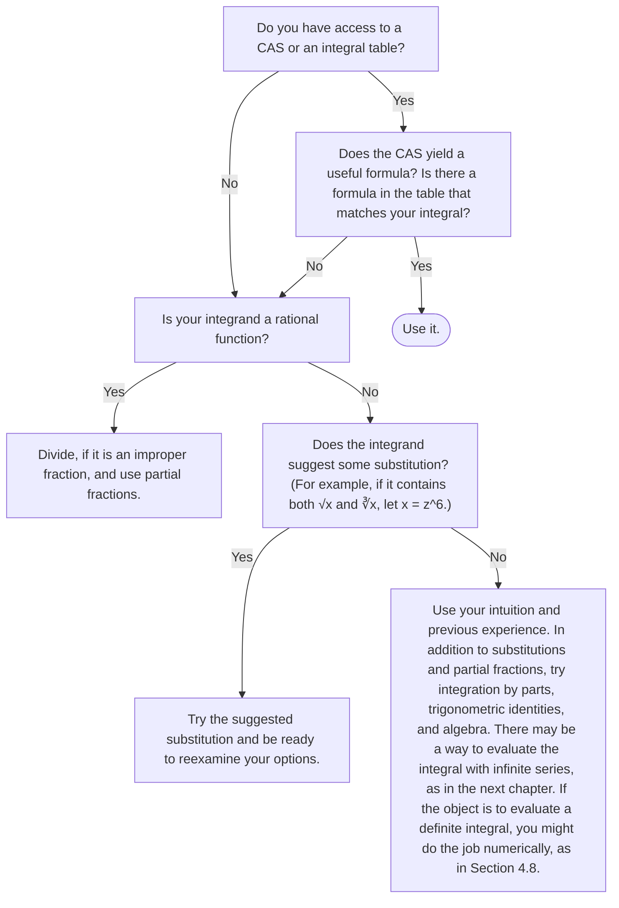

# 7.1 Basic Integration Formulas

When modeling real-world phenomena and measuring geometric or physical quantities, we frequently encounter integrals that are far more involved than the elementary antiderivatives seen in earlier chapters. While we know in principle that evaluating an indefinite integral requires finding an antiderivative of the integrand and adding an arbitrary constant $C$, complex models rarely hand us integrands that immediately match a known differentiation rule. The overarching goal of integration techniques is to systematically transform unfamiliar integrals into standard forms that we can recognize directly, look up in an integration table, or evaluate using a computer algebra system.

## Fundamental Integration Formulas

Before developing specialized algebraic and analytical techniques for transforming complicated integrands, we first consolidate the foundational integration formulas established from elementary derivatives. Every integration technique ultimately aims to reduce an unfamiliar integral to one or more of these eighteen standard forms.

> [!theorem] Basic Integration Formulas (Table 7.1)
> Let $u$ and $v$ be differentiable functions, $k$, $n$, and $a$ be constants, and $C$ be an arbitrary constant of integration.
> 
> | # | Integration Formula | Conditions / Alternative Forms |
> | :--- | :--- | :--- |
> | **1.** | $\int du = u + C$ | — |
> | **2.** | $\int k \, du = ku + C$ | Any number $k$ |
> | **3.** | $\int (du + dv) = \int du + \int dv$ | Linearity (sum/difference of differentials) |
> | **4.** | $\int u^n \, du = \frac{u^{n+1}}{n+1} + C$ | $n \neq -1$ |
> | **5.** | $\int \frac{du}{u} = \ln \|u\| + C$ | $u \neq 0$ |
> | **6.** | $\int \sin u \, du = -\cos u + C$ | — |
> | **7.** | $\int \cos u \, du = \sin u + C$ | — |
> | **8.** | $\int \sec^2 u \, du = \tan u + C$ | — |
> | **9.** | $\int \csc^2 u \, du = -\cot u + C$ | — |
> | **10.** | $\int \sec u \tan u \, du = \sec u + C$ | — |
> | **11.** | $\int \csc u \cot u \, du = -\csc u + C$ | — |
> | **12.** | $\int \tan u \, du = -\ln \|\cos u\| + C$ | $= \ln \|\sec u\| + C$ |
> | **13.** | $\int \cot u \, du = \ln \|\sin u\| + C$ | $= -\ln \|\csc u\| + C$ |
> | **14.** | $\int e^u \, du = e^u + C$ | — |
> | **15.** | $\int a^u \, du = \frac{a^u}{\ln a} + C$ | $a > 0, \quad a \neq 1$ |
> | **16.** | $\int \frac{du}{\sqrt{a^2 - u^2}} = \sin^{-1}\left(\frac{u}{a}\right) + C$ | $a > 0$ |
> | **17.** | $\int \frac{du}{a^2 + u^2} = \frac{1}{a} \tan^{-1}\left(\frac{u}{a}\right) + C$ | $a > 0$ |
> | **18.** | $\int \frac{du}{u\sqrt{u^2 - a^2}} = \frac{1}{a} \sec^{-1}\left\|\frac{u}{a}\right\| + C$ | $a > 0$ |

Notice how these eighteen formulas organize naturally by function family. Formulas 1 through 3 capture the basic differential identity and the linearity of the indefinite integral, allowing us to pull out constant multiples and integrate term by term. Formulas 4 and 5 govern all real powers of $u$: the general power rule handles every exponent $n \neq -1$, while the reciprocal case $n = -1$ bridges algebraic powers to the natural logarithm $\ln |u|$. Formulas 6 through 13 cover the trigonometric functions—both the direct reverses of the six basic trigonometric derivatives (Formulas 6–11) and the logarithmic antiderivatives for $\tan u$ and $\cot u$ obtained by rewriting them as ratios of sine and cosine (Formulas 12–13). Finally, Formulas 14 and 15 handle natural and general base-$a$ exponential functions, while Formulas 16 through 18 recognize quadratic expressions in $u^2$ and $a^2$ as derivatives of the inverse trigonometric functions $\sin^{-1}$, $\tan^{-1}$, and $\sec^{-1}$.

## Algebraic and Trigonometric Procedures for Matching Integrals

When an integral does not immediately match any entry in Table 7.1, why can we not simply apply a formula right away? Usually, the obstacle is structural: the variable part of the integrand may be buried inside a composite expression, a quadratic may contain a linear cross-term, a trigonometric power or radical may block term-by-term integration, or a rational expression may be top-heavy. By applying targeted algebraic or trigonometric manipulations, we can reshape the integrand until one of the standard forms emerges.

### Making a Simplifying Substitution

The most fundamental strategy is to look for a composite structure where part of the integrand is proportional to the derivative of another part. If we can identify an inner expression $u = g(x)$ whose differential $du = g'(x) \, dx$ accounts for the remaining factors in the integrand (up to a constant multiple), the substitution transforms a seemingly complicated integral in $x$ directly into a basic formula in $u$, such as the power rule $\int u^n \, du$ or the logarithmic form $\int \frac{du}{u}$.

### Completing the Square

What should we do when an integrand contains a general quadratic expression of the form $ax^2 + bx + c$ inside a denominator or beneath a square root, such as $\int \frac{dx}{\sqrt{8x - x^2}}$? Looking at Formulas 16 through 18 in Table 7.1, we see that the inverse trigonometric forms only contain squares of the variable $u$ and a constant $a$—namely $\sqrt{a^2 - u^2}$, $a^2 + u^2$, or $u\sqrt{u^2 - a^2}$—with no first-degree term in $u$.

Whenever a first-degree term is present in a quadratic, we can eliminate it by **completing the square**. By factoring out the leading sign or coefficient, adding and subtracting the square of half the linear coefficient, and grouping the perfect square trinomial, we rewrite the quadratic into a sum or difference of squares involving a shifted linear term $(x - h)^2$ and a constant $a^2$. Making the simple translation substitution $u = x - h$ (for which $du = dx$) then reduces the integral directly to one of the standard inverse trigonometric forms in Formulas 16–18.

### Expanding a Power and Using a Trigonometric Identity

When an integrand involves an algebraic power of a sum or difference of functions—such as $(\sec x + \tan x)^2$—we cannot integrate the base directly as a power of $u$ unless its derivative is also present as a factor. Instead, we first expand the power algebraically.

In trigonometric integrals, expanding a binomial power often produces a mix of familiar derivative pairs alongside squared trigonometric terms like $\tan^2 x$ or $\cot^2 x$ that do not appear directly as integrands in Table 7.1. However, Table 7.1 *does* include the integrals of $\sec^2 x$ and $\csc^2 x$ (Formulas 8 and 9). We can bridge the gap using the Pythagorean identities:

$$
\begin{aligned}
\tan^2 x + 1 = \sec^2 x \quad &\iff \quad \tan^2 x = \sec^2 x - 1 \\
\cot^2 x + 1 = \csc^2 x \quad &\iff \quad \cot^2 x = \csc^2 x - 1
\end{aligned}
$$

Replacing $\tan^2 x$ with $\sec^2 x - 1$ (or $\cot^2 x$ with $\csc^2 x - 1$) converts the expanded integrand entirely into terms that integrate immediately via Table 7.1.

### Eliminating a Square Root

Square roots of trigonometric expressions, such as $\sqrt{1 + \cos 4x}$, pose a challenge because the sum inside the radical prevents us from taking the square root term by term, and the absence of a $\sin 4x$ factor prevents a simple substitution. To eliminate the square root, we need to turn the sum $1 + \cos(2\theta)$ inside the radical into a single squared quantity.

We achieve this by invoking the half-angle (or double-angle) identity for cosine:

$$
\cos^2 \theta = \frac{1 + \cos 2\theta}{2} \quad \iff \quad 1 + \cos 2\theta = 2\cos^2 \theta
$$

(and analogously $\sin^2 \theta = \frac{1 - \cos 2\theta}{2} \iff 1 - \cos 2\theta = 2\sin^2 \theta$). Substituting $1 + \cos 2\theta = 2\cos^2 \theta$ underneath the radical collapses the sum into a perfect square up to a factor of $2$:

$$
\sqrt{1 + \cos 2\theta} = \sqrt{2\cos^2 \theta} = \sqrt{2} \, |\cos \theta|
$$

> [!warning] Absolute Values When Eliminating Even Roots
> For any real quantity $u$, the principal square root of a square is the absolute value, $\sqrt{u^2} = |u|$, not simply $u$. When simplifying $\sqrt{\cos^2 \theta} = |\cos \theta|$ in a definite integral, you must inspect the sign of $\cos \theta$ on the interval of integration before dropping the absolute value bars. On subintervals where $\cos \theta \ge 0$, $|\cos \theta| = \cos \theta$; on subintervals where $\cos \theta < 0$, $|\cos \theta| = -\cos \theta$.

### Reducing an Improper Fraction

When integrating a rational function—a ratio of two polynomials $\frac{P(x)}{Q(x)}$—the first thing we must check is the relative degree of the numerator and denominator.

> [!abstract] Definition: Improper and Proper Rational Fractions
> A rational expression $\frac{P(x)}{Q(x)}$ is called an **improper fraction** if the degree of the numerator polynomial $P(x)$ is greater than or equal to the degree of the denominator polynomial $Q(x)$ ($\deg P \ge \deg Q$). If the degree of the numerator is strictly less than the degree of the denominator ($\deg P < \deg Q$), the rational expression is called a **proper fraction**.

To integrate an improper fraction, we first perform **polynomial long division**, dividing the denominator $Q(x)$ into the numerator $P(x)$ to obtain a polynomial quotient $Q_{\text{quot}}(x)$ plus a remainder $R(x)$ with $\deg R < \deg Q$:

$$
\frac{P(x)}{Q(x)} = Q_{\text{quot}}(x) + \frac{R(x)}{Q(x)}
$$

The polynomial quotient $Q_{\text{quot}}(x)$ can always be integrated immediately term by term using the power rule, leaving only the simpler proper fraction $\frac{R(x)}{Q(x)}$ to evaluate.

> [!note] Limitation of Long Division Alone
> Reducing an improper fraction by polynomial long division does not always produce a proper fraction $\frac{R(x)}{Q(x)}$ that we can integrate directly using a single substitution or basic formula. When the denominator of the resulting proper fraction has degree two or higher, additional decomposition techniques—such as partial fractions—are required.

### Separating a Fraction

Why does a fraction with a multi-term numerator over a single denominator, such as $\frac{A(x) + B(x)}{D(x)}$, often resist a single substitution? Frequently, one part of the numerator is proportional to the derivative of an expression in the denominator (inviting a $u$-substitution), while another part is a constant that matches an inverse trigonometric or logarithmic formula. Trying to handle the entire numerator at once mixes two incompatible integration mechanisms.

By algebraically **separating the fraction** over its common denominator,

$$
\int \frac{A(x) + B(x)}{D(x)} \, dx = \int \frac{A(x)}{D(x)} \, dx + \int \frac{B(x)}{D(x)} \, dx
$$

we decouple the terms so that each resulting integral can be matched independently to its appropriate basic formula. When combining the antiderivatives of the separated integrals, their individual arbitrary constants $C_1$ and $C_2$ are consolidated into a single constant $C = C_1 + C_2$.

### Multiplying by a Form of $1$ and the Secant and Cosecant Integrals

Sometimes an integrand contains neither an obvious inner function nor an algebraic sum that can be split or expanded, yet multiplying and dividing the integrand by a cleverly chosen expression $h(x)$—that is, multiplying by $\frac{h(x)}{h(x)} = 1$—creates a numerator that is the exact derivative of the new denominator.

This exact strategy unlocks two critical trigonometric integrals that were missing from Table 7.1: the integrals of $\sec u$ and $\csc u$. While Table 7.1 lists the integrals of $\sin u$, $\cos u$, $\tan u$, and $\cot u$, how do we evaluate $\int \sec u \, du$ and $\int \csc u \, du$?

> [!theorem] The Secant and Cosecant Integrals (Table 7.2)
> For any differentiable function $u$,
> 1. **Secant Integral:**
>    $$
>    \int \sec u \, du = \ln |\sec u + \tan u| + C
>    $$
> 2. **Cosecant Integral:**
>    $$
>    \int \csc u \, du = -\ln |\csc u + \cot u| + C
>    $$

**Proof:**
To evaluate $\int \sec x \, dx$, we multiply the integrand $\sec x$ by $1$ written in the algebraic form $\frac{\sec x + \tan x}{\sec x + \tan x}$:

$$
\begin{aligned}
\int \sec x \, dx &= \int (\sec x)(1) \, dx \\
&= \int \sec x \cdot \frac{\sec x + \tan x}{\sec x + \tan x} \, dx \\
&= \int \frac{\sec^2 x + \sec x \tan x}{\sec x + \tan x} \, dx
\end{aligned}
$$

Why did we choose $\sec x + \tan x$? Look closely at the denominator $u = \tan x + \sec x$: differentiating $u$ with respect to $x$ gives $du = (\sec^2 x + \sec x \tan x) \, dx$, which is the exact numerator of our rewritten fraction! Substituting $u = \tan x + \sec x$ therefore reduces the integral to the basic logarithmic form (Formula 5 of Table 7.1):

$$
\begin{aligned}
\int \frac{\sec^2 x + \sec x \tan x}{\sec x + \tan x} \, dx &= \int \frac{du}{u} \\
&= \ln |u| + C \\
&= \ln |\sec x + \tan x| + C
\end{aligned}
$$

Replacing secants and tangents with cosecants and cotangents—specifically, multiplying $\csc u$ by $\frac{\csc u + \cot u}{\csc u + \cot u}$ and noting that $d(\csc u + \cot u) = (-\csc u \cot u - \csc^2 u) \, du$—yields the companion formula $\int \csc u \, du = -\ln |\csc u + \cot u| + C$. $\blacksquare$

## Summary of Procedures for Matching Integrals to Basic Formulas

To consolidate the algebraic and trigonometric strategies developed in this section, the table below summarizes each procedure alongside a representative transformation showing how an unfamiliar expression is reshaped into a form that matches Table 7.1.

| Procedure | Representative Transformation |
| :--- | :--- |
| **Making a simplifying substitution** | $\frac{2x - 9}{\sqrt{x^2 - 9x + 1}} \, dx = \frac{du}{\sqrt{u}}$ $\quad$ (with $u = x^2 - 9x + 1$, $du = (2x - 9) \, dx$) |
| **Completing the square** | $\sqrt{8x - x^2} = \sqrt{16 - (x - 4)^2}$ |
| **Using a trigonometric identity** | $(\sec x + \tan x)^2 = \sec^2 x + 2\sec x \tan x + \tan^2 x$ $= \sec^2 x + 2\sec x \tan x + (\sec^2 x - 1) = 2\sec^2 x + 2\sec x \tan x - 1$ |
| **Eliminating a square root** | $\sqrt{1 + \cos 4x} = \sqrt{2\cos^2 2x} = \sqrt{2} \, \|\cos 2x\|$ |
| **Reducing an improper fraction** | $\frac{3x^2 - 7x}{3x + 2} = x - 3 + \frac{6}{3x + 2}$ |
| **Separating a fraction** | $\frac{3x + 2}{\sqrt{1 - x^2}} = \frac{3x}{\sqrt{1 - x^2}} + \frac{2}{\sqrt{1 - x^2}}$ |
| **Multiplying by a form of $1$** | $\sec x = \sec x \cdot \frac{\sec x + \tan x}{\sec x + \tan x} = \frac{\sec^2 x + \sec x \tan x}{\sec x + \tan x}$ |

---

# 7.2 Integration by Parts

In Section 7.1, we saw how algebraic rearrangements and simple $u$-substitutions can reshape unfamiliar integrals into entries from Table 7.1. However, many common integrals—especially products of unrelated function families such as polynomials, exponentials, logarithms, and trigonometric functions—lack the inner-derivative structure required for substitution.

**Integration by parts** is a technique designed to simplify integrals of the product form
$$
\int f(x)g(x) \, dx
$$
in which $f$ can be differentiated repeatedly and $g$ can be integrated repeatedly without difficulty. Two classic structural patterns illustrate where this technique excels:

1. **Polynomial-Type Products (Eventual Termination):** In an integral such as $\int x e^x \, dx$, the factor $f(x) = x$ can be differentiated repeatedly (twice, in this case) to become zero, while $g(x) = e^x$ can be integrated repeatedly without difficulty.
2. **Cyclic Products (Self-Replication):** In an integral such as $\int e^x \sin x \, dx$, neither factor differentiates to zero, but each part of the integrand appears again after repeated differentiation or integration, allowing us to solve for the unknown integral algebraically.

## The Integration-by-Parts Formula

### Indefinite Integral Formulation

Just as the substitution method reverses the Chain Rule for derivatives, integration by parts reverses the **Product Rule**.

> [!theorem] The Integration-by-Parts Formula
> If $u$ and $v$ are differentiable functions, then
> $$
> \int u \, dv = uv - \int v \, du
> $$

**Proof:**
By the Product Rule for derivatives, the derivative of the product $uv$ with respect to $x$ is
$$
\frac{d}{dx}(uv) = u\frac{dv}{dx} + v\frac{du}{dx}
$$
Writing this identity in differential form gives
$$
d(uv) = u \, dv + v \, du
$$
Rearranging terms to isolate $u \, dv$ on the left-hand side yields

$$
u \, dv = d(uv) - v \, du
$$

Integrating both sides of this differential equation produces the integration-by-parts formula:
$$
\int u \, dv = uv - \int v \, du
$$
$\blacksquare$

What makes this formula so useful? Notice that the integration-by-parts formula does not evaluate $\int u \, dv$ outright; instead, it expresses one integral, $\int u \, dv$, in terms of a second integral, $\int v \, du$. With a proper choice of $u$ and $v$, the second integral $\int v \, du$ is simpler to evaluate than the original integral $\int u \, dv$. Whenever we face an integral we cannot handle directly, integration by parts lets us trade it for a new integral with which we might have greater success.

> [!note] Choosing the Simplest Antiderivative for $v$
> When integrating the differential $dv$ to obtain $v$, any antiderivative $v + C_1$ is valid because the constant $C_1$ cancels out between the $uv$ term and the $-\int v \, du$ term. Therefore, we always choose the **simplest antiderivative** of $dv$ (setting the intermediate constant of integration to zero) and append the single arbitrary constant $C$ at the very end of the integration.

### Definite Integral Formulation and Geometric Interpretation

When evaluating a definite integral by parts, we apply the limits of integration to both the integrated product term $uv$ and the remaining integral.

> [!theorem] Integration by Parts for Definite Integrals
> In terms of the variable limits $(v_1, u_1)$ and $(v_2, u_2)$, the equivalent formula for definite integrals is
> $$
> \int_{v_1}^{v_2} u \, dv = (u_2 v_2 - u_1 v_1) - \int_{u_1}^{u_2} v \, du
> $$
> Equivalently, when $u = u(x)$ and $v = v(x)$ are expressed as functions of $x$ on the interval $[a, b]$,
> $$
> \int_a^b u \, dv = \left[uv\right]_a^b - \int_a^b v \, du
> $$

![[07. Techniques Of Integration-1794898886550.webp]]

Figure 7.1 reveals how the three terms of the definite integration-by-parts formula can be interpreted geometrically as areas in the $(v, u)$-plane. Suppose a curve is described by $u = f(v)$ with inverse $v = f^{-1}(u)$ over the first-quadrant interval from $(v_1, u_1)$ to $(v_2, u_2)$:

- The integral $\int_{v_1}^{v_2} u \, dv$ represents the area of the region between the curve $u = f(v)$ and the horizontal $v$-axis from $v_1$ to $v_2$.
- The integral $\int_{u_1}^{u_2} v \, du$ represents the area of the region between the curve $v = f^{-1}(u)$ and the vertical $u$-axis from $u_1$ to $u_2$.
- Together with the small inner rectangle of area $u_1 v_1$ near the origin, these two regions partition the large outer rectangle of total area $u_2 v_2$. Subtracting the areas of the inner rectangle $u_1 v_1$ and the vertical-axis region $\int_{u_1}^{u_2} v \, du$ from the large rectangle $u_2 v_2$ leaves precisely the area $\int_{v_1}^{v_2} u \, dv$:

$$
\int_{v_1}^{v_2} u \, dv = (u_2 v_2 - u_1 v_1) - \int_{u_1}^{u_2} v \, du
$$

## When and How to Use Integration by Parts

### Guidelines for Choosing $u$ and $dv$

How do we decide when to reach for integration by parts, and how should we split an integrand into $u$ and $dv$?

1. **When to Use:** If a simplifying substitution does not work, try integration by parts.
2. **How to Partition the Integrand:** Start with an integral of the form
   $$
   \int f(x)g(x) \, dx
   $$
   Match this with an integral of the form
   $$
   \int u \, dv
   $$
   by choosing $dv$ to be part of the integrand including $dx$ and possibly $f(x)$ or $g(x)$, leaving the remaining factor as $u$.
3. **Guideline for Selecting $u$ and $dv$:** Because the formula $\int u \, dv = uv - \int v \, du$ produces a new integral $\int v \, du$ on the right-hand side, two criteria govern the split:
   - First, we must be able to integrate $dv$ readily to find $v$.
   - Second, the new integral $\int v \, du$ should be simpler than the original integral $\int u \, dv$. If the new integral is more complex than the original one, abandon that split and try a different choice for $u$ and $dv$.

To see why the choice of $u$ and $dv$ is decisive, consider the four possible ways to partition a product such as $\int x \cos x \, dx = \int u \, dv$:

- **Choice 1 ($u = 1$ and $dv = x \cos x \, dx$):** Unusable, because we do not know how to integrate $dv = x \cos x \, dx$ to find $v$ in the first place.
- **Choice 2 ($u = x \cos x$ and $dv = dx$):** Differentiating $u$ via the Product Rule gives $du = (\cos x - x \sin x) \, dx$ while $v = x$, producing the new integral $\int v \, du = \int (x \cos x - x^2 \sin x) \, dx$, which is strictly worse than the integral we started with.
- **Choice 3 ($u = \cos x$ and $dv = x \, dx$):** Differentiating $u$ gives $du = -\sin x \, dx$ while integrating $dv$ raises the power of $x$ to $v = \frac{x^2}{2}$, leading to $\int v \, du = -\int \frac{x^2}{2} \sin x \, dx$. Increasing the degree of the algebraic factor makes the integral more complex rather than simpler.
- **Choice 4 ($u = x$ and $dv = \cos x \, dx$):** Differentiating $u = x$ simplifies it to $du = dx$, while $dv = \cos x \, dx$ integrates easily to $v = \sin x$. This reduces $\int v \, du$ to the basic integral $\int \sin x \, dx$, solving the problem immediately:
  $$
  \int x \cos x \, dx = x \sin x - \int \sin x \, dx = x \sin x + \cos x + C
  $$

> [!summary] Strategic Objective of Integration by Parts
> Always keep in mind that the objective is to go from $\int u \, dv$ to a new integral $\int v \, du$ that is simpler. Integration by parts does not always work for every integrand, so we cannot always achieve this goal, but whenever a factor simplifies upon differentiation while the remaining factor can be integrated without difficulty, choosing the differentiating factor as $u$ is the key.

### Integrands with a Single Factor

At first glance, integration by parts appears to require a product of two distinct functions $f(x)$ and $g(x)$. Yet the method is equally valuable when the integrand has only a **single visible factor**, such as $\int \ln x \, dx$ or $\int \cos^{-1} x \, dx$ (and other inverse trigonometric or logarithmic functions).

Why does integration by parts work on a single factor? Although we do not have an elementary integration formula for $\ln x$ or $\cos^{-1} x$ in Table 7.1, their *derivatives* are purely algebraic functions ($\frac{1}{x}$ and $-\frac{1}{\sqrt{1 - x^2}}$, respectively). By viewing the integrand as a product with $1$—writing $\int \ln x \, dx$ as $\int \ln x \cdot 1 \, dx$—we can assign:

- $u = \ln x$, which simplifies to the algebraic differential $du = \frac{1}{x} \, dx$ when differentiated.
- $dv = dx$, which is trivial to integrate to its simplest antiderivative $v = x$.

Applying $\int u \, dv = uv - \int v \, du$ then cancels the algebraic factors inside the new integral:

$$
\begin{aligned}
\int \ln x \, dx &= x \ln x - \int x \cdot \frac{1}{x} \, dx \\
&= x \ln x - \int dx \\
&= x \ln x - x + C
\end{aligned}
$$

## Repeated Use and Cyclic Integrals

### Repeated Integration by Parts

Sometimes a single application of integration by parts moves us closer to a basic formula without finishing the job in one step. This occurs whenever the factor chosen for $u$ (such as a higher-degree polynomial $x^n$ with $n \ge 2$) requires multiple differentiations to reduce to a constant.

For instance, in an integral of the form $\int x^2 e^x \, dx$, setting $u = x^2$ and $dv = e^x \, dx$ (so $du = 2x \, dx$ and $v = e^x$) yields

$$
\int x^2 e^x \, dx = x^2 e^x - 2 \int x e^x \, dx
$$

While $\int x e^x \, dx$ is still a product, the degree of $x$ has dropped from $2$ to $1$. Applying integration by parts a second time to $\int x e^x \, dx$ with $u = x$ and $dv = e^x \, dx$ reduces the remaining integral to $\int e^x \, dx = e^x$, completing the evaluation. In general, an integrand of the form $x^n e^{ax}$, $x^n \sin(ax)$, or $x^n \cos(ax)$ requires $n$ successive integrations by parts to eliminate the power $x^n$.

### Solving for the Unknown Integral

What happens when neither factor in $\int f(x)g(x) \, dx$ eventually differentiates to zero, as in integrals of the form $\int e^{ax} \cos bx \, dx$ or $\int e^{ax} \sin bx \, dx$ that arise frequently in electrical engineering?

In these **cyclic integrals**, differentiating or integrating either factor repeatedly regenerates the original functions up to sign and constant multiples. Their evaluation requires **two integrations by parts, followed by solving algebraically for the unknown integral**.

To understand the mechanism, consider $\int e^x \cos x \, dx$:

1. **First Integration by Parts:** Let $u = e^x$ and $dv = \cos x \, dx$, so $du = e^x \, dx$ and $v = \sin x$. Then
   $$
   \int e^x \cos x \, dx = e^x \sin x - \int e^x \sin x \, dx
   $$
2. **Second Integration by Parts:** The new integral $\int e^x \sin x \, dx$ has the same form as the original integral except with $\sin x$ in place of $\cos x$. Applying integration by parts a second time with the consistent choice $u = e^x$ and $dv = \sin x \, dx$ (so $du = e^x \, dx$ and $v = -\cos x$) gives
   $$
   \begin{aligned}
   \int e^x \cos x \, dx &= e^x \sin x - \left(-e^x \cos x - \int (-\cos x)(e^x \, dx)\right) \\
   &= e^x \sin x + e^x \cos x - \int e^x \cos x \, dx
   \end{aligned}
   $$
3. **Solving Algebraically for the Unknown Integral:** Notice that the unknown integral $\int e^x \cos x \, dx$ now appears on both sides of the equation with opposite signs. Adding $\int e^x \cos x \, dx$ to both sides combines the two integral expressions:
   $$
   2 \int e^x \cos x \, dx = e^x \sin x + e^x \cos x + C
   $$
   Dividing by $2$ and renaming the arbitrary constant of integration $C' = \frac{C}{2}$ yields the closed-form antiderivative:
   $$
   \int e^x \cos x \, dx = \frac{e^x \sin x + e^x \cos x}{2} + C'
   $$

> [!warning] Role Consistency in Cyclic Integrations by Parts
> In the first step of evaluating $\int e^x \cos x \, dx$, choosing $u = e^x$ and $dv = \cos x \, dx$ (rather than $u = \cos x$ and $dv = e^x \, dx$) is arbitrary—either initial assignment works. However, once you have chosen which factor to differentiate and which to integrate in the first step, **your choice in the second integration by parts is no longer arbitrary**.
>
> If you switch roles in the second integration—for instance, choosing $u = \sin x$ and $dv = e^x \, dx$ after having chosen $u = e^x$ and $dv = \cos x \, dx$ in the first—the second integration simply undoes the first:
> $$
> \begin{aligned}
> \int e^x \cos x \, dx &= e^x \sin x - \left(e^x \sin x - \int e^x \cos x \, dx\right) \\
> &= \int e^x \cos x \, dx
> \end{aligned}
> $$
> The resulting identity $I = I$ is true, but completely useless because the boundary terms cancel out! **Moral:** Once you have decided on what to differentiate and integrate in cyclic circumstances like these, stick with that choice across all steps.

## Tabular Integration

We have seen that integrals of the form $\int f(x)g(x) \, dx$, in which $f$ can be differentiated repeatedly to become zero and $g$ can be integrated repeatedly without difficulty, are natural candidates for integration by parts. However, when many repetitions are required (such as when $f(x) = x^3$ or a higher-degree polynomial), writing out each recursive integration-by-parts equation becomes cumbersome.

**Tabular integration** is an organizational method that streamlines repeated integration by parts into a compact two-column table, saving a great deal of algebraic work.

> [!abstract] Procedure: Tabular Integration
> To evaluate $\int f(x)g(x) \, dx$ when $f(x)$ differentiates to $0$ after $n$ derivatives and $g(x)$ can be integrated repeatedly:
> 1. **Construct Two Columns:**
>    - In the left column, titled **$f(x)$ and its derivatives**, list $f(x)$ followed by its successive derivatives $f'(x), f''(x), \dots, f^{(n)}(x) = 0$ until you reach $0$.
>    - In the right column, titled **$g(x)$ and its integrals**, list $g(x)$ alongside $f(x)$, followed row by row by its successive antiderivatives $G_1(x), G_2(x), \dots, G_n(x)$ (with all integration constants omitted) down to the row containing $0$.
> 2. **Connect Diagonal Products with Alternating Signs:**
>    - Draw a diagonal arrow from each non-zero entry in the left column to the entry **one row lower** in the right column (matching $f(x)$ with $G_1(x)$, $f'(x)$ with $G_2(x)$, and so on).
>    - Label the arrows with alternating algebraic signs, always beginning with $(+)$ on the first arrow: $(+), (-), (+), (-), \dots$
> 3. **Sum the Signed Diagonal Products:**
>    - Add the products of the functions connected by the arrows, applying the sign attached to each arrow, and append $+ C$ at the end:
>      $$
>      \int f(x)g(x) \, dx = +f(x)G_1(x) - f'(x)G_2(x) + f''(x)G_3(x) - \cdots + (-1)^{n-1} f^{(n-1)}(x)G_n(x) + C
>      $$

Why does this table reproduce repeated integration by parts? In the first pass of $\int u \, dv = uv - \int v \, du$ with $u = f(x)$ and $dv = g(x) \, dx$, the boundary term $+uv$ is precisely the first diagonal product $+f(x)G_1(x)$, while the minus sign in front of $-\int v \, du = -\int f'(x)G_1(x) \, dx$ flips the sign of the next boundary term to $-f'(x)G_2(x)$. Each subsequent integration by parts introduces another factor of $-1$ on the remaining integral, causing the signs along the diagonal arrows to alternate $(+), (-), (+), (-), \dots$ until $f^{(n)}(x) = 0$ makes the final remaining integral vanish.

For example, when evaluating $\int x^3 \sin x \, dx$ with $f(x) = x^3$ and $g(x) = \sin x$, the tabular arrangement takes the form:

| $f(x)$ and its derivatives | Sign & Diagonal Connection | $g(x)$ and its integrals | Resulting Term (with Sign) |
| :--- | :---: | :--- | :--- |
| $x^3$ | $\xrightarrow{(+) \text{ to row 2}}$ | $\sin x$ | — |
| $3x^2$ | $\xrightarrow{(-) \text{ to row 3}}$ | $-\cos x$ | $+(x^3)(-\cos x) = -x^3 \cos x$ |
| $6x$ | $\xrightarrow{(+) \text{ to row 4}}$ | $-\sin x$ | $-(3x^2)(-\sin x) = +3x^2 \sin x$ |
| $6$ | $\xrightarrow{(-) \text{ to row 5}}$ | $\cos x$ | $+(6x)(\cos x) = +6x \cos x$ |
| $0$ | *(terminates)* | $\sin x$ | $-(6)(\sin x) = -6 \sin x$ |

Summing the signed products connected by the arrows immediately yields

$$
\int x^3 \sin x \, dx = -x^3 \cos x + 3x^2 \sin x + 6x \cos x - 6 \sin x + C
$$

without writing out four separate rounds of integration by parts.

---

# 7.3 Partial Fractions

In Section 7.1, we saw that an improper rational function can be reduced by polynomial long division into a polynomial plus a proper fraction, but we also noted that long division alone does not tell us how to integrate a proper fraction whose denominator has degree two or higher. How do we integrate a general rational function $\frac{f(x)}{g(x)}$ when a simple $u$-substitution does not match the numerator?

A fundamental theorem from advanced algebra states that every rational function, no matter how complicated, can be rewritten as a sum of simpler fractions that we can integrate using techniques we already know. For instance, the rational expression $\frac{5x - 3}{x^2 - 2x - 3}$ can be decomposed into the sum

$$
\frac{5x - 3}{x^2 - 2x - 3} = \frac{2}{x + 1} + \frac{3}{x - 3}
$$

While the fraction on the left does not match any single formula in Table 7.1, the two fractions on the right integrate immediately to natural logarithms:

$$
\begin{aligned}
\int \frac{5x - 3}{(x + 1)(x - 3)} \, dx &= \int \frac{2}{x + 1} \, dx + \int \frac{3}{x - 3} \, dx \\
&= 2\ln |x + 1| + 3\ln |x - 3| + C
\end{aligned}
$$

Reversing the process of adding fractions over a common denominator transforms an intractable rational integral into a sum of elementary logarithmic, power-rule, and inverse trigonometric integrals.

## Core Principles of Partial-Fraction Decomposition

### Partial Fractions and Undetermined Coefficients

Suppose we know that the denominator of $\frac{5x - 3}{x^2 - 2x - 3}$ factors into $(x + 1)(x - 3)$, so that the fraction can be split into pieces with denominators $x + 1$ and $x - 3$, but we do not yet know the numerators $2$ and $3$. How do we find them systematically? We introduce unknown constants $A$ and $B$ and write

$$
\frac{5x - 3}{x^2 - 2x - 3} = \frac{A}{x + 1} + \frac{B}{x - 3}
$$

> [!abstract] Definition: Method of Partial Fractions and Undetermined Coefficients
> The algebraic method for rewriting a rational function as a sum of simpler component fractions is called the **method of partial fractions**. In a decomposition such as
> $$
> \frac{5x - 3}{x^2 - 2x - 3} = \frac{A}{x + 1} + \frac{B}{x - 3}
> $$
> the component fractions $\frac{A}{x + 1}$ and $\frac{B}{x - 3}$ are called **partial fractions** because their denominators are only part of the original denominator $x^2 - 2x - 3$. The unknown constants $A$ and $B$ in their numerators are called **undetermined coefficients** until proper values for them have been found.

Why can we solve for multiple unknown constants from what looks like a single equation? The key is that a partial-fraction decomposition is not an equation to be solved for a specific value of $x$; rather, it must hold as an **algebraic identity** for all values of $x$ (where the denominators are nonzero). Two polynomials in $x$ are identically equal for all $x$ if and only if the coefficients of like powers of $x$ on the two sides are equal.

> [!abstract] Procedure: How to Evaluate Undetermined Coefficients
> 1. **Clear Fractions:** Multiply both sides of the given partial-fraction equation by the common denominator $g(x)$ to clear the equation of fractions.
> 2. **Equate Coefficients of Like Terms:** Expand and group the right-hand side by powers of $x$, then equate the coefficients of like terms (powers of $x$) on both sides of the polynomial identity.
> 3. **Solve for the Coefficients:** Solve the resulting system of simultaneous linear equations for the undetermined coefficients.

Applying this procedure to $\frac{5x - 3}{(x + 1)(x - 3)} = \frac{A}{x + 1} + \frac{B}{x - 3}$, we multiply both sides by $(x + 1)(x - 3)$ to clear fractions and group like powers of $x$:

$$
5x - 3 = A(x - 3) + B(x + 1) = (A + B)x - 3A + B
$$

Equating the coefficients of $x^1$ and $x^0$ on the two sides produces two linear equations in two unknowns:

$$
A + B = 5, \qquad -3A + B = -3
$$

Subtracting the second equation from the first gives $4A = 8$, so $A = 2$, and substituting back yields $B = 3$.

### Structural Cases of Rational Integrands

Before stating the general algorithm for any rational function, let us examine how the algebraic structure of the fraction—specifically, its degree and the types of factors in its denominator—dictates the form of its partial fractions.

#### 1. Distinct Linear Factors in the Denominator

When a proper fraction has a denominator that factors into distinct first-degree factors $(x + p)(x + q)$, each distinct linear factor receives a single partial fraction with a constant numerator:

$$
\frac{\text{numerator}}{(x + p)(x + q)} = \frac{A}{x + p} + \frac{B}{x + q}
$$

Each resulting term $\int \frac{A}{x + p} \, dx = A\ln |x + p|$ integrates immediately to a natural logarithm.

#### 2. Repeated Linear Factors in the Denominator

What happens if a linear factor in the denominator is repeated, such as $(x + 2)^2$ in $\frac{6x + 7}{(x + 2)^2}$? If we tried to write only a single constant over $(x + 2)^2$, we could never match the first-degree numerator $6x + 7$. Instead, a repeated linear factor $(x + p)^2$ requires **one partial fraction for each power of the factor** from $1$ up to its multiplicity:

$$
\frac{\text{numerator}}{(x + p)^2} = \frac{A}{x + p} + \frac{B}{(x + p)^2}
$$

For $\frac{6x + 7}{(x + 2)^2}$, writing

$$
\frac{6x + 7}{(x + 2)^2} = \frac{A}{x + 2} + \frac{B}{(x + 2)^2}
$$

and clearing fractions gives $6x + 7 = A(x + 2) + B = Ax + (2A + B)$. Matching coefficients of like terms yields $A = 6$ and $2A + B = 7 \implies B = -5$, so

$$
\frac{6x + 7}{(x + 2)^2} = \frac{6}{x + 2} - \frac{5}{(x + 2)^2}
$$

Here, the first partial fraction integrates via the natural logarithm, while the second integrates via the power rule $\int (x + 2)^{-2} \, dx = -(x + 2)^{-1}$.

#### 3. Improper Rational Fractions

Partial-fraction templates only work when the rational expression is a **proper fraction** ($\deg f < \deg g$). Why? Because any sum of proper partial fractions over a common denominator $g(x)$ automatically has a numerator of degree strictly less than $\deg g(x)$, so it can never equal an improper fraction whose numerator has degree greater than or equal to $\deg g(x)$.

Whenever the degree of the numerator is greater than or equal to the degree of the denominator, we must **first divide the denominator into the numerator** by polynomial long division to obtain a polynomial plus a proper fraction, and then expand the proper fraction into partial fractions. For example, given the improper fraction $\frac{2x^3 - 4x^2 - x - 3}{x^2 - 2x - 3}$ (where $\deg f = 3 \ge \deg g = 2$), polynomial long division of $x^2 - 2x - 3$ into $2x^3 - 4x^2 - x - 3$ gives a quotient of $2x$ (since $2x(x^2 - 2x - 3) = 2x^3 - 4x^2 - 6x$) and a remainder of $(-x - 3) - (-6x) = 5x - 3$:

$$
\begin{aligned}
\frac{2x^3 - 4x^2 - x - 3}{x^2 - 2x - 3} &= 2x + \frac{5x - 3}{x^2 - 2x - 3} \\
&= 2x + \frac{2}{x + 1} + \frac{3}{x - 3}
\end{aligned}
$$

#### 4. Irreducible Quadratic Factors in the Denominator

Not every quadratic factor in a denominator can be split into two linear factors without introducing complex numbers.

> [!abstract] Definition: Irreducible Quadratic Polynomial
> A quadratic polynomial $ax^2 + bx + c$ is **irreducible** if it cannot be written as the product of two linear factors with real coefficients (equivalently, when its discriminant satisfies $b^2 - 4ac < 0$).

When a proper fraction contains an irreducible quadratic factor such as $x^2 + 1$ in the denominator, a single constant numerator is not general enough to account for all possible proper remainders upon division by a second-degree polynomial. Instead, **for quadratic factors, we use first-degree numerators ($Ax + B$), not constant numerators**.

For example, to decompose $\frac{-2x + 4}{(x^2 + 1)(x - 1)^2}$, whose denominator contains both the irreducible quadratic factor $x^2 + 1$ and the repeated linear factor $(x - 1)^2$, we write

$$
\frac{-2x + 4}{(x^2 + 1)(x - 1)^2} = \frac{Ax + B}{x^2 + 1} + \frac{C}{x - 1} + \frac{D}{(x - 1)^2}
$$

Clearing the equation of fractions and expanding in descending powers of $x$ gives

$$
\begin{aligned}
-2x + 4 &= (Ax + B)(x - 1)^2 + C(x - 1)(x^2 + 1) + D(x^2 + 1) \\
&= (A + C)x^3 + (-2A + B - C + D)x^2 + (A - 2B + C)x + (B - C + D)
\end{aligned}
$$

Equating coefficients of $x^3$, $x^2$, $x^1$, and $x^0$ yields the four-equation system

$$
\begin{aligned}
\text{Coefficients of } x^3: \quad 0 &= A + C \\
\text{Coefficients of } x^2: \quad 0 &= -2A + B - C + D \\
\text{Coefficients of } x^1: \quad -2 &= A - 2B + C \\
\text{Coefficients of } x^0: \quad 4 &= B - C + D
\end{aligned}
$$

Subtracting the fourth equation from the second immediately gives $-4 = -2A \implies A = 2$; the first equation then gives $C = -A = -2$; substituting $A + C = 0$ into the third equation gives $-2 = -2B \implies B = 1$; and the fourth equation yields $D = 4 - B + C = 1$.

Once we have found the first-degree numerator over an irreducible quadratic, how do we integrate a term like $\int \frac{2x + 1}{x^2 + 1} \, dx$? We use the **fraction-separation technique** from Section 7.1 to split the linear numerator into two pieces:

$$
\begin{aligned}
\int \frac{-2x + 4}{(x^2 + 1)(x - 1)^2} \, dx &= \int \left(\frac{2x + 1}{x^2 + 1} - \frac{2}{x - 1} + \frac{1}{(x - 1)^2}\right) dx \\
&= \int \left(\frac{2x}{x^2 + 1} + \frac{1}{x^2 + 1} - \frac{2}{x - 1} + \frac{1}{(x - 1)^2}\right) dx \\
&= \ln(x^2 + 1) + \tan^{-1} x - 2\ln |x - 1| - \frac{1}{x - 1} + C
\end{aligned}
$$

Notice how cleanly the two parts of $\frac{Ax + B}{x^2 + a^2}$ separate: the $\frac{Ax}{x^2 + a^2}$ piece is proportional to the derivative of the denominator and integrates to $\frac{A}{2}\ln(x^2 + a^2)$, while the constant piece $\frac{B}{x^2 + a^2}$ integrates directly to the inverse tangent $\frac{B}{a}\tan^{-1}\left(\frac{x}{a}\right)$. (If the irreducible quadratic has a middle $px$ term, $x^2 + px + q$, we complete the square first as in Section 7.1.)

## General Description of the Method

### Necessary Conditions for Partial-Fraction Expansion

Success in writing a rational function $\frac{f(x)}{g(x)}$ as a sum of partial fractions depends on two foundational conditions:

1. **The degree of $f(x)$ must be less than the degree of $g(x)$ ($\deg f < \deg g$).** That is, the fraction must be **proper**. If it is not, divide $g(x)$ into $f(x)$ by polynomial long division first and work with the remainder term.
2. **We must know the factors of $g(x)$.** In theory, a theorem from advanced algebra guarantees that any polynomial with real coefficients can be written as a product of real linear factors and real irreducible quadratic factors. In practice, finding these factors explicitly for high-degree polynomials may be difficult.

### The General Algorithm for Proper Rational Functions

A theorem from advanced algebra guarantees that when the two conditions above are met, any proper rational function $\frac{f(x)}{g(x)}$ can be uniquely decomposed into a sum of partial fractions via the following four-step method.

> [!theorem] The Method of Partial Fractions ($f(x)/g(x)$ Proper)
> Let $\frac{f(x)}{g(x)}$ be a proper rational function ($\deg f(x) < \deg g(x)$) whose denominator $g(x)$ is factored into powers of distinct real linear factors and distinct real irreducible quadratic factors.
> 
> - **Step 1 (Linear Factors):** Let $x - r$ be a linear factor of $g(x)$, and suppose $(x - r)^m$ is the highest power of $x - r$ that divides $g(x)$. Assign the sum of $m$ partial fractions to this factor:
>   $$
>   \frac{A_1}{x - r} + \frac{A_2}{(x - r)^2} + \cdots + \frac{A_m}{(x - r)^m}
>   $$
>   Do this for each distinct linear factor of $g(x)$.
> - **Step 2 (Irreducible Quadratic Factors):** Let $x^2 + px + q$ be an irreducible quadratic factor of $g(x)$, and suppose $(x^2 + px + q)^n$ is the highest power of this factor that divides $g(x)$. Assign the sum of $n$ partial fractions to this factor:
>   $$
>   \frac{B_1 x + C_1}{x^2 + px + q} + \frac{B_2 x + C_2}{(x^2 + px + q)^2} + \cdots + \frac{B_n x + C_n}{(x^2 + px + q)^n}
>   $$
>   Do this for each distinct quadratic factor of $g(x)$ that cannot be factored into linear factors with real coefficients.
> - **Step 3 (Form and Clear the Identity):** Set the original fraction $\frac{f(x)}{g(x)}$ equal to the sum of all these partial fractions. Clear the resulting equation of fractions and arrange the terms in decreasing powers of $x$.
> - **Step 4 (Solve for the Undetermined Coefficients):** Equate the coefficients of corresponding powers of $x$ and solve the resulting equations for the undetermined coefficients.

| Factor Structure in Proper Fraction | Partial-Fraction Decomposition Template |
| :--- | :--- |
| **Distinct linear factors** | $\frac{\text{numerator}}{(x + p)(x + q)} = \frac{A}{x + p} + \frac{B}{x + q}$ |
| **Repeated linear factor (multiplicity $2$)** | $\frac{\text{numerator}}{(x + p)^2} = \frac{A}{x + p} + \frac{B}{(x + p)^2}$ |
| **Repeated linear factor (multiplicity $m$)** | $\frac{\text{numerator}}{(x - r)^m} = \frac{A_1}{x - r} + \frac{A_2}{(x - r)^2} + \cdots + \frac{A_m}{(x - r)^m}$ |
| **Irreducible quadratic + repeated linear** | $\frac{\text{numerator}}{(x^2 + p)(x + q)^2} = \frac{Ax + B}{x^2 + p} + \frac{C}{x + q} + \frac{D}{(x + q)^2}$ |
| **Repeated irreducible quadratic (multiplicity $n$)** | $\frac{\text{numerator}}{(x^2 + px + q)^n} = \frac{B_1 x + C_1}{x^2 + px + q} + \frac{B_2 x + C_2}{(x^2 + px + q)^2} + \cdots + \frac{B_n x + C_n}{(x^2 + px + q)^n}$ |

## The Heaviside "Cover-up" Method for Linear Factors

### Algebraic Justification of the Cover-up Rule

Solving a system of $n$ simultaneous equations by equating coefficients can be tedious when $g(x)$ has several factors. However, in the special case where:

1. the degree of $f(x)$ is strictly less than the degree of $g(x)$ ($\deg f < \deg g$), and
2. $g(x)$ is a product of $n$ **distinct linear factors, each raised to the first power**,
   $$
   g(x) = (x - r_1)(x - r_2)\cdots(x - r_n)
   $$

there is a remarkably fast shortcut—known as the **Heaviside "cover-up" method**—that finds every undetermined coefficient directly by inspection.

To understand why the cover-up method works, consider a three-factor partial-fraction expansion such as

$$
\frac{x^2 + 1}{(x - 1)(x - 2)(x - 3)} = \frac{A}{x - 1} + \frac{B}{x - 2} + \frac{C}{x - 3}
$$

Instead of clearing *all* denominators at once, suppose we multiply both sides solely by the single factor $(x - 1)$ to isolate $A$:

$$
\frac{x^2 + 1}{(x - 2)(x - 3)} = A + \frac{B(x - 1)}{x - 2} + \frac{C(x - 1)}{x - 3}
$$

Look closely at what happens when we now set $x = 1$ in this identity: because $(x - 1)$ appears in the numerator of the $B$ and $C$ terms, both of those fractions vanish! The equation immediately reduces to

$$
\frac{(1)^2 + 1}{(1 - 2)(1 - 3)} = A + 0 + 0 \quad \implies \quad A = \frac{2}{(-1)(-2)} = 1
$$

Notice that the expression on the left-hand side, $\frac{(1)^2 + 1}{(1 - 2)(1 - 3)}$, is the exact number we obtain if we take the original fraction $\frac{x^2 + 1}{(x - 1)(x - 2)(x - 3)}$, **cover up** the factor $(x - 1)$ in the denominator with a finger, and evaluate the remaining uncovered expression at the root $x = 1$. Covering up $(x - 2)$ and evaluating the rest at $x = 2$ similarly gives $B = \frac{(2)^2 + 1}{(2 - 1)(2 - 3)} = -5$, and covering up $(x - 3)$ and evaluating at $x = 3$ gives $C = \frac{(3)^2 + 1}{(3 - 1)(3 - 2)} = 5$.

### Step-by-Step Cover-up Procedure

> [!abstract] Procedure: The Heaviside "Cover-up" Method for Distinct Linear Factors
> Given a proper rational function $\frac{f(x)}{g(x)}$ ($\deg f < \deg g$) whose denominator factors into $n$ distinct first-power linear factors:
> 1. **Step 1 (Factor the Denominator):** Write the quotient with $g(x)$ completely factored:
>    $$
>    \frac{f(x)}{g(x)} = \frac{f(x)}{(x - r_1)(x - r_2)\cdots(x - r_n)}
>    $$
> 2. **Step 2 (Cover and Evaluate at Each Root):** Cover the factors $(x - r_i)$ of $g(x)$ one at a time, each time replacing all the uncovered $x$'s by the number $r_i$. This gives the coefficient $A_i$ for each root $r_i$:
>    $$
>    \begin{aligned}
>    A_1 &= \frac{f(r_1)}{(r_1 - r_2)\cdots(r_1 - r_n)} \\
>    A_2 &= \frac{f(r_2)}{(r_2 - r_1)(r_2 - r_3)\cdots(r_2 - r_n)} \\
>    &\;\;\vdots \\
>    A_n &= \frac{f(r_n)}{(r_n - r_1)(r_n - r_2)\cdots(r_n - r_{n-1})}
>    \end{aligned}
>    $$
> 3. **Step 3 (Assemble the Expansion):** Write the partial-fraction expansion of $\frac{f(x)}{g(x)}$ as
>    $$
>    \frac{f(x)}{g(x)} = \frac{A_1}{x - r_1} + \frac{A_2}{x - r_2} + \cdots + \frac{A_n}{x - r_n}
>    $$

> [!note] Unshifted Factor $x$ as the Root $r = 0$
> When factoring a denominator such as $g(x) = x^3 + 3x^2 - 10x = x(x - 2)(x + 5)$, remember that a standalone factor of $x$ is simply the linear factor $(x - 0)$ corresponding to the root $r_1 = 0$. Covering $x$ and evaluating the remaining expression at $x = 0$ immediately gives the coefficient of $\frac{1}{x}$.

## Alternative Techniques for Determining the Constants

What if the denominator contains repeated linear factors or irreducible quadratic factors, where the Heaviside cover-up method alone cannot determine all the constants, and expanding high-degree polynomials to equate coefficients of $x^k$ is cumbersome? Two additional methods provide fast alternatives for finding the undetermined coefficients after clearing fractions.

### Determining Constants by Differentiation

When a denominator has a repeated linear factor $(x - r)^m$, clearing fractions produces a polynomial identity in which substituting $x = r$ determines only the coefficient of the highest power $\frac{1}{(x - r)^m}$ (because every other term is multiplied by at least one factor of $(x - r)$ and vanishes at $x = r$). However, if we **differentiate both sides of the cleared polynomial identity with respect to $x$**, the powers of $(x - r)$ drop by one, allowing us to substitute $x = r$ again to isolate the next coefficient!

To see how cleanly this works, consider the repeated linear expansion

$$
\frac{x - 1}{(x + 1)^3} = \frac{A}{x + 1} + \frac{B}{(x + 1)^2} + \frac{C}{(x + 1)^3}
$$

1. **Clear Fractions and Evaluate at $x = -1$:** Multiplying both sides by $(x + 1)^3$ gives the polynomial identity
   $$
   x - 1 = A(x + 1)^2 + B(x + 1) + C
   $$
   Substituting $x = -1$ eliminates the $A$ and $B$ terms, immediately giving $C = -1 - 1 = -2$.
2. **Differentiate Once and Evaluate at $x = -1$:** Differentiating both sides of the polynomial identity with respect to $x$ eliminates $C$ and reduces the powers of $(x + 1)$:
   $$
   1 = 2A(x + 1) + B
   $$
   Substituting $x = -1$ now eliminates the $A$ term and directly gives $B = 1$.
3. **Differentiate Again:** Differentiating a second time with respect to $x$ yields
   $$
   0 = 2A \quad \implies \quad A = 0
   $$
   Hence $\frac{x - 1}{(x + 1)^3} = \frac{1}{(x + 1)^2} - \frac{2}{(x + 1)^3}$, found without ever expanding $(x + 1)^2$ or solving simultaneous equations.

### Assigning Selected Numerical Values to $x$

Because the polynomial equation obtained after clearing fractions is an identity that holds for **every** real value of $x$, we are never required to expand the products on the right-hand side. Instead, we can substitute any convenient numerical values for $x$—such as the roots of the linear factors or small integers like $x = 0, \pm 1, \pm 2$—directly into the cleared equation to generate simple equations in $A, B, C, \dots$.

For instance, in the expansion

$$
\frac{x^2 + 1}{(x - 1)(x - 2)(x - 3)} = \frac{A}{x - 1} + \frac{B}{x - 2} + \frac{C}{x - 3}
$$

clearing fractions yields

$$
x^2 + 1 = A(x - 2)(x - 3) + B(x - 1)(x - 3) + C(x - 1)(x - 2)
$$

Setting $x = 1, 2, 3$ successively in this cleared equation annihilates two of the three products on the right-hand side each time:

- **$x = 1$:** $(1)^2 + 1 = A(-1)(-2) + B(0) + C(0) \implies 2 = 2A \implies A = 1$
- **$x = 2$:** $(2)^2 + 1 = A(0) + B(1)(-1) + C(0) \implies 5 = -B \implies B = -5$
- **$x = 3$:** $(3)^2 + 1 = A(0) + B(0) + C(2)(1) \implies 10 = 2C \implies C = 5$

When only distinct linear factors are present, substituting the roots into the cleared identity performs the exact same arithmetic as the Heaviside cover-up method. More generally, when repeated linear factors or irreducible quadratic factors are also present, we can first substitute all real roots of $g(x)$ to find as many constants as possible immediately, and then substitute small convenient values such as $x = 0, \pm 1, \pm 2$ (or differentiate) to find the remaining constants.

---

# 7.4 Trigonometric Substitutions

In Sections 7.1 through 7.3, we developed algebraic rearrangements, $u$-substitutions, integration by parts, and partial-fraction decompositions to evaluate a wide range of integrals. Yet many integrals arising in geometry and physics contain square roots of quadratic binomials—specifically expressions of the forms $\sqrt{a^2 + x^2}$, $\sqrt{a^2 - x^2}$, and $\sqrt{x^2 - a^2}$—or higher integer powers of those binomials, without any matching derivative factor outside to support an ordinary $u$-substitution. Because a square root does not distribute across addition or subtraction, we cannot simplify $\sqrt{a^2 + x^2}$ or $\sqrt{a^2 - x^2}$ directly as written.

**Trigonometric substitutions** resolve this obstacle by substituting a carefully chosen trigonometric function of a new angle variable $\theta$ for $x$. Through the Pythagorean trigonometric identities, each two-term binomial $a^2 + x^2$, $a^2 - x^2$, or $x^2 - a^2$ collapses into a **single squared trigonometric term** ($a^2 \sec^2 \theta$, $a^2 \cos^2 \theta$, or $a^2 \tan^2 \theta$). Collapsing two terms into one perfect square lets us eliminate the radical (or reduce a higher power of the binomial) and transform the algebraic integral into a trigonometric integral that we can evaluate directly using the tools of Section 7.1.

## The Three Basic Substitutions

### Algebraic Identities and Reference Right Triangles

Assume throughout that $a > 0$. Which trigonometric function of $\theta$ collapses each of the three canonical binomials $a^2 + x^2$, $a^2 - x^2$, and $x^2 - a^2$ into a single squared term? The three standard substitutions—$x = a \tan \theta$, $x = a \sin \theta$, and $x = a \sec \theta$—follow directly from the Pythagorean identities and can be visualized immediately through **reference right triangles** with acute angle $\theta$:

1. **Substituting $x = a \tan \theta$ for $a^2 + x^2$:**
   Using the identity $1 + \tan^2 \theta = \sec^2 \theta$, we replace the sum $a^2 + x^2$ by a single squared term:
   $$
   a^2 + x^2 = a^2 + a^2 \tan^2 \theta = a^2(1 + \tan^2 \theta) = a^2 \sec^2 \theta
   $$
   In a reference right triangle where $\tan \theta = \frac{x}{a}$, the side opposite $\theta$ is $x$ and the side adjacent to $\theta$ is $a$, making the hypotenuse $\sqrt{a^2 + x^2}$. Taking the principal square root of $a^2 \sec^2 \theta$ (with $a > 0$) gives
   $$
   \sqrt{a^2 + x^2} = \sqrt{a^2 \sec^2 \theta} = a|\sec \theta|
   $$

2. **Substituting $x = a \sin \theta$ for $a^2 - x^2$:**
   Using the identity $1 - \sin^2 \theta = \cos^2 \theta$, we replace the difference $a^2 - x^2$ by a single squared term:
   $$
   a^2 - x^2 = a^2 - a^2 \sin^2 \theta = a^2(1 - \sin^2 \theta) = a^2 \cos^2 \theta
   $$
   In a reference right triangle where $\sin \theta = \frac{x}{a}$, the side opposite $\theta$ is $x$ and the hypotenuse is $a$, making the side adjacent to $\theta$ equal to $\sqrt{a^2 - x^2}$. Taking the principal square root gives
   $$
   \sqrt{a^2 - x^2} = \sqrt{a^2 \cos^2 \theta} = a|\cos \theta|
   $$

3. **Substituting $x = a \sec \theta$ for $x^2 - a^2$:**
   Using the identity $\sec^2 \theta - 1 = \tan^2 \theta$, we replace the difference $x^2 - a^2$ by a single squared term:
   $$
   x^2 - a^2 = a^2 \sec^2 \theta - a^2 = a^2(\sec^2 \theta - 1) = a^2 \tan^2 \theta
   $$
   In a reference right triangle where $\sec \theta = \frac{x}{a}$, the hypotenuse is $x$ and the side adjacent to $\theta$ is $a$, making the side opposite $\theta$ equal to $\sqrt{x^2 - a^2}$. Taking the principal square root gives
   $$
   \sqrt{x^2 - a^2} = \sqrt{a^2 \tan^2 \theta} = a|\tan \theta|
   $$

![[07. Techniques Of Integration-1794969674195.webp]]

> [!summary] The Three Basic Trigonometric Substitutions
> For $a > 0$, each substitution converts a two-term quadratic binomial into a single squared term:
> 1. $x = a \tan \theta$ replaces $a^2 + x^2$ by $a^2 \sec^2 \theta$, giving $\sqrt{a^2 + x^2} = a|\sec \theta|$.
> 2. $x = a \sin \theta$ replaces $a^2 - x^2$ by $a^2 \cos^2 \theta$, giving $\sqrt{a^2 - x^2} = a|\cos \theta|$.
> 3. $x = a \sec \theta$ replaces $x^2 - a^2$ by $a^2 \tan^2 \theta$, giving $\sqrt{x^2 - a^2} = a|\tan \theta|$.

Notice that at this purely algebraic stage, absolute value bars remain around $\sec \theta$, $\cos \theta$, and $\tan \theta$ because $\sqrt{u^2} = |u|$ for every real number $u$. Before we can safely drop those absolute value bars—and before we can translate an antiderivative in $\theta$ back into $x$—we must examine the allowable values of $\theta$.

### Reversibility and Principal Value Intervals for $\theta$

Why do we need to restrict the interval of values for $\theta$ when making a trigonometric substitution? There are two essential reasons: **reversibility** and **sign control**.

First, any substitution we perform in an indefinite integral must be **reversible** so that we can return to the original variable $x$ after integrating in $\theta$. If we substitute $x = a \tan \theta$, we must be able to invert that relationship uniquely as $\theta = \tan^{-1}(x/a)$ once integration is complete; likewise, $x = a \sin \theta$ must invert to $\theta = \sin^{-1}(x/a)$, and $x = a \sec \theta$ must invert to $\theta = \sec^{-1}(x/a)$. Because trigonometric functions are periodic, they possess well-defined inverses only when their domains are restricted to standard **principal value intervals**.

![[07. Techniques Of Integration-1795001189736.webp]]

> [!theorem] Reversibility and Principal Value Intervals for Trigonometric Substitutions
> Let $a > 0$. For the trigonometric substitutions to be one-to-one and reversible, $\theta$ must lie in the principal value interval of the corresponding inverse trigonometric function:
> 1. **Tangent Substitution:**
>    $$
>    x = a \tan \theta \quad \Longleftrightarrow \quad \theta = \tan^{-1}\left(\frac{x}{a}\right) \quad \text{with } -\frac{\pi}{2} < \theta < \frac{\pi}{2}
>    $$
> 2. **Sine Substitution:**
>    $$
>    x = a \sin \theta \quad \Longleftrightarrow \quad \theta = \sin^{-1}\left(\frac{x}{a}\right) \quad \text{with } -\frac{\pi}{2} \le \theta \le \frac{\pi}{2}
>    $$
> 3. **Secant Substitution:**
>    $$
>    x = a \sec \theta \quad \Longleftrightarrow \quad \theta = \sec^{-1}\left(\frac{x}{a}\right) \quad \text{with } \begin{cases} 0 \le \theta < \frac{\pi}{2} & \text{if } \frac{x}{a} \ge 1, \\ \frac{\pi}{2} < \theta \le \pi & \text{if } \frac{x}{a} \le -1. \end{cases}
>    $$

Now look at the second payoff of these domain restrictions—how they govern the signs inside the absolute value bars $a|\sec \theta|$, $a|\cos \theta|$, and $a|\tan \theta|$:

- **In the tangent substitution ($-\frac{\pi}{2} < \theta < \frac{\pi}{2}$):** On this open interval, $\cos \theta > 0$ everywhere, so its reciprocal $\sec \theta = \frac{1}{\cos \theta}$ is strictly positive ($\sec \theta > 0$). Thus $|\sec \theta| = \sec \theta$, and for $a > 0$, $\sqrt{a^2 + x^2} = a \sec \theta$ automatically.
- **In the sine substitution ($-\frac{\pi}{2} \le \theta \le \frac{\pi}{2}$):** On this closed interval, $\cos \theta \ge 0$ everywhere. Thus $|\cos \theta| = \cos \theta$, and for $a > 0$, $\sqrt{a^2 - x^2} = a \cos \theta$ automatically. (Whenever $\sqrt{a^2 - x^2}$ appears in a denominator, $x \neq \pm a$, which narrows the interval to $-\frac{\pi}{2} < \theta < \frac{\pi}{2}$ where $\cos \theta > 0$ strictly.)
- **In the secant substitution:** Here we encounter a crucial difference between the two branches of $\sec^{-1}(x/a)$. When $\frac{x}{a} \ge 1$, the angle lies in $0 \le \theta < \frac{\pi}{2}$, where $\tan \theta \ge 0$ and $|\tan \theta| = \tan \theta$. When $\frac{x}{a} \le -1$, however, the angle lies in $\frac{\pi}{2} < \theta \le \pi$ (the second quadrant), where $\tan \theta \le 0$ and therefore $|\tan \theta| = -\tan \theta$.

> [!warning] Restricting the Secant Substitution to $\frac{x}{a} \ge 1$
> To avoid sign reversals from the second-quadrant branch $\frac{\pi}{2} < \theta \le \pi$ (where $\tan \theta \le 0$), we restrict the substitution $x = a \sec \theta$ to integrals in which $\frac{x}{a} \ge 1$. This places $\theta$ in $[0, \frac{\pi}{2})$ and guarantees $\tan \theta \ge 0$, so that
> $$
> \sqrt{x^2 - a^2} = \sqrt{a^2 \tan^2 \theta} = |a \tan \theta| = a \tan \theta
> $$
> holds free of absolute values, provided $a > 0$. (When $\sqrt{x^2 - a^2}$ appears in a denominator, requiring $\frac{x}{a} > 1$ puts $\theta$ in $(0, \frac{\pi}{2})$ where $\tan \theta > 0$ strictly.)

The table below summarizes the complete setup for all three trigonometric substitutions when $a > 0$:

| Binomial | Substitution | Differential $dx$ | Principal Interval for $\theta$ | Simplified Radical ($a > 0$) |
| :--- | :--- | :--- | :--- | :--- |
| $a^2 + x^2$ | $x = a \tan \theta$ | $a \sec^2 \theta \, d\theta$ | $-\frac{\pi}{2} < \theta < \frac{\pi}{2}$ | $\sqrt{a^2 + x^2} = a\|\sec \theta\| = a \sec \theta$ |
| $a^2 - x^2$ | $x = a \sin \theta$ | $a \cos \theta \, d\theta$ | $-\frac{\pi}{2} \le \theta \le \frac{\pi}{2}$ | $\sqrt{a^2 - x^2} = a\|\cos \theta\| = a \cos \theta$ |
| $x^2 - a^2$ | $x = a \sec \theta$ | $a \sec \theta \tan \theta \, d\theta$ | $0 \le \theta < \frac{\pi}{2}$ (for $\frac{x}{a} \ge 1$) | $\sqrt{x^2 - a^2} = a\|\tan \theta\| = a \tan \theta$ |

## Theoretical Walk-Through of the Integration Procedure

### Step-by-Step Integration Procedure

Putting together the algebraic identities, domain restrictions, and back-substitution mechanics gives a unified workflow for evaluating integrals that contain radicals or integer powers of $a^2 + x^2$, $a^2 - x^2$, or $x^2 - a^2$.

> [!abstract] Procedure: Evaluating Integrals by Trigonometric Substitution
> 1. **Normalize the Quadratic Binomial (If Needed):** Identify whether the integrand involves $a^2 + x^2$, $a^2 - x^2$, or $x^2 - a^2$ (with $a > 0$). If the $x^2$-term has a coefficient $b \neq 1$ ($b > 0$), factor $b$ out of the binomial first so the variable square has coefficient $1$.
> 2. **Substitute $x$, $dx$, and Specify the $\theta$-Domain:** Choose the matching trigonometric substitution ($x = a \tan \theta$, $x = a \sin \theta$, or $x = a \sec \theta$ with $x/a \ge 1$), compute the differential $dx$ in terms of $d\theta$, and state the principal value interval for $\theta$.
> 3. **Simplify the Binomial and Radical:** Replace the binomial by a single squared trigonometric term using a Pythagorean identity. When taking a square root, write the absolute value first and then drop the absolute value bars only after verifying the sign of $\sec \theta$, $\cos \theta$, or $\tan \theta$ on the specified $\theta$-interval.
> 4. **Integrate in Terms of $\theta$:** Evaluate the resulting trigonometric integral using Table 7.1, Table 7.2 ($\int \sec \theta \, d\theta$), or trigonometric identities such as half-angle formulas.
> 5. **Return to $x$ (or Transform Limits):** For an indefinite integral, apply double-angle identities if needed so all trigonometric expressions involve only the single angle $\theta$, replace $\theta$ using the inverse trigonometric relation, and read the remaining trigonometric ratios from the reference right triangle (simplifying any constant logarithmic offsets into $C'$). For a definite integral, convert the $x$-limits directly to $\theta$-limits and evaluate without converting back to $x$.

> [!warning] Two Common Pitfalls: Omitting $dx$ and Skipping Sign Checks
> Always substitute the differential $dx = g'(\theta) \, d\theta$ alongside $x = g(\theta)$; leaving $dx$ behind or forgetting the derivative factor invalidates the change of variables. Likewise, never simplify $\sqrt{\sec^2 \theta}$, $\sqrt{\cos^2 \theta}$, or $\sqrt{\tan^2 \theta}$ by casually erasing the square root and exponent—always pass through the absolute value $|\cdot|$ and verify that the principal interval guarantees nonnegativity.

### Normalizing Leading Coefficients and Evaluating the $\theta$-Integral

Let us walk through the key structural transformations that appear during Steps 1 through 4 of the procedure.

First, what happens when the quadratic binomial inside a radical has a non-unit leading coefficient on $x^2$, such as $\sqrt{bx^2 - c}$ with $b > 0$ and $c > 0$? Rather than inventing a brand-new substitution formula, we factor the leading coefficient $b$ out of the binomial inside the radical:

$$
\sqrt{bx^2 - c} = \sqrt{b\left(x^2 - \frac{c}{b}\right)} = \sqrt{b}\sqrt{x^2 - \left(\sqrt{\frac{c}{b}}\right)^2}
$$

Setting $a = \sqrt{\frac{c}{b}} > 0$ immediately puts the radical into the canonical form $\sqrt{b}\sqrt{x^2 - a^2}$. For $x > \sqrt{\frac{c}{b}}$ (so that $\frac{x}{a} > 1$), we then apply the standard secant substitution $x = a \sec \theta = \sqrt{\frac{c}{b}} \sec \theta$ with $0 < \theta < \frac{\pi}{2}$ and $dx = \sqrt{\frac{c}{b}} \sec \theta \tan \theta \, d\theta$. Exactly the same factoring step converts $\sqrt{bx^2 + c}$ into $\sqrt{b}\sqrt{x^2 + a^2}$ and $\sqrt{c - bx^2}$ into $\sqrt{b}\sqrt{a^2 - x^2}$ with $a = \sqrt{\frac{c}{b}}$.

Once $x$, $dx$, and the radical are expressed in terms of $\theta$, the resulting $\theta$-integral frequently reduces to one of two recurring trigonometric forms from Section 7.1:

1. **Reduction to the Secant Integral ($\int \sec \theta \, d\theta$):**
   Consider the two canonical reciprocal-radical integrals $\int \frac{dx}{\sqrt{a^2 + x^2}}$ and $\int \frac{dx}{\sqrt{x^2 - a^2}}$ (with $a > 0$, and $x > a$ in the second integral).
   - For $\int \frac{dx}{\sqrt{a^2 + x^2}}$, setting $x = a \tan \theta$ with $dx = a \sec^2 \theta \, d\theta$ and $-\frac{\pi}{2} < \theta < \frac{\pi}{2}$ gives
     $$
     \begin{aligned}
     \int \frac{dx}{\sqrt{a^2 + x^2}} &= \int \frac{a \sec^2 \theta \, d\theta}{\sqrt{a^2 \sec^2 \theta}} \\
     &= \int \frac{\sec^2 \theta \, d\theta}{|\sec \theta|} \\
     &= \int \sec \theta \, d\theta \qquad \left(\text{since } \sec \theta > 0 \text{ for } -\frac{\pi}{2} < \theta < \frac{\pi}{2}\right) \\
     &= \ln |\sec \theta + \tan \theta| + C
     \end{aligned}
     $$
   - Similarly, for $\int \frac{dx}{\sqrt{x^2 - a^2}}$ ($x > a > 0$), setting $x = a \sec \theta$ with $dx = a \sec \theta \tan \theta \, d\theta$ and $0 < \theta < \frac{\pi}{2}$ gives
     $$
     \begin{aligned}
     \int \frac{dx}{\sqrt{x^2 - a^2}} &= \int \frac{a \sec \theta \tan \theta \, d\theta}{\sqrt{a^2 \tan^2 \theta}} \\
     &= \int \frac{\sec \theta \tan \theta \, d\theta}{|\tan \theta|} \\
     &= \int \sec \theta \, d\theta \qquad \left(\text{since } \tan \theta > 0 \text{ for } 0 < \theta < \frac{\pi}{2}\right) \\
     &= \ln |\sec \theta + \tan \theta| + C
     \end{aligned}
     $$
   Notice how both integrals collapse directly to $\int \sec \theta \, d\theta$, whose evaluation $\ln |\sec \theta + \tan \theta| + C$ we established in Section 7.1 (Table 7.2) by multiplying by $\frac{\sec \theta + \tan \theta}{\sec \theta + \tan \theta}$. Likewise, normalizing $\int \frac{dx}{\sqrt{bx^2 - c}}$ ($b, c > 0$, $x > \sqrt{c/b}$) produces $\frac{1}{\sqrt{b}} \int \sec \theta \, d\theta = \frac{1}{\sqrt{b}} \ln |\sec \theta + \tan \theta| + C$.

2. **Reduction to Squared Sine or Cosine via Half-Angle Identities:**
   When a factor of $x^2$ accompanies $\sqrt{a^2 - x^2}$ in $\int \frac{x^2 \, dx}{\sqrt{a^2 - x^2}}$ ($a > 0$, $|x| < a$), substituting $x = a \sin \theta$, $dx = a \cos \theta \, d\theta$ with $-\frac{\pi}{2} < \theta < \frac{\pi}{2}$ yields an even power of sine:
   $$
   \begin{aligned}
   \int \frac{x^2 \, dx}{\sqrt{a^2 - x^2}} &= \int \frac{a^2 \sin^2 \theta \cdot a \cos \theta \, d\theta}{a |\cos \theta|} \\
   &= a^2 \int \sin^2 \theta \, d\theta \qquad \left(\text{since } \cos \theta > 0 \text{ for } -\frac{\pi}{2} < \theta < \frac{\pi}{2}\right)
   \end{aligned}
   $$
   Just as in Section 7.1, we evaluate $\int \sin^2 \theta \, d\theta$ (or $\int \cos^2 \theta \, d\theta$ in tangent substitutions of higher powers) by invoking the **half-angle identities**:
   $$
   \sin^2 \theta = \frac{1 - \cos 2\theta}{2}, \qquad \cos^2 \theta = \frac{1 + \cos 2\theta}{2}
   $$
   Applying the half-angle identity for $\sin^2 \theta$ turns the integral into an elementary cosine integral:
   $$
   \begin{aligned}
   a^2 \int \sin^2 \theta \, d\theta &= a^2 \int \frac{1 - \cos 2\theta}{2} \, d\theta \\
   &= \frac{a^2}{2}\left(\theta - \frac{\sin 2\theta}{2}\right) + C
   \end{aligned}
   $$

### Converting Back to $x$ and Simplifying Constants

After integrating in terms of $\theta$, how do we express an indefinite antiderivative back in terms of the original variable $x$? There are three structural steps to watch for:

1. **Reading Ratios from the Reference Right Triangle:**
   Whenever the antiderivative contains $\theta$ directly, we replace it using the reversible inverse function ($\tan^{-1}(x/a)$, $\sin^{-1}(x/a)$, or $\sec^{-1}(x/a)$). Whenever the antiderivative contains trigonometric functions of $\theta$, we read their ratios directly from the **reference right triangle** of the original substitution (Figure 7.3) with $a > 0$:
   - From $x = a \tan \theta$: $\tan \theta = \frac{x}{a}$ and $\sec \theta = \frac{\sqrt{a^2 + x^2}}{a}$.
   - From $x = a \sin \theta$: $\sin \theta = \frac{x}{a}$ and $\cos \theta = \frac{\sqrt{a^2 - x^2}}{a}$.
   - From $x = a \sec \theta$ ($\frac{x}{a} \ge 1$, $0 \le \theta < \frac{\pi}{2}$): $\sec \theta = \frac{x}{a}$ and $\tan \theta = \frac{\sqrt{x^2 - a^2}}{a}$.

   Notice why the triangle ratios for $x = a \tan \theta$ and $x = a \sin \theta$ remain valid even when $x < 0$ (so that $\theta \in (-\frac{\pi}{2}, 0)$): on $(-\frac{\pi}{2}, \frac{\pi}{2})$, $\sec \theta$ and $\cos \theta$ stay strictly positive just like the positive ratios $\frac{\sqrt{a^2 + x^2}}{a}$ and $\frac{\sqrt{a^2 - x^2}}{a}$, while $\tan \theta = \frac{x}{a}$ and $\sin \theta = \frac{x}{a}$ naturally carry the sign of $x$.

2. **Expanding Multiple-Angle Terms via Double-Angle Identities:**
   Notice that integrating a half-angle expression produced $\frac{\sin 2\theta}{2}$, which involves the double angle $2\theta$, whereas our reference right triangle is drawn for the single angle $\theta$. Before substituting ratios from the triangle, we must rewrite $\sin 2\theta$ in terms of $\theta$ using the double-angle identity
   $$
   \sin 2\theta = 2 \sin \theta \cos \theta
   $$
   so that $\frac{\sin 2\theta}{2} = \sin \theta \cos \theta$. Returning to our canonical antiderivative for $\int \frac{x^2 \, dx}{\sqrt{a^2 - x^2}}$, we can now read $\sin \theta$ and $\cos \theta$ straight off the sine reference triangle:
   $$
   \begin{aligned}
   \frac{a^2}{2}\left(\theta - \frac{\sin 2\theta}{2}\right) + C &= \frac{a^2}{2}(\theta - \sin \theta \cos \theta) + C \\
   &= \frac{a^2}{2}\left(\sin^{-1}\left(\frac{x}{a}\right) - \frac{x}{a} \cdot \frac{\sqrt{a^2 - x^2}}{a}\right) + C \\
   &= \frac{a^2}{2} \sin^{-1}\left(\frac{x}{a}\right) - \frac{x}{2}\sqrt{a^2 - x^2} + C
   \end{aligned}
   $$

3. **Absorbing Additive Logarithmic Constants into $C'$:**
   When back-substitution produces a logarithm of a sum of triangle ratios with common denominator $a$, as happens in $\int \frac{dx}{\sqrt{a^2 + x^2}} = \ln |\sec \theta + \tan \theta| + C$, we can simplify the logarithm by splitting off the constant $-\ln a$ and absorbing it into a renamed arbitrary constant $C' = C - \ln a$:
   $$
   \begin{aligned}
   \ln |\sec \theta + \tan \theta| + C &= \ln \left|\frac{\sqrt{a^2 + x^2}}{a} + \frac{x}{a}\right| + C \\
   &= \ln \left|\frac{\sqrt{a^2 + x^2} + x}{a}\right| + C \\
   &= \ln \left|\sqrt{a^2 + x^2} + x\right| - \ln a + C \\
   &= \ln \left|\sqrt{a^2 + x^2} + x\right| + C'
   \end{aligned}
   $$
   where $C' = C - \ln a$ (since $a > 0$ is constant, $-\ln a$ simply shifts the arbitrary constant of integration). In the normalized secant form $\frac{1}{\sqrt{b}} \ln |\sec \theta + \tan \theta| + C$ for $\int \frac{dx}{\sqrt{bx^2 - c}}$ (where $\sec \theta = \frac{\sqrt{b}\,x}{\sqrt{c}}$ and $\tan \theta = \frac{\sqrt{bx^2 - c}}{\sqrt{c}}$), the result can likewise be written either as $\frac{1}{\sqrt{b}} \ln \left|\frac{\sqrt{b}\,x}{\sqrt{c}} + \frac{\sqrt{bx^2 - c}}{\sqrt{c}}\right| + C$ or with the constant $-\frac{1}{\sqrt{b}} \ln \sqrt{c}$ absorbed into $C'$.

### Integer Powers of Quadratic Binomials and Definite Integrals

Trigonometric substitutions are not restricted to integrands containing square roots. They are equally effective for evaluating integrals that contain **integer powers of a quadratic binomial**, such as $(x^2 + a^2)^2$ in a denominator, because replacing the two-term binomial $x^2 + a^2$ by the single squared term $a^2 \sec^2 \theta$ collapses the higher power into a single trigonometric power that cancels against $dx$.

For example, consider an integral containing $(x^2 + a^2)^2$ in the denominator ($a > 0$), such as $\int \frac{dx}{(x^2 + a^2)^2}$. Substituting $x = a \tan \theta$ and $dx = a \sec^2 \theta \, d\theta$ converts $(x^2 + a^2)^2$ into $(a^2 \sec^2 \theta)^2 = a^4 \sec^4 \theta$, which immediately reduces the reciprocal secant power to $\cos^2 \theta$:

$$
\begin{aligned}
\int \frac{dx}{(x^2 + a^2)^2} &= \int \frac{a \sec^2 \theta \, d\theta}{(a^2 \sec^2 \theta)^2} \\
&= \int \frac{a \sec^2 \theta \, d\theta}{a^4 \sec^4 \theta} \\
&= \frac{1}{a^3} \int \cos^2 \theta \, d\theta \\
&= \frac{1}{2a^3} \int (1 + \cos 2\theta) \, d\theta \\
&= \frac{1}{2a^3}\left(\theta + \frac{\sin 2\theta}{2}\right) + C
\end{aligned}
$$

Notice also an important shortcut when a trigonometric substitution is used on a **definite integral** $\int_{x_1}^{x_2} f(x) \, dx$: we do not need to draw a reference right triangle or convert the antiderivative back to $x$ at all. Instead, because the substitution is reversible on its principal value interval, we transform the endpoints $x = x_1$ and $x = x_2$ directly into the corresponding angles $\theta_1$ and $\theta_2$ (using $\theta = \tan^{-1}(x/a)$, $\theta = \sin^{-1}(x/a)$, or $\theta = \sec^{-1}(x/a)$). Thus, for the definite integral $\int_{x_1}^{x_2} \frac{dx}{(x^2 + a^2)^2}$ with $\theta_1 = \tan^{-1}(x_1/a)$ and $\theta_2 = \tan^{-1}(x_2/a)$, we simply evaluate the $\theta$-antiderivative directly between the transformed limits:

$$
\int_{x_1}^{x_2} \frac{dx}{(x^2 + a^2)^2} = \frac{1}{2a^3} \int_{\theta_1}^{\theta_2} (1 + \cos 2\theta) \, d\theta = \frac{1}{2a^3} \left[\theta + \frac{\sin 2\theta}{2}\right]_{\theta_1}^{\theta_2}
$$

Transforming the limits of integration eliminates both the double-angle expansion and the reference-triangle back-substitution step altogether.

---

# 7.5 Integral Tables and CAS

Throughout this chapter, we have built a toolkit of core integration techniques: substitution, integration by parts, trigonometric methods, and partial fractions. In practice, however, applying these techniques from scratch every time a standard radical, logarithmic, or trigonometric pattern appears would mean repeating the same lengthy calculations over and over. To work efficiently, mathematicians and engineers rely on **integral tables**—compendia of pre-derived antiderivatives—alongside **reduction formulas** and **Computer Algebra Systems (CAS)**. At the same time, it is just as important to understand the limits of these tools: some deceptively simple integrals have no closed-form elementary antiderivative at all, and knowing how to navigate a systematic decision workflow ensures we choose the right tool—whether table, software, series, or numerical approximation—at every turn.

## Integration with Tables

### Origin and Purpose of Integral Tables

Where do the formulas printed in an integral table come from? They are not arbitrary rules handed down without justification; rather, every formula in an integral table is the recorded result of applying the core techniques we have already learned—chiefly **substitutions** and **integration by parts**, supported by algebraic manipulation and trigonometric identities. In principle, we could derive any tabulated formula from scratch whenever we needed it. Having an integral table simply spares us from repeating laborious intermediate work.

Whenever a given integral directly matches a tabulated form—or can be reshaped into one through an appropriate combination of algebra, trigonometry, substitution, and calculus—the table supplies a ready-made antiderivative. By contrast, a Computer Algebra System (CAS) can evaluate many indefinite integrals even faster than manual table lookup and typically does not require you to massage the integrand into a rigid, pre-tabulated template beforehand.

### Parameter Conventions and Domain Restrictions

To make a single table entry cover an entire family of integrals, integration formulas are stated in terms of general symbolic constants such as $a$, $b$, $c$, $m$, and $n$. Unless a formula explicitly states otherwise, these constants can assume **any real value** and **need not be integers**.

However, you cannot blindly substitute numbers into a table formula without checking whether those parameter values break the formula's algebraic or domain assumptions. These restrictions appear in two ways:

1. **Explicit Parameter Restrictions:** Many formulas carry explicit conditions alongside them to exclude exponents where a power rule fails or a denominator vanishes. For example, Formula 5 requires $n \neq -1$, Formula 7 requires $n \neq -1$, Formula 11 requires $n \neq -2$, and Formula 99 requires $n \neq -1$. When an exponent hits the excluded value, a separate table formula—typically involving a logarithm—governs that special case instead. For instance, when $n = -1$ excludes Formula 7, Formula 8 supplies the logarithmic antiderivative:
   $$
   \int x(ax + b)^{-1} \, dx = \frac{x}{a} - \frac{b}{a^2} \ln |ax + b| + C \quad (a \neq 0)
   $$
2. **Implicit Domain Assumptions:** Even when restrictions are not printed explicitly next to a formula, every tabulated identity assumes that the constants do not take on values requiring **division by zero** or **taking even roots of negative numbers**. For example, Formula 8 above implicitly requires $a \neq 0$ because $a$ and $a^2$ appear in denominators.

> [!warning] Branching by Parameter Sign
> Watch carefully for sign conditions on parameters appearing under radicals. A single algebraic family can split into completely different elementary function types depending on whether a constant is positive or negative.
>
> For integrals of the form $\int \frac{dx}{x\sqrt{ax + b}}$, the antiderivative branches according to the sign of the constant term under the square root:
> - **Positive constant term ($b > 0$ in $\sqrt{ax + b}$):** Formula 13(b) yields a logarithmic antiderivative:
>   $$
>   \int \frac{dx}{x\sqrt{ax + b}} = \frac{1}{\sqrt{b}} \ln \left| \frac{\sqrt{ax + b} - \sqrt{b}}{\sqrt{ax + b} + \sqrt{b}} \right| + C \quad (b > 0)
>   $$
> - **Negative constant term ($b < 0$ in $\sqrt{ax + b}$, written with an explicit minus sign as $\sqrt{ax - b}$ where $b > 0$):** Formula 13(a) yields an inverse tangent antiderivative instead:
>   $$
>   \int \frac{dx}{x\sqrt{ax - b}} = \frac{2}{\sqrt{b}} \tan^{-1} \sqrt{\frac{ax - b}{b}} + C \quad (b > 0)
>   $$
>
> Applying Formula 13(b) when the constant term under the radical is negative would force $\sqrt{b}$ to take the square root of a negative number, violating the implicit domain rules.

### Chaining Multiple Table Formulas Sequentially

Not every entry in an integral table finishes the job in one step. Often, a table formula converts a difficult integral into an algebraic boundary term plus a **simpler residual integral** that still needs to be evaluated. Evaluating an integral with a table is therefore frequently a **sequential chaining process**: one table entry reduces the problem, and a second table entry (or a basic formula from Table 7.1) evaluates what remains.

Two structural examples from the table illustrate how this chaining works:

- **Reducing Radical Denominator Powers:** Formula 15 expresses an integral with $x^2$ in the denominator in terms of the simpler $x$ denominator handled by Formula 13(a) or 13(b):
  $$
  \int \frac{dx}{x^2\sqrt{ax + b}} = -\frac{\sqrt{ax + b}}{bx} - \frac{a}{2b} \int \frac{dx}{x\sqrt{ax + b}} + C
  $$
  Once Formula 15 is applied (with $b$ carrying whatever sign the constant term has in $ax + b$), the remaining integral on the right is completed by selecting whichever branch of Formula 13 matches the sign of that constant term.
- **Transforming Inverse Trigonometric Products into Radical Integrals:** Formula 99 removes an inverse sine factor at the expense of creating an algebraic radical integral:
  $$
  \int x^n \sin^{-1} ax \, dx = \frac{x^{n+1}}{n + 1} \sin^{-1} ax - \frac{a}{n + 1} \int \frac{x^{n+1} \, dx}{\sqrt{1 - a^2 x^2}}, \quad n \neq -1
  $$
  The residual integral on the right can then be matched to an algebraic radical formula in the table—such as Formula 33:
  $$
  \int \frac{x^2}{\sqrt{a^2 - x^2}} \, dx = \frac{a^2}{2} \sin^{-1}\left(\frac{x}{a}\right) - \frac{1}{2} x \sqrt{a^2 - x^2} + C
  $$
  Whenever two or more table formulas are chained together in this way, any separate arbitrary constants of integration produced along the way combine into a single final constant of integration (often denoted $C'$ or $C$).

## Reduction Formulas

### Definition and Representative Reduction Formulas

In Section 7.2, we saw that evaluating integrals with high powers of a function by repeated integration by parts can be tedious. **Reduction formulas** capture the result of that integration-by-parts pattern once and for all in a single reusable recurrence relation.

> [!abstract] Definition: Reduction Formula
> A **reduction formula** is an integration formula that replaces an integral containing a power of a function with an integrated boundary term plus a simpler integral of the same form (or a closely related family) whose power has been reduced. By applying a reduction formula repeatedly, an original high-power integral is eventually expressed in terms of a power low enough to be evaluated directly.

Several core reduction formulas appear frequently when integrating trigonometric and logarithmic powers:

1. **Tangent Power Reduction (Equation 1):**
   $$
   \int \tan^n x \, dx = \frac{1}{n - 1} \tan^{n-1} x - \int \tan^{n-2} x \, dx \quad (n \neq 1)
   $$
   Notice that each application lowers the exponent on $\tan x$ by $2$ (with $n \neq 1$ required to avoid division by zero), eventually reducing the integral to $\int \tan x \, dx$ or $\int 1 \, dx$.
2. **Logarithmic Power Reduction (Equation 2):**
   $$
   \int (\ln x)^n \, dx = x(\ln x)^n - n \int (\ln x)^{n-1} \, dx
   $$
   Each step lowers the exponent on $\ln x$ by $1$, stepping down toward $\int (\ln x)^0 \, dx = \int dx$.
3. **Mixed Sine–Cosine Reduction on $\sin x$ (Equation 3 / Formula 68):**
   $$
   \int \sin^n x \cos^m x \, dx = -\frac{\sin^{n-1} x \cos^{m+1} x}{m + n} + \frac{n - 1}{m + n} \int \sin^{n-2} x \cos^m x \, dx \quad (n \neq -m)
   $$
   Here, the exponent $n$ on $\sin x$ decreases by $2$ while the exponent $m$ on $\cos x$ remains fixed (requiring $n \neq -m$ so that $m + n \neq 0$).
4. **Cosine Power Reduction (Formula 61):**
   $$
   \int \cos^n ax \, dx = \frac{\cos^{n-1} ax \sin ax}{na} + \frac{n - 1}{n} \int \cos^{n-2} ax \, dx \quad (n \neq 0,\ a \neq 0)
   $$
   Each step reduces the cosine exponent by $2$ until the integral reduces to $\int \cos ax \, dx$ or $\int 1 \, dx$.
5. **Alternative Mixed Sine–Cosine Reduction on $\cos x$ (Formula 69 with $a = 1$):**
   $$
   \int \sin^n x \cos^m x \, dx = \frac{\sin^{n+1} x \cos^{m-1} x}{m + n} + \frac{m - 1}{m + n} \int \sin^n x \cos^{m-2} x \, dx \quad (m \neq -n)
   $$
   Unlike Equation (3), this companion formula leaves the sine exponent $n$ untouched and reduces the cosine exponent $m$ by $2$.

### Proof of the Logarithmic Reduction Formula

As the boundary-term-minus-integral structure of every reduction formula suggests, reduction formulas are derived using **integration by parts**. We can see this mechanism directly by proving Equation (2).

> [!theorem] Reduction Formula for Powers of the Natural Logarithm
> For any positive integer $n$,
> $$
> \int (\ln x)^n \, dx = x(\ln x)^n - n \int (\ln x)^{n-1} \, dx
> $$

**Proof:**
We apply the integration-by-parts formula
$$
\int u \, dv = uv - \int v \, du
$$
Because the integrand consists of a single logarithmic factor $(\ln x)^n$, we follow the standard single-factor strategy from Section 7.2 by setting
$$
u = (\ln x)^n \quad \text{and} \quad dv = dx
$$
Differentiating $u$ with the Chain Rule and taking the simplest antiderivative of $dv$ gives
$$
du = n(\ln x)^{n-1} \frac{dx}{x} \quad \text{and} \quad v = x
$$
Substituting $u$, $v$, $du$, and $dv$ into the integration-by-parts formula, the factors of $x$ and $\frac{1}{x}$ inside the new integral cancel cleanly:
$$
\begin{aligned}
\int (\ln x)^n \, dx &= x(\ln x)^n - \int x \cdot n(\ln x)^{n-1} \frac{dx}{x} \\
&= x(\ln x)^n - n \int (\ln x)^{n-1} \, dx
\end{aligned}
$$
This establishes the reduction formula for every positive integer $n$. $\blacksquare$

### Combining Reduction Formulas and Alternative Reduction Paths

Just as ordinary table entries can be chained together, **two reduction formulas often work together in sequence**. When evaluating $\int \sin^n x \cos^m x \, dx$ via Equation (3) (Formula 68), repeated application lowers the exponent $n$ by $2$ at each stage; if $n$ is even, the sine factor eventually drops to $\sin^0 x = 1$, leaving a pure cosine power integral $\int \cos^m x \, dx$. At that point, Formula 61 takes over to reduce the cosine exponent $m$ down to an elementary integral.

On the other hand, we do not have to reduce $n$ first: we could instead choose Formula 69, which reduces the cosine exponent $m$ by $2$ while leaving $n$ unchanged. If $m$ is odd, reducing $m$ by $2$ eventually brings the cosine factor down to $\cos^1 x$, leaving an integral of the form $\int \sin^n x \cos x \, dx$ that yields immediately to the elementary substitution $u = \sin x$.

Even though one reduction path may finish in fewer steps than another, there is rarely an obvious way to know in advance which formula will be fastest. Practically speaking, it is counterproductive to spend too much time hunting for the "optimal" reduction formula—pick a valid one that moves the exponents downward and forge ahead.

> [!note] Equivalence of Different-Looking Trigonometric Antiderivatives
> Choosing Formula 68 versus Formula 69 on the same trigonometric integral frequently produces **answers that look algebraically different** (for example, expressing an antiderivative primarily in powers of $\cos x$ versus powers of $\sin x$). This happens routinely with trigonometric integrals and is no cause for concern: trigonometric identities bridge the two expressions up to an additive constant, meaning both results are mathematically equivalent and you may use whichever form you prefer.

## Nonelementary Integrals

### Antiderivative Existence vs. Elementary Expressibility

The rise of computers and symbolic calculators capable of computing antiderivatives automatically has sparked renewed interest in a fundamental theoretical question: which continuous functions have antiderivatives that can be written as **finite combinations of elementary functions** (polynomials, rational functions, roots, exponentials, logarithms, and trigonometric and inverse trigonometric functions), and which do not?

> [!abstract] Definition: Nonelementary Integral
> An integral of a function whose antiderivative cannot be expressed as a finite combination of elementary functions is called a **nonelementary integral**.

It is vital not to confuse **non-elementarity** with **non-existence**. In every standard example of a nonelementary integral on a valid domain, the integrand is **continuous**—and every continuous function is guaranteed to have an antiderivative! What fails is not the existence of the antiderivative, but our ability to write that antiderivative down using a finite algebraic formula built from elementary functions.

When an integral is nonelementary, how do we actually evaluate it? We must turn to one of two non-elementary tools:
- **Infinite series** (developed in Chapter 8), which represent the antiderivative as a convergent power series.
- **Numerical integration methods** (such as the trapezoidal and Simpson approximations studied in Section 4.8), which approximate definite integrals to any desired precision.

Furthermore, nonelementary status is preserved under invertible substitutions: **any integral that can be transformed into a nonelementary integral by substitution is itself nonelementary**, since an elementary antiderivative for the transformed integral would immediately yield an elementary antiderivative for the original one upon reversing the substitution.

### Classic Examples of Nonelementary Integrals

Many nonelementary integrals look deceptively simple—so inviting that they tempt us to search for a clever substitution or integration-by-parts trick just to see how they simplify. Yet mathematicians have proved that none of the following continuous integrands admit an elementary antiderivative:

- **The Error Function:** Crucial in probability, statistics, and heat conduction, the error function is defined directly as a nonelementary integral:
  $$
  \operatorname{erf}(x) = \frac{2}{\sqrt{\pi}} \int_0^x e^{-t^2} \, dt
  $$
- **Integrals from Engineering and Physics:** Two classical examples arising in optics, wave diffraction, and arc-length problems are
  $$
  \int \sin x^2 \, dx \quad \text{and} \quad \int \sqrt{1 + x^4} \, dx
  $$
- **Additional Deceptively Simple Forms:** Other elementary-looking integrands whose antiderivatives are provably nonelementary include
  $$
  \int \frac{e^x}{x} \, dx, \quad \int e^{(e^x)} \, dx, \quad \int \frac{1}{\ln x} \, dx, \quad \int \ln(\ln x) \, dx, \quad \int \frac{\sin x}{x} \, dx, \quad \int \sqrt{1 - k^2 \sin^2 x} \, dx \quad (0 < k < 1)
  $$

While none of the routine practice exercises in Chapter 7 require you to produce an elementary formula for a nonelementary integral, recognizing these canonical forms—and anything reducible to them by substitution—saves you from chasing impossible closed forms and tells you immediately when series or numerical tools are required.

## A General Procedure for Indefinite Integration

### Flowchart 7.1 Decision Workflow

While there is no guaranteed, mechanical recipe that evaluates every indefinite integral on the first try, the decision sequence in **Flowchart 7.1** organizes the techniques of this chapter into a practical strategy.

Walking through this flowchart systematically keeps your integration strategy structured:

1. **Check for a CAS or Integral Table First:** Ask whether you have access to a Computer Algebra System or an integral table. If you do, test whether the CAS returns a useful closed-form expression or whether a table formula matches your integrand. Whenever a match or useful CAS result appears, use it directly.
2. **Test for a Rational Integrand:** If no table or CAS yields a useful formula (or neither is available), examine whether the integrand is a **rational function**—a ratio of two polynomials. If so, perform polynomial long division whenever the fraction is improper, and then decompose the proper remainder using **partial fractions** (Section 7.3).
3. **Look for a Suggestive Substitution:** If the integrand is not rational, check whether its algebraic or radical structure points to a simplifying substitution. For instance, an integrand containing both $\sqrt{x}$ and $\sqrt[3]{x}$ invites the rationalizing substitution $x = z^6$ (where $6$ is the least common multiple of the radical indices $2$ and $3$). Carry out the substitution, then reenter the workflow and reexamine the transformed integral.
4. **Draw on Intuition, Combined Techniques, Series, or Numerical Methods:** If no substitution jumps out, rely on experience and creative restructuring—combining substitutions and partial fractions with **integration by parts**, **trigonometric identities**, and **algebraic manipulation**. When elementary methods still do not succeed, the integral may require an **infinite series** representation (Chapter 8), or—if the goal is a definite integral—a **numerical approximation** (Section 4.8).

## Integration with a Computer Algebra System (CAS)

### Symbolic, Definite, and Parameterized Integration Commands

One of the most powerful capabilities of a Computer Algebra System (CAS) is its ability to evaluate integrals symbolically. Every CAS provides a dedicated integration command—for instance, `int` in **Maple** and `Integrate` in **Mathematica**.

Using these commands supports several distinct workflows:

- **Indefinite Symbolic Integration:** You may either bind an integrand to a named function first (for example, `f := x^2 * sqrt(a^2 + x^2);` followed by `int(f, x);` in Maple) or pass the integrand expression directly into the command without naming it (`int(..., x);` in Maple or `Integrate[..., x]` in Mathematica). In both cases, the variable of integration is explicitly specified, and the CAS returns a representative antiderivative without appending the arbitrary constant $+C$.
- **Post-Integration Simplification:** A CAS does not always return its antiderivative in the cleanest or most factored form on the first pass. Applying a simplification command—such as `simplify(");` in Maple, which acts on the preceding output—often combines or factors terms into a tidier algebraic expression.
- **Definite and Parameterized Integrals:** By supplying bounds of integration (such as `int(f, x = 0..Pi/2);` in Maple), a CAS evaluates definite integrals symbolically even when symbolic constants like $a$ remain inside the integrand. If you subsequently assign a specific numerical value to a parameter (such as `a := 1;` before `int(f, x = 0..1);`), the system produces the exact evaluated result for that parameter value.

### Unevaluated Output and Platform Differences

When a CAS cannot find a closed-form solution for an indefinite or definite integral, it does not guess—it simply **echoes back the unevaluated integral expression** you requested. For instance, entering `int((arccos(a*x))^2, x);` in Maple (Version 3.0) causes the system to return $\int \arccos(ax)^2 \, dx$ unchanged.

> [!warning] Interpreting Unevaluated CAS Integrals
> Seeing a CAS return an integral unevaluated tells you that **this particular system** could not find a closed-form antiderivative—it is **not** an automatic proof that no elementary antiderivative exists! There are two distinct possibilities:
> 1. **Genuinely Nonelementary Integral:** The integrand truly has no closed-form elementary antiderivative, in which case series expansion or numerical integration is needed.
> 2. **Algorithmic Limitation of the Software:** A closed-form elementary antiderivative *does* exist, but the specific CAS engine or version failed to locate it. For example, whereas Maple (Version 3.0) returns $\int \arccos(ax)^2 \, dx$ unevaluated, **Mathematica** evaluates `Integrate[ArcCos[a * x]^2, x]` directly to the closed-form antiderivative
>    $$
>    -2x - \frac{2\sqrt{1 - a^2 x^2} \cos^{-1}(ax)}{a} + x(\cos^{-1}(ax))^2
>    $$

Even when two CAS platforms both succeed in evaluating an integral, they vary in how they process and format their results, frequently producing **algebraically different-looking yet mathematically equivalent answers**:

- **Algebraic Radical Integrals:** For $\int x^2 \sqrt{a^2 + x^2} \, dx$, Maple returns an expanded combination of radical and logarithmic terms that benefits from a follow-up `simplify(");` command, whereas Mathematica immediately produces a neatly grouped form closely resembling standard table entry Formula 22:
  $$
  \sqrt{a^2 + x^2}\left(\frac{a^2 x}{8} + \frac{x^3}{4}\right) - \frac{a^4 \ln\left(x + \sqrt{a^2 + x^2}\right)}{8}
  $$
- **Trigonometric Integrals:** Just as Formulas 68 and 69 yield different-looking trigonometric antiderivatives by hand, Maple and Mathematica can represent the same trigonometric integral in entirely different bases. On $\int \sin^2 x \cos^3 x \, dx$, Maple outputs a polynomial in $\sin x$ and $\cos x$ matching manual reduction-formula work, whereas Mathematica expresses the antiderivative as a multiple-angle sine sum:
  $$
  \frac{30 \sin x - 5 \sin 3x - 3 \sin 5x}{240}
  $$
  Although these outputs look completely different on the surface, trigonometric identities guarantee that they belong to the exact same family of antiderivatives (differing at most by a constant).

### CAS Limitations and the Role of Human Mathematical Insight

Although a CAS is an extraordinarily capable assistant for tackling complicated integrals, **every CAS has inherent limitations**. In fact, there are situations where feeding an integral blindly into a CAS can **further complicate a problem**—producing a sprawling symbolic output that is awkward to simplify, verify, or interpret in an applied setting.

On the other hand, **a little human mathematical thinking** before or alongside using software—spotting an astute substitution, factoring or rewriting an algebraic expression, or recognizing symmetry—can transform an intimidating integral into one that is remarkably easy to solve by hand or effortless for the CAS to evaluate cleanly. Software augments integration fluency, but it never replaces mathematical judgment.

---

# 7.6 Improper Integrals

Up to this point, every definite integral $\int_a^b f(x) \, dx$ we have evaluated has satisfied two foundational requirements:

1. **Finite Domain:** The interval of integration $[a, b]$ is finite.
2. **Finite Range:** The range of the integrand $f$ is finite on $[a, b]$ (in particular, $f$ does not become infinite anywhere on the interval).

In practice, however, many important geometric and physical problems violate one or both of these conditions. For instance, we might wish to find the area under the curve $y = \frac{\ln x}{x^2}$ over the **infinite domain** from $x = 1$ to $x = \infty$, or the area under the curve $y = \frac{1}{\sqrt{x}}$ over the finite interval $[0, 1]$ where the integrand has an **infinite range** as $x \to 0^+$.

![[07. Techniques Of Integration-1795007168416.webp]]

Even though these regions extend infinitely far—either horizontally along the $x$-axis or vertically along an asymptote—we handle both situations with the same intuitive limiting idea. Instead of trying to integrate over the troublesome infinite boundary or point of discontinuity directly, we ask: *"What is the integral when the domain is slightly smaller?"* On any trimmed finite closed subinterval where the integrand remains continuous and bounded, the integral is an ordinary proper definite integral. We evaluate that finite case first and then examine what happens to the answer in the limit as the trimmed boundary expands to infinity or approaches the vertical asymptote.

## Defining Improper Integrals

### Infinite Limits of Integration and Endpoint Discontinuities

Integrals that either have infinite limits of integration or involve functions that become infinite at a point within the interval of integration are called **improper integrals**. To make sense of them rigorously, we reduce each improper integral to a limit of proper definite integrals over truncated closed intervals.

> [!abstract] Definition: Improper Integrals (Infinite Limits and Endpoint Discontinuities)
> Integrals with infinite limits of integration and integrals of functions that become infinite at a point within the interval of integration are **improper integrals**. When the limits involved exist, we evaluate such integrals with the following definitions:
>
> 1. If $f$ is continuous on $[a, \infty)$, then
>    $$
>    \int_a^\infty f(x) \, dx = \lim_{b \to \infty} \int_a^b f(x) \, dx
>    $$
> 2. If $f$ is continuous on $(-\infty, b]$, then
>    $$
>    \int_{-\infty}^b f(x) \, dx = \lim_{a \to -\infty} \int_a^b f(x) \, dx
>    $$
> 3. If $f$ is continuous on $(a, b]$, then
>    $$
>    \int_a^b f(x) \, dx = \lim_{c \to a^+} \int_c^b f(x) \, dx
>    $$
> 4. If $f$ is continuous on $[a, b)$, then
>    $$
>    \int_a^b f(x) \, dx = \lim_{c \to b^-} \int_a^c f(x) \, dx
>    $$
>
> In each case, if the limit is finite, we say that the improper integral **converges** and that the limit is the **value** of the improper integral. If the limit fails to exist, the improper integral **diverges**.

Let us unpack what each part of this definition is doing:

- **Parts 1 and 2 (Infinite Limits of Integration):** Here the integrand $f$ is continuous everywhere on a half-infinite ray $[a, \infty)$ or $(-\infty, b]$. By replacing $\infty$ with a finite upper bound $b$ (or $-\infty$ with a finite lower bound $a$), the truncated integral $\int_a^b f(x) \, dx$ is a standard definite integral. We compute its value in terms of the variable boundary and then send $b \to \infty$ (or $a \to -\infty$).
- **Parts 3 and 4 (Infinite Discontinuities at an Endpoint):** Here the interval $[a, b]$ is finite, but $f$ fails to remain bounded at one endpoint—becoming infinite as $x \to a^+$ in Part 3 or as $x \to b^-$ in Part 4. Notice the direction of the one-sided limits: we pull the variable endpoint $c$ strictly inside the interval of continuity ($c \to a^+$ in $(a, b]$, or $c \to b^-$ in $[a, b)$) so that $f$ is continuous on the closed subinterval $[c, b]$ or $[a, c]$ before taking the limit.
- **Convergence vs. Divergence:** Only a **finite** real limit counts as convergence. If the limit goes to $\infty$ or $-\infty$, or oscillates without settling down, the limit fails to exist as a finite number and the improper integral **diverges**.

### Interior Infinite Discontinuities

What happens if an integrand $f$ is well-behaved at both endpoints $a$ and $b$, yet blows up to infinity at some *interior* point $d$ between $a$ and $b$? It is tempting—and disastrously wrong—to overlook the interior asymptote and apply the Fundamental Theorem of Calculus directly from $a$ to $b$. Because the integrand is not bounded across $d$, the integral must be split at $d$ into two separate endpoint-discontinuity improper integrals.

> [!abstract] Definition: Improper Integrals with an Interior Infinite Discontinuity
> If $f$ becomes infinite at an interior point $d$ of $[a, b]$, then
> $$
> \int_a^b f(x) \, dx = \int_a^d f(x) \, dx + \int_d^b f(x) \, dx
> $$
> The integral from $a$ to $b$ **converges** if the integrals from $a$ to $d$ and $d$ to $b$ both converge. Otherwise, the integral from $a$ to $b$ **diverges**.

Notice how this definition immediately connects back to Parts 3 and 4 above: the left piece $\int_a^d f(x) \, dx$ is continuous on $[a, d)$ and evaluated via Part 4 as $\lim_{c \to d^-} \int_a^c f(x) \, dx$, whereas the right piece $\int_d^b f(x) \, dx$ is continuous on $(d, b]$ and evaluated via Part 3 as $\lim_{c \to d^+} \int_c^b f(x) \, dx$. Crucially, these two one-sided limits are completely independent: **both** must exist and be finite for $\int_a^b f(x) \, dx$ to converge. If either side diverges—even if the other side is finite—the original integral over $[a, b]$ diverges.

### Algebraic Caution in Evaluating Limits of Antiderivatives

Evaluating an improper integral $\int_a^\infty f(x) \, dx$ often begins with finding an antiderivative using techniques such as integration by parts or partial fractions (Sections 7.2 and 7.3). In rational-function integrations in particular, the resulting antiderivative frequently contains multiple logarithmic terms that individually grow without bound as the variable upper limit $b \to \infty$.

> [!warning] Combine Logarithmic Terms Before Taking the Limit
> When an antiderivative contains a difference of logarithmic terms that each approach $\infty$ as $b \to \infty$, combine the logarithms into a single logarithmic quotient *before* evaluating the limit.

For example, an antiderivative evaluated at $b$ might produce terms such as $2\ln(b - 1) - \ln(b^2 + 1)$. If you try to pass the limit $b \to \infty$ through each term separately, you immediately collide with the indeterminate form
$$
\lim_{b \to \infty} \big(2\ln(b - 1) - \ln(b^2 + 1)\big) = \infty - \infty
$$
Of course, the standard way to resolve that $\infty - \infty$ indeterminate form is to combine the logarithms anyway. By merging $2\ln(x - 1) - \ln(x^2 + 1)$ into $\ln \frac{(x - 1)^2}{x^2 + 1}$ inside the antiderivative *before* substituting the limits and taking $b \to \infty$, you evaluate $\lim_{b \to \infty} \ln \frac{(b - 1)^2}{b^2 + 1} = \ln 1 = 0$ directly—keeping the calculation cleaner and shorter while avoiding indeterminate forms altogether.

## Integrals from $-\infty$ to $\infty$

In the mathematics underlying studies of light, electricity, and sound, we regularly encounter integrals whose domain extends infinitely in *both* directions, from $-\infty$ to $\infty$. Because neither endpoint is finite, we anchor the domain by splitting the real line at an arbitrary finite point $a$ and applying Parts 1 and 2 to the two half-infinite rays.

> [!abstract] Definition: Improper Integrals over $(-\infty, \infty)$
> If $f$ is continuous on $(-\infty, \infty)$ and if $\int_{-\infty}^a f(x) \, dx$ and $\int_a^\infty f(x) \, dx$ both converge, we say that $\int_{-\infty}^\infty f(x) \, dx$ **converges** and define its value to be
> $$
> \int_{-\infty}^\infty f(x) \, dx = \int_{-\infty}^a f(x) \, dx + \int_a^\infty f(x) \, dx
> $$
> If either or both of the integrals on the right-hand side of this equation diverge, the integral of $f$ from $-\infty$ to $\infty$ **diverges**.

Two fundamental properties govern how you work with doubly infinite integrals:

1. **Independence of the Splitting Point $a$:** It can be shown that the specific choice of the splitting point $a$ makes no difference to either convergence or the final value. You are always free to select the most algebraically convenient anchor point (such as $a = 0$).
2. **Independent Tail Limits vs. Symmetric Limits:** Notice that the definition splits the integral into two *separate* limits—$\lim_{b \to -\infty} \int_b^a f(x) \, dx$ and $\lim_{c \to \infty} \int_a^c f(x) \, dx$—which must both exist independently as finite numbers.

> [!warning] Doubly Infinite Integrals Need Not Equal Symmetric Limits
> The improper integral $\int_{-\infty}^\infty f(x) \, dx$ need **not** equal the single symmetric limit
> $$
> \lim_{b \to \infty} \int_{-b}^b f(x) \, dx
> $$
> Indeed, $\lim_{b \to \infty} \int_{-b}^b f(x) \, dx$ may exist and be finite even when $\int_{-\infty}^\infty f(x) \, dx$ diverges. Never evaluate a doubly infinite improper integral by coupling both limits to a single parameter $b$ without first verifying convergence via the two-part definition.

## The Integral $\int_1^\infty \frac{dx}{x^p}$

When a nonnegative continuous function $f(x)$ approaches $0$ as $x \to \infty$, it is natural to wonder whether that shrinking height is enough to make the area under its curve over $[1, \infty)$ finite. To answer this question—and to build a benchmark family we can compare other integrals against—we examine the $p$-integral $\int_1^\infty \frac{dx}{x^p}$.

### Comparing $p = 1$ and $p = 2$

Consider the two prototype curves $y = \frac{1}{x}$ (the case $p = 1$) and $y = \frac{1}{x^2}$ (the case $p = 2$) on $[1, \infty)$. Both functions are continuous on $[1, \infty)$ and both graphs approach the $x$-axis as $x \to \infty$, so at first glance one might suspect that both infinite areas are finite.

![[07. Techniques Of Integration-1795007243533.webp]]

Applying Part 1 of the definition to each integral reveals two completely different outcomes:

- **Case $p = 1$:** Evaluating over $[1, b]$ and letting $b \to \infty$ gives
  $$
  \begin{aligned}
  \int_1^\infty \frac{dx}{x} &= \lim_{b \to \infty} \int_1^b \frac{dx}{x} \\
  &= \lim_{b \to \infty} (\ln b - \ln 1) \\
  &= \infty
  \end{aligned}
  $$
  Because the limit is infinite, $\int_1^\infty \frac{dx}{x}$ **diverges**.

- **Case $p = 2$:** Evaluating over $[1, b]$ and letting $b \to \infty$ gives
  $$
  \begin{aligned}
  \int_1^\infty \frac{dx}{x^2} &= \lim_{b \to \infty} \int_1^b \frac{dx}{x^2} \\
  &= \lim_{b \to \infty} \left(-\frac{1}{b} + 1\right) \\
  &= 1
  \end{aligned}
  $$
  Because the limit is finite, $\int_1^\infty \frac{dx}{x^2}$ **converges** and its value is $1$.

Geometrically, this contrast carries an essential lesson: a curve merely approaching the $x$-axis as $x \to \infty$ is **not** enough to ensure finite area. The curve $y = \frac{1}{x}$ drops too slowly, accumulating infinite area, whereas $y = \frac{1}{x^2}$ drops rapidly enough for the total area from $1$ to $\infty$ to equal $1$.

### General Convergence Criterion for the $p$-Integral

Testing arbitrary real exponents $p$ confirms that $p = 1$ marks the exact boundary between divergence and convergence for the family $\int_1^\infty \frac{dx}{x^p}$.

> [!note] Convergence Criterion for $\int_1^\infty \frac{dx}{x^p}$
> Generally, the improper integral $\int_1^\infty \frac{dx}{x^p}$:
> - **Converges** if $p > 1$,
> - **Diverges** if $p \le 1$.

Because its behavior is completely characterized by the single exponent $p$, $\int_1^\infty \frac{dx}{x^p}$ serves as our primary reference yardstick whenever we test more complicated improper integrals for convergence or divergence.

## Tests for Convergence and Divergence

### Why Comparison Tests Are Needed

In practice, most improper integrals cannot be evaluated directly by finding an elementary antiderivative and taking a limit. When direct evaluation is impossible, we follow a **two-step procedure**:

1. **Establish Convergence First:** Prove analytically that the improper integral converges (or diverges).
2. **Approximate Numerically Second:** Once convergence is guaranteed, approximate the numerical value of the integral using a numerical method or computer algebra system.

To see how we can prove convergence without knowing an antiderivative, consider the canonical nonelementary integral
$$
\int_1^\infty e^{-x^2} \, dx = \lim_{b \to \infty} \int_1^b e^{-x^2} \, dx
$$
We cannot evaluate $\int_1^b e^{-x^2} \, dx$ directly in terms of elementary functions. Yet we can still establish that its limit as $b \to \infty$ is finite by combining **monotonicity** with an **upper bound**:

1. **Monotonicity:** Because $e^{-x^2} > 0$ everywhere, the accumulated area $F(b) = \int_1^b e^{-x^2} \, dx$ is an **increasing function of $b$**. As $b \to \infty$, an increasing function faces only two possibilities: either it grows without bound ($\to \infty$) or it approaches a finite limit.
2. **Upper Bound via Comparison:** For every $x \ge 1$, we have $x^2 \ge x$, and hence $0 \le e^{-x^2} \le e^{-x}$.

![[07. Techniques Of Integration-1795007296959.webp]]

Integrating this inequality over $[1, b]$ bounds the nonelementary integral above by an elementary exponential integral we *can* evaluate:
$$
\int_1^b e^{-x^2} \, dx \le \int_1^b e^{-x} \, dx = -e^{-b} + e^{-1} < e^{-1} \approx 0.36788
$$
Because $\int_1^b e^{-x^2} \, dx$ increases as $b$ grows yet stays strictly below $e^{-1}$ for every $b \ge 1$, it cannot become infinite. Therefore, $\int_1^\infty e^{-x^2} \, dx$ **converges** to some definite finite value (which is less than $0.37$), even though this argument tells us nothing about what that exact value is.

### The Direct Comparison Test

The comparison between $e^{-x^2}$ and $e^{-x}$ generalizes directly into a formal theorem for nonnegative continuous functions on $[a, \infty)$.

> [!theorem] Theorem 1: Direct Comparison Test
> Let $f$ and $g$ be continuous on $[a, \infty)$ and suppose that $0 \le f(x) \le g(x)$ for all $x \ge a$. Then:
> 1. $\int_a^\infty f(x) \, dx$ converges if $\int_a^\infty g(x) \, dx$ converges.
> 2. $\int_a^\infty g(x) \, dx$ diverges if $\int_a^\infty f(x) \, dx$ diverges.

Intuitively, both parts reflect the geometry of nonnegative areas:

- In **Part 1**, $f$ is trapped between the $x$-axis and the upper curve $g$. If the total area under $g$ over $[a, \infty)$ is finite, then the increasing area $\int_a^b f(x) \, dx$ is bounded above by $\int_a^\infty g(x) \, dx$ and must also converge to a finite value.
- In **Part 2**, if the smaller curve $f$ already encloses infinite area over $[a, \infty)$, then the larger curve $g$ lying above it must enclose infinite area as well, so $\int_a^\infty g(x) \, dx$ diverges.

Notice that the hypotheses require **both** functions to be nonnegative ($0 \le f(x) \le g(x)$) on $[a, \infty)$ and that the inequality only yields conclusions in these two directions: knowing that a larger integral $\int_a^\infty g(x) \, dx$ diverges tells you nothing about the smaller integral $\int_a^\infty f(x) \, dx$, and knowing that a smaller integral $\int_a^\infty f(x) \, dx$ converges tells you nothing about the larger integral $\int_a^\infty g(x) \, dx$.

### The Limit Comparison Test

What if an integrand behaves asymptotically like a familiar benchmark—say, a $p$-integral or an exponential—as $x \to \infty$, but establishing a strict pointwise inequality $f(x) \le g(x)$ everywhere on $[a, \infty)$ is awkward or fails? Rather than comparing function values point by point, we can compare their long-run growth rates.

> [!theorem] Theorem 2: Limit Comparison Test
> If the positive functions $f$ and $g$ are continuous on $[a, \infty)$ and if
> $$
> \lim_{x \to \infty} \frac{f(x)}{g(x)} = L \qquad (0 < L < \infty),
> $$
> then $\int_a^\infty f(x) \, dx$ and $\int_a^\infty g(x) \, dx$ both converge or both diverge.

In the language of relative growth rates (Section 6.7), Theorem 2 states that if two positive functions grow (or decay) at the same rate as $x \to \infty$—meaning their ratio tends to a finite, strictly positive limit $L$—then their improper integrals from $a$ to $\infty$ behave alike: either they **both converge** or they **both diverge**.

> [!warning] Same Convergence Behavior Does Not Imply Equal Values
> When Theorem 2 shows that $\int_a^\infty f(x) \, dx$ and $\int_a^\infty g(x) \, dx$ both converge, this does **not** mean that the two integrals converge to the same numerical value.

For example, $f(x) = \frac{1}{x^2}$ and $g(x) = \frac{1}{1 + x^2}$ satisfy $\lim_{x \to \infty} \frac{1/x^2}{1/(1 + x^2)} = 1$, confirming that both integrals over $[1, \infty)$ converge together; yet their actual values are completely different, with $\int_1^\infty \frac{dx}{x^2} = 1$ whereas $\int_1^\infty \frac{dx}{1 + x^2} = \frac{\pi}{4}$. Theorem 2 determines **whether** an integral converges or diverges, not **what value** it converges to.

## Evaluating Improper Integrals with a CAS

Computer Algebra Systems (CAS) can evaluate many convergent improper integrals both symbolically (producing exact closed-form expressions when they exist) and numerically (to a chosen number of digits):

- **Maple:** Given an integrand expression assigned to `f`, evaluate the improper integral from $a$ to $\infty$ symbolically with
  `int(f, x=a..infinity);`
  To convert the symbolic output to a numerical approximation with $k$ significant digits, use
  `evalf(", k);`
  where the ditto symbol `"` instructs Maple to evaluate the last expression returned on the screen (for instance, `evalf(", 6);` produces a $6$-digit approximation).

- **Mathematica:** Evaluate the improper integral of `expr` from $a$ to $\infty$ symbolically with
  `Integrate[expr, {x, a, Infinity}]`
  To obtain a numerical approximation with $k$ digits, use
  `N[%, k]`
  where `%` refers to the previous output (for example, `N[%, 6]`).

## Summary of Types of Improper Integrals

Every improper integral discussed in this section falls into one of two broad categories—**infinite limits of integration** or **integrands that become infinite**—and within those categories into six specific structural types:

| Category | Type | Continuity / Domain Condition | Evaluation Definition | Convergence Requirement & Representative Prototype |
| :--- | :--- | :--- | :--- | :--- |
| Infinite Limits of Integration | 1. Upper limit | $f$ continuous on $[a, \infty)$ | $\int_a^\infty f(x) \, dx = \lim_{b \to \infty} \int_a^b f(x) \, dx$ | Converges if the limit is finite; e.g., $\int_1^\infty \frac{\ln x}{x^2} \, dx = \lim_{b \to \infty} \int_1^b \frac{\ln x}{x^2} \, dx$ |
| Infinite Limits of Integration | 2. Lower limit | $f$ continuous on $(-\infty, b]$ | $\int_{-\infty}^b f(x) \, dx = \lim_{a \to -\infty} \int_a^b f(x) \, dx$ | Converges if the limit is finite; e.g., $\int_{-\infty}^0 \frac{dx}{1 + x^2} = \lim_{a \to -\infty} \int_a^0 \frac{dx}{1 + x^2}$ |
| Infinite Limits of Integration | 3. Both limits | $f$ continuous on $(-\infty, \infty)$ | $\int_{-\infty}^\infty f(x) \, dx = \int_{-\infty}^a f(x) \, dx + \int_a^\infty f(x) \, dx$ | Converges iff **both** tail integrals converge (choice of $a$ is arbitrary); e.g., $\int_{-\infty}^\infty \frac{dx}{1 + x^2} = \lim_{b \to -\infty} \int_b^0 \frac{dx}{1 + x^2} + \lim_{c \to \infty} \int_0^c \frac{dx}{1 + x^2}$ |
| Integrand Becomes Infinite | 4. Upper endpoint | $f$ continuous on $[a, b)$, infinite as $x \to b^-$ | $\int_a^b f(x) \, dx = \lim_{c \to b^-} \int_a^c f(x) \, dx$ | Converges if the one-sided limit is finite; e.g., $\int_0^1 \frac{dx}{(x - 1)^{2/3}} = \lim_{b \to 1^-} \int_0^b \frac{dx}{(x - 1)^{2/3}}$ |
| Integrand Becomes Infinite | 5. Lower endpoint | $f$ continuous on $(a, b]$, infinite as $x \to a^+$ | $\int_a^b f(x) \, dx = \lim_{c \to a^+} \int_c^b f(x) \, dx$ | Converges if the one-sided limit is finite; e.g., $\int_1^3 \frac{dx}{(x - 1)^{2/3}} = \lim_{d \to 1^+} \int_d^3 \frac{dx}{(x - 1)^{2/3}}$ |
| Integrand Becomes Infinite | 6. Interior point | $f$ becomes infinite at an interior point $d$ of $[a, b]$ | $\int_a^b f(x) \, dx = \int_a^d f(x) \, dx + \int_d^b f(x) \, dx$ | Converges iff **both** $\int_a^d f(x) \, dx$ and $\int_d^b f(x) \, dx$ converge; e.g., $\int_0^3 \frac{dx}{(x - 1)^{2/3}} = \int_0^1 \frac{dx}{(x - 1)^{2/3}} + \int_1^3 \frac{dx}{(x - 1)^{2/3}}$ |

---

# Skeleton Index

## 7.1 Basic Integration Formulas

### Fundamental Integration Formulas
**Basic Integration Formulas (Table 7.1)**
- State the three basic differential and linearity integration rules for $\int du$, $\int k \, du$, and $\int (du + dv)$.
- State the integration formulas and parameter restrictions for algebraic powers $\int u^n \, du$ and the reciprocal form $\int \frac{du}{u}$.
- State the six basic trigonometric integration formulas reversing the elementary derivatives of sine, cosine, tangent, cotangent, secant, and cosecant.
- State the two equivalent logarithmic integration formulas for $\int \tan u \, du$ and the two equivalent logarithmic integration formulas for $\int \cot u \, du$.
- State the integration formulas for the natural exponential $\int e^u \, du$ and the general exponential $\int a^u \, du$, including the required conditions on the base $a$.
- State the three standard integration formulas that yield inverse trigonometric functions ($\sin^{-1}$, $\tan^{-1}$, and $\sec^{-1}$), specifying the exact algebraic form of each integrand.

### Algebraic and Trigonometric Procedures for Matching Integrals
**Making a Simplifying Substitution**
- Explain the structural condition under which a simplifying substitution reduces a composite integrand to a standard formula in Table 7.1.

**Completing the Square**
- Explain why a general quadratic expression $ax^2 + bx + c$ inside a radical or denominator cannot be integrated directly using the inverse trigonometric formulas, and describe the algebraic procedure used to reduce it to a standard form.

**Expanding a Power and Using a Trigonometric Identity**
- Explain how to evaluate an integral containing an algebraic power of a sum of trigonometric functions (such as $\sec x$ and $\tan x$), and state the Pythagorean identities used to convert squared tangent or cotangent terms into directly integrable forms.

**Eliminating a Square Root**
- State the trigonometric identity used to eliminate a square root of the form $\sqrt{1 \pm \cos(2\theta)}$, and explain the critical algebraic caution that must be observed regarding the sign of the resulting trigonometric function on the interval of integration.

**Reducing an Improper Fraction**
- Define improper and proper rational fractions in terms of polynomial degrees.
- Describe the algebraic procedure required before integrating an improper rational fraction, and explain why this procedure alone is not always sufficient to complete the integration using basic formulas.

**Separating a Fraction**
- Explain why and how separating a numerator over a common denominator enables the evaluation of integrals whose numerator terms require different integration rules.

**Multiplying by a Form of $1$ and the Secant and Cosecant Integrals**
- State and prove the integration formula for $\int \sec u \, du$.
- State the integration formula for $\int \csc u \, du$ and explain how its derivation parallels that of $\int \sec u \, du$.

### Summary of Procedures for Matching Integrals to Basic Formulas
**Overview of Matching Procedures**
- List the seven standard algebraic and trigonometric procedures for matching unfamiliar integrals to basic integration formulas, and illustrate the structural transformation achieved by each.

## 7.2 Integration by Parts

**Introduction & Structural Patterns**
- State the general integrand form for which integration by parts is designed, and describe the two primary structural patterns of product integrands to which the method applies.

### The Integration-by-Parts Formula
**Indefinite Integral Formulation**
- State and prove the indefinite integration-by-parts formula starting from the differentiation rule it reverses.
- Explain the conceptual role of the integration-by-parts formula in transforming an unfamiliar integral, and justify why the intermediate constant of integration can be omitted when finding $v$ from $dv$.

**Definite Integral Formulation and Geometric Interpretation**
- State the definite integration-by-parts formula in terms of both the variable limits $(v_1, u_1)$ to $(v_2, u_2)$ and the interval limits $[a, b]$.
- Interpret each term of the definite integration-by-parts formula geometrically as areas in the $(v, u)$-plane using the graph of $u = f(v)$.

### When and How to Use Integration by Parts
**Guidelines for Choosing $u$ and $dv$**
- State the step-by-step guidelines for deciding when to use integration by parts and how to partition an integrand $\int f(x)g(x) \, dx$ into $u$ and $dv$.
- Analyze the four possible ways to partition $\int x \cos x \, dx$ into $u$ and $dv$, explaining why three of the choices fail or complicate the integral while one succeeds.

**Integrands with a Single Factor**
- Explain how integration by parts can be applied to an integrand consisting of a single logarithmic or inverse trigonometric factor, and use this method to derive the indefinite integral of $\ln x$.

### Repeated Use and Cyclic Integrals
**Repeated Integration by Parts**
- Explain why and how integration by parts is applied repeatedly to evaluate integrals containing higher-degree polynomial factors such as $\int x^n e^{ax} \, dx$.

**Solving for the Unknown Integral**
- Describe the multi-step procedure for evaluating cyclic integrals of the form $\int e^{ax} \cos bx \, dx$ or $\int e^{ax} \sin bx \, dx$, and demonstrate the derivation for $\int e^x \cos x \, dx$.
- Explain the consequence of switching the roles of the differentiated and integrated function families during the second pass of integration by parts on a cyclic integral.

### Tabular Integration
**The Tabular Integration Procedure**
- State the structural condition on $\int f(x)g(x) \, dx$ required for tabular integration, and outline the step-by-step procedure for constructing the table and assembling the antiderivative.
- Explain why the signs attached to the diagonal arrows in tabular integration alternate starting with $(+)$.

## 7.3 Partial Fractions

### Core Principles of Partial-Fraction Decomposition
**Partial Fractions and Undetermined Coefficients**
- Define the method of partial fractions, partial fractions, and undetermined coefficients in the context of rational integration.
- Explain why a single partial-fraction equation can determine multiple unknown constants, and state the three-step procedure for evaluating undetermined coefficients by equating like powers of $x$.

**Structural Cases of Rational Integrands**
- State the form of the partial-fraction decomposition for a proper rational function whose denominator consists of distinct linear factors, and identify the elementary function family produced upon integration.
- Explain how to set up the partial-fraction decomposition when the denominator contains a repeated linear factor $(x + p)^2$, and explain why a single fraction over $(x + p)^2$ with a constant numerator is insufficient.
- Explain why partial-fraction templates apply only to proper rational functions, and describe the preliminary algebraic step required when $\deg f(x) \ge \deg g(x)$.
- Define an irreducible quadratic polynomial with real coefficients.
- State the form of the numerator assigned to an irreducible quadratic factor in a partial-fraction expansion, and explain how to integrate a resulting partial fraction of the form $\int \frac{Ax + B}{x^2 + a^2} \, dx$.

### General Description of the Method
**Necessary Conditions for Partial-Fraction Expansion**
- State the two foundational conditions required to write a rational function $\frac{f(x)}{g(x)}$ as a sum of partial fractions.

**The General Algorithm for Proper Rational Functions**
- State the complete four-step Method of Partial Fractions for expanding a proper rational function $\frac{f(x)}{g(x)}$ whose denominator contains repeated linear factors $(x - r)^m$ and repeated irreducible quadratic factors $(x^2 + px + q)^n$.

### The Heaviside "Cover-up" Method for Linear Factors
**Algebraic Justification of the Cover-up Rule**
- State the two conditions on $\frac{f(x)}{g(x)}$ under which the Heaviside cover-up method applies, and derive the cover-up rule algebraically for a distinct linear factor $(x - r_i)$.

**Step-by-Step Cover-up Procedure**
- Outline the three-step Heaviside cover-up procedure and state the explicit formula for each undetermined coefficient $A_i$ in terms of the roots $r_1, r_2, \dots, r_n$ of $g(x)$.
- Explain how to handle an unshifted factor of $x$ in the denominator $g(x)$ when applying the cover-up method.

### Alternative Techniques for Determining the Constants
**Determining Constants by Differentiation**
- Explain how successive differentiation of the cleared polynomial identity, combined with root substitution, isolates the undetermined coefficients of a repeated linear factor $(x - r)^m$, and demonstrate the procedure on $\frac{x - 1}{(x + 1)^3}$.

**Assigning Selected Numerical Values to $x$**
- Explain how substituting selected numerical values for $x$ into the cleared polynomial identity determines the unknown constants in a partial-fraction expansion without expanding polynomial products.

## 7.4 Trigonometric Substitutions

### The Three Basic Substitutions

**Algebraic Identities and Reference Right Triangles**
- State the overarching algebraic purpose of trigonometric substitutions for integrals containing square roots or integer powers of the quadratic binomials $a^2 + x^2$, $a^2 - x^2$, and $x^2 - a^2$.
- Identify the three basic trigonometric substitutions (for $a > 0$), construct the corresponding reference right triangle for each, and derive both the single-term replacement for each binomial and the resulting square-root expression (retaining absolute value bars).

**Reversibility and Principal Value Intervals for $\theta$**
- Explain the two theoretical reasons why $\theta$ must be restricted to a specific interval when applying a trigonometric substitution.
- State the inverse trigonometric relation and principal value interval required for reversibility in each of the three basic trigonometric substitutions, and determine how each interval governs the sign of the radical expression.
- Compare the sign of the tangent term across the two branches of the inverse secant domain, and state the domain restriction adopted to keep the radical $\sqrt{x^2 - a^2}$ free of absolute values (assuming $a > 0$).

### Theoretical Walk-Through of the Integration Procedure

**Step-by-Step Integration Procedure**
- Outline the complete five-step procedure for evaluating an integral by trigonometric substitution.
- State the two common pitfalls regarding differential replacement and square-root simplification that must be avoided when applying a trigonometric substitution.

**Normalizing Leading Coefficients and Evaluating the $\theta$-Integral**
- Explain how to algebraically normalize a radical with a non-unit leading coefficient of the form $\sqrt{bx^2 - c}$ (with $b, c > 0$) into canonical form prior to substituting.
- Show how trigonometric substitution reduces the canonical integrals $\int \frac{dx}{\sqrt{a^2 + x^2}}$ and $\int \frac{dx}{\sqrt{x^2 - a^2}}$ (with $x > a > 0$) to a standard trigonometric integral from Section 7.1, and evaluate them in terms of $\theta$.
- Demonstrate how trigonometric substitution transforms $\int \frac{x^2 \, dx}{\sqrt{a^2 - x^2}}$ ($a > 0$, $|x| < a$) into an even-power trigonometric integral, and evaluate the resulting $\theta$-integral.

**Converting Back to $x$ and Simplifying Constants**
- Explain how to convert an antiderivative in $\theta$ back to $x$ using inverse trigonometric functions and reference right triangles for all three basic substitutions, and justify why the triangle ratios remain valid when $x < 0$ in the tangent and sine cases.
- Explain why multiple-angle trigonometric terms must be rewritten before reading ratios from a reference right triangle, and use this process to complete the conversion of the antiderivative of $\int \frac{x^2 \, dx}{\sqrt{a^2 - x^2}}$ back to $x$.
- Demonstrate how to simplify logarithmic antiderivatives arising from trigonometric substitutions (such as that of $\int \frac{dx}{\sqrt{a^2 + x^2}}$) by absorbing additive constant terms into a redefined arbitrary constant of integration.

**Integer Powers of Quadratic Binomials and Definite Integrals**
- Explain why trigonometric substitutions apply to integrals containing integer powers of quadratic binomials without radicals, and evaluate $\int \frac{dx}{(x^2 + a^2)^2}$ ($a > 0$) in terms of $\theta$.
- Describe how to evaluate a definite integral $\int_{x_1}^{x_2} f(x) \, dx$ using trigonometric substitution without converting the antiderivative back to $x$, and demonstrate the method on $\int_{x_1}^{x_2} \frac{dx}{(x^2 + a^2)^2}$.

## 7.5 Integral Tables and CAS

### Integration with Tables
**Origin and Purpose of Integral Tables**
- Explain the theoretical origin of the integration formulas found in integral tables.
- State why integral tables are used in practice, and contrast manual table lookup with using a Computer Algebra System (CAS) in terms of speed and integrand preparation.

**Parameter Conventions and Domain Restrictions**
- State the general conventions governing symbolic constants in integral tables regarding the types of numbers they may represent.
- Explain both the explicit parameter restrictions printed alongside table formulas and the implicit domain rules that must never be violated when assigning parameter values.
- State the two sign-dependent table formulas for integrals of the form $\int \frac{dx}{x\sqrt{ax + b}}$, specifying the parameter-sign condition for each branch and explaining how the parameter convention shifts when the radical is written with a subtraction sign.

**Chaining Multiple Table Formulas Sequentially**
- Explain why evaluating an integral with a table can require chaining multiple formulas sequentially, and describe what happens to intermediate arbitrary constants of integration when results are combined.
- Illustrate this multi-step mechanism structurally for reducing higher denominator powers in $\int \frac{dx}{x^2\sqrt{ax + b}}$ and for transforming inverse trigonometric products of the form $\int x^n \sin^{-1} ax \, dx$ into algebraic radical integrals.

### Reduction Formulas
**Definition and Representative Reduction Formulas**
- Define a reduction formula and explain how repeated application enables the evaluation of high-power integrals.
- State the representative reduction formulas for $\int \tan^n x \, dx$, $\int (\ln x)^n \, dx$, $\int \sin^n x \cos^m x \, dx$ (reducing the sine exponent and reducing the cosine exponent), and $\int \cos^n ax \, dx$, including all required parameter restrictions.

**Proof of the Logarithmic Reduction Formula**
- State and prove the reduction formula for $\int (\ln x)^n \, dx$ for any positive integer $n$.

**Combining Reduction Formulas and Alternative Reduction Paths**
- Explain how two reduction formulas can be combined sequentially to evaluate mixed sine–cosine power integrals of the form $\int \sin^n x \cos^m x \, dx$.
- Compare alternative reduction choices for $\int \sin^n x \cos^m x \, dx$, explain the practical strategy for selecting a reduction formula without over-searching, and explain why different reduction paths can yield different-looking yet valid trigonometric antiderivatives.

### Nonelementary Integrals
**Antiderivative Existence vs. Elementary Expressibility**
- Define a nonelementary integral.
- Distinguish between the existence of an antiderivative for a continuous integrand and its expressibility as a finite combination of elementary functions.
- Identify the two primary methods used to evaluate nonelementary integrals, and explain how substitution affects the nonelementary status of an integral.

**Classic Examples of Nonelementary Integrals**
- Define the error function $\operatorname{erf}(x)$ in integral form.
- State the classic examples of nonelementary integrals arising in engineering, physics, and calculus, including any required parameter constraints.

### A General Procedure for Indefinite Integration
**Flowchart 7.1 Decision Workflow**
- Reconstruct the decision workflow of Flowchart 7.1 for indefinite integration in exact logical sequence.
- Describe the procedure executed at each stage of Flowchart 7.1, including the fallback options for both indefinite and definite integrals when standard elementary techniques do not succeed.

### Integration with a Computer Algebra System (CAS)
**Symbolic, Definite, and Parameterized Integration Commands**
- Identify the symbolic integration commands used in Maple and Mathematica, and explain the difference between evaluating an integral via a named function versus direct expression input.
- Explain how to request post-integration algebraic simplification, symbolic definite integration over an interval, and parameterized definite integration in a CAS.

**Unevaluated Output and Platform Differences**
- Interpret what it means when a CAS returns an integral expression unevaluated, and contrast the two possible causes behind that output.
- Explain how different CAS platforms can produce different-looking closed-form antiderivatives for the same algebraic or trigonometric integral—or succeed in finding a closed-form elementary expression where another platform returns the integral unevaluated.

**CAS Limitations and the Role of Human Mathematical Insight**
- Analyze the fundamental limitations of Computer Algebra Systems, including how blind software usage can complicate a problem, and explain the complementary role of human mathematical thinking in integration.

## 7.6 Improper Integrals

**Introduction & Motivation**
- State the two foundational properties normally required of a definite integral $\int_a^b f(x) \, dx$, and describe the two ways an integration problem can fail to satisfy them.
- Explain the general limiting strategy used to assign a meaning to integrals that violate either property.

### Defining Improper Integrals
**Infinite Limits of Integration and Endpoint Discontinuities**
- Define an improper integral, and state the four formal limit definitions for improper integrals with infinite limits of integration or infinite discontinuities at an endpoint of $[a, b]$, specifying the exact continuity interval and limit direction in each case.
- Define what it means for an improper integral to converge, what its value is when it converges, and what it means for it to diverge.
- Explain why the one-sided limits in the endpoint-discontinuity definitions must approach the endpoint from inside the interval of continuity.

**Interior Infinite Discontinuities**
- Define an improper integral of a function $f$ that becomes infinite at an interior point $d$ of $[a, b]$, and state the exact condition required for the integral over $[a, b]$ to converge or diverge.
- Explain how an interior-discontinuity integral relates to the two endpoint-discontinuity definitions.

**Algebraic Caution in Evaluating Limits of Antiderivatives**
- Identify the algebraic pitfall that occurs when passing the limit $b \to \infty$ separately through multiple unbounded logarithmic terms in an antiderivative, and state the recommended algebraic procedure to avoid it.

### Integrals from $-\infty$ to $\infty$
**Doubly Infinite Integrals and Symmetric Limits**
- Define the doubly infinite improper integral $\int_{-\infty}^\infty f(x) \, dx$ for a function $f$ continuous on $(-\infty, \infty)$, and state its convergence and divergence criteria.
- Address whether the value or convergence of $\int_{-\infty}^\infty f(x) \, dx$ depends on the choice of the finite splitting point $a$.
- Determine whether $\int_{-\infty}^\infty f(x) \, dx$ is always equivalent to the symmetric limit $\lim_{b \to \infty} \int_{-b}^b f(x) \, dx$, and justify your conclusion.

### The Integral $\int_1^\infty \frac{dx}{x^p}$
**Comparing $p = 1$ and $p = 2$**
- Investigate and compare the convergence behavior of $\int_1^\infty \frac{dx}{x}$ and $\int_1^\infty \frac{dx}{x^2}$ directly from the definition, and explain what this comparison reveals geometrically about curves that approach the $x$-axis as $x \to \infty$.

**General Convergence Criterion for the $p$-Integral**
- State the general convergence and divergence criterion for the $p$-integral $\int_1^\infty \frac{dx}{x^p}$ in terms of the exponent $p$.

### Tests for Convergence and Divergence
**Why Comparison Tests Are Needed**
- Explain why comparison tests are needed in practice, and outline the two-step procedure used when an improper integral cannot be evaluated directly.
- Prove that $\int_1^\infty e^{-x^2} \, dx$ converges even though its integrand has no elementary antiderivative, and state what this argument tells us (and does not tell us) about the integral's numerical value.

**The Direct Comparison Test**
- State the Direct Comparison Test (Theorem 1), including all hypotheses on the functions $f$ and $g$ and both conclusions.
- Explain the geometric intuition behind both parts of Theorem 1, and determine whether the reverse comparisons yield conclusions about convergence or divergence.

**The Limit Comparison Test**
- State the Limit Comparison Test (Theorem 2), including all continuity, positivity, and limit hypotheses on $f$ and $g$.
- Interpret Theorem 2 in terms of the relative growth rates of $f$ and $g$ as $x \to \infty$.
- Determine whether two improper integrals shown to converge together under the Limit Comparison Test must converge to the same numerical value, and justify your answer with an illustrative pair of integrals.

### Evaluating Improper Integrals with a CAS
**CAS Evaluation Commands**
- State the Maple and Mathematica commands used both to evaluate an improper integral over $[a, \infty)$ symbolically and to obtain a $k$-digit numerical approximation from the preceding output.

### Summary of Types of Improper Integrals
**Classification of the Six Types of Improper Integrals**
- Classify all six types of improper integrals under the two major structural categories, and for each type state its continuity or domain condition, its formal evaluation definition, and its convergence requirement.
